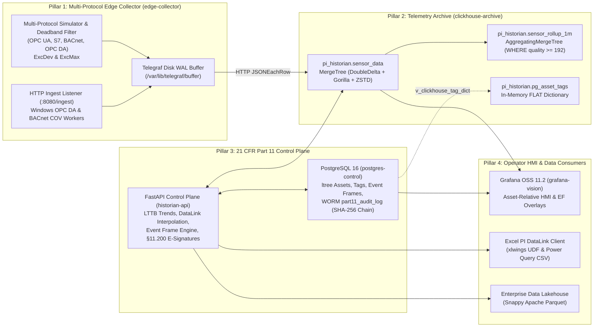
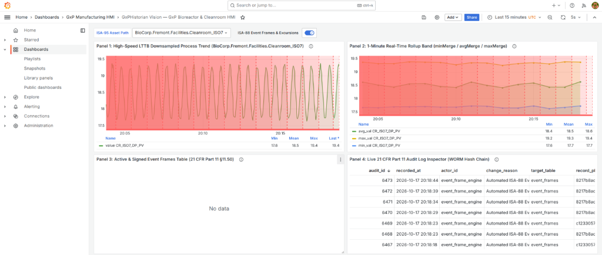

# GxPHistorian GxP Industrial Historian

**A 21 CFR Part 11, EU GMP Annex 11, and ISPE GAMP 5 Qualified Open-Source Industrial Time-Series Historian & Asset Framework**

🌐 **Official Website:** [https://gxphistorian.com](https://gxphistorian.com) · 📚 **Documentation Portal:** [https://gxphistorian.com/docs](https://gxphistorian.com/docs) · 💻 **GitHub:** [https://github.com/saram-io/gxp-historian](https://github.com/saram-io/gxp-historian) · 📋 **GMP Validation Binder:** [https://gxphistorian.com/binder/COMPLETE_GMP_VALIDATION_BINDER.html](https://gxphistorian.com/binder/COMPLETE_GMP_VALIDATION_BINDER.html) · ⚖️ **License:** [MIT](LICENSE)

GxPHistorian GxP Industrial Historian is a production-ready, 4-Pillar open-source replacement for the proprietary **OSIsoft / AVEVA PI System** engineered for pharmaceutical, biotech, and regulated manufacturing environments. It combines **ClickHouse 24.8 LTS** (lossless `DoubleDelta` + `Gorilla` telemetry archive and LTTB visual downsampling), **PostgreSQL 16** (`ltree` ISA-95 Asset Framework, ISA-88 Event Frames, and cryptographic SHA-256 WORM 21 CFR Part 11 audit trail), **InfluxData Telegraf 1.32 + Python Multi-Protocol Edge Workers** (Stage 1 Exception/Deadband filtering and disk-backed store-and-forward WAL), **FastAPI**, **Grafana OSS**, and a **GxPHistorian DataLink Client for Excel** (`xlwings` UDFs + native Power Query CSV).

---

## 1. OSIsoft / AVEVA PI System Parity Matrix

| Legacy OSIsoft / AVEVA PI Component | GxPHistorian GxP Historian Equivalent | Key Technical Capabilities |
| :--- | :--- | :--- |
| **PI Data Archive** (Swinging Door / Archive Subsystem) | **ClickHouse 24.8 LTS (`pi_historian.sensor_data`) + Stage 2 Swinging Door (`CompDev`/`CompMax`)** | `MergeTree` partitioned by month (`toYYYYMM(ts)`) with lossless `Delta`, `DoubleDelta`, `Gorilla`, and `T64` codecs layered with `ZSTD(1)`, optional Stage 2 Swinging Door compression (`CompDev`, `CompMax`, `CompMin`), and real-time 1-minute `AggregatingMergeTree` rollups (`sensor_rollup_1m`). |
| **PI Asset Framework (PI AF)** | **PostgreSQL 16 `ltree` + ClickHouse `FLAT` Dictionary + Template Auto-Instantiation** | ISA-95 hierarchical asset paths (`Enterprise.Site.Area.Unit`) indexed via PostgreSQL `GiST`, one-call AF Template auto-instantiation (`POST /api/v1/assets/instantiate-template`), canonical UOM conversion (`degC`/`degF`/`K`, `bar`/`psi`/`Pa`/`kPa`, `L_min`/`mL_min`/`GPM`), Digital State Sets (`digital_state_sets`), and ClickHouse RAM dictionary sync (`pi_historian.pg_asset_tags`). |
| **PI Event Frames (EF) & PI Notifications** | **PostgreSQL `event_frames` + `TrueFor` Backfill + Multi-Stage Signatures + Multi-Channel Alert Engine** | Automated ISA-88 batch & excursion detection, historical backfill with `TrueFor` debounce (`POST /api/v1/event-frames/backfill`), hierarchical parent/child batch phases (`parent_event_id`), multi-stage 21 CFR Part 11 electronic signatures (`Operator Review` -> `Supervisor Verification` -> `QA Final Approval`), and multi-channel **Email (SMTP/HTML)**, **SMS (Twilio / Carrier Gateway / OT Cellular SMPP)**, **Mobile Push (APNs Critical / FCM / PagerDuty v2)**, and **Webhook** notification rules with Escalation Teams, Non-Repetition/Resend intervals, Two-Way SMS `"ACK <id>"`, and Send-on-Close (`POST /api/v1/notifications/evaluate`). |
| **PI Interface Node & PI Buffer Subsystem** | **Telegraf 1.32 Disk WAL + Python Edge Workers** | Stage 1 Exception/Deadband filtering (`ExcDev` & `ExcMax`) + optional Stage 2 Swinging Door (`CompDev` & `CompMax`) in memory + disk-backed Write-Ahead Log (`/var/lib/telegraf/buffer`, 1M metric capacity) for zero-data-loss store-and-forward across OPC UA, BACnet/IP, Siemens S7, Modbus, and Windows OPC DA. |
| **PI Vision & PI BatchView** (`PlotValues` Trends, EF Overlays & Golden Batch) | **Grafana OSS 11.2 + ClickHouse `largestTriangleThreeBuckets` + `/api/v1/batches/compare`** | Asset-relative dashboard (`${asset_path}`) with native ClickHouse LTTB visual peak preservation, 1-minute rollup bands, Event Frame shaded region annotations, relative batch elapsed-hour (`T+0.0h`) Golden Batch alignment (`mean ± 2 SD` reference envelope), and live Part 11 audit trail inspection. |
| **PI DataLink & PI Web API StreamSets** (`PICurrVal`, `PIArcVal`, `PICompDat`, `PISampDat`, `PIAdvCalcDat`, `PITimeFilter`) | **FastAPI `/api/v1/datalink/*` + `/api/v1/streamsets/*` + 8 `xlwings` Excel UDFs / Power Query** | Complete 8-function Excel DataLink suite (`=GXPHISTORIAN_SAMPLED()`, `=GXPHISTORIAN_PLOT_VALUES()`, `=GXPHISTORIAN_EVENT_SUMMARY()`, `=GXPHISTORIAN_CURRENT_VALUE()`, `=GXPHISTORIAN_ARCHIVE_VALUE()`, `=GXPHISTORIAN_COMPRESSED_DATA()`, `=GXPHISTORIAN_CALCULATED_DATA()`, `=GXPHISTORIAN_TIME_FILTER()`) plus bulk multi-tag StreamSets (`/api/v1/streamsets/end`, `/api/v1/streamsets/interpolated`). |
| **PI Analysis Service & SQC** (Asset Analytics & Statistical Process Control) | **GxP Calculation Engine (`/api/v1/analytics/{mkt,f0-lethality,sqc}`)** | Built-in ICH Q1A Mean Kinetic Temperature ($\text{MKT}$, $\Delta H = 83.144\text{ kJ/mol}$), USP `<1229>` Steam Sterilization Lethality ($F_0$ trapezoidal integration), and Western Electric SQC SPC rules (`Rule_1_Beyond_3Sigma`, `Rule_2_TwoOfThree_Beyond_2Sigma`, `Rule_3_FourOfFive_Beyond_1Sigma`, `Rule_4_EightConsecutive_SameSide`, $C_p$, $C_{pk}$). |
| **PI Manual Logger** | **21 CFR Part 11 Manual Data Entry (`/api/v1/manual-logger/entries`)** | Validated offline/at-line lab and cleanroom logbook entry with optional dual-person verification (`verified_by`), WORM audit trail attribution, and automatic dual-write into ClickHouse `pi_historian.sensor_data` (`quality = 192`). |
| **PI Integrator for Business Analytics** | **FastAPI + PyArrow Zero-ETL Lakehouse Exporter** | One-call (`POST /api/v1/lakehouse/export-parquet`) Snappy-compressed Apache Parquet export enriched with ISA-95 asset hierarchy and engineering units. |
| **AVEVA Industrial AI Assistant / PI Web API** | **Pydantic AI Co-Pilot (`app/gxp_ai_agent.py`) & `gxphistorian-mcp` (`app/mcp_server.py`)** | Typed ISA-88 Batch Excursion Investigator (`output_type=DeviationInvestigationBrief`, `WHERE quality >= 192`), Part 11 human-in-the-loop `ApprovalRequired` tag provisioning, Capabilities on Demand (`defer_loading=True`), and 6-tool `FastMCP` server. |

---

## 2. 4-Pillar System Architecture



### Container & Port Matrix

| Container Name | Role | Internal Port | Default Host Port (`.env`) | Technology Stack |
| :--- | :--- | :--- | :--- | :--- |
| `postgres-control` | Pillar 3: Relational Control Plane & Part 11 WORM Audit Log | `5432` | `5435` (`PG_PORT`) | PostgreSQL 16 (`ltree`, `btree_gist`, `pgcrypto`) |
| `clickhouse-archive` | Pillar 2: Immutable Time-Series Archive & Rollup Engine | `8123` / `9000` | `8125` / `9005` | ClickHouse Server 24.8 LTS (`Apache-2.0`) |
| `instrument-mock-server` | Pillar 1: Multi-Protocol Biopharma Instrument Mock Server | `8095`, `4840`, `5020`, `47808/udp`, `1102`, `4001` | `8095`, `4840`, `5020`, `47808/udp`, `1102`, `4001` | Python 3.12 Asyncio (OPC UA, Modbus TCP, BACnet/IP, S7comm, RS-232 `MT-SICS`, OPC DA & UFL) |
| `edge-collector` | Pillar 1: Multi-Protocol Collector & Store-and-Forward WAL | `8080` | `8080` (`EDGE_INGEST_PORT`) | Telegraf 1.32 Alpine + Python 3.12 |
| `historian-api` | Pillar 3: GxP REST API, Event Frame Engine & DataLink Server | `8000` | `8020` (`API_PORT`) | FastAPI, Psycopg 3, ClickHouse Connect, PyArrow |
| `gxphistorian-mcp` | Pillar 3: Pydantic AI Co-Pilot & FastMCP Streamable HTTP Server | `8030` | `8030` (`MCP_PORT`) | Pydantic AI 2.0, FastMCP, Pydantic Logfire |
| `grafana-vision` | Pillar 4: Pre-Provisioned Operator HMI | `3000` | `3020` (`GRAFANA_PORT`) | Grafana OSS 11.2 + ClickHouse Datasource Plugin |

---

## 3. 21 CFR Part 11, EU Annex 11 & ALCOA+ Technical Controls

1. **Mandatory Attribution Context (`§11.10(e)` / ALCOA+ Attributable & Contemporaneous):**
   - Every `INSERT`, `UPDATE`, or `DELETE` on `asset_templates`, `assets`, `tags`, `event_frames`, `digital_state_sets`, `event_frame_templates`, `event_frame_signatures`, `manual_logger_entries`, `notification_rules`, and `notification_deliveries` is intercepted by the PostgreSQL trigger `fn_enforce_part11_audit()`.
   - Transactions must supply `SET LOCAL app.actor_id` and `SET LOCAL app.change_reason` (populated via `X-Actor-Id` and `X-Change-Reason` HTTP headers on `historian-api`). Any unattributed mutation raises `21 CFR Part 11 Violation: app.actor_id and app.change_reason are mandatory`.
2. **Write-Once-Read-Many (WORM) Audit Trail Immutability (`§11.10(e)`):**
   - The `part11_audit_log` table enforces a `BEFORE UPDATE OR DELETE OR TRUNCATE` trigger (`fn_prevent_audit_tampering()`) that unconditionally raises `21 CFR Part 11 WORM Violation: Audit trail records are immutable`, blocking tampering even by database superusers.
3. **Cryptographic SHA-256 Audit Hash Chaining (`ALCOA+ Original & Enduring`):**
   - Every audit row links the prior row's SHA-256 digest starting from `GENESIS_0000000000000000`:
     $$\text{row\_hash} = \text{SHA256}(\text{prev\_hash} \parallel \text{recorded\_at} \parallel \text{actor\_id} \parallel \text{operation} \parallel \text{coalesce}(\text{new\_payload}, \text{''}))$$
   - End-to-end chain integrity is verifiable on demand via `GET /api/v1/audit-trail/verify`.
4. **Dual-Challenge & Multi-Stage Electronic Signatures (`§11.50`, `§11.70`, `§11.200`):**
   - Signing an Event Frame (`POST /api/v1/event-frames/{event_id}/sign`) verifies `user_id` and `password` against `pgcrypto` bcrypt hashes in PostgreSQL `users`, computes a non-repudiable `HMAC-SHA256` signature over `(event_id, user_id, signature_meaning, signed_at)`, supports multi-stage sequential approvals in `event_frame_signatures` (`GET /api/v1/event-frames/{event_id}/signatures`), and records every signature stage in the WORM audit trail.
5. **OPC Signal Quality Filtering (`quality >= 192`) & Step vs. Continuous Interpolation:**
   - Raw telemetry preserves all OPC quality states (`192` = Good, `64` = Uncertain, `0` = Bad) for sensor diagnostics, while all GMP rollups (`mv_sensor_rollup_1m`), LTTB visual trends, DataLink queries, and Event Frame KPIs strictly filter `WHERE quality >= 192`.
   - Continuous analog tags (`is_step_tag = false`) use linear time-weighted interpolation (`WITH FILL STEP ... INTERPOLATE`), whereas discrete state tags (`is_step_tag = true`, e.g., agitator states `0/1/2`) use Last Observation Carried Forward (LOCF) so impossible fractional states (such as `1.5`) are never synthesized.

---

## 4. Repository Structure

```text
clickhouse-historian/
├── .antigravity/
│   └── rules.md                                      # Architectural & 21 CFR Part 11 guardrails
├── .env / .env.example                               # Non-default GxP credentials & host port mappings
├── docker-compose.yml                                # 7-service orchestrated stack (including gxphistorian-mcp & mock-server)
├── pytest.ini                                        # Pytest configuration for IQ/OQ qualification
├── init-postgres/
│   └── 01_control_plane_part11.sql                   # PostgreSQL 16 ltree, pgcrypto, WORM audit & seed data
├── init-clickhouse/
│   └── 01_telemetry_core.sql                         # MergeTree codecs, 1m rollups, PG dictionary & bridges
├── instrument-mock-server/
│   ├── Dockerfile                                    # Multi-protocol biopharma instrument mock server image
│   └── mock_instruments.py                           # Live OPC UA (:4840), Modbus (:5020), BACnet (:47808), S7 (:1102), RS-232 (:4001) & HTTP (:8095)
├── edge-collector/
│   ├── Dockerfile                                    # Telegraf 1.32 Alpine + Python 3.12 edge collector image
│   ├── telegraf-clickhouse.conf                      # Disk WAL buffer, HTTP ingest (:8080), execd & CH output
│   └── scripts/
│       ├── multi_protocol_simulator.py               # Deterministic plant simulator + Stage 1 Deadband & Stage 2 Swinging Door
│       ├── opcda_windows_forwarder.py                # Windows localhost COM OPC DA -> HTTP JSON bridge
│       └── bacnet_cov_worker.py                      # Async BACnet/IP COV / ReadPropertyMultiple worker
├── app/
│   ├── Dockerfile                                    # FastAPI control plane & gxphistorian-mcp container definition
│   ├── requirements.txt                              # FastAPI, Psycopg 3, ClickHouse Connect, PyArrow, Pydantic AI, FastMCP
│   ├── main.py                                       # Unified REST API, Event Frame Engine, DataLink & Part 11
│   ├── pi_parity_engine.py                           # AVEVA PI System Parity Engine (DataLink, StreamSets, MKT/F0/SQC, BatchView, AF, Manual Logger, Notifications)
│   ├── gxp_ai_agent.py                               # Pydantic AI Excursion Investigator & Part 11 Co-Pilot Agents
│   └── mcp_server.py                                 # Standalone FastMCP (gxphistorian-mcp :8030) GxP historian server
├── provisioning/grafana/
│   ├── datasources/datasources.yml                   # Auto-provisioned ClickHouse & PostgreSQL datasources
│   └── dashboards/
│       ├── dashboards.yml                            # Dashboard provider configuration
│       └── gxphistorian_bioreactor_hmi.json          # Asset-relative Bioreactor & Cleanroom HMI dashboard
├── docs/
│   ├── images/photos/                                # 9 high-res photorealistic instrument & connector product galleries
│   ├── images/instruments/                           # 10 SVG visual equipment, rear-panel connector & wiring guides
│   ├── images/connectors/                            # 7 SVG physical pinout, protocol packet, state-machine & multi-channel alerting diagrams
│   ├── PI_NOTIFICATIONS_ALERTING_EMAIL_SMS_MOBILE.md # AVEVA PI Notifications Deep Dive & Multi-Channel Email, SMS & Mobile Alerting Guide
│   ├── PYDANTIC_AI_COPILOT_AND_MCP_SERVER.md         # Pydantic AI GxP Co-Pilot & gxphistorian-mcp Server Guide
│   ├── MOCK_INSTRUMENT_SERVER_TESTING_GUIDE.md       # Multi-Protocol Biopharma Instrument Mock Server & Testing Guide
│   ├── CONNECTORS_AND_PROTOCOLS_ENCYCLOPEDIA.md      # Visual Encyclopedia of Physical Hardware & Software Connectors
│   ├── CONNECTOR_GUIDE_OPC_UA_AND_OPC_DA.md          # OPC UA (IEC 62541) & Classic OPC DA (Zero-DCOM Bridge) deep dive
│   ├── CONNECTOR_GUIDE_BACNET_IP_AND_MSTP.md         # BACnet/IP & BACnet MS/TP (ASHRAE 135, DNET:DADR, COV) deep dive
│   ├── CONNECTOR_GUIDE_MODBUS_TCP_AND_RTU.md         # Modbus TCP & RTU (RS-485, ABCD/CDAB Endianness) deep dive
│   ├── CONNECTOR_GUIDE_PLC_S7_ETHERNETIP_HART_SERIAL_UFL.md # S7comm, EtherNet/IP, 4-20mA HART, RS-232 & Watch-Folder UFL
│   ├── BIOPHARMA_INSTRUMENT_INTEGRATION_CATALOG.md   # Master matrix & signal archetypes for 35+ biopharma instruments
│   ├── XCELLEREX_X_PLATFORM_INTEGRATION.md           # Cytiva Xcellerex X-Platform & Figurate integration guide
│   ├── USP_BIOREACTORS_SARTORIUS_THERMO_EPPENDORF.md # Sartorius Biostat STR/Ambr, Thermo TruBio DV, Eppendorf DASGIP
│   ├── PAT_CELL_ANALYZERS_AND_SPECTROSCOPY.md        # BioProfile FLEX2, Vi-CELL BLU, Cedex Bio HT, Raman Rxn, Hamilton Arc
│   ├── DSP_CHROMATOGRAPHY_TFF_FILTRATION.md          # Cytiva ÄKTA (UNICORN 7), Sartorius Sartoflow, Millipore Mobius/Cogent
│   ├── CELL_GENE_THERAPY_AND_MRNA_LNP_INSTRUMENTS.md # CliniMACS Prodigy, Sefia S-2000, Sepax C-Pro, NanoAssemblr LNP, CRFs
│   ├── ASEPTIC_FILL_FINISH_LYO_AND_GMP_UTILITIES.md  # Lyophilizers, SKAN Isolators, LasAir EMS (BACnet/Modbus), Sievers M9 TOC
│   ├── GMP_STABILITY_CHAMBERS_COLD_CHAIN_AND_AUTOCLAVES.md # Binder KBF Stability (MKT), Incubators, -80C ULT, Steam Autoclaves (F0)
│   ├── LEGACY_PROTOCOLS_BACNET_OPCDA_MODBUS_S7.md    # Legacy BACnet MS/TP & IP, COM OPC DA, Modbus RTU/TCP, S7comm & HART
│   ├── LEGACY_SERIAL_RS232_AND_PI_UFL_REPLACEMENT.md # RS-232 / Moxa NPort (MT-SICS balances, osmometers) & PI UFL watchfolders
│   └── HARDWARE_SIZING_AND_CAPACITY_PLANNING.md      # Tier 1–4 server BOMs, 10yr NVMe + 15yr WORM sizing & Edge IPC specs
├── excel-datalink-client/
│   ├── gxphistorian_datalink_udf.py                  # 8 xlwings UDFs (=GXPHISTORIAN_SAMPLED, =GXPHISTORIAN_CALCULATED_DATA, etc.)
│   └── README_EXCEL_SETUP.md                         # Power Query (zero-macro) & xlwings setup guide
└── gxp-validation-package/
    ├── generate_gmp_binder.py                        # Automated 8-Document GMP Validation Binder generator
    ├── specs/
    │   └── urs_risk_catalog.yaml                     # 21 URS items mapped to FRS, GAMP Cat, CSA Risk & pytest
    ├── tests/
    │   ├── conftest.py                               # Fixtures & JSON evidence collector hook
    │   ├── test_01_iq_infrastructure.py              # IQ-01..05: Credentials, schemas, codecs, dict, WAL
    │   ├── test_02_oq_part11_compliance.py           # OQ-01..05: Part 11 attribution, WORM, e-sig, hash chain
    │   ├── test_03_oq_historian_core.py              # OQ-06..10: Multi-protocol, bad quality, LOCF, LTTB, Parquet
    │   ├── test_04_ai_agent_and_mcp.py               # OQ-11..12: Pydantic AI Co-Pilot, FastMCP & ApprovalRequired
    │   └── test_05_oq_aveva_pi_parity.py             # OQ-13..16: DataLink/StreamSets, MKT/F0/SQC/BatchView, AF/UOM/ManualLogger, SwingingDoor/Backfill/MultiSig/Notifications
    ├── evidence/
    │   └── oq_execution_results.json                 # Timestamped pytest execution evidence log
    └── dist_binder/                                  # Generated 8 Markdown deliverables + HTML/PDF binder
        ├── 01_Validation_Master_Plan_VMP.md
        ├── 02_User_Requirements_Specification_URS.md
        ├── 03_Functional_And_Design_Specification_FDS.md
        ├── 04_CSA_Functional_Risk_Assessment_FRA.md
        ├── 05_SOUP_OSS_Vendor_Qualification_Dossier.md
        ├── 06_Executed_IQ_OQ_Protocol_And_Evidence_Report.md
        ├── 07_Requirements_Traceability_Matrix_RTM.md
        ├── 08_Validation_Summary_Report_VSR.md
        └── COMPLETE_GMP_VALIDATION_BINDER.html
```

### Connectors, Protocols, Biopharma Equipment & Sizing Guides (`docs/`)
| Guide Document | Covered Connectors, Protocols, Instruments & Skids |
| :--- | :--- |
| [docs/PI_NOTIFICATIONS_ALERTING_EMAIL_SMS_MOBILE.md](docs/PI_NOTIFICATIONS_ALERTING_EMAIL_SMS_MOBILE.md) | **PI Notifications: Email, SMS & Mobile Alerting:** Deep research on AVEVA PI Notifications Service & Exele TopView plus GxPHistorian multi-channel alerting (`EMAIL` SMTP/HTML, `SMS` Twilio / Carrier Gateway / Purdue L3.5 Cellular SMPP Modems, `MOBILE_PUSH` APNs Critical / FCM / PagerDuty v2, `WEBHOOK`), Escalation Teams, Non-Repetition/Resend, Two-Way SMS `"ACK <id>"`, and Send-on-Close. |
| [docs/PYDANTIC_AI_COPILOT_AND_MCP_SERVER.md](docs/PYDANTIC_AI_COPILOT_AND_MCP_SERVER.md) | **Pydantic AI GxP Co-Pilot & `gxphistorian-mcp` Server:** ISA-88 Batch Excursion Investigation Agent (`output_type=DeviationInvestigationBrief`, `WHERE quality >= 192`), Part 11 human-in-the-loop `ApprovalRequired` tag provisioning, Capabilities on Demand (`defer_loading=True`), and the 6-tool `FastMCP` server. |
| [docs/MOCK_INSTRUMENT_SERVER_TESTING_GUIDE.md](docs/MOCK_INSTRUMENT_SERVER_TESTING_GUIDE.md) | **Multi-Protocol Biopharma Instrument Mock Server (`instrument-mock-server`):** Live hardware-free socket & HTTP testing across OPC UA Binary (`:4840`), Modbus TCP `ABCD`/`CDAB`/`INT16` (`:5020`), BACnet/IP `BVLC` (`:47808/udp`), Siemens S7comm `RFC 1006` `DB10` (`:1102`), RS-232 Moxa `MT-SICS` (`:4001`), and Windows OPC DA 2.05a / `PI UFL` SHA-256 Watch-Folder (`:8095`) with live fault & excursion injection (`/control/override`). |
| [docs/CONNECTORS_AND_PROTOCOLS_ENCYCLOPEDIA.md](docs/CONNECTORS_AND_PROTOCOLS_ENCYCLOPEDIA.md) | **Connectors & Protocols Visual Encyclopedia:** Physical hardware connector identification & pinouts (`RJ45 T568B`, `M12 D/X/A-Coded`, `DB9 RS-232/MPI`, `Phoenix RS-485 & 4–20 mA`, `Moxa` / `Advantech` / `Helmholz` / `LOYTEC` gateways) and all 8 software protocol families. |
| [docs/CONNECTOR_GUIDE_OPC_UA_AND_OPC_DA.md](docs/CONNECTOR_GUIDE_OPC_UA_AND_OPC_DA.md) | **OPC UA & Classic OPC DA Connectors:** `NodeId` Address Space, `Basic256Sha256` X.509 certificate lifecycle, `MonitoredItem` subscriptions, 32-bit `StatusCode` mapping (`192/64/0`), and the Zero-DCOM Windows Localhost COM Forwarder (`opcda_windows_forwarder.py`). |
| [docs/CONNECTOR_GUIDE_BACNET_IP_AND_MSTP.md](docs/CONNECTOR_GUIDE_BACNET_IP_AND_MSTP.md) | **BACnet/IP & BACnet MS/TP Connectors:** Physical 3-pin RS-485 MS/TP wiring & 8-switch binary MAC DIP switches, `LOYTEC`/`BASrouter` `DNET:DADR` routing, BBMD Foreign Device registration (`UDP :47808`), ASHRAE 135 objects (`AI`, `AV`, `BI`, `MSV`), `SubscribeCOV`, and 4-bit `Status_Flags`. |
| [docs/CONNECTOR_GUIDE_MODBUS_TCP_AND_RTU.md](docs/CONNECTOR_GUIDE_MODBUS_TCP_AND_RTU.md) | **Modbus TCP & Modbus RTU Connectors:** The 4 Modbus memory tables (`0x`, `1x`, `3x`, `4x`), solving the "Off-by-One" (`40101` vs `100`) addressing rule, visual 32-bit IEEE-754 float word/byte order (`ABCD`, `CDAB`, `BADC`, `DCBA`), and `16-bit INT` fixed-point scaling. |
| [docs/CONNECTOR_GUIDE_PLC_S7_ETHERNETIP_HART_SERIAL_UFL.md](docs/CONNECTOR_GUIDE_PLC_S7_ETHERNETIP_HART_SERIAL_UFL.md) | **PLC (`S7comm` & `EtherNet/IP`), `4–20 mA HART`, `RS-232 Serial` & File Watch-Folders:** Siemens S7-1500/300 `Rack/Slot` & `DB10.DBD0` offsets, Allen-Bradley ControlLogix CIP symbolic tags, $250\,\Omega$ shunt + NAMUR NE 43 (`< 3.6 mA`) burnout, Null-Modem DB9 `MT-SICS` balance streaming, and `SHA-256` File Watch-Folders (`PI UFL` replacement). |
| [docs/BIOPHARMA_INSTRUMENT_INTEGRATION_CATALOG.md](docs/BIOPHARMA_INSTRUMENT_INTEGRATION_CATALOG.md) | **Master Catalog & Visual Connector Field Guide:** 35+ GMP biopharma instruments, RJ45 / M12 / DB9 / RS-485 physical port guide, Purdue Level 1–3 zoning, and Continuous (`LINEAR`) vs. Discrete (`LOCF`) vs. Sparse At-Line PAT (`exc_dev=0`) rules. |
| [docs/XCELLEREX_X_PLATFORM_INTEGRATION.md](docs/XCELLEREX_X_PLATFORM_INTEGRATION.md) | **Cytiva Xcellerex™ X-Platform (50–2000 L):** Figurate™ automation (Emerson DeltaV™ & Rockwell PlantPAx®) via OPC UA and OPC DA with visual cabinet wiring walkthrough. |
| [docs/USP_BIOREACTORS_SARTORIUS_THERMO_EPPENDORF.md](docs/USP_BIOREACTORS_SARTORIUS_THERMO_EPPENDORF.md) | **USP Bioreactors & High-Throughput Screening:** Sartorius Biostat® STR (BioPAT® MFCS / S7-1500 `X2`), Sartorius Ambr® 15/250 multi-vessel DoE arrays, Thermo Fisher HyPerforma™ S.U.B. (TruBio® DV), and Eppendorf BioFlo® / DASGIP® (`DASware® connect`). |
| [docs/PAT_CELL_ANALYZERS_AND_SPECTROSCOPY.md](docs/PAT_CELL_ANALYZERS_AND_SPECTROSCOPY.md) | **At-Line PAT & In-Line Spectroscopy:** Nova Biomedical BioProfile® FLEX2 (+ Seg-Flow®), Beckman Coulter Vi-CELL™ BLU, Roche Cedex® Bio HT, Endress+Hauser Raman Rxn2™/Rxn4™, and Hamilton Arc® / Mettler Toledo smart sensors. |
| [docs/DSP_CHROMATOGRAPHY_TFF_FILTRATION.md](docs/DSP_CHROMATOGRAPHY_TFF_FILTRATION.md) | **Downstream Purification (Chromatography & TFF):** Cytiva ÄKTA™ process / ready / readyflux (`UNICORN™ 7`), Sartorius Sartoflow® / Resolute®, and MilliporeSigma Mobius® / Cogent® with LTTB UV280 peak preservation. |
| [docs/CELL_GENE_THERAPY_AND_MRNA_LNP_INSTRUMENTS.md](docs/CELL_GENE_THERAPY_AND_MRNA_LNP_INSTRUMENTS.md) | **Cell & Gene Therapy (CAR-T), mRNA-LNP & Controlled-Rate Freezers:** Miltenyi CliniMACS Prodigy®, Cytiva Sefia™ S-2000 & Sepax™ C-Pro, Precision NanoSystems NanoAssemblr™ GMP mRNA-LNP system, and Planer Kryo 560 / Thermo CryoMed™ CRFs with patient `COI_ID` Event Frames. |
| [docs/ASEPTIC_FILL_FINISH_LYO_AND_GMP_UTILITIES.md](docs/ASEPTIC_FILL_FINISH_LYO_AND_GMP_UTILITIES.md) | **Fill-Finish, Lyophilization, Cleanroom EMS & WFI:** GMP Freeze Dryers (Capacitance Manometer / Pirani convergence), SKAN Isolators, PMS LasAir® III / Airnet® II particle counters, BACnet/IP EMS, and Veolia Sievers® M9 TOC / Thornton conductivity. |
| [docs/GMP_STABILITY_CHAMBERS_COLD_CHAIN_AND_AUTOCLAVES.md](docs/GMP_STABILITY_CHAMBERS_COLD_CHAIN_AND_AUTOCLAVES.md) | **ICH Q1A Stability Chambers, Incubators, $-80\,^\circ\text{C}$ Cold Chain & Steam Autoclaves:** Binder KBF / Weiss Stability Chambers (with ClickHouse SQL Mean Kinetic Temperature `MKT`), Infors HT / Thermo Heracell™ $\text{CO}_2$ Incubators, PHCbi / Thermo TSX $-80\,^\circ\text{C}$ ULT Freezers, and Fedegari / Getinge Steam Sterilizers (with real-time $F_0$ lethality SQL). |
| [docs/LEGACY_PROTOCOLS_BACNET_OPCDA_MODBUS_S7.md](docs/LEGACY_PROTOCOLS_BACNET_OPCDA_MODBUS_S7.md) | **Legacy Fieldbus, BMS & PLC Protocols:** `BACnet/IP & MS/TP` (`DNET:DADR` routing & BBMD), Windows COM/DCOM `OPC DA 2.05a` zero-DCOM bridge, `Modbus RTU/TCP` (`ABCD`/`CDAB` endianness & scaling), Siemens `S7comm` (S7-300/400 autoclaves + Helmholz NETLink adapter), and `4–20 mA HART` multiplexers. |
| [docs/LEGACY_SERIAL_RS232_AND_PI_UFL_REPLACEMENT.md](docs/LEGACY_SERIAL_RS232_AND_PI_UFL_REPLACEMENT.md) | **Legacy RS-232 Serial & PI UFL Flat-File Replacement:** Moxa NPort 5150 TCP serial streaming for Mettler Toledo / Sartorius `MT-SICS` analytical balances and Advanced Instruments osmometers, plus ALCOA+ SHA-256 watchfolder ingestion for Sartocheck® / Palltronic® filter integrity testers. |
| [docs/HARDWARE_SIZING_AND_CAPACITY_PLANNING.md](docs/HARDWARE_SIZING_AND_CAPACITY_PLANNING.md) | **Hardware Sizing & Capacity Planning:** Compression math (`1.5–2.5 B/sample`), 10k–25k tag clinical/pilot GMP reference BOM, 10-year NVMe + 15-year S3 WORM tiering, and Level 2.5 Industrial Edge IPC specs. |

---

## 5. Quickstart & Deployment

### Prerequisites
- Docker Engine 24+ and Docker Compose v2
- Python 3.11+ (optional, for running the local `pytest` qualification suite and GMP binder generator)

### 1. Configure Environment & Launch the Stack

```bash
cp .env.example .env
docker compose up -d --build
```

Verify that all 6 services (`postgres-control`, `clickhouse-archive`, `edge-collector`, `historian-api`, `gxphistorian-mcp`, `grafana-vision`) are running and healthy:

```bash
docker compose ps
curl -s http://localhost:8020/api/v1/health | jq .
curl -s http://localhost:8030/health | jq .
```

Expected health output:

```json
{
  "status": "healthy",
  "postgres_control_plane": "connected",
  "clickhouse_archive": "connected",
  "part11_audit_records": 220,
  "sensor_data_rows": 1450
}
```

### 2. Seeded GxP Assets, Tags & Part 11 Users

On initial startup, `init-postgres/01_control_plane_part11.sql` seeds the following ISA-95 assets, multi-protocol tags, and Part 11 test accounts:

#### Seeded ISA-95 Assets & Multi-Protocol Tags
| Tag ID | Tag Name | ISA-95 `ltree` Asset Path | Attribute | Units | Step Tag (`LOCF`) | Deadband (`exc_dev`) | Limits (`Low` / `High`) | Source Protocol |
| :--- | :--- | :--- | :--- | :--- | :--- | :--- | :--- | :--- |
| `101` | `BR201_TEMP_PV` | `BioCorp.Fremont.USP.Bioreactor_201` | `Vessel_Temp_PV` | `degC` | `false` (Linear) | `0.05` | `35.0` / `38.0` | `OPC_UA` |
| `102` | `BR201_PH_PV` | `BioCorp.Fremont.USP.Bioreactor_201` | `Vessel_pH_PV` | `pH` | `false` (Linear) | `0.02` | `6.8` / `7.4` | `OPC_UA` |
| `103` | `BR201_AGIT_STATE` | `BioCorp.Fremont.USP.Bioreactor_201` | `Agitator_State` | `state` | `true` (Step/LOCF) | `0.0` | `0.0` / `2.0` | `SIEMENS_S7` |
| `301` | `CR104_DIFF_PRESS` | `BioCorp.Fremont.Facilities.Cleanroom_Suite_104` | `Room_Diff_Pressure_PV` | `Pa` | `false` (Linear) | `0.5` | `12.5` / `50.0` | `BACNET_IP` |
| `401` | `CHROM01_UV280_PV` | `BioCorp.Fremont.DSP.Chrom_Skid_01` | `UV280_Absorbance_PV` | `mAU` | `false` (Linear) | `0.1` | `0.0` / `1000.0` | `OPC_DA` |

#### Seeded 21 CFR Part 11 Accounts (`users`)
| User ID | Full Name | Role | Default Qualification Password |
| :--- | :--- | :--- | :--- |
| `operator_01` | Sarah Jenkins | `Process_Operator` | `Operator_Pass_2026!` |
| `qa_approver_01` | Dr. Marcus Vance | `Quality_Assurance` | `QA_Approve_2026!` |

---

## 6. REST API Reference (`historian-api`)

Interactive OpenAPI documentation is available at `http://localhost:8020/docs`.

### Browse ISA-95 Asset Hierarchy (`ltree`)
```bash
curl -s http://localhost:8020/api/v1/assets/tree | jq .
```

### Provision a New Tag (Requires 21 CFR Part 11 Attribution Headers)
```bash
curl -s -X POST http://localhost:8020/api/v1/tags \
  -H "Content-Type: application/json" \
  -H "X-Actor-Id: operator_01" \
  -H "X-Change-Reason: Provision Dissolved Oxygen sensor for Bioreactor 201" \
  -d '{
    "tag_id": 104,
    "tag_name": "BR201_DO_PV",
    "asset_id": 1,
    "attribute_name": "Dissolved_Oxygen_PV",
    "eng_units": "%Sat",
    "is_step_tag": false,
    "exc_dev": 0.1,
    "low_limit": 20.0,
    "high_limit": 100.0,
    "source_protocol": "OPC_UA"
  }' | jq .
```

### Query PI Vision Equivalent Downsampled Trend (`largestTriangleThreeBuckets`)
```bash
curl -s "http://localhost:8020/api/v1/trends/plot-values?tag_id=101&start_time=2026-10-17T00:00:00Z&end_time=2026-10-18T00:00:00Z&intervals=200" | jq .
```

### Query PI DataLink Equivalent Sampled Data (Linear vs. Step LOCF, JSON or CSV)
```bash
# Continuous analog tag (Linear interpolation) in CSV format for Excel Power Query
curl -s "http://localhost:8020/api/v1/datalink/sampled?tag_name=BR201_TEMP_PV&start_time=2026-10-17T12:00:00Z&end_time=2026-10-17T12:10:00Z&step_seconds=60&format=csv"

# Discrete step tag (LOCF step interpolation) in JSON format
curl -s "http://localhost:8020/api/v1/datalink/sampled?tag_name=BR201_AGIT_STATE&start_time=2026-10-17T12:00:00Z&end_time=2026-10-17T12:10:00Z&step_seconds=60&format=json" | jq .
```

### Evaluate ISA-88 Excursion Event Frames & Execute 21 CFR Part 11 Electronic Signature
```bash
# 1. Trigger Event Frame limit evaluation across recent telemetry
curl -s -X POST "http://localhost:8020/api/v1/event-frames/evaluate?lookback_minutes=15" | jq .

# 2. Sign an Event Frame with dual-challenge credentials and HMAC-SHA256 binding
curl -s -X POST "http://localhost:8020/api/v1/event-frames/<EVENT_UUID>/sign" \
  -H "Content-Type: application/json" \
  -H "X-Actor-Id: qa_approver_01" \
  -H "X-Change-Reason: Formal QA review and disposition of thermal excursion" \
  -d '{
    "user_id": "qa_approver_01",
    "password": "QA_Approve_2026!",
    "signature_meaning": "Excursion Investigation Reviewed",
    "change_reason": "Formal QA review and disposition of thermal excursion"
  }' | jq .
```

### Verify End-to-End 21 CFR Part 11 Cryptographic SHA-256 Hash Chain
```bash
curl -s http://localhost:8020/api/v1/audit-trail/verify | jq .
```

### Zero-ETL Apache Parquet Lakehouse Export
```bash
curl -s -X POST http://localhost:8020/api/v1/lakehouse/export-parquet \
  -H "Content-Type: application/json" \
  -d '{
    "tag_id": 101,
    "start_time": "2026-10-17T00:00:00Z",
    "end_time": "2026-10-18T00:00:00Z"
  }' | jq .
```

### Pydantic AI GxP Co-Pilot & `gxphistorian-mcp` Server (`/api/v1/ai/*`)
```bash
# 1. Inspect the gxphistorian-mcp FastMCP tool/resource manifest
curl -s http://localhost:8020/api/v1/ai/mcp/manifest | jq .

# 2. Generate an advisory ISA-88 Batch Excursion Investigation Brief (quality >= 192; never calls /sign)
curl -s -X POST "http://localhost:8020/api/v1/ai/event-frames/<EVENT_UUID>/investigate" \
  -H "Content-Type: application/json" \
  -d '{"use_deterministic_fallback": false}' | jq .

# 3. Stage a Part 11 Tag Proposal (pauses with HTTP 202 ApprovalRequired until human approval)
curl -s -X POST http://localhost:8020/api/v1/ai/copilot/propose-tag \
  -H "Content-Type: application/json" \
  -d '{
    "tag_id": 105,
    "tag_name": "BR201_PRESS_PV",
    "asset_id": 1,
    "attribute_name": "Headspace_Pressure_PV",
    "eng_units": "bar",
    "is_step_tag": false,
    "exc_dev": 0.02,
    "low_limit": 0.0,
    "high_limit": 2.5,
    "source_protocol": "OPC_UA",
    "approved": false
  }' | jq .
```

### AVEVA PI System Analytical, Asset Framework, BatchView & Manual Logger Parity
```bash
# 1. PI DataLink & StreamSets Parity (PICurrVal, PIArcVal, PICompDat, PIAdvCalcDat, PITimeFilter, StreamSets)
curl -s "http://localhost:8020/api/v1/datalink/current?tag_name=BR201_TEMP_PV&target_uom=degF" | jq .
curl -s "http://localhost:8020/api/v1/datalink/calculated?tag_name=BR201_TEMP_PV&start_time=2026-01-16T10:00:00Z&end_time=2026-01-16T10:10:00Z&interval_seconds=600&calculation_basis=TIME_WEIGHTED" | jq .
curl -s -X POST http://localhost:8020/api/v1/streamsets/end -H "Content-Type: application/json" -d '{"asset_path": "BioCorp.Fremont.USP.Bioreactor_201"}' | jq .

# 2. GxP Calculation Engine (ICH Q1A MKT, USP <1229> F0 Steam Lethality, Western Electric SQC SPC, Golden Batch Overlay)
curl -s "http://localhost:8020/api/v1/analytics/mkt?tag_name=BR201_TEMP_PV&start_time=2026-01-16T14:00:00Z&end_time=2026-01-16T14:09:00Z" | jq .
curl -s "http://localhost:8020/api/v1/analytics/f0-lethality?tag_name=BR201_TEMP_PV&start_time=2026-01-16T15:00:00Z&end_time=2026-01-16T15:15:00Z" | jq .
curl -s "http://localhost:8020/api/v1/analytics/sqc?tag_name=CHR401_UV280_ABS&start_time=2026-01-16T16:00:00Z&end_time=2026-01-16T16:19:00Z" | jq .

# 3. PI AF Template Auto-Instantiation, Canonical UOM Conversion & Part 11 Manual Logger
curl -s -X POST http://localhost:8020/api/v1/af/uom/convert -H "Content-Type: application/json" -d '{"value": 100.0, "from_uom": "degC", "to_uom": "degF"}' | jq .
curl -s -X POST http://localhost:8020/api/v1/assets/instantiate-template \
  -H "Content-Type: application/json" \
  -H "X-Actor-Id: automation_eng_rlee" \
  -H "X-Change-Reason: Auto-instantiate Bioreactor 202 from GMP_Bioreactor_v1 template" \
  -d '{"template_name": "GMP_Bioreactor_v1", "asset_name": "Bioreactor 202", "asset_path": "BioCorp.Fremont.USP.Bioreactor_202", "parent_path": "BioCorp.Fremont.USP", "tag_prefix": "BR202"}' | jq .

# 4. Stage 2 Swinging Door Compression, Event Frame TrueFor Backfill, Multi-Stage Signatures & Multi-Channel PI Notifications
curl -s http://localhost:8020/api/v1/event-frames/1/signatures | jq .
curl -s http://localhost:8020/api/v1/notifications/channels | jq .
curl -s -X POST http://localhost:8020/api/v1/notifications/preview \
  -H "Content-Type: application/json" \
  -d '{"event_name": "Excursion_HIGH_BR201_TEMP_PV", "severity": "CRITICAL", "asset_path": "BioCorp.Fremont.USP.Bioreactor_201", "tag_name": "BR201_TEMP_PV", "peak_val": 39.42, "eng_units": "degC"}' | jq .
curl -s -X POST http://localhost:8020/api/v1/notifications/evaluate \
  -H "Content-Type: application/json" \
  -d '{"simulate_elapsed_minutes": 20.0, "respect_non_repetition": true, "dispatch_recovery_on_close": true}' | jq .
curl -s -X POST http://localhost:8020/api/v1/notifications/sms-webhook \
  -H "Content-Type: application/json" \
  -d '{"From": "+14155550101", "Body": "ACK 1 Jacket cooling valve reset"}' | jq .
```

---

## 7. Operator HMI (Grafana Vision) & GxPHistorian DataLink Client

### Grafana Operator HMI (`http://localhost:3020`)



- **URL:** `http://localhost:3020/d/gxphistorian-gxp-bioreactor-hmi`
- **Credentials:** `admin` / `GxP_Grafana_2026!` (configured in `.env`)
- **Features:**
  - Dynamic `$asset_path` template selector querying PostgreSQL `assets`.
  - Automated **Event Frame Annotations Overlay** rendering batch runs and critical excursions as shaded vertical bands across process trends.
  - **Panel 1:** High-Speed LTTB Downsampled Process Trend (`largestTriangleThreeBuckets`).
  - **Panel 2:** 1-Minute Real-Time Rollup Band (`minMerge`, `avgMerge`, `maxMerge` from `pi_historian.sensor_rollup_1m`).
  - **Panel 3:** Active & Signed ISA-88 Event Frames Table with HMAC-SHA256 verification status.
  - **Panel 4:** Live 21 CFR Part 11 WORM Audit Trail Inspector (`part11_audit_log`).

### GxPHistorian DataLink Client for Excel (`excel-datalink-client/`)
See [excel-datalink-client/README_EXCEL_SETUP.md](file:///home/d3lee/my-repos/clickhouse-historian/excel-datalink-client/README_EXCEL_SETUP.md) for full instructions on:
1. **Zero-Plugin Native Excel Power Query (`Data -> From Web`)** using `/api/v1/datalink/sampled?format=csv`.
2. **`xlwings` User-Defined Functions (`=GXPHISTORIAN_SAMPLED()`, `=GXPHISTORIAN_PLOT_VALUES()`, `=GXPHISTORIAN_EVENT_SUMMARY()`, `=GXPHISTORIAN_CURRENT_VALUE()`, `=GXPHISTORIAN_ARCHIVE_VALUE()`, `=GXPHISTORIAN_COMPRESSED_DATA()`, `=GXPHISTORIAN_CALCULATED_DATA()`, `=GXPHISTORIAN_TIME_FILTER()`)** and CLI CSV export via [excel-datalink-client/gxphistorian_datalink_udf.py](file:///home/d3lee/my-repos/clickhouse-historian/excel-datalink-client/gxphistorian_datalink_udf.py).

---

## 8. Executable GAMP 5 / FDA CSA IQ/OQ Qualification & GMP Validation Binder

The repository includes an automated 21-test IQ/OQ qualification suite mapped to `URS-001` through `URS-021` ([gxp-validation-package/specs/urs_risk_catalog.yaml](file:///home/d3lee/my-repos/clickhouse-historian/gxp-validation-package/specs/urs_risk_catalog.yaml)) and an automated generator that builds an 8-Document Commercial GMP Validation Binder.

### 1. Run the Automated IQ/OQ Pytest Suite
```bash
python3 -m venv .venv
.venv/bin/pip install -r app/requirements.txt pytest pyyaml
.venv/bin/pytest -v
```
Executing `pytest` runs all 21 IQ/OQ tests (`test_01_iq_infrastructure.py`, `test_02_oq_part11_compliance.py`, `test_03_oq_historian_core.py`, `test_04_ai_agent_and_mcp.py`, `test_05_oq_aveva_pi_parity.py`) and records timestamped execution evidence to `gxp-validation-package/evidence/oq_execution_results.json`.

### 2. Generate the 8-Document Commercial GMP Validation Binder
```bash
.venv/bin/python3 gxp-validation-package/generate_gmp_binder.py
```
This script combines `urs_risk_catalog.yaml`, `oq_execution_results.json`, live container `@sha256` digests (`docker inspect`), and live database samples from `part11_audit_log` and `event_frames` to output into `gxp-validation-package/dist_binder/`:
1. `01_Validation_Master_Plan_VMP.md`
2. `02_User_Requirements_Specification_URS.md`
3. `03_Functional_And_Design_Specification_FDS.md`
4. `04_CSA_Functional_Risk_Assessment_FRA.md`
5. `05_SOUP_OSS_Vendor_Qualification_Dossier.md`
6. `06_Executed_IQ_OQ_Protocol_And_Evidence_Report.md`
7. `07_Requirements_Traceability_Matrix_RTM.md`
8. `08_Validation_Summary_Report_VSR.md`
9. `COMPLETE_GMP_VALIDATION_BINDER.html` (single-file, print-ready HTML/PDF validation binder)

---

## 9. Enterprise Implementation, Legacy PI Migration & GxP Validation Services

Need turnkey deployment, historical OSIsoft / AVEVA PI Data Archive migration, OT/IT biopharma skid connectivity, or site-specific 21 CFR Part 11 / GAMP 5 / FDA CSA IQ/OQ/PQ qualification?

**[Saram Consulting (saram.io)](https://saram.io)** provides end-to-end commercial implementation and validation services for `GxPHistorian`:
- **Request an Implementation Quote:** [https://saram.io/#inquiry](https://saram.io/#inquiry)
- **Direct Contact:** [info@saram.consulting](mailto:info@saram.consulting) · `+1 (925) 394-6606`

---

## 10. License

Built by **[Saram Consulting (saram.io)](https://saram.io)**. This project is licensed under the **MIT License** — see the [LICENSE](LICENSE) file for details.

> **Trademark Notice:** *PI System*, *PI Vision*, *PI DataLink*, *PI Asset Framework*, *PI UFL*, *OSIsoft*, and *AVEVA* are registered trademarks or trademarks of AVEVA Group Limited / OSIsoft, LLC. All references to third-party trademarks and instrument models in this repository are strictly for comparative architectural and interoperability documentation purposes (nominative fair use); GxPHistorian is an open-source product built by [Saram Consulting](https://saram.io) and is not affiliated with or endorsed by AVEVA or OSIsoft.
