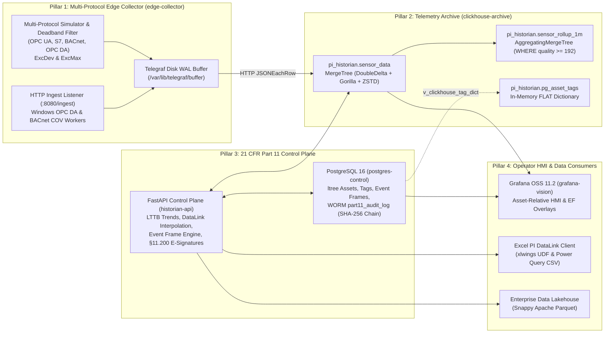

# OpenPI GxP Industrial Historian

**A 21 CFR Part 11, EU GMP Annex 11, and ISPE GAMP 5 Qualified Open-Source Industrial Time-Series Historian & Asset Framework**

OpenPI GxP Industrial Historian is a production-ready, 4-Pillar open-source replacement for the proprietary **OSIsoft / AVEVA PI System** engineered for pharmaceutical, biotech, and regulated manufacturing environments. It combines **ClickHouse 24.8 LTS** (lossless `DoubleDelta` + `Gorilla` telemetry archive and LTTB visual downsampling), **PostgreSQL 16** (`ltree` ISA-95 Asset Framework, ISA-88 Event Frames, and cryptographic SHA-256 WORM 21 CFR Part 11 audit trail), **InfluxData Telegraf 1.32 + Python Multi-Protocol Edge Workers** (Stage 1 Exception/Deadband filtering and disk-backed store-and-forward WAL), **FastAPI**, **Grafana OSS**, and an **Excel PI DataLink Client** (`xlwings` UDFs + native Power Query CSV).

---

## 1. OSIsoft / AVEVA PI System Parity Matrix

| Legacy OSIsoft / AVEVA PI Component | OpenPI GxP Historian Equivalent | Key Technical Capabilities |
| :--- | :--- | :--- |
| **PI Data Archive** (Swinging Door / Archive Subsystem) | **ClickHouse 24.8 LTS (`pi_historian.sensor_data`)** | `MergeTree` partitioned by month (`toYYYYMM(ts)`) with lossless `Delta`, `DoubleDelta`, `Gorilla`, and `T64` codecs layered with `ZSTD(1)` + real-time 1-minute `AggregatingMergeTree` rollups (`sensor_rollup_1m`). |
| **PI Asset Framework (PI AF)** | **PostgreSQL 16 `ltree` + ClickHouse `FLAT` Dictionary** | ISA-95 hierarchical asset paths (`Enterprise.Site.Area.Unit`) indexed via PostgreSQL `GiST` and synchronized into ClickHouse RAM (`pi_historian.pg_asset_tags`) with 5–15s refresh lifetime. |
| **PI Event Frames (EF)** | **PostgreSQL `event_frames` + FastAPI State Machine** | Automated ISA-88 batch & excursion detection (`BR201_TEMP_PV > 38.0°C`), ClickHouse `quality >= 192` KPI capture (`peak_val`, `avg_val`, `min_val`, `sample_count`), and 21 CFR Part 11 electronic signatures. |
| **PI Interface Node & PI Buffer Subsystem** | **Telegraf 1.32 Disk WAL + Python Edge Workers** | Stage 1 Exception/Deadband filtering (`ExcDev` & `ExcMax`) in memory + disk-backed Write-Ahead Log (`/var/lib/telegraf/buffer`, 1M metric capacity) for zero-data-loss store-and-forward across OPC UA, BACnet/IP, Siemens S7, Modbus, and Windows OPC DA. |
| **PI Vision** (`PlotValues` Trends & EF Overlays) | **Grafana OSS 11.2 + ClickHouse `largestTriangleThreeBuckets`** | Asset-relative dashboard (`${asset_path}`) with native ClickHouse LTTB visual peak preservation, 1-minute rollup bands, Event Frame shaded region annotations, and live Part 11 audit trail inspection. |
| **PI DataLink** (Excel `PISampDat`, `PIAdvCalcDat`) | **FastAPI `/api/v1/datalink/sampled` + `xlwings` UDF / Power Query** | Drop-in `=PI_SAMPLED_DATA()`, `=PI_SUMMARY_DATA()`, and `=PI_EVENT_FRAMES()` Excel functions plus zero-macro Power Query CSV streams respecting continuous (`LINEAR`) vs. discrete (`LOCF` step) tag metadata. |
| **PI Integrator for Business Analytics** | **FastAPI + PyArrow Zero-ETL Lakehouse Exporter** | One-call (`POST /api/v1/lakehouse/export-parquet`) Snappy-compressed Apache Parquet export enriched with ISA-95 asset hierarchy and engineering units. |

---

## 2. 4-Pillar System Architecture



### Container & Port Matrix

| Container Name | Role | Internal Port | Default Host Port (`.env`) | Technology Stack |
| :--- | :--- | :--- | :--- | :--- |
| `postgres-control` | Pillar 3: Relational Control Plane & Part 11 WORM Audit Log | `5432` | `5435` (`PG_PORT`) | PostgreSQL 16 (`ltree`, `btree_gist`, `pgcrypto`) |
| `clickhouse-archive` | Pillar 2: Immutable Time-Series Archive & Rollup Engine | `8123` / `9000` | `8125` / `9005` | ClickHouse Server 24.8 LTS (`Apache-2.0`) |
| `edge-collector` | Pillar 1: Multi-Protocol Collector & Store-and-Forward WAL | `8080` | `8080` (`EDGE_INGEST_PORT`) | Telegraf 1.32 Alpine + Python 3.12 |
| `historian-api` | Pillar 3: GxP REST API, Event Frame Engine & DataLink Server | `8000` | `8020` (`API_PORT`) | FastAPI, Psycopg 3, ClickHouse Connect, PyArrow |
| `grafana-vision` | Pillar 4: Pre-Provisioned Operator HMI | `3000` | `3020` (`GRAFANA_PORT`) | Grafana OSS 11.2 + ClickHouse Datasource Plugin |

---

## 3. 21 CFR Part 11, EU Annex 11 & ALCOA+ Technical Controls

1. **Mandatory Attribution Context (`§11.10(e)` / ALCOA+ Attributable & Contemporaneous):**
   - Every `INSERT`, `UPDATE`, or `DELETE` on `asset_templates`, `assets`, `tags`, and `event_frames` is intercepted by the PostgreSQL trigger `fn_enforce_part11_audit()`.
   - Transactions must supply `SET LOCAL app.actor_id` and `SET LOCAL app.change_reason` (populated via `X-Actor-Id` and `X-Change-Reason` HTTP headers on `historian-api`). Any unattributed mutation raises `21 CFR Part 11 Violation: app.actor_id and app.change_reason are mandatory`.
2. **Write-Once-Read-Many (WORM) Audit Trail Immutability (`§11.10(e)`):**
   - The `part11_audit_log` table enforces a `BEFORE UPDATE OR DELETE OR TRUNCATE` trigger (`fn_prevent_audit_tampering()`) that unconditionally raises `21 CFR Part 11 WORM Violation: Audit trail records are immutable`, blocking tampering even by database superusers.
3. **Cryptographic SHA-256 Audit Hash Chaining (`ALCOA+ Original & Enduring`):**
   - Every audit row links the prior row's SHA-256 digest starting from `GENESIS_0000000000000000`:
     $$\text{row\_hash} = \text{SHA256}(\text{prev\_hash} \parallel \text{recorded\_at} \parallel \text{actor\_id} \parallel \text{operation} \parallel \text{coalesce}(\text{new\_payload}, \text{''}))$$
   - End-to-end chain integrity is verifiable on demand via `GET /api/v1/audit-trail/verify`.
4. **Dual-Challenge Electronic Signatures (`§11.50`, `§11.70`, `§11.200`):**
   - Signing an Event Frame (`POST /api/v1/event-frames/{event_id}/sign`) verifies `user_id` and `password` against `pgcrypto` bcrypt hashes in PostgreSQL `users`, computes a non-repudiable `HMAC-SHA256` signature over `(event_id, user_id, signature_meaning, signed_at)`, updates the Event Frame, and records the signature in the WORM audit trail.
5. **OPC Signal Quality Filtering (`quality >= 192`) & Step vs. Continuous Interpolation:**
   - Raw telemetry preserves all OPC quality states (`192` = Good, `64` = Uncertain, `0` = Bad) for sensor diagnostics, while all GMP rollups (`mv_sensor_rollup_1m`), LTTB visual trends, DataLink queries, and Event Frame KPIs strictly filter `WHERE quality >= 192`.
   - Continuous analog tags (`is_step_tag = false`) use linear time-weighted interpolation (`WITH FILL STEP ... INTERPOLATE`), whereas discrete state tags (`is_step_tag = true`, e.g., agitator states `0/1/2`) use Last Observation Carried Forward (LOCF) so impossible fractional states (such as `1.5`) are never synthesized.

---

## 4. Repository Structure

```text
clickhouse-historian/
├── .antigravity/
│   └── rules.md                                      # Architectural & 21 CFR Part 11 guardrails
├── .env / .env.example                               # Non-default GxP credentials & host port mappings
├── docker-compose.yml                                # 5-service orchestrated stack with healthchecks
├── pytest.ini                                        # Pytest configuration for IQ/OQ qualification
├── init-postgres/
│   └── 01_control_plane_part11.sql                   # PostgreSQL 16 ltree, pgcrypto, WORM audit & seed data
├── init-clickhouse/
│   └── 01_telemetry_core.sql                         # MergeTree codecs, 1m rollups, PG dictionary & bridges
├── edge-collector/
│   ├── Dockerfile                                    # Telegraf 1.32 Alpine + Python 3.12 edge collector image
│   ├── telegraf-clickhouse.conf                      # Disk WAL buffer, HTTP ingest (:8080), execd & CH output
│   └── scripts/
│       ├── multi_protocol_simulator.py               # Deterministic plant simulator + Stage 1 Deadband filter
│       ├── opcda_windows_forwarder.py                # Windows localhost COM OPC DA -> HTTP JSON bridge
│       └── bacnet_cov_worker.py                      # Async BACnet/IP COV / ReadPropertyMultiple worker
├── app/
│   ├── Dockerfile                                    # FastAPI control plane container definition
│   ├── requirements.txt                              # FastAPI, Psycopg 3, ClickHouse Connect, PyArrow
│   └── main.py                                       # Unified REST API, Event Frame Engine, DataLink & Part 11
├── provisioning/grafana/
│   ├── datasources/datasources.yml                   # Auto-provisioned ClickHouse & PostgreSQL datasources
│   └── dashboards/
│       ├── dashboards.yml                            # Dashboard provider configuration
│       └── openpi_bioreactor_hmi.json                # Asset-relative Bioreactor & Cleanroom HMI dashboard
├── excel-datalink-client/
│   ├── openpi_datalink_udf.py                        # xlwings UDFs (=PI_SAMPLED_DATA, =PI_SUMMARY_DATA, etc.)
│   └── README_EXCEL_SETUP.md                         # Power Query (zero-macro) & xlwings setup guide
└── gxp-validation-package/
    ├── generate_gmp_binder.py                        # Automated 8-Document GMP Validation Binder generator
    ├── specs/
    │   └── urs_risk_catalog.yaml                     # 15 URS items mapped to FRS, GAMP Cat, CSA Risk & pytest
    ├── tests/
    │   ├── conftest.py                               # Fixtures & JSON evidence collector hook
    │   ├── test_01_iq_infrastructure.py              # IQ-01..05: Credentials, schemas, codecs, dict, WAL
    │   ├── test_02_oq_part11_compliance.py           # OQ-01..05: Part 11 attribution, WORM, e-sig, hash chain
    │   └── test_03_oq_historian_core.py              # OQ-06..10: Multi-protocol, bad quality, LOCF, LTTB, Parquet
    ├── evidence/
    │   └── oq_execution_results.json                 # Timestamped pytest execution evidence log
    └── dist_binder/                                  # Generated 8 Markdown deliverables + HTML/PDF binder
        ├── 01_Validation_Master_Plan_VMP.md
        ├── 02_User_Requirements_Specification_URS.md
        ├── 03_Functional_And_Design_Specification_FDS.md
        ├── 04_CSA_Functional_Risk_Assessment_FRA.md
        ├── 05_SOUP_OSS_Vendor_Qualification_Dossier.md
        ├── 06_Executed_IQ_OQ_Protocol_And_Evidence_Report.md
        ├── 07_Requirements_Traceability_Matrix_RTM.md
        ├── 08_Validation_Summary_Report_VSR.md
        └── COMPLETE_GMP_VALIDATION_BINDER.html
```

---

## 5. Quickstart & Deployment

### Prerequisites
- Docker Engine 24+ and Docker Compose v2
- Python 3.11+ (optional, for running the local `pytest` qualification suite and GMP binder generator)

### 1. Configure Environment & Launch the Stack

```bash
cp .env.example .env
docker compose up -d --build
```

Verify that all 5 services are running and healthy:

```bash
docker compose ps
curl -s http://localhost:8020/api/v1/health | jq .
```

Expected health output:

```json
{
  "status": "healthy",
  "postgres_control_plane": "connected",
  "clickhouse_archive": "connected",
  "part11_audit_records": 220,
  "sensor_data_rows": 1450
}
```

### 2. Seeded GxP Assets, Tags & Part 11 Users

On initial startup, `init-postgres/01_control_plane_part11.sql` seeds the following ISA-95 assets, multi-protocol tags, and Part 11 test accounts:

#### Seeded ISA-95 Assets & Multi-Protocol Tags
| Tag ID | Tag Name | ISA-95 `ltree` Asset Path | Attribute | Units | Step Tag (`LOCF`) | Deadband (`exc_dev`) | Limits (`Low` / `High`) | Source Protocol |
| :--- | :--- | :--- | :--- | :--- | :--- | :--- | :--- | :--- |
| `101` | `BR201_TEMP_PV` | `BioCorp.Fremont.USP.Bioreactor_201` | `Vessel_Temp_PV` | `degC` | `false` (Linear) | `0.05` | `35.0` / `38.0` | `OPC_UA` |
| `102` | `BR201_PH_PV` | `BioCorp.Fremont.USP.Bioreactor_201` | `Vessel_pH_PV` | `pH` | `false` (Linear) | `0.02` | `6.8` / `7.4` | `OPC_UA` |
| `103` | `BR201_AGIT_STATE` | `BioCorp.Fremont.USP.Bioreactor_201` | `Agitator_State` | `state` | `true` (Step/LOCF) | `0.0` | `0.0` / `2.0` | `SIEMENS_S7` |
| `301` | `CR104_DIFF_PRESS` | `BioCorp.Fremont.Facilities.Cleanroom_Suite_104` | `Room_Diff_Pressure_PV` | `Pa` | `false` (Linear) | `0.5` | `12.5` / `50.0` | `BACNET_IP` |
| `401` | `CHROM01_UV280_PV` | `BioCorp.Fremont.DSP.Chrom_Skid_01` | `UV280_Absorbance_PV` | `mAU` | `false` (Linear) | `0.1` | `0.0` / `1000.0` | `OPC_DA` |

#### Seeded 21 CFR Part 11 Accounts (`users`)
| User ID | Full Name | Role | Default Qualification Password |
| :--- | :--- | :--- | :--- |
| `operator_01` | Sarah Jenkins | `Process_Operator` | `Operator_Pass_2026!` |
| `qa_approver_01` | Dr. Marcus Vance | `Quality_Assurance` | `QA_Approve_2026!` |

---

## 6. REST API Reference (`historian-api`)

Interactive OpenAPI documentation is available at `http://localhost:8020/docs`.

### Browse ISA-95 Asset Hierarchy (`ltree`)
```bash
curl -s http://localhost:8020/api/v1/assets/tree | jq .
```

### Provision a New Tag (Requires 21 CFR Part 11 Attribution Headers)
```bash
curl -s -X POST http://localhost:8020/api/v1/tags \
  -H "Content-Type: application/json" \
  -H "X-Actor-Id: operator_01" \
  -H "X-Change-Reason: Provision Dissolved Oxygen sensor for Bioreactor 201" \
  -d '{
    "tag_id": 104,
    "tag_name": "BR201_DO_PV",
    "asset_id": 1,
    "attribute_name": "Dissolved_Oxygen_PV",
    "eng_units": "%Sat",
    "is_step_tag": false,
    "exc_dev": 0.1,
    "low_limit": 20.0,
    "high_limit": 100.0,
    "source_protocol": "OPC_UA"
  }' | jq .
```

### Query PI Vision Equivalent Downsampled Trend (`largestTriangleThreeBuckets`)
```bash
curl -s "http://localhost:8020/api/v1/trends/plot-values?tag_id=101&start_time=2026-10-17T00:00:00Z&end_time=2026-10-18T00:00:00Z&intervals=200" | jq .
```

### Query PI DataLink Equivalent Sampled Data (Linear vs. Step LOCF, JSON or CSV)
```bash
# Continuous analog tag (Linear interpolation) in CSV format for Excel Power Query
curl -s "http://localhost:8020/api/v1/datalink/sampled?tag_name=BR201_TEMP_PV&start_time=2026-10-17T12:00:00Z&end_time=2026-10-17T12:10:00Z&step_seconds=60&format=csv"

# Discrete step tag (LOCF step interpolation) in JSON format
curl -s "http://localhost:8020/api/v1/datalink/sampled?tag_name=BR201_AGIT_STATE&start_time=2026-10-17T12:00:00Z&end_time=2026-10-17T12:10:00Z&step_seconds=60&format=json" | jq .
```

### Evaluate ISA-88 Excursion Event Frames & Execute 21 CFR Part 11 Electronic Signature
```bash
# 1. Trigger Event Frame limit evaluation across recent telemetry
curl -s -X POST "http://localhost:8020/api/v1/event-frames/evaluate?lookback_minutes=15" | jq .

# 2. Sign an Event Frame with dual-challenge credentials and HMAC-SHA256 binding
curl -s -X POST "http://localhost:8020/api/v1/event-frames/<EVENT_UUID>/sign" \
  -H "Content-Type: application/json" \
  -H "X-Actor-Id: qa_approver_01" \
  -H "X-Change-Reason: Formal QA review and disposition of thermal excursion" \
  -d '{
    "user_id": "qa_approver_01",
    "password": "QA_Approve_2026!",
    "signature_meaning": "Excursion Investigation Reviewed",
    "change_reason": "Formal QA review and disposition of thermal excursion"
  }' | jq .
```

### Verify End-to-End 21 CFR Part 11 Cryptographic SHA-256 Hash Chain
```bash
curl -s http://localhost:8020/api/v1/audit-trail/verify | jq .
```

### Zero-ETL Apache Parquet Lakehouse Export
```bash
curl -s -X POST http://localhost:8020/api/v1/lakehouse/export-parquet \
  -H "Content-Type: application/json" \
  -d '{
    "tag_id": 101,
    "start_time": "2026-10-17T00:00:00Z",
    "end_time": "2026-10-18T00:00:00Z"
  }' | jq .
```

---

## 7. Operator HMI (Grafana Vision) & Excel PI DataLink Client

### Grafana Operator HMI (`http://localhost:3020`)
- **URL:** `http://localhost:3020/d/openpi-bioreactor-hmi`
- **Credentials:** `admin` / `GxP_Grafana_2026!` (configured in `.env`)
- **Features:**
  - Dynamic `$asset_path` template selector querying PostgreSQL `assets`.
  - Automated **Event Frame Annotations Overlay** rendering batch runs and critical excursions as shaded vertical bands across process trends.
  - **Panel 1:** High-Speed LTTB Downsampled Process Trend (`largestTriangleThreeBuckets`).
  - **Panel 2:** 1-Minute Real-Time Rollup Band (`minMerge`, `avgMerge`, `maxMerge` from `pi_historian.sensor_rollup_1m`).
  - **Panel 3:** Active & Signed ISA-88 Event Frames Table with HMAC-SHA256 verification status.
  - **Panel 4:** Live 21 CFR Part 11 WORM Audit Trail Inspector (`part11_audit_log`).

### Excel PI DataLink Client (`excel-datalink-client/`)
See [excel-datalink-client/README_EXCEL_SETUP.md](file:///home/d3lee/my-repos/clickhouse-historian/excel-datalink-client/README_EXCEL_SETUP.md) for full instructions on:
1. **Zero-Plugin Native Excel Power Query (`Data -> From Web`)** using `/api/v1/datalink/sampled?format=csv`.
2. **`xlwings` User-Defined Functions (`=PI_SAMPLED_DATA()`, `=PI_SUMMARY_DATA()`, `=PI_EVENT_FRAMES()`)** and CLI CSV export via [excel-datalink-client/openpi_datalink_udf.py](file:///home/d3lee/my-repos/clickhouse-historian/excel-datalink-client/openpi_datalink_udf.py).

---

## 8. Executable GAMP 5 / FDA CSA IQ/OQ Qualification & GMP Validation Binder

The repository includes an automated 15-test IQ/OQ qualification suite mapped to `URS-001` through `URS-015` ([gxp-validation-package/specs/urs_risk_catalog.yaml](file:///home/d3lee/my-repos/clickhouse-historian/gxp-validation-package/specs/urs_risk_catalog.yaml)) and an automated generator that builds an 8-Document Commercial GMP Validation Binder.

### 1. Run the Automated IQ/OQ Pytest Suite
```bash
python3 -m venv .venv
.venv/bin/pip install -r app/requirements.txt pytest pyyaml
.venv/bin/pytest -v
```
Executing `pytest` runs all 15 IQ/OQ tests (`test_01_iq_infrastructure.py`, `test_02_oq_part11_compliance.py`, `test_03_oq_historian_core.py`) and records timestamped execution evidence to `gxp-validation-package/evidence/oq_execution_results.json`.

### 2. Generate the 8-Document Commercial GMP Validation Binder
```bash
.venv/bin/python3 gxp-validation-package/generate_gmp_binder.py
```
This script combines `urs_risk_catalog.yaml`, `oq_execution_results.json`, live container `@sha256` digests (`docker inspect`), and live database samples from `part11_audit_log` and `event_frames` to output into `gxp-validation-package/dist_binder/`:
1. `01_Validation_Master_Plan_VMP.md`
2. `02_User_Requirements_Specification_URS.md`
3. `03_Functional_And_Design_Specification_FDS.md`
4. `04_CSA_Functional_Risk_Assessment_FRA.md`
5. `05_SOUP_OSS_Vendor_Qualification_Dossier.md`
6. `06_Executed_IQ_OQ_Protocol_And_Evidence_Report.md`
7. `07_Requirements_Traceability_Matrix_RTM.md`
8. `08_Validation_Summary_Report_VSR.md`
9. `COMPLETE_GMP_VALIDATION_BINDER.html` (single-file, print-ready HTML/PDF validation binder)
