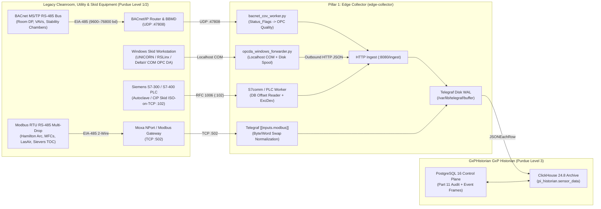

**Connecting Legacy BACnet/IP & MS/TP, Windows COM/DCOM OPC DA 2.05a, Modbus RTU/TCP, Siemens S7comm (S7-300/400), Allen-Bradley DF1/PCCC, and 4–20 mA HART Instruments to GxPHistorian GxP Industrial Historian**

---

## 1. Overview: Replacing Legacy OSIsoft PI Interfaces in Brownfield Biopharma Plants

In established cGMP biopharmaceutical facilities, critical equipment—steam sterilizers (autoclaves), Clean-in-Place (CIP) skids, chromatography workstations, cleanroom HVAC/EMS controllers, WFI loops, and stability chambers—often predates OPC UA by 10 to 25 years. Historically, connecting these systems required purchasing and maintaining separate proprietary **OSIsoft / AVEVA PI Interfaces**:

| Legacy Protocol / Physical Layer | Traditional OSIsoft / AVEVA PI Interface | GxPHistorian GxP Historian Equivalent (`edge-collector`) | Typical Biopharma Equipment |
| :--- | :--- | :--- | :--- |
| **BACnet/IP & BACnet MS/TP** (UDP `:47808` / RS-485) | *PI Interface for BACnet* | `edge-collector/scripts/bacnet_cov_worker.py` (`bacpypes3`) | Cleanroom EMS differential pressure cascades, HVAC AHUs, walk-in stability & cold rooms ($2\text{–}8\,^\circ\text{C}$, $-80\,^\circ\text{C}$) |
| **Classic OPC DA 2.05a / 3.0** (Windows COM/DCOM) | *PI Interface for OPC DA* + *PI Buffer Subsystem* | `edge-collector/scripts/opcda_windows_forwarder.py` (`OpenOPC` + `LocalSpoolBuffer`) | Cytiva UNICORN™ 5/6/7, Emerson DeltaV™ OPC Mirror, Rockwell RSLinx Classic, Sartorius MFCS/win 3 |
| **Modbus RTU (RS-485/RS-232) & Modbus TCP** (`:502`) | *PI Interface for Modbus Ethernet / Serial* | Telegraf `[[inputs.modbus]]` (TCP & `rtuovertcp` via Moxa NPort) | Veolia Sievers® 900/M9 TOC, PMS LasAir® II/III particle counters, Hamilton Arc® RS-485 probes, Brooks MFCs, Binder stability chambers |
| **Siemens S7comm** (`RFC 1006` ISO-on-TCP `:102`) | *PI Interface for Siemens S7* | Python `snap7` / `[[inputs.s7comm]]` worker $\rightarrow$ `:8080/ingest` | Fedegari / Getinge autoclaves, legacy Sartorius Biostat® D-DCU, Syntegon/Bosch vial washers & depyrogenation tunnels, CIP skids |
| **Allen-Bradley DF1 / PCCC / EtherNet/IP** (PLC-5 / SLC 500) | *PI Interface for Allen-Bradley DF1 / CIP* | Python `pycomm3` (`SLCDriver` / `LogixDriver`) worker $\rightarrow$ `:8080/ingest` | Legacy Millipore TFF skids, Paul Mueller WFI storage & distribution skids, lyophilizer refrigeration skids |
| **4–20 mA Analog + HART** (Bell 202 FSK) | *PI Interface for HART / Cornerstone* | HART-to-Modbus TCP Multiplexer $\rightarrow$ `[[inputs.modbus]]` | Legacy Rosemount / Endress+Hauser sanitary pressure, level, PT100 RTD, and Micro Motion Coriolis flow transmitters |


---

## 1.5 Non-Technical Step-by-Step Physical Wiring & Adapter Guide

If your facility has older equipment from the 1995–2015 era that lacks an OPC UA server or even lacks an Ethernet port, you do **not** need to replace the equipment or upgrade its validated PLC code. Here is the exact hardware adapter to buy and how to wire it in under 15 minutes:

| Legacy Situation | What Hardware Adapter to Buy | How to Physically Wire It | How GxPHistorian Reads It |
| :--- | :--- | :--- | :--- |
| **1. Equipment has a 2-Wire or 3-Wire `RS-485` Screw Terminal (`D+`, `D-`, `GND`)** | **[Moxa MGate MB3180](https://www.moxa.com/en/products/industrial-edge-connectivity/protocol-gateways/modbus-tcp-gateways/mgate-mb3180-mb3280-mb3480-series)** (for Modbus RTU, `$160`) or **[Contemporary Controls BASrouter](https://www.ccontrols.com/basautomation/basrouters.php)** (for BACnet MS/TP, `$390`) | Wire `D+` to `D+`, `D-` to `D-`, and `GND` to `GND` in a single **Daisy-Chain line** (never wire RS-485 in a star!). Place a **$120\,\Omega$ termination resistor** across `D+` and `D-` at the first device and at the gateway terminal block. | Gateway converts serial frames into **Modbus TCP (`Port 502`)** or **BACnet/IP (`UDP 47808`)** on your Ethernet LAN. |
| **2. Legacy Siemens S7-300 / S7-400 Autoclave or CIP Skid has NO Ethernet Port (only a 9-Pin `MPI / PROFIBUS` DB9 socket)** | **[Helmholz NETLink® PRO Compact](https://www.helmholz.de/en/products/fieldbus-applications/profibus/gateways/netlink-pro/artikel/show/700-884-mpi21/)** or **IBH Link S7++** RJ45-to-MPI/PROFIBUS Plug Adapter (`~$450`) | Snap the adapter directly onto the 9-pin female **MPI / DP port (`X1`)** on the front of the S7-300/400 CPU. It draws $24\text{V}$ power directly from the PLC port and provides a pass-through socket so your local HMI stays connected! Plug a **Cat6 cable** into the adapter's top RJ45 port. | `edge-collector` polls the S7-300/400 Data Blocks (`DB`) over **RFC 1006 ISO-on-TCP (`Port 102`, Rack `0`, Slot `2`)** with **zero PLC program changes**. |
| **3. Legacy Windows XP / 7 / 10 PC runs an `OPC DA 2.05a` Server (`UNICORN`, `RSLinx`, `Kepware`)** | **Zero hardware required** (or a `$20` USB-to-Ethernet adapter if the PC only has 1 NIC) | Never open Windows DCOM port `135` across the network! Copy `edge-collector/scripts/opcda_windows_forwarder.py` onto the Windows PC. | Reads COM `OPC DA` locally on `localhost` (`127.0.0.1`), buffers on disk (`opcda_spool.jsonl`), and pushes outbound HTTP JSON batches to `edge-collector:8080/ingest`. |
| **4. Standalone `4–20 mA` Analog Transmitter or `PT100 RTD` Temperature Probe** | **[Advantech ADAM-6017](https://www.advantech.com/en/products/iot-modules/adam-6017/mod_9df3d854-3e9a-4712-9856-d76ffefb2100)** (8-Ch `4–20 mA` to Modbus TCP, `$240`) or **Advantech ADAM-6015** (7-Ch `PT100 RTD`, `$240`) | Wire your $24\text{V DC}$ power supply `+24V` to the sensor `+`, sensor `-` to `AI0+` on the ADAM module, and `AI0-` back to `0V COM`. Plug a **Cat6 cable** into the ADAM module's RJ45 port. | Polls milliamps over **Modbus TCP (`Port 502`)**, scales $4\text{–}20\text{ mA}$ linearly to engineering units, and flags `quality = 0` (`Bad`) if loop current drops below $3.6\text{ mA}$ (cut wire). |

---

## 2. End-to-End Legacy Protocol Architecture



---

## 3. Deep Dive & Examples by Legacy Protocol

### 3.1 BACnet/IP & Legacy BACnet MS/TP (Cleanroom EMS & Stability Chambers)

#### Understanding Legacy BACnet Topologies in Biopharma
1. **BACnet MS/TP (Master-Slave/Token-Passing over EIA-485):**
   - Localized cleanroom pressure controllers (e.g., Setra, Phoenix Controls, Siemens DXR, Johnson Controls FEC) often sit on a 2-wire RS-485 daisy chain running at `38400` or `76800` baud.
   - An **MS/TP-to-BACnet/IP Router** (e.g., Contemporary Controls BASrouter or Loytec LVIS) bridges the RS-485 trunk onto the Ethernet network (`UDP 47808`).
   - In `bacpypes3` (`edge-collector/scripts/bacnet_cov_worker.py`), devices behind a BACnet router are addressed using **`DNET:DADR`** routing notation (e.g., `"2001:14"`, where `2001` is the MS/TP network number and `14` is the 8-bit MAC address on the RS-485 trunk) or via the router's IP.
2. **Traversing Subnets/VLANs with BBMD & Foreign Device Registration (FDR):**
   - Standard BACnet discovery (`Who-Is` / `I-Am`) uses local UDP broadcasts that are blocked by Layer 3 cleanroom VLAN routers.
   - Because `AsyncBacnetTelemetryWorker` in `edge-collector/scripts/bacnet_cov_worker.py` uses **directed unicast `ReadProperty`** (`Address("192.168.10.30:47808")`) rather than relying on broadcast discovery, it traverses Layer 3 firewalls cleanly with only `UDP 47808` permitted—even if no BBMD is deployed on the Historian VLAN.
3. **Why `ReadProperty` Polling with Edge Deadband Outperforms Legacy `SubscribeCOV`:**
   - Older field controllers have tiny RAM tables (often supporting only 5–16 active `SubscribeCOV` subscriptions before returning `Error: resources / no-space-for-object`).
   - Polling `presentValue` and `statusFlags` every 1–5 seconds in `bacnet_cov_worker.py` and applying Stage 1 `exc_dev` / `exc_max` filtering in the Edge Collector completely avoids controller COV table exhaustion while achieving identical compression in ClickHouse.

#### Example: Polling Direct BACnet/IP & Routed BACnet MS/TP Controllers (`bacnet_cov_worker.py`)
```python
from bacnet_cov_worker import AsyncBacnetTelemetryWorker, BacnetPointSpec
import asyncio

worker = AsyncBacnetTelemetryWorker(
    ingest_url="http://localhost:8080/ingest",
    points=[
        # 1. Direct BACnet/IP Cleanroom ISO-7 Differential Pressure Transmitter
        BacnetPointSpec(
            tag_id=301,
            device_address="192.168.10.30:47808",
            object_identifier="analog-input,1",
            exc_dev=0.10,   # Emit on >= 0.10 Pa change
            exc_max=10.0,   # Or every 10s heartbeat
        ),
        # 2. Legacy BACnet MS/TP Stability Chamber (2-8 degC) on MS/TP Network 2001, MAC Address 14
        #    Routed via BACnet/IP Router at 192.168.10.1
        BacnetPointSpec(
            tag_id=305,
            device_address="2001:14@192.168.10.1:47808",
            object_identifier="analog-input,0",
            exc_dev=0.05,   # Emit on >= 0.05 degC change
            exc_max=30.0,
        ),
    ],
)
asyncio.run(worker.poll_cycle())
```

---

### 3.2 Classic Windows COM/DCOM OPC DA 2.05a (`opcda_windows_forwarder.py`)

#### Why Traditional Remote OPC DA Fails in Modern GMP Plants
Legacy **OPC DA 2.05a** relies on Microsoft **DCOM (Distributed Component Object Model)**:
1. Initial handshake occurs on `TCP 135` (RPC Endpoint Mapper), which then dynamically assigns an arbitrary high port (`49152–65535`).
2. Requires matching Windows NTLM workgroup credentials or bidirectional Active Directory trust between the Level 2 skid PC and the Level 3 historian node.
3. Microsoft hardened DCOM authentication (`KB5004442` packet integrity enforcement), breaking legacy anonymous/unencrypted DCOM connections to older Windows 7 / Windows 10 LTSC skid workstations.

#### The GxPHistorian Zero-DCOM Solution
Run `edge-collector/scripts/opcda_windows_forwarder.py` directly on the Windows OPC DA workstation as a local Windows service (using a 32-bit Python environment if the vendor OPC server is a 32-bit COM DLL/EXE registered under `HKLM\SOFTWARE\WOW6432Node\Classes`):
- **Localhost COM Only:** `self._opc_client.connect(self.prog_id, "localhost")` communicates strictly within the local Windows kernel via LRPC (Local RPC)—zero inbound firewall ports are opened on the skid PC.
- **Quality Normalization:** `map_opcda_quality()` converts COM quality strings (`"Good"`, `"Good: Local Override"`, `"Uncertain"`, `"Bad: Sensor Failure"`) to standard integer OPC quality codes (`192`, `64`, `0`).
- **Store-and-Forward Spool (`LocalSpoolBuffer`):** If the plant network drops, telemetry is appended to `./opcda_spool.jsonl` on the Windows PC and automatically drained in FIFO batches (`drain_batches(max_items=500)`) as soon as `http://<edge-collector>:8080/ingest` is reachable again.

#### Common Biopharma OPC DA `ProgID` Reference
| Vendor Software Platform | Standard Windows COM `ProgID` |
| :--- | :--- |
| **Cytiva UNICORN™ 5 / 6 / 7 (ÄKTA™)** | `UNICORN.OPCServer.1` |
| **Emerson DeltaV™ OPC Mirror** | `OPC.DeltaV.1` |
| **Rockwell Automation RSLinx Classic** | `RSLinx OPC Server` or `RSLinx Remote OPC Server` |
| **Sartorius BioPAT® MFCS/win 3** | `Sartorius.MFCS.OPCServer` |
| **Siemens SIMATIC NET / WinCC** | `OPC.SimaticNET` or `OPCServer.WinCC` |
| **Matrikon OPC Simulation / Tunneller** | `Matrikon.OPC.Simulation.1` |

---

### 3.3 Legacy Modbus RTU (RS-485 / RS-232) & Modbus TCP (`:502`)

#### Solving the Three Classic Modbus Integration Traps
When connecting legacy **Modbus RTU** (2-wire RS-485 via a Moxa NPort serial device server) or **Modbus TCP** analyzers (Sievers TOC, PMS LasAir particle counters, Hamilton Arc sensors, Brooks MFCs, Binder stability chambers), three protocol pitfalls frequently corrupt readings if not configured properly:

1. **Trap 1 — Word & Byte Endianness (`ABCD`, `CDAB`, `BADC`, `DCBA`):**
   - The Modbus specification only defines 16-bit registers (`uint16`); it never standardized how a 32-bit IEEE-754 floating-point number (`FLOAT32-IEEE`) is split across two consecutive 16-bit registers (`Reg N` and `Reg N+1`).
   - **Big-Endian (`ABCD`):** High word first, high byte first (used by PMS LasAir® and many modern transmitters).
   - **Word-Swapped (`CDAB`):** Low 16-bit word in `Reg N`, high 16-bit word in `Reg N+1` (used by Schneider/Modicon PLCs, older Sievers® 900/M9 firmware modes, and Hamilton Arc® Modbus RTU registers).
   - *Fix:* Set `byte_order = "CDAB"` or `"ABCD"` per register block in Telegraf `[[inputs.modbus]]`.
2. **Trap 2 — 1-Based Modicon Documentation vs. 0-Based Wire Addressing:**
   - Vendor manuals often list Holding Registers as `40301` (Modicon 5-digit) or `400301` (Modicon 6-digit).
   - On the wire, Function Code `03` (`holding_registers`) uses **0-based indexing**: `40301` = Function Code `03`, address `300` (`301 - 1`).
3. **Trap 3 — Fixed-Point Integer Scaling (`INT16` / `UINT16` with Implied Decimals):**
   - Legacy controllers (such as Binder stability chambers or Eurotherm 2404/3504 temperature controllers) store `37.05 °C` as signed 16-bit integer `3705` (`scale = 0.01`) or `37.1 °C` as `371` (`scale = 0.1`).
   - *Fix:* Set `data_type = "INT16"` and `scale = 0.01` in `[[inputs.modbus]]` so ClickHouse receives the true floating-point engineering value (`37.05`).

#### Example: Complete Multi-Device Legacy Modbus Configuration (`telegraf-clickhouse.conf`)
```toml
# 1. Legacy RS-485 Modbus RTU Hamilton Arc Incyte/VisiFerm Probes behind a Moxa NPort Gateway
[[inputs.modbus]]
  name_override = "sensor_data"
  controller = "tcp://10.20.60.50:4001"
  transmission_mode = "RTUoverTCP"
  slave_id = 2
  timeout = "2s"
  configuration_type = "register"

  holding_registers = [
    # Hamilton VisiFerm Optical DO (%Sat) at 0-based register 2088, word-swapped CDAB Float32
    { name = "val", byte_order = "CDAB", data_type = "FLOAT32-IEEE", scale = 1.0, address = [2088, 2089] }
  ]
  [inputs.modbus.tags]
    tag_id = "104"

# 2. Legacy Eurotherm / Binder GMP Stability Chamber Controller (Fixed-Point INT16 with 0.01 scale)
[[inputs.modbus]]
  name_override = "sensor_data"
  controller = "tcp://10.20.60.55:502"
  transmission_mode = "TCP"
  slave_id = 1
  timeout = "2s"
  configuration_type = "register"

  input_registers = [
    # Chamber Temperature PV (raw 2504 -> 25.04 degC)
    { name = "val", byte_order = "AB", data_type = "INT16", scale = 0.01, address = [1] }
  ]
  [inputs.modbus.tags]
    tag_id = "801"
```

---

### 3.4 Legacy Siemens S7-300 / S7-400 (`S7comm` Port 102) for Autoclaves & CIP Skids

Many validated **Fedegari** and **Getinge** GMP steam sterilizers (autoclaves), **Syntegon (Bosch)** vial washers/depyrogenation tunnels, and **CIP skids** run on legacy **Siemens SIMATIC S7-300 (`Rack 0, Slot 2`)** or **S7-400 (`Rack 0, Slot 3`)** PLCs that do not have an onboard OPC UA server. Instead, they communicate via **Siemens `S7comm` (`RFC 1006` ISO-on-TCP over port `102`)**, reading absolute Data Block (`DB`) addresses.

GxPHistorian GxP Historian seeds `Tag 103: BR201_AGIT_STATE` with `source_protocol = 'S7COMM'` and `source_config = '{"rack": 0, "slot": 1, "db": 10, "offset": 0}'` in `init-postgres/01_control_plane_part11.sql`.

#### Production Python `S7comm` Edge Worker Example (`snap7` $\rightarrow$ `:8080/ingest`)
Below is a complete reference worker for polling a legacy **Siemens S7-300 GMP Steam Autoclave** (chamber temperature, coldest drain temperature, chamber pressure, accumulated $F_0$ sterilization lethality, and sterilization phase state) with Stage 1 deadband filtering:

```python
#!/usr/bin/env python3
"""
Legacy Siemens S7-300 / S7-400 (S7comm RFC 1006 Port 102) Edge Worker.
Reads Data Block (DB) offsets for a GMP Steam Sterilizer (Autoclave), applies
Stage 1 Exception/Deadband filtering, and posts JSON batches to :8080/ingest.
"""
from __future__ import annotations

import struct
import time
from dataclasses import dataclass
from typing import Dict, List, Optional
import httpx

@dataclass
class S7TagSpec:
    tag_id: int
    db_number: int
    byte_offset: int
    data_type: str  # "REAL" (Float32, 4 bytes) or "INT" (Int16, 2 bytes)
    exc_dev: float
    exc_max: float
    is_step_tag: bool = False

AUTOCLAVE_S7_TAGS = [
    S7TagSpec(tag_id=901, db_number=10, byte_offset=0,  data_type="REAL", exc_dev=0.05, exc_max=5.0), # Chamber Temp (degC)
    S7TagSpec(tag_id=902, db_number=10, byte_offset=4,  data_type="REAL", exc_dev=0.05, exc_max=5.0), # Drain Cold-Spot Temp (degC)
    S7TagSpec(tag_id=903, db_number=10, byte_offset=8,  data_type="REAL", exc_dev=0.01, exc_max=5.0), # Chamber Pressure (barA)
    S7TagSpec(tag_id=904, db_number=10, byte_offset=12, data_type="REAL", exc_dev=0.10, exc_max=5.0), # Accumulated F0 Lethality (min)
    S7TagSpec(tag_id=905, db_number=10, byte_offset=16, data_type="INT",  exc_dev=0.00, exc_max=15.0, is_step_tag=True), # Cycle Phase (0=Idle, 1=VacPulse, 2=Sterilize, 3=Dry)
]

PHASE_NAMES = {0: "IDLE", 1: "PRE_VACUUM_PULSES", 2: "STERILIZATION_HOLD_121C", 3: "DRYING_COOLING"}

def parse_s7_buffer(buf: bytes, spec: S7TagSpec) -> float:
    if spec.data_type == "REAL":
        return round(float(struct.unpack(">f", buf[spec.byte_offset : spec.byte_offset + 4])[0]), 4)
    return float(struct.unpack(">h", buf[spec.byte_offset : spec.byte_offset + 2])[0])

def poll_s7_autoclave(plc_ip: str = "10.20.40.80", rack: int = 0, slot: int = 2, ingest_url: str = "http://localhost:8080/ingest") -> None:
    import snap7  # pip install python-snap7

    client = snap7.client.Client()
    client.connect(plc_ip, rack, slot)
    raw_db10 = bytes(client.db_read(10, 0, 18))

    ts_ms = int(time.time() * 1000)
    batch = []
    for spec in AUTOCLAVE_S7_TAGS:
        val = parse_s7_buffer(raw_db10, spec)
        str_val = PHASE_NAMES.get(int(val), "") if spec.is_step_tag else ""
        batch.append({
            "tag_id": spec.tag_id,
            "ts": ts_ms,
            "val": val,
            "str_val": str_val,
            "quality": 192,
            "status_code": 0,
        })

    httpx.post(ingest_url, json=batch, timeout=5.0).raise_for_status()
```

---

### 3.5 Legacy 4–20 mA Analog Loops with Highway Addressable Remote Transducer (`HART`)

In older USP/DSP tank farms and WFI loops, sensors (e.g., **Rosemount 3051S** sanitary pressure, **Endress+Hauser Liquiphant / Promass**, **Micro Motion Coriolis** mass flow meters) are wired via **4–20 mA current loops** superimposing a digital **Bell 202 FSK HART signal** ($1200\,\text{bps}$).
- While the PLC AI card often reads only the primary 4–20 mA analog value, the digital HART signal carries **secondary/tertiary process variables** (e.g., simultaneous Coriolis mass flow, fluid density $\text{g/cm}^3$, and temperature) plus **NAMUR NE 107 device health diagnostics**.
- **Integration Pattern:** Install a non-intrusive **HART Multiplexer / WirelessHART Gateway** (such as Emerson Rosemount 1410D/1420 or Pepperl+Fuchs KFD2-HMM-16) in parallel with the PLC termination panel. The gateway exposes all primary, secondary, tertiary, and diagnostic HART variables over **Modbus TCP (`:502`)** or **OPC UA (`:4840`)** directly to `edge-collector`.

