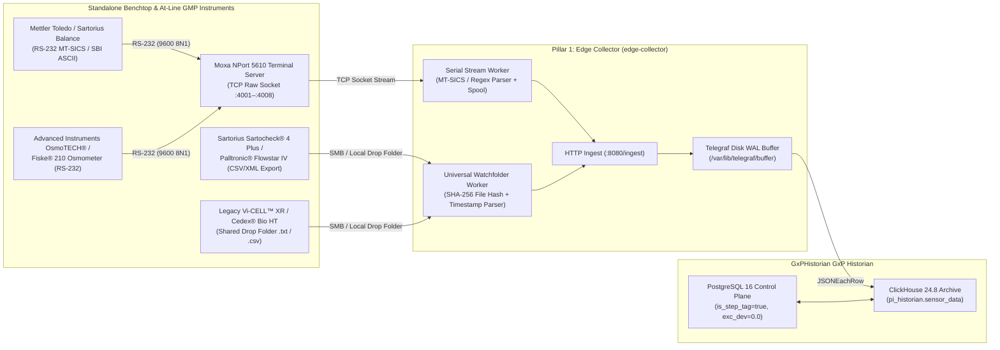

**Replacing the OSIsoft / AVEVA PI Interface for Universal File and Stream Loading (PI UFL) to Connect Standalone Analytical Balances, Osmometers, Filter Integrity Testers, and Legacy Benchtop Analyzers to GxPHistorian GxP Industrial Historian**

---

## 1. Overview: Why Biopharma Facilities Rely on Serial & File-Stream Ingestion

Across media preparation suites, buffer kitchens, In-Process Control (IPC) laboratories, and downstream filtration rooms, thousands of critical GMP instruments do **not** have a PLC, OPC UA server, or Modbus register map. Instead, they communicate exclusively via:

1. **Unidirectional or Command/Response RS-232 / RS-422 Serial Ports (`DB9` / `RJ45`):** Streaming ASCII measurement tickets (`MT-SICS`, `SBI`, `ASTM E1381/E1394`, or custom print strings) through a **Serial-to-Ethernet Terminal Server** (e.g., **Moxa NPort 5110/5610** or **Digi PortServer TS**).
2. **Flat-File Network Drop Folders (`.csv`, `.txt`, `.xml`, `.cdf`):** Exporting batch or sample result files to a local directory or SMB/CIFS share upon assay completion.

In a traditional OSIsoft / AVEVA PI System, these instruments are ingested using the **PI Interface for Universal File and Stream Loading (PI UFL)** configured via complex `.ini` regex files.

**GxPHistorian GxP Industrial Historian** replaces *PI UFL* with deterministic Python edge workers that parse serial TCP streams and watched directories, enforce **ALCOA+ data integrity** (preserving the instrument's native measurement timestamp, operator/sample ID, and file SHA-256 hash), spool locally during network outages, and post normalized JSON batches to `http://edge-collector:8080/ingest`.


---

## 1.5 Non-Technical Step-by-Step Setup Guide (Balances, Osmometers & Filter Integrity Testers)

Even if you have never configured a serial port before, you can connect any benchtop **[Mettler Toledo](https://www.mt.com/us/en/home/products/Laboratory_Weighing_Solutions/Balances/XPR-analytical-balance.html) / [Sartorius Cubis® II](https://www.sartorius.com/en/products/lab-weighing/lab-balances/cubis-ii) Balance**, **[Advanced Instruments OsmoTECH®](https://www.aicompanies.com/product/osmotech-xt-single-sample-micro-osmometer/) Osmometer**, or **[Sartocheck® 5](https://www.sartorius.com/en/products/process-filtration/filter-integrity-testing) / [Palltronic® Flowstar](https://www.cytivalifesciences.com/en/us/shop/bioprocess-filtration/integrity-test-instruments/palltronic-flowstar-iv-filter-integrity-test-instrument-p-45129) Filter Integrity Tester** in 4 simple steps:

### Path A: Connecting Any 9-Pin RS-232 Benchtop Balance or Osmometer via a Moxa NPort 5150
1. **What to Buy:**
   - **1x [Moxa NPort 5150](https://www.moxa.com/en/products/industrial-edge-connectivity/serial-device-servers/general-device-servers/nport-5100-series)** 1-Port RS-232/422/485 Serial Device Server (`~$130`).
   - **1x DB9 Serial Cable + DB9 Mini Null-Modem Adapter** (`~$10`, swaps Pin 2 `RX` and Pin 3 `TX`).
   - **1x Standard Cat6 Ethernet Patch Cable** (`~$10`).
2. **Plug In the Cables:**
   - Plug the 9-pin DB9 cable into the **`RS-232 / COM` port on the back of your balance or osmometer** and connect the other end to **Port 1 on the Moxa NPort 5150**.
   - Plug the **Cat6 Ethernet cable** into the Moxa NPort's RJ45 jack and into your lab wall Ethernet port.
3. **Set the Balance / Osmometer Screen Settings (Must Match the Moxa!):**
   - On a **[Mettler Toledo XPR / XSR / ICS Balance](https://www.mt.com/us/en/home/products/Laboratory_Weighing_Solutions/Balances/XPR-analytical-balance.html)**: Tap **Settings $\rightarrow$ Connections $\rightarrow$ RS232 $\rightarrow$ Protocol = `MT-SICS`**, **Baud = `9600`**, **Data Bits = `8`**, **Parity = `None`**, **Stop Bits = `1` (`9600 8N1`)**, **Handshake = `Off/Xon-Xoff`**.
   - On a **[Sartorius Cubis® II Balance](https://www.sartorius.com/en/products/lab-weighing/lab-balances/cubis-ii)**: Tap **Settings $\rightarrow$ Connections $\rightarrow$ COM / RS232 $\rightarrow$ Protocol = `SBI` or `SICS` (`9600 8N1`)**.
4. **Configure the Moxa NPort 5150 Web Console (2 Minutes in Any Browser):**
   - Open `http://192.168.127.254` (default Moxa IP) in your browser and log in (`admin` / `moxa`).
   - Under **Network Settings**, assign your lab static IP (e.g., `10.20.55.10`).
   - Under **Serial Settings $\rightarrow$ Port 1**, set **Baud Rate = `9600`**, **Data Bits = `8`**, **Stop Bits = `1`**, **Parity = `None`**, **Interface = `RS-232`**.
   - Under **Operating Settings $\rightarrow$ Port 1**, select **Operation Mode = `TCP Server Mode`**, **Local TCP Port = `4001`**, **Delimiter 1 = `0D` (`\r`)**, **Delimiter 2 = `0A` (`\n`)**, and click **Save/Restart**.
   - **How to Verify It Works:** Press the **`Print`** button on your balance and watch the **orange `Tx/Rx` LED** on top of the Moxa NPort blink! If it doesn't blink, snap the **Null-Modem Adapter** onto the DB9 cable and press `Print` again.

### Path B: Connecting a Filter Integrity Tester ([Sartocheck® 5](https://www.sartorius.com/en/products/process-filtration/filter-integrity-testing), [Palltronic® Flowstar V](https://www.cytivalifesciences.com/en/us/shop/bioprocess-filtration/integrity-test-instruments/palltronic-flowstar-iv-filter-integrity-test-instrument-p-45129), `Integritest® 5`) via Shared Folder
1. Plug a **Cat6 Ethernet cable** into the **rear RJ45 network port** of the Filter Integrity Tester cart.
2. On the tester's touchscreen, log in as **Administrator $\rightarrow$ System Settings $\rightarrow$ Network Export / File Transfer (SMB/CIFS)**.
3. Enter the `GxPHistorian` watch-folder network share path: `\\10.20.10.50\gxphistorian_ufl\incoming\filter_integrity` and check **Automatically Export XML/CSV Report After Test Completion**.
4. Every time an operator finishes a Pre-Use Post-Sterilization Integrity Test (**PUPSIT**) or Post-Use Bubble Point / Diffusion test, the tester drops the signed report into `incoming/`, where `GxPHistorian` hashes the raw file with **SHA-256**, extracts the Bubble Point (`mbar`) and Diffusion Rate (`mL/min`), creates an ISA-88 Event Frame, and moves the original file into the immutable WORM archive!

---

## 2. Architecture: Replacing OSIsoft PI UFL with GxPHistorian Edge Workers



---

## 3. Target Legacy Serial & Flat-File Biopharma Instruments

| Instrument Category | Common Models in GMP Biopharma | Output Interface & Format | Key Parameters Archived in GxPHistorian | Recommended Tag Settings |
| :--- | :--- | :--- | :--- | :--- |
| **Analytical & Floor Balances** | Mettler Toledo Excellence (XPR/XSR), ICS429/689; Sartorius Cubis® II / Combics | RS-232 / TCP `MT-SICS` (`S S    125.42 g`) or multi-line GLP print ticket | Net Dispensed Weight (`g` or `kg`), Tare Weight, Lot/Material ID (`str_val`) | `is_step_tag = true` (`LOCF`), `exc_dev = 0.0` |
| **Freezing-Point Osmometers** | Advanced Instruments OsmoTECH®, OsmoPRO®,Osmo1, Fiske® 210; Gonotec Osmomat | RS-232 ASCII ticket, ASTM E1394, or CSV export | Osmolality (`mOsm/kg H2O`), Sample ID (`str_val`) | `is_step_tag = true` (`LOCF`), `exc_dev = 0.0` |
| **Filter Integrity Testers (FIT)** | Sartorius Sartocheck® 4 Plus / 5; Pall Palltronic® Flowstar IV / V; Millipore Integritest® 5 | Network CSV / XML / PDF ticket drop or RS-232 | Bubble Point (`mbar` / `psi`), Diffusion Rate (`mL/min`), Water Intrusion (`mL/min`), Pass/Fail status | `is_step_tag = true` (`LOCF`), `exc_dev = 0.0` |
| **Benchtop pH / Conductivity Meters** | Mettler Toledo SevenExcellence™; Thermo Orion™ Versa Star Pro | RS-232 ASCII CSV string or LabX® XML drop | Offline pH Check, Offline Conductivity (`mS/cm`), Calibration Slope (`%`) | `is_step_tag = true` (`LOCF`), `exc_dev = 0.0` |
| **Blood Gas & Legacy Cell Counters** | Radiometer ABL90 FLEX; Beckman Coulter Vi-CELL™ XR | ASTM E1394 / HL7 TCP stream or `.txt` archive file | Offline pH, $p\text{CO}_2$, $p\text{O}_2$, Viability %, VCD (`10^6 cells/mL`) | `is_step_tag = true` (`LOCF`), `exc_dev = 0.0` |

---

## 4. Production Example 1: RS-232 / Moxa NPort TCP Serial Worker (`MT-SICS` Balances & Serial Osmometers)

In media and buffer preparation rooms, RS-232 ports on **Mettler Toledo** balances and **Advanced Instruments** osmometers are connected to a **Moxa NPort** configured in **TCP Server Mode** (e.g., IP `10.20.70.10`, Port `4001` = Balance 01, Port `4002` = Osmometer 01).

### How Mettler Toledo `MT-SICS` Frame Parsing & OPC Quality Mapping Works
Standard `MT-SICS` responses follow a strict status grammar:
- `S S     1250.45 g` $\rightarrow$ **Stable (`S S`)** weight reading: mapped to `val = 1250.45`, **`quality = 192` (`Good`)**, `status_code = 0`.
- `S D     1248.10 g` $\rightarrow$ **Dynamic / Unstable (`S D`)** weight reading (operator still pouring powder): mapped to `val = 1248.10`, **`quality = 64` (`Uncertain`)**, `status_code = 3` (excluded from GMP rollups!).
- `S +` or `S -` $\rightarrow$ **Overload / Underload Fault:** mapped to `val = 0.0`, **`quality = 0` (`Bad`)**, `status_code = 1`.

### Reference Implementation (`serial_ufl_stream_worker.py`)
```python
#!/usr/bin/env python3
"""
GxPHistorian Replacement for OSIsoft PI UFL (Serial / Moxa NPort TCP Stream Mode).
Parses Mettler Toledo MT-SICS balance frames and Advanced Instruments Osmometer
RS-232 tickets, maps stability flags to OPC quality (192/64/0), and posts to :8080/ingest.
"""
from __future__ import annotations

import re
import socket
import time
from typing import Optional
import httpx

# Regex 1: Mettler Toledo MT-SICS response: "S S      125.420 g" or "S D       45.100 g"
MT_SICS_RE = re.compile(r"^S\s+(?P<status>[SD\+\-])\s*(?P<val>[\-\d\.]+)?\s*(?P<unit>[a-zA-Z]+)?$")

# Regex 2: Advanced Instruments Fiske 210 / OsmoPRO RS-232 ticket: "SAMPLE=BR201_D3  OSMO=294 mOsm/kg"
OSMO_TICKET_RE = re.compile(r"SAMPLE=(?P<sample_id>\S+)\s+OSMO=(?P<val>\d+(?:\.\d+)?)\s*mOsm", re.IGNORECASE)


def parse_mt_sics_line(line: str, tag_id: int) -> Optional[dict]:
    match = MT_SICS_RE.match(line.strip())
    if not match:
        return None
    status = match.group("status")
    ts_ms = int(time.time() * 1000)

    if status in ("+", "-"):
        return {
            "tag_id": tag_id,
            "ts": ts_ms,
            "val": 0.0,
            "str_val": "OVERLOAD_OR_UNDERLOAD_FAULT",
            "quality": 0,       # Bad quality
            "status_code": 1,
        }

    val = float(match.group("val") or 0.0)
    unit = match.group("unit") or "g"
    if unit.lower() == "kg":
        val *= 1000.0  # Normalize to grams

    is_stable = status == "S"
    return {
        "tag_id": tag_id,
        "ts": ts_ms,
        "val": round(val, 4),
        "str_val": "STABLE_WEIGHT" if is_stable else "DYNAMIC_UNSTABLE",
        "quality": 192 if is_stable else 64,  # 192=Good (Stable), 64=Uncertain (Dynamic)
        "status_code": 0 if is_stable else 3,
    }


def parse_osmometer_line(line: str, tag_id: int) -> Optional[dict]:
    match = OSMO_TICKET_RE.search(line.strip())
    if not match:
        return None
    return {
        "tag_id": tag_id,
        "ts": int(time.time() * 1000),
        "val": float(match.group("val")),
        "str_val": match.group("sample_id"),
        "quality": 192,
        "status_code": 0,
    }


def stream_moxa_serial_port(host: str, port: int, tag_id: int, ingest_url: str = "http://localhost:8080/ingest") -> None:
    """Connects to a Moxa NPort TCP raw serial socket and forwards parsed points to edge-collector."""
    with socket.create_connection((host, port), timeout=10.0) as sock:
        sock_file = sock.makefile("r", encoding="ascii", errors="replace")
        for raw_line in sock_file:
            payload = parse_mt_sics_line(raw_line, tag_id) or parse_osmometer_line(raw_line, tag_id)
            if payload:
                httpx.post(ingest_url, json=[payload], timeout=5.0).raise_for_status()
```

---

## 5. Production Example 2: Universal Flat-File Watchfolder Worker (Filter Integrity Testers & Legacy Cell Analyzers)

When a **Sartorius Sartocheck® 4 Plus** or **Pall Palltronic® Flowstar IV** completes a pre-use or post-use sterilizing-grade $0.22\,\mu\text{m}$ filter integrity test (Bubble Point or Forward Flow / Diffusion), it writes a structured CSV or XML result file into a watched directory.

### Reference Implementation (`flatfile_ufl_watcher.py`)
```python
#!/usr/bin/env python3
"""
GxPHistorian Replacement for OSIsoft PI UFL (Flat-File Watchfolder Mode).
Monitors a directory for Filter Integrity Tester (Sartocheck / Palltronic) and
benchtop analyzer CSV files, computes SHA-256 file hashes for ALCOA+ auditability,
extracts explicit test completion timestamps, and posts to :8080/ingest.
"""
from __future__ import annotations

import csv
import datetime as dt
import hashlib
import pathlib
import shutil
import httpx

# Map (Equipment_ID, Parameter_Name) -> GxPHistorian tag_id
UFL_TAG_CATALOG = {
    ("FIT_01", "BUBBLE_POINT_MBAR"): 851,
    ("FIT_01", "DIFFUSION_ML_MIN"):  852,
    ("FIT_01", "TEST_RESULT_CODE"):  853,  # 1.0 = PASS, 0.0 = FAIL (Step Tag)
}

def process_ufl_csv_file(
    csv_file: pathlib.Path,
    archive_dir: pathlib.Path,
    ingest_url: str = "http://localhost:8080/ingest",
) -> int:
    # 1. Compute SHA-256 digest of the raw instrument file for ALCOA+ traceability
    raw_bytes = csv_file.read_bytes()
    file_sha256 = hashlib.sha256(raw_bytes).hexdigest()[:16]

    batch = []
    with csv_file.open("r", encoding="utf-8-sig") as fh:
        reader = csv.DictReader(fh)
        for row in reader:
            equip_id = row["EquipmentID"].strip().upper()
            param = row["Parameter"].strip().upper()
            tag_id = UFL_TAG_CATALOG.get((equip_id, param))
            if tag_id is None:
                continue

            # Parse explicit instrument timestamp (ISO-8601 UTC)
            ts_dt = dt.datetime.fromisoformat(row["TimestampUTC"].replace("Z", "+00:00"))
            ts_ms = int(ts_dt.timestamp() * 1000)

            batch.append({
                "tag_id": tag_id,
                "ts": ts_ms,
                "val": float(row["Value"]),
                "str_val": f"{row.get('BatchID', 'NA')}|sha256:{file_sha256}",
                "quality": 192 if row.get("InstrumentStatus", "VALID") == "VALID" else 64,
                "status_code": 0,
            })

    if batch:
        httpx.post(ingest_url, json=batch, timeout=5.0).raise_for_status()

    # Move processed file to immutable archive folder
    archive_dir.mkdir(parents=True, exist_ok=True)
    shutil.move(str(csv_file), str(archive_dir / f"{csv_file.stem}_{file_sha256}{csv_file.suffix}"))
    return len(batch)
```

---

## 6. Provisioning Legacy Serial & UFL Tags via the 21 CFR Part 11 API

Because serial balance check-weights, osmolality readings, and filter integrity test results are discrete, event-driven GMP records:
1. Set `"is_step_tag": true` (`LOCF` interpolation).
2. Set `"exc_dev": 0.0` so every single weighing or filter test is recorded in ClickHouse even if two consecutive vials or filters yield identical numerical values.

```bash
# Provision a Sartorius Sartocheck 4 Plus Bubble Point Integrity Test Tag
curl -s -X POST http://localhost:8020/api/v1/tags \
  -H "Content-Type: application/json" \
  -H "X-Actor-Id: operator_01" \
  -H "X-Change-Reason: Provision Sartocheck 4 Plus Bubble Point tag via GxPHistorian UFL Watchfolder" \
  -d '{
    "tag_id": 851,
    "tag_name": "DSP_FIT01_BUBBLE_PT_PV",
    "asset_id": 1,
    "attribute_name": "Sterilizing_Filter_Bubble_Point",
    "eng_units": "mbar",
    "is_step_tag": true,
    "exc_dev": 0.0,
    "low_limit": 3200.0,
    "high_limit": 5000.0,
    "source_protocol": "PI_UFL_CSV",
    "source_config": {
      "watch_dir": "/var/spool/gxphistorian/fit_drop",
      "equipment_id": "FIT_01",
      "parameter": "BUBBLE_POINT_MBAR"
    }
  }' | jq .
```
If a post-use filter integrity test reports a Bubble Point below `low_limit: 3200.0 mbar` (e.g., `2850.0 mbar`), GxPHistorian’s Event Frame engine (`POST /api/v1/event-frames/evaluate`) automatically opens a `CRITICAL` excursion Event Frame on the batch, requiring formal QA investigation and a dual-challenge **21 CFR Part 11 electronic signature** (`POST /api/v1/event-frames/{event_id}/sign`).

