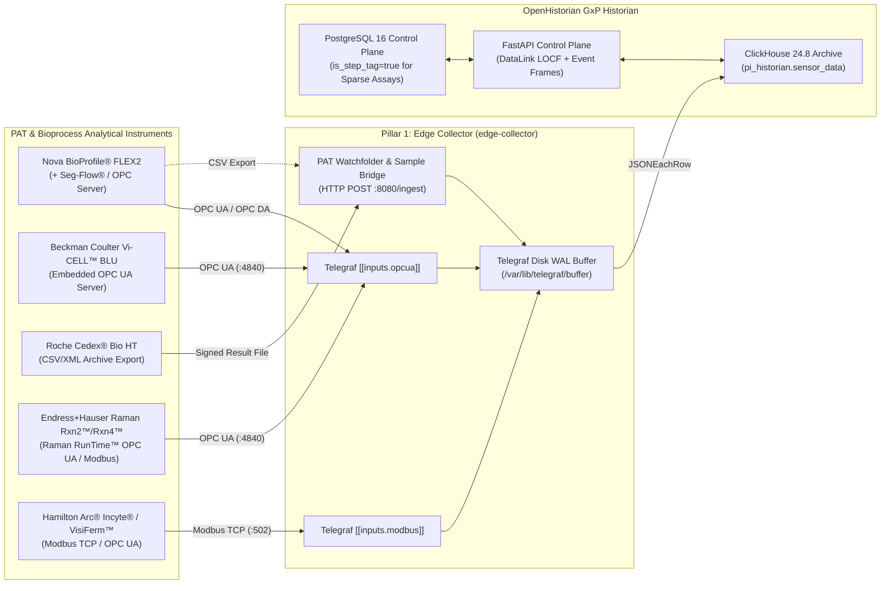

**Connecting Nova Biomedical BioProfile® FLEX2, Beckman Coulter Vi-CELL™ BLU, Roche Cedex® Bio HT, Endress+Hauser Raman Rxn2™/Rxn4™, and Hamilton Arc® / Mettler Toledo Sensors to OpenHistorian GxP Industrial Historian**

---

## 1. Overview: Bridging PAT & At-Line Analytical Data into the Historian

In modern Upstream and Downstream bioprocessing, online bioreactor probes (Temperature, pH, DO) tell only half the story. Critical Quality Attributes (CQAs) and biological state metrics—**Viable Cell Density (VCD)**, **Cell Viability (%)**, **Glucose**, **Lactate**, **Glutamine**, **Glutamate**, **Ammonium ($\text{NH}_4^+$)**, **Osmolality**, and **Monoclonal Antibody (IgG) Titer**—are measured by:

1. **At-Line Automated Cell & Metabolite Analyzers:**
   - **Nova Biomedical BioProfile® FLEX2** (coupled with the BioProfile® Automated Sampler or **Flownamics® Seg-Flow®** online sampling system)
   - **Beckman Coulter Vi-CELL™ BLU** (automated Trypan Blue imaging cell viability analyzer)
   - **Roche CustomBiotech Cedex® Bio HT & Cedex® HiRes** (high-throughput metabolite, substrate, and IgG titer analyzer)
2. **In-Line PAT Spectroscopy & Smart Sensors:**
   - **Endress+Hauser (Kaiser) Raman Rxn2™ / Rxn4™ Bioprocess Analyzer** (*in situ* Raman spectroscopy predicting real-time glucose, lactate, VCD, and antibody titer for closed-loop nutrient feeding)
   - **Hamilton Arc® (Incyte® Permittivity/Biomass, VisiFerm™ Optical DO, EasyFerm™ pH) & Mettler Toledo InPro® / M800 Transmitters**

---

## 2. Integration Architecture



---

## 3. Golden Rules for Sparse At-Line Analytical Samples in OpenHistorian

Unlike a 1 Hz thermocouple, an at-line **BioProfile® FLEX2**, **Vi-CELL™ BLU**, or **Cedex® Bio HT** produces a discrete analytical result vector once every 1 to 12 hours per bioreactor vessel. To prevent data loss or interpolation distortion:

1. **Set `exc_dev = 0.0` (Zero Deadband Suppression):** Every analytical sample is a GMP record. Setting `exc_dev = 0.0` guarantees that two consecutive identical assay results (e.g., `Viability = 98.4%` followed 6 hours later by `98.4%`) are both archived.
2. **Set `is_step_tag = true` (`LOCF` Step Interpolation):** When process engineers pull hourly tables in Excel (`=PI_SAMPLED_DATA()`) or overlay offline glucose with online Raman glucose in Grafana, `is_step_tag = true` uses Last Observation Carried Forward (`LOCF`) so a pre-feed glucose measurement of `1.8 g/L` at 08:00 and a post-bolus measurement of `6.0 g/L` at 14:00 do not create a synthetic linear ramp across the morning.
3. **Map Vessel ID from the Sample Name:** Multi-vessel analyzers serve 4 to 24 bioreactors. Route each result to the specific bioreactor's `tag_id` in PostgreSQL (`BioCorp.Fremont.USP.Bioreactor_201` vs. `Bioreactor_202`) using the sample's `VesselID` / `SampleID` prefix.
4. **Preserve the Explicit Sample Draw Timestamp (`ts`):** Always pass the analyzer’s `SampleTimestamp` (in UTC epoch milliseconds) in the `ts` field of the JSON payload sent to `http://edge-collector:8080/ingest`. Telegraf’s JSON transformation in `edge-collector/telegraf-clickhouse.conf` (`"ts": $exists(fields.ts) ? fields.ts : timestamp`) preserves the exact time the sample was drawn from the bioreactor rather than the time the assay completed.

---

## 4. Instrument-Specific Integration Configurations

### 4.1 Nova Biomedical BioProfile® FLEX2 (OPC Server & Seg-Flow® Autosampler)
The **BioProfile® FLEX2** combines up to 5 analytical modules:
- **Chemistry/Biosensor Module:** Glucose (`g/L`), Lactate (`g/L`), Glutamine (`mmol/L`), Glutamate (`mmol/L`), Ammonium $\text{NH}_4^+$ (`mmol/L`)
- **pH / Blood Gas Module:** pH, $p\text{CO}_2$ (`mmHg`), $p\text{O}_2$ (`mmHg`)
- **Cell Density / Viability (CDV) Module:** Total Cell Density (`10^6 cells/mL`), Viable Cell Density (`10^6 cells/mL`), Viability (`%`), Cell Diameter ($\mu\text{m}$)
- **Osmolality Module:** Osmolality (`mOsm/kg`)

#### Connection via BioProfile OPC UA / Seg-Flow® OPC Server
Configure `edge-collector/telegraf-clickhouse.conf` to subscribe to the FLEX2 / Seg-Flow OPC UA namespace for `Bioreactor_201`:
```toml
[[inputs.opcua]]
  name = "sensor_data"
  endpoint = "opc.tcp://10.20.50.10:4840/BioProfileOPC"
  security_policy = "Basic256Sha256"
  security_mode = "SignAndEncrypt"
  certificate = "/etc/telegraf/certs/openhistorian_client_cert.pem"
  private_key = "/etc/telegraf/certs/openhistorian_client_key.pem"

  nodes = [
    { name = "val", namespace = "2", identifier_type = "s", identifier = "FLEX2.BR201.Gluc",      default_tags = { tag_id = "501" } },
    { name = "val", namespace = "2", identifier_type = "s", identifier = "FLEX2.BR201.Lac",       default_tags = { tag_id = "502" } },
    { name = "val", namespace = "2", identifier_type = "s", identifier = "FLEX2.BR201.NH4",       default_tags = { tag_id = "503" } },
    { name = "val", namespace = "2", identifier_type = "s", identifier = "FLEX2.BR201.VCD",       default_tags = { tag_id = "504" } },
    { name = "val", namespace = "2", identifier_type = "s", identifier = "FLEX2.BR201.Viability", default_tags = { tag_id = "505" } },
    { name = "val", namespace = "2", identifier_type = "s", identifier = "FLEX2.BR201.Osm",       default_tags = { tag_id = "506" } }
  ]
```
*(If using the legacy Windows COM BioProfile OPC DA Server, run `edge-collector/scripts/opcda_windows_forwarder.py` on the FLEX2 workstation with `exc_dev = 0.0`.)*

---

### 4.2 Beckman Coulter Vi-CELL™ BLU (Native Embedded OPC UA Server)
The **Vi-CELL™ BLU** includes an embedded, 21 CFR Part 11 compliant **OPC UA Server** designed for direct bioprocess automation and historian connectivity.
- **Endpoint:** `opc.tcp://<vicell-blu-ip>:4840` (or configured port in the Vi-CELL BLU Admin console)
- **Key Exposed Nodes:**
  - `ViCellBlu.SampleResult.SampleID` (String — e.g., `"BR201_DAY04_S1"`, stored in `str_val`)
  - `ViCellBlu.SampleResult.ViableCellsPerMl` (`10^6 cells/mL`)
  - `ViCellBlu.SampleResult.TotalCellsPerMl` (`10^6 cells/mL`)
  - `ViCellBlu.SampleResult.ViabilityPercent` (`%`)
  - `ViCellBlu.SampleResult.AverageViableDiameter` ($\mu\text{m}$)

---

### 4.3 Roche CustomBiotech Cedex® Bio HT (Watchfolder CSV/XML to `:8080/ingest` Worker)
Because **Roche Cedex® Bio HT** commonly exports validated result archives as structured CSV/TXT/XML files to a network share (or via an LDMS drop folder), you can stream Cedex results directly into `edge-collector:8080/ingest` using a lightweight Python worker patterned after `opcda_windows_forwarder.py`:

```python
#!/usr/bin/env python3
"""
Example PAT File-to-Historian Bridge for Roche Cedex Bio HT & BioProfile FLEX2 CSV Exports.
Parses validated assay exports, preserves exact sample draw timestamp (UTC ms),
and posts normalized JSON batches to edge-collector (:8080/ingest).
"""
import csv
import datetime as dt
import pathlib
import httpx

TAG_MAP = {
    ("BR201", "GLC2B"): 501,  # Glucose (g/L)
    ("BR201", "LAC2B"): 502,  # Lactate (g/L)
    ("BR201", "NH3B"):  503,  # Ammonia (mmol/L)
    ("BR201", "IGG2B"): 507,  # IgG Titer (g/L)
    ("BR201", "LDHB"):  508,  # LDH (U/L - cell lysis indicator)
}

def ingest_cedex_csv(csv_path: pathlib.Path, ingest_url: str = "http://localhost:8080/ingest") -> None:
    batch = []
    with csv_path.open("r", encoding="utf-8") as fh:
        reader = csv.DictReader(fh, delimiter=";")
        for row in reader:
            vessel = row["SampleID"].split("_")[0].upper()
            assay = row["TestCode"].upper()
            tag_id = TAG_MAP.get((vessel, assay))
            if tag_id is None:
                continue
            sample_dt = dt.datetime.fromisoformat(row["SampleTimeUTC"]).replace(tzinfo=dt.timezone.utc)
            batch.append({
                "tag_id": tag_id,
                "ts": int(sample_dt.timestamp() * 1000),
                "val": float(row["ResultValue"]),
                "str_val": row["SampleID"],
                "quality": 192 if row.get("Flag", "OK") == "OK" else 64,
                "status_code": 0,
            })
    if batch:
        httpx.post(ingest_url, json=batch, timeout=5.0).raise_for_status()
```

---

### 4.4 Endress+Hauser (Kaiser) Raman Rxn2™ / Rxn4™ & Hamilton Arc® Smart Sensors

#### Endress+Hauser Raman Rxn2™ / Rxn4™ (In-Line Raman Spectroscopy)
The Raman Rxn analyzer acquires *in situ* spectra via an immersible BioOptic™ probe and executes chemometric Partial Least Squares (PLS) models (in **Raman RunTime™** or **Sartorius Umetrics™ SIMCA®-online**) every 1–5 minutes.
- **OPC UA Integration:** Connect `edge-collector` to Raman RunTime’s embedded OPC UA server (`opc.tcp://<raman-rxn-ip>:4840`) or SIMCA-online OPC UA server to archive predicted `Raman_Glucose_g_L`, `Raman_Lactate_g_L`, `Raman_VCD_10e6_mL`, `Raman_Titer_g_L`, and model diagnostics (`Hotelling_T2`, `DModX` spectral residual).
- **Quality Mapping:** Map chemometric outlier flags (`DModX > DModX_Crit`) to `quality = 64` (Uncertain) so automated glucose feed controllers and GMP rollups immediately recognize out-of-calibration spectra.

#### Hamilton Arc® (Incyte® Permittivity, VisiFerm™ DO, EasyFerm™ pH) & Mettler Toledo M800
Hamilton **Incyte®** sensors measure dielectric permittivity ($\varepsilon$, `pF/cm`) at multiple radio frequencies to track viable cell biomass continuously in real time without micro-carrier or cell-clumping interference.
- Connected either via the bioreactor PLC (OPC UA) or directly via **Modbus TCP** (`[[inputs.modbus]]` in `telegraf-clickhouse.conf`) to read permittivity (`pF/cm`), conductivity (`mS/cm`), optical DO (`%Sat`), and sensor health diagnostics (`Electrode_Quality_%`, `Glass_Impedance_MOhm`).

---

## 5. Provisioning PAT & Metabolite Tags via the 21 CFR Part 11 API

```bash
# Provision At-Line Glucose (Tag 501, Step/LOCF) and Online Raman Glucose (Tag 511, Linear)
curl -s -X POST http://localhost:8020/api/v1/tags \
  -H "Content-Type: application/json" \
  -H "X-Actor-Id: operator_01" \
  -H "X-Change-Reason: Provision BioProfile FLEX2 At-Line Glucose tag for Bioreactor 201" \
  -d '{
    "tag_id": 501,
    "tag_name": "BR201_FLEX2_GLUC_PV",
    "asset_id": 1,
    "attribute_name": "AtLine_Glucose_PV",
    "eng_units": "g/L",
    "is_step_tag": true,
    "exc_dev": 0.0,
    "low_limit": 1.0,
    "high_limit": 8.0,
    "source_protocol": "OPC_UA",
    "source_config": {"node_id": "ns=2;s=FLEX2.BR201.Gluc", "archetype": "SPARSE_PAT_ASSAY"}
  }' | jq .

curl -s -X POST http://localhost:8020/api/v1/tags \
  -H "Content-Type: application/json" \
  -H "X-Actor-Id: operator_01" \
  -H "X-Change-Reason: Provision Raman Rxn2 In-Line Glucose PAT prediction tag for Bioreactor 201" \
  -d '{
    "tag_id": 511,
    "tag_name": "BR201_RAMAN_GLUC_PV",
    "asset_id": 1,
    "attribute_name": "InLine_Raman_Glucose_PV",
    "eng_units": "g/L",
    "is_step_tag": false,
    "exc_dev": 0.02,
    "low_limit": 1.0,
    "high_limit": 8.0,
    "source_protocol": "OPC_UA",
    "source_config": {"node_id": "ns=2;s=RamanRunTime.BR201.Predicted_Glucose", "sampling_ms": 60000}
  }' | jq .
```

