**Connecting Cytiva Xcellerex™ X-Platform Single-Use Bioreactors (50 L – 2000 L) and Figurate™ Automation to the OpenHistorian GxP Industrial Historian**

---

## 1. Overview

**OpenHistorian GxP Industrial Historian** integrates directly with **Cytiva Xcellerex™ X-Platform** single-use bioreactors (supporting batch, fed-batch, and perfusion upstream workflows from 50 L to 2000 L) via their **Figurate™ automation solutions** layer—whether deployed on **Emerson DeltaV™ DCS**, **Rockwell Automation PlantPAx® (ControlLogix / FactoryTalk)**, or legacy supervisory stations.

By default, the repository’s qualification seed (`init-postgres/01_control_plane_part11.sql`) models a **2000 L Upstream Processing (USP) single-use bioreactor** (`BioCorp.Fremont.USP.Bioreactor_201`) with pre-configured ISA-95 `ltree` asset paths, Stage 1 exception/deadband filtering (`ExcDev` / `ExcMax`), 1-minute ClickHouse rollups, automated ISA-88 Event Frames, and 21 CFR Part 11 cryptographic audit trails.

---

## 2. End-to-End Integration Architecture

```mermaid
flowchart LR
  subgraph Skid["Cytiva Xcellerex™ X-Platform Skid"]
    IO["Smart Sensors & Actuators\n(Temp, pH, DO, MFCs, Load Cells, Agitator, Pumps)"]
    FIG["Figurate™ Automation Layer\n(Emerson DeltaV™ or Rockwell PlantPAx®)"]
    IO -->|"EtherNet/IP or PROFINET"| FIG
  end

  subgraph Edge["Pillar 1: Edge Collector (edge-collector)"]
    OPCUA["OPC UA Client / Worker\n(TLS + Cert Auth + ExcDev/ExcMax)"]
    OPCDA["Windows Localhost OPC DA Bridge\n(opcda_windows_forwarder.py)"]
    ING["HTTP Ingest (:8080/ingest)"]
    WAL["Telegraf Disk WAL Buffer\n(/var/lib/telegraf/buffer)"]
    OPCUA --> WAL
    OPCDA -->|"JSON Batch + Local Spool"| ING --> WAL
  end

  subgraph Core["Pillars 2–4: OpenHistorian GxP Historian"]
    CH["ClickHouse 24.8 Archive\n(pi_historian.sensor_data & 1m Rollups)"]
    PG["PostgreSQL 16 Control Plane\n(ltree ISA-95, ISA-88 Event Frames, Part 11 WORM)"]
    API["FastAPI Control Plane\n(historian-api :8020)"]
    HMI["Grafana HMI (:3020) &\nExcel PI DataLink Client"]
  end

  FIG -->|"OPC UA (Port 4840)"| OPCUA
  FIG -.->|"Legacy COM OPC DA"| OPCDA
  WAL -->|"JSONEachRow"| CH
  PG -.->|"pg_asset_tags Dictionary"| CH
  CH <--> API <--> PG
  API --> HMI
```



---

## 3. Protocol Connectivity Pathways (Pillar 1: Edge Collector)

Depending on your facility's DCS/PLC topology, `edge-collector` supports three production ingestion pathways:

### Pathway A: Native OPC UA (Primary Recommended Path for Figurate™)
Both **Figurate™ for Emerson DeltaV** (via DeltaV PK Controller or Application Station OPC UA Server) and **Figurate™ for Rockwell PlantPAx** (via FactoryTalk Linx OPC UA Gateway or ControlLogix embedded OPC UA) expose real-time process values (`PV`), setpoints (`SP`), controller outputs (`OUT`), alarms, and ISA-88 phase states over **OPC UA**.

1. **Stage 1 Exception/Deadband Filtering (`ExcDev` & `ExcMax`):**
   - Configured in `edge-collector/telegraf-clickhouse.conf` or via a Python OPC UA worker implementing `ExceptionDeadbandFilter` (`edge-collector/scripts/multi_protocol_simulator.py`).
   - Suppresses high-frequency sensor noise within `exc_dev` while guaranteeing a periodic heartbeat every `exc_max` seconds and immediate emission on any OPC quality transition.
2. **OPC UA Telegraf Input Configuration Example (`edge-collector/telegraf-clickhouse.conf`):**
   ```toml
   [[inputs.opcua]]
     name = "sensor_data"
     endpoint = "opc.tcp://10.20.30.10:4840"
     connect_timeout = "10s"
     request_timeout = "5s"
     security_policy = "Basic256Sha256"
     security_mode = "SignAndEncrypt"
     certificate = "/etc/telegraf/certs/openhistorian_client_cert.pem"
     private_key = "/etc/telegraf/certs/openhistorian_client_key.pem"
     auth_method = "UserName"
     username = "${FIGURATE_OPCUA_USER}"
     password = "${FIGURATE_OPCUA_PASSWORD}"

     nodes = [
       { name = "val", namespace = "2", identifier_type = "s", identifier = "Figurate.BR201.TE_01.PV", default_tags = { tag_id = "101" } },
       { name = "val", namespace = "2", identifier_type = "s", identifier = "Figurate.BR201.AE_PH_01.PV", default_tags = { tag_id = "102" } },
       { name = "val", namespace = "2", identifier_type = "s", identifier = "Figurate.BR201.AE_DO_01.PV", default_tags = { tag_id = "104" } },
       { name = "val", namespace = "2", identifier_type = "s", identifier = "Figurate.BR201.SIC_AGIT.STATE", default_tags = { tag_id = "103" } }
     ]
   ```

### Pathway B: Legacy Windows OPC DA Forwarder (`opcda_windows_forwarder.py`)
For older Xcellerex installations or brownfield facilities running **DeltaV OPC Mirror**, **RSLinx Classic**, or **AVEVA / Wonderware** on Windows workstations exposing only COM **OPC DA 2.05a**:
- Run `edge-collector/scripts/opcda_windows_forwarder.py` directly on the Windows workstation.
- Connects to `localhost` COM (`OpenOPC` / `pywin32`), avoiding remote DCOM port 135/ephemeral firewall exposure.
- Applies Stage 1 `exc_dev` / `exc_max` deadband filtering in memory (`WindowsOpcDaForwarder.poll_once`), buffers to a local JSONL disk spool (`LocalSpoolBuffer`) if the network drops, and forwards normalized JSON batches to `http://<edge-collector>:8080/ingest`.

### Pathway C: Direct PLC / Fieldbus Ingestion (EtherNet/IP, PROFINET / S7)
When direct controller polling is required alongside DCS supervisory links (e.g., reading high-speed agitator drive status, mass flow controllers, or auxiliary skid interlocks), `edge-collector` supports pluggable `[[inputs.execd]]` workers and native Telegraf industrial inputs (`s7comm`, `modbus`, `eip`), writing into the same disk-backed Write-Ahead Log (`/var/lib/telegraf/buffer`, 1,000,000 metric capacity).

---

## 4. Standard Xcellerex™ X-Platform / Figurate™ Tag Mapping

The table below outlines standard Xcellerex X-Platform parameters and how their interpolation and deadband behaviors should be configured in OpenHistorian GxP Historian:

| Tag ID | Tag Name | Figurate™ Parameter Description | Eng Units | `is_step_tag` (Interpolation) | `exc_dev` (Deadband) | Typical USP Limits (`Low` / `High`) | Protocol |
| :--- | :--- | :--- | :--- | :--- | :--- | :--- | :--- |
| `101` | `BR201_TEMP_PV` | Dual-probe vessel temperature (`TE_01.PV`) | `degC` | `false` (`LINEAR`) | `0.05` | `35.0` / `38.0` | `OPC_UA` |
| `102` | `BR201_PH_PV` | Primary single-use/glass pH sensor (`AE_PH_01.PV`) | `pH` | `false` (`LINEAR`) | `0.02` | `6.80` / `7.40` | `OPC_UA` |
| `103` | `BR201_AGIT_STATE` | Bottom-mount magnetic agitator state (`0=OFF, 1=LOW, 2=HIGH_RUN`) | `state` | `true` (`LOCF` Step) | `0.00` | `0.0` / `2.0` | `OPC_UA` / `S7COMM` |
| `104` | `BR201_DO_PV` | Optical Dissolved Oxygen primary sensor (`AE_DO_01.PV`) | `%Sat` | `false` (`LINEAR`) | `0.10` | `20.0` / `100.0` | `OPC_UA` |
| `105` | `BR201_AGIT_RPM_PV` | Magnetic impeller agitation speed (`SI_AGIT.PV`) | `RPM` | `false` (`LINEAR`) | `0.50` | `10.0` / `250.0` | `OPC_UA` |
| `106` | `BR201_SPARGE_O2_PV` | Sparger $\text{O}_2$ Mass Flow Controller (`FIC_O2.PV`) | `SLPM` | `false` (`LINEAR`) | `0.05` | `0.0` / `50.0` | `OPC_UA` |
| `107` | `BR201_SPARGE_CO2_PV` | Sparger $\text{CO}_2$ Mass Flow Controller (`FIC_CO2.PV`) | `SLPM` | `false` (`LINEAR`) | `0.02` | `0.0` / `20.0` | `OPC_UA` |
| `108` | `BR201_VESSEL_WT_PV` | Bioreactor load cell vessel weight (`WI_01.PV`) | `kg` | `false` (`LINEAR`) | `0.20` | `50.0` / `2100.0` | `OPC_UA` |
| `109` | `BR201_PHASE_STATE` | ISA-88 Figurate™ unit procedure phase state | `phase` | `true` (`LOCF` Step) | `0.00` | `NULL` / `NULL` | `OPC_UA` |

> **Why `is_step_tag` Matters for GMP Compliance:**
> Continuous analog parameters (`is_step_tag = false`) use linear time-weighted interpolation (`WITH FILL STEP ... INTERPOLATE`) in PI DataLink queries, whereas discrete equipment states (`is_step_tag = true`, such as agitator state or ISA-88 batch phase) enforce Last Observation Carried Forward (`LOCF`) so impossible fractional states (e.g., `1.5`) are never synthesized.

---

## 5. Step-by-Step Provisioning & Operation

### Step 1: Register the Xcellerex Asset in the ISA-95 Hierarchy
In PostgreSQL (`init-postgres/01_control_plane_part11.sql`), each Xcellerex unit is registered in the `assets` table with an `ltree` path (`Enterprise.Site.Area.Unit`):

```sql
BEGIN;
SET LOCAL app.actor_id = 'operator_01';
SET LOCAL app.change_reason = 'Register Xcellerex X-Platform 2000L Bioreactor 201';

INSERT INTO assets (asset_id, asset_name, asset_path, template_id, metadata) VALUES
  (1, 'Bioreactor_201', 'BioCorp.Fremont.USP.Bioreactor_201', 1,
   '{"vessel_volume_L": 2000, "model": "Cytiva Xcellerex X-Platform 2000L", "automation": "Figurate DeltaV", "gmp_classification": "Grade_C", "equipment_id": "EQ-BR-201"}'::jsonb)
ON CONFLICT (asset_id) DO NOTHING;

COMMIT;
```

### Step 2: Provision Figurate™ Tags via the 21 CFR Part 11 Control Plane API
Use `POST /api/v1/tags` with mandatory `X-Actor-Id` and `X-Change-Reason` headers (`§11.10(e)` attribution). Any unattributed write is blocked by `fn_enforce_part11_audit()`.

```bash
curl -s -X POST http://localhost:8020/api/v1/tags \
  -H "Content-Type: application/json" \
  -H "X-Actor-Id: operator_01" \
  -H "X-Change-Reason: Provision Xcellerex X-Platform Optical DO sensor via Figurate OPC UA" \
  -d '{
    "tag_id": 104,
    "tag_name": "BR201_DO_PV",
    "asset_id": 1,
    "attribute_name": "Dissolved_Oxygen_PV",
    "eng_units": "%Sat",
    "is_step_tag": false,
    "exc_dev": 0.1,
    "low_limit": 20.0,
    "high_limit": 100.0,
    "source_protocol": "OPC_UA",
    "source_config": {
      "endpoint": "opc.tcp://10.20.30.10:4840",
      "node_id": "ns=2;s=Figurate.BR201.AE_DO_01.PV",
      "sampling_ms": 1000
    }
  }' | jq .
```

Within **5–15 seconds**, ClickHouse automatically refreshes its in-memory `FLAT` dictionary (`pi_historian.pg_asset_tags` reading `v_clickhouse_tag_dict`), making the new tag immediately available for hierarchy-enriched analytics and Parquet exports.

### Step 3: Verify OPC Signal Quality Handling & Lossless Archiving
- **Raw Diagnostic Archive (`pi_historian.sensor_data`):** Preserves every emitted sample across all OPC quality codes (`192` = Good, `64` = Uncertain, `0` = Bad) using `DoubleDelta + ZSTD(1)` on timestamps and `Gorilla + ZSTD(1)` on floating-point values. If a single-use pH or DO sensor cable is disconnected (`quality = 0`), the fault event is preserved for maintenance diagnostics.
- **Good-Quality GMP Calculations (`WHERE quality >= 192`):** The real-time 1-minute rollup materialized view (`pi_historian.mv_sensor_rollup_1m`), LTTB visual trends (`/api/v1/trends/plot-values`), DataLink queries (`/api/v1/datalink/sampled`), and Event Frame KPIs strictly filter `WHERE quality >= 192` so sensor faults never corrupt batch averages or excursion metrics.

### Step 4: Automated ISA-88 Batch Event Frames & 21 CFR Part 11 Electronic Signatures
1. **Batch & Excursion Detection:** Calling `POST /api/v1/event-frames/evaluate` (or running the background evaluation loop in `app/main.py`) automatically opens/updates the parent `Fermentation_Batch` Event Frame on `Bioreactor_201` and detects parameter excursions (such as `BR201_TEMP_PV > 38.0 °C`), capturing summary metrics (`peak_val`, `avg_val`, `min_val`, `sample_count`, `duration_sec`).
2. **Operator HMI Visualization:** Open `http://localhost:3020/d/openhistorian-gxp-bioreactor-hmi` in Grafana to view high-speed LTTB vessel trends (`largestTriangleThreeBuckets`), 1-minute rollup envelopes, shaded Event Frame excursion overlays, and the live 21 CFR Part 11 WORM audit trail.
3. **QA Disposition & Electronic Signature (`§11.50`, `§11.70`, `§11.200`):**
   ```bash
   curl -s -X POST "http://localhost:8020/api/v1/event-frames/<EVENT_UUID>/sign" \
     -H "Content-Type: application/json" \
     -H "X-Actor-Id: qa_approver_01" \
     -H "X-Change-Reason: QA disposition of Xcellerex Bioreactor 201 thermal excursion" \
     -d '{
       "user_id": "qa_approver_01",
       "password": "QA_Approver_2026!",
       "signature_meaning": "Excursion Investigation Reviewed",
       "change_reason": "QA disposition of Xcellerex Bioreactor 201 thermal excursion"
     }' | jq .
   ```
   This verifies the user’s password against `pgcrypto` bcrypt hashes in PostgreSQL, binds a non-repudiable `HMAC-SHA256` signature to the Event Frame, and appends a tamper-evident entry to the SHA-256 hash chain in `part11_audit_log`.

