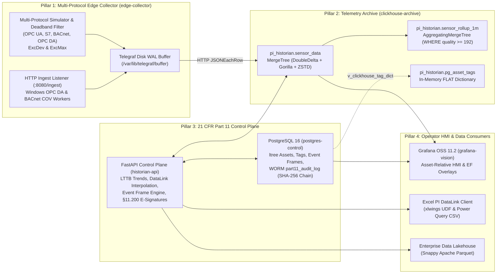

GxPHistorian strictly separates **immutable high-frequency time-series storage** (ClickHouse 24.8 LTS) from **mutable relational asset metadata, batch state, and cryptographic WORM audit logs** (PostgreSQL 16). This 4-Pillar separation eliminates the performance bottlenecks of relational historians while avoiding expensive ClickHouse `ALTER TABLE ... UPDATE/DELETE` mutations.

---

## 1. End-to-End Data Flow Diagram



---

## 2. Pillar 1: Multi-Protocol Edge Collector (`edge-collector`)

Pillar 1 replaces legacy *OSIsoft PI Interface Nodes* and the *PI Buffer Subsystem*:

1. **Multi-Protocol Normalization:**
   - All incoming field protocols (**OPC UA**, **Siemens S7**, **BACnet/IP (`COV`)**, **Modbus RTU/TCP**, **Windows COM OPC DA HTTP batches**, and **RS-232 / PI UFL watchfolders**) are normalized into the canonical 6-field telemetry tuple:
     `(tag_id, ts, val, str_val, quality, status_code)`.
2. **Stage 1 Exception / Deadband (`ExcDev` & `ExcMax`) + Optional Stage 2 Swinging Door (`CompDev` & `CompMax`):**
   - By default, GxPHistorian performs **Stage 1 Exception Filtering** in memory at the edge and archives every emitted sample losslessly in ClickHouse (`DoubleDelta` + `Gorilla` + `ZSTD(1)`):
     - Suppresses high-frequency ADC electrical noise when $|\text{val}_{\text{now}} - \text{val}_{\text{last\_emitted}}| < \text{exc\_dev}$ and $\Delta t < \text{exc\_max}$, provided `quality` has not changed.
     - Immediately emits any sample where `quality` transitions (e.g., `192` Good $\rightarrow$ `0` Bad) or when the heartbeat timer `exc_max` expires.
     - Discrete state tags (`is_step_tag = true`) and sparse at-line PAT analyzers set `exc_dev = 0.0` so every state transition and analytical sample is archived.
   - For legacy OSIsoft / AVEVA PI System migration qualification (`URS-021` / `OQ-16`), GxPHistorian also provides **Stage 2 Swinging Door Compression (`CompDev`, `CompMax`, `CompMin`)** in `edge-collector/scripts/multi_protocol_simulator.py` and `POST /api/v1/compression/swinging-door-evaluate`, maintaining upper/lower slope envelopes (`upper_slope`, `lower_slope`) from the last archived point and archiving the inflection precursor whenever slopes cross (`upper_slope < lower_slope`).
3. **Disk-Backed Store-and-Forward WAL (`URS-005`):**
   - Configured in `edge-collector/telegraf-clickhouse.conf`:
     ```toml
     [agent]
       buffer_strategy = "disk"
       buffer_directory = "/var/lib/telegraf/buffer"
       metric_buffer_limit = 1000000
       metric_batch_size = 1000
       flush_interval = "1s"
     ```
   - If the Purdue Level 3 firewall or ClickHouse archive is unreachable during network maintenance, up to 1,000,000 telemetry samples are persisted safely to disk and flushed in chronological batches upon reconnection.

---

## 3. Pillar 2: Immutable Telemetry Archive (`clickhouse-archive`)

Pillar 2 uses **ClickHouse Server 24.8 LTS (`Apache-2.0`)** initialized via `init-clickhouse/01_telemetry_core.sql`.

### Raw Immutable Telemetry Table (`pi_historian.sensor_data`)

```sql
CREATE TABLE IF NOT EXISTS pi_historian.sensor_data
(
    tag_id UInt32 CODEC(Delta, ZSTD(1)),
    ts DateTime64(3, 'UTC') CODEC(DoubleDelta, ZSTD(1)),
    val Float64 CODEC(Gorilla, ZSTD(1)),
    str_val LowCardinality(String) DEFAULT '' CODEC(ZSTD(1)),
    quality UInt8 DEFAULT 192 CODEC(T64, ZSTD(1)),
    status_code UInt16 DEFAULT 0 CODEC(T64, ZSTD(1))
)
ENGINE = MergeTree()
PARTITION BY toYYYYMM(ts)
ORDER BY (tag_id, ts);
```

- **Why Lossless Codecs Instead of Swinging Door?**
  - `DoubleDelta` on `DateTime64(3, 'UTC')` exploits regular polling intervals ($\Delta(\Delta t) \approx 0$), compressing timestamps to ~1–2 bits per sample.
  - `Gorilla` XOR compression on `Float64` exploits small IEEE-754 mantissa changes between consecutive sensor readings, layered with `ZSTD(1)` block compression.
  - Every archived point is **100% mathematically lossless**—eliminating the regulatory risk of synthetic straight-line approximations across critical process excursions.

### Real-Time 1-Minute Rollups (`pi_historian.sensor_rollup_1m`)

An `AggregatingMergeTree` table populated synchronously on insert by `mv_sensor_rollup_1m` pre-computes `avgState`, `minState`, `maxState`, `stddevPopState`, `argMinState` (`first_val`), `argMaxState` (`last_val`), and `countState` strictly over **Good OPC quality (`WHERE quality >= 192`)**.

### In-Memory PostgreSQL Asset & Tag Dictionary (`pi_historian.pg_asset_tags`)

ClickHouse maintains an in-memory `FLAT()` dictionary backed directly by PostgreSQL's `v_clickhouse_tag_dict` view (`LIFETIME(MIN 5 MAX 15)`). Analytical queries enrich `tag_id` with `tag_name`, `asset_path`, `eng_units`, `is_step_tag`, `low_limit`, and `high_limit` in $O(1)$ RAM lookup time (`dictGet('pi_historian.pg_asset_tags', 'eng_units', toUInt64(tag_id))`) without cross-engine SQL joins.

---

## 4. Pillar 3: 21 CFR Part 11 Control Plane (`postgres-control` + `historian-api`)

Pillar 3 combines **PostgreSQL 16** (`ltree`, `btree_gist`, `pgcrypto`) and the **FastAPI Control Plane (`app/main.py` & `app/pi_parity_engine.py`)**:

- **ISA-95 Asset Hierarchy & AF Template Auto-Instantiation (`assets`, `asset_templates`, `digital_state_sets`):**
  - Uses PostgreSQL `ltree` paths (e.g., `BioCorp.Fremont.USP.Bioreactor_201`) indexed with `GiST` (`idx_assets_asset_path_gist`) for subtree queries (`asset_path <@ 'BioCorp.Fremont.USP'`).
  - Supports one-call PI AF Template auto-instantiation (`POST /api/v1/assets/instantiate-template`), canonical UOM conversion (`/api/v1/af/uom/convert`), and PI Digital State Sets (`/api/v1/af/digital-state-sets`).
- **Tag Catalog (`tags`) & Manual Logger (`manual_logger_entries`):**
  - Stores engineering units (`eng_units`), interpolation discipline (`is_step_tag`), Stage 1 exception deadband (`exc_dev`, `exc_max_seconds`), Stage 2 Swinging Door tolerances (`comp_dev`, `comp_max_seconds`, `comp_min_seconds`), alarm limits (`low_limit`, `high_limit`), and protocol source configuration.
  - Provides a 21 CFR Part 11 Manual Logger (`POST /api/v1/manual-logger/entries`) that records attributed offline lab/logbook entries in PostgreSQL and dual-writes them into ClickHouse `pi_historian.sensor_data`.
- **GxP Calculation Engine (`/api/v1/analytics/*`) & Golden Batch Overlay (`/api/v1/batches/compare`):**
  - Computes ICH Q1A Mean Kinetic Temperature ($\text{MKT}$), USP `<1229>` Steam Sterilization Lethality ($F_0$), Western Electric Statistical Process Control (`SQC`), and relative elapsed-hour (`T+0.0h`) Golden Batch trajectory alignment (`mean ± 2 SD`).
- **ISA-88 Event Frame Engine (`event_frames`, `event_frame_signatures`) & PI Notifications (`notification_rules`, `notification_deliveries`):**
  - Detects process excursions and batch phases against ClickHouse `quality >= 192` telemetry, supports historical backfill with `TrueFor` debounce (`POST /api/v1/event-frames/backfill`), hierarchical parent/child batch phases (`parent_event_id`), multi-stage `§11.200` dual-challenge electronic signatures, and audit-logged webhook/email notification rules.
- **21 CFR Part 11 WORM Audit Log (`part11_audit_log`):**
  - Enforces mandatory `app.actor_id` and `app.change_reason` session context across all 10 GxP tables, SHA-256 cryptographic hash chaining, and unconditional `BEFORE UPDATE OR DELETE OR TRUNCATE` immutability triggers.

---

## 5. Pillar 4: Operator HMI, Excel DataLink & Lakehouse (`grafana-vision`)

- **Grafana OSS 11.2 (`grafana-vision`):** Auto-provisioned with ClickHouse and PostgreSQL datasources and the **GxPHistorian GxP Bioreactor & Cleanroom HMI** dashboard (`gxphistorian_bioreactor_hmi.json`).
- **GxPHistorian DataLink for Microsoft Excel & StreamSets:** Provides zero-plugin native Excel Power Query CSV streams, bulk multi-tag StreamSets (`/api/v1/streamsets/end`, `/api/v1/streamsets/interpolated`), and all 8 `xlwings` worksheet functions (`=GXPHISTORIAN_SAMPLED`, `=GXPHISTORIAN_PLOT_VALUES`, `=GXPHISTORIAN_EVENT_SUMMARY`, `=GXPHISTORIAN_CURRENT_VALUE`, `=GXPHISTORIAN_ARCHIVE_VALUE`, `=GXPHISTORIAN_COMPRESSED_DATA`, `=GXPHISTORIAN_CALCULATED_DATA`, `=GXPHISTORIAN_TIME_FILTER`).
- **Zero-ETL Apache Parquet Lakehouse Exporter:** Exports Snappy-compressed `.parquet` files enriched with ISA-95 `asset_path` and `eng_units` for downstream AI/ML and MSAT analytics.
