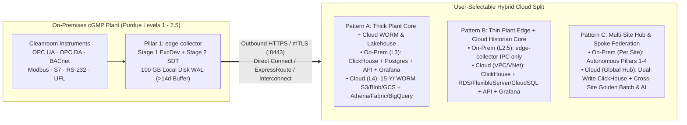

**Architecting and Qualifying GxPHistorian Across On-Premises OT (Purdue Levels 1–2.5/3) and Cloud VPC/VNet Environments in Amazon Web Services, Microsoft Azure, and Google Cloud**


---

## 1. Why Hybrid Cloud (Not 100% Cloud-Only) Is Mandatory in cGMP Manufacturing

In regulated pharmaceutical, biotech, and cell/gene therapy manufacturing (**FDA 21 CFR Part 11**, **EU GMP Annex 11**, and **ISA-95 / IEC 62443 Purdue Model**), attempting to poll cleanroom equipment directly from a public cloud region without an on-premises edge layer fails both **engineering physics** and **GMP data integrity mandates**:

1. **Non-Routable Layer 2 / Localhost Industrial Protocols:**
   - Cleanroom skids and lab instruments communicate over protocols that cannot (and must never) traverse a WAN router directly to the cloud:
     - **BACnet/IP (`UDP :47808`)** relies on local subnet broadcasts (`Who-Is` / `I-Am` / `SubscribeCOV`).
     - **Classic Windows OPC DA 2.05a** (used by Cytiva UNICORN™ 7 and legacy Emerson DeltaV™ stations) uses local Microsoft COM (`opcda_windows_forwarder.py`).
     - **Siemens S7comm (`TCP :102`)** and **Modbus TCP (`TCP :502`)** lack native transport encryption or user authentication.
     - **RS-232 Serial (`MT-SICS` Balances)** and **Watch-Folder Flat Files (`PI UFL`)** exist on isolated cleanroom VLANs.
2. **Zero-Data-Loss Autonomy During WAN Outages (`URS-005` / ALCOA+ Contemporaneous & Complete):**
   - A 14-day perfusion bioreactor campaign or a 72-hour lyophilization cycle cannot lose GMP batch records if a backhoe severs the facility's fiber-optic ISP link or a cloud VPN tunnel re-keys.
   - Therefore, **Pillar 1 (`edge-collector`) ALWAYS runs on-premises at Purdue Level 2 / 2.5**, normalizing all field protocols into the canonical 6-field tuple `(tag_id, ts, val, str_val, quality, status_code)`, executing Stage 1 Exception/Deadband (`ExcDev`/`ExcMax`) and optional Stage 2 Swinging Door (`CompDev`/`CompMax`) filtering in memory, and persisting up to **100 GB (>14 days for 25,000 tags)** in its local disk-backed Write-Ahead Log (`/var/lib/telegraf/buffer`).

Because GxPHistorian cleanly decouples **Pillar 1 (Edge Collector)** from **Pillar 2 (ClickHouse Archive)**, **Pillar 3 (PostgreSQL 16 + FastAPI + MCP Control Plane)**, and **Pillar 4 (Grafana HMI, Excel DataLink & Parquet Lakehouse)**, organizations can choose the exact hybrid boundary between their plant floor and **AWS**, **Microsoft Azure**, or **Google Cloud (GCP)**.

---

## 2. Three Selectable Hybrid Cloud Topologies



| Hybrid Pattern | On-Premises Footprint (Plant OT) | Cloud Footprint (AWS / Azure / GCP) | WAN Outage Behavior & Ideal Use Case |
| :--- | :--- | :--- | :--- |
| **Pattern A: Thick Plant Core + Cloud 15-Year WORM & Lakehouse** *(Recommended for Commercial cGMP Plants)* | **All 4 Pillars (`edge-collector`, `clickhouse-archive` 10-yr hot NVMe, `postgres-control`, `historian-api`, `gxphistorian-mcp`, `grafana-vision`)** run in Purdue Level 2.5 / Level 3 on-premises. | • **15-Year WORM Cold Tier** (`ClickHouse` tiered volume + `pgBackRest` PITR backups)<br>• **Zero-ETL Parquet Lakehouse** (`Athena`, `Fabric`, `BigQuery`) | **100% WAN-independent plant operation.** Cleanroom HMIs, Event Frame detection, and `§11.200` e-signatures work with zero internet/WAN connectivity. Cloud provides elastic 15-year `21 CFR 211.180` WORM retention and global MSAT analytics. |
| **Pattern B: Thin Plant Edge + Cloud Historian Core** *(Recommended for Clinical/Pilot Biotechs & Distributed Sites)* | **Pillar 1 (`edge-collector`) only** on dual fanless DIN-rail IPCs (`deploy/hybrid-cloud/docker-compose.edge-only.yml`) with a 100 GB local Disk WAL + Windows OPC DA sidecars. | **Pillars 2, 3 & 4** (`clickhouse-archive` or ClickHouse Cloud, Managed PostgreSQL 16, `historian-api`, `gxphistorian-mcp`, and `grafana-vision`) inside private cloud VPC/VNet. | **Zero database servers to maintain on-site.** If WAN drops, the Level 2.5 DIN-rail IPC buffers **$>14\text{ days}$** of telemetry on local pSLC NVMe and flushes chronologically when WAN recovers. |
| **Pattern C: Multi-Site Hub & Spoke Federation** *(Recommended for Global Multi-Site Enterprises & CDMOs)* | **Full Pillars 1–4 at each manufacturing site** (e.g., Fremont, Boston, Dublin) for local batch control + Telegraf dual-write (`deploy/hybrid-cloud/telegraf-hybrid-dualwrite.conf`). | **Global Enterprise Hub (Pillars 2–4)** aggregating all sites for cross-site Golden Batch overlays (`/api/v1/batches/compare`) and global AI investigations. | **Best of both worlds:** Every plant is 100% locally autonomous, while global MSAT and QA teams query a unified multi-site cloud historian and Lakehouse. |

---

## 3. Master Cloud Service Mapping Matrix (AWS vs. Azure vs. Google Cloud)

GxPHistorian is engineered without proprietary database lock-in:
- **Pillar 2 (`clickhouse-archive`)** uses standard ClickHouse 24.8 LTS (`Apache-2.0`) `MergeTree` and `AggregatingMergeTree` tables with built-in `<type>s3</type>` and `<type>azure_blob_storage</type>` virtual filesystems.
- **Pillar 3 (`postgres-control`)** uses standard PostgreSQL 16 `contrib` extensions (`ltree`, `btree_gist`, `pgcrypto`) and pure PL/pgSQL WORM triggers (`fn_enforce_part11_audit()`, `fn_prevent_audit_tampering()`) that run **unmodified** on managed cloud PostgreSQL services without requiring superuser OS filesystem access.

| GxPHistorian Subsystem | Amazon Web Services (AWS) | Microsoft Azure | Google Cloud (GCP) |
| :--- | :--- | :--- | :--- |
| **Pillar 1: Level 2.5 Edge Runtime (`edge-collector`)** | Fanless DIN-Rail IPC (`Docker`), **AWS IoT Greengrass v2**, or **AWS Outposts** 1U/2U rack server | Fanless DIN-Rail IPC (`Docker`), **Azure IoT Operations**, or **Azure Local (Stack HCI)** | Fanless DIN-Rail IPC (`Docker`) or **Google Distributed Cloud (GDC) Edge** |
| **Private OT-to-Cloud Transport (`21 CFR §11.30`)** | **AWS Site-to-Site VPN** / **AWS Direct Connect** + [AWS PrivateLink](https://aws.amazon.com/privatelink/) (`:8443` mTLS) | **Azure VPN Gateway** / **Azure ExpressRoute** + **Azure Private Link** (`:8443` mTLS) | **Cloud HA VPN** / **Dedicated Interconnect** + **Private Service Connect** (`:8443` mTLS) |
| **Pillar 2: `clickhouse-archive` Hot Tier** | • **Self-Managed:** EC2 `i4i.4xlarge` (Nitro NVMe) or `m7i.4xlarge` + EBS `gp3`/`io2`<br>• **Managed:** [ClickHouse Cloud](https://clickhouse.com/cloud) on AWS | • **Self-Managed:** Azure VM `Standard_L16s_v3` (NVMe) or `Standard_E16bs_v5` + **Premium SSD v2**<br>• **Managed:** [ClickHouse Cloud](https://clickhouse.com/cloud) on Azure | • **Self-Managed:** GCE `n2-standard-16` (Local SSD) or `c3-standard-22` + **Hyperdisk Extreme**<br>• **Managed:** [ClickHouse Cloud](https://clickhouse.com/cloud) on GCP |
| **Pillar 2 & 3: 15-Year WORM Cold Storage (`21 CFR 211.180`)** | [Amazon S3 Object Lock](https://aws.amazon.com/s3/features/object-lock/) (`COMPLIANCE` Mode, 15-Yr Retention) + **AWS KMS** CMK | [Azure Immutable Blob Storage](https://learn.microsoft.com/en-us/azure/storage/blobs/immutable-storage-overview) (Locked Time-Based Retention Policy) + **Azure Key Vault** | [Google Cloud Storage Bucket Lock](https://cloud.google.com/storage/docs/bucket-lock) (Locked Retention Policy, 15-Yr) + **Cloud KMS** |
| **Pillar 3: `postgres-control` Managed Relational & WORM Audit** | [Amazon RDS for PostgreSQL 16](https://aws.amazon.com/rds/postgresql/) (Multi-AZ) or **Amazon Aurora PostgreSQL** (`ltree`, `btree_gist`, `pgcrypto`) | [Azure Database for PostgreSQL — Flexible Server](https://azure.microsoft.com/en-us/products/postgresql) (Zone-Redundant HA, `ltree`, `btree_gist`, `pgcrypto`) | [Cloud SQL for PostgreSQL 16](https://cloud.google.com/sql/docs/postgres) (Enterprise Plus HA) or **AlloyDB for PostgreSQL** (`ltree`, `btree_gist`, `pgcrypto`) |
| **Pillar 3: `historian-api` & `gxphistorian-mcp` Compute** | **Amazon ECS on AWS Fargate** or **Amazon EKS** behind Internal ALB | **Azure Container Apps** (VNet-Injected) or **Azure Kubernetes Service (AKS)** | **Google Cloud Run** (Internal VPC Ingress) or **GKE Autopilot** |
| **Pillar 3: Private GxP AI Model (`gxp_ai_agent.py`)** | [Amazon Bedrock](https://aws.amazon.com/bedrock/) (`anthropic.claude-sonnet-4` / `amazon.nova-pro` via VPC Endpoint) | [Azure OpenAI Service](https://azure.microsoft.com/en-us/products/ai-services/openai-service) (`gpt-4o` via Private Link) | [Google Cloud Vertex AI](https://cloud.google.com/vertex-ai) (`gemini-2.5-flash` / `gemini-2.5-pro` via Private Service Connect) |
| **Pillar 4: `grafana-vision` & Zero-ETL Lakehouse** | **Amazon Managed Grafana** + **AWS Glue Data Catalog** + **Amazon Athena** / **Redshift Spectrum** | **Azure Managed Grafana** (Entra ID) + **Microsoft Fabric OneLake** / **Azure Synapse** / **Databricks** | Grafana on Cloud Run behind **Cloud IAP** + [BigQuery BigLake](https://cloud.google.com/bigquery/docs/omni-introduction) External Parquet Tables |

---

## 4. Amazon Web Services (AWS) Hybrid Implementation Guide

### Step 1: Provision the 15-Year WORM S3 Bucket (`COMPLIANCE` Mode)

Create an Amazon S3 bucket with **S3 Object Lock** enabled in `COMPLIANCE` mode (which prevents even the AWS Account Root user from deleting or overwriting archived telemetry or `pgBackRest` audit logs before the 15-year retention period expires):

```bash
aws s3api create-bucket \
  --bucket biocorp-gxphistorian-worm-15yr \
  --region us-east-1 \
  --object-lock-enabled-for-bucket

aws s3api put-object-lock-configuration \
  --bucket biocorp-gxphistorian-worm-15yr \
  --object-lock-configuration '{
    "ObjectLockEnabled": "Enabled",
    "Rule": {
      "DefaultRetention": {
        "Mode": "COMPLIANCE",
        "Years": 15
      }
    }
  }'
```

Mount `deploy/hybrid-cloud/clickhouse-tiered-storage/aws_s3_worm.xml` to `/etc/clickhouse-server/config.d/tiered_storage.xml` on your ClickHouse instance (on-premises in **Pattern A** or EC2 in **Pattern B/C**):

```xml
<clickhouse>
  <storage_configuration>
    <disks>
      <hot_nvme>
        <path>/var/lib/clickhouse/</path>
        <keep_free_space_bytes>1099511627776</keep_free_space_bytes>
      </hot_nvme>
      <cold_worm_s3>
        <type>s3</type>
        <endpoint>https://s3.us-east-1.amazonaws.com/biocorp-gxphistorian-worm-15yr/telemetry/</endpoint>
        <use_environment_credentials>true</use_environment_credentials>
        <metadata_path>/var/lib/clickhouse/disks/cold_worm_s3/</metadata_path>
        <cache_enabled>true</cache_enabled>
        <data_cache_max_size>107374182400</data_cache_max_size>
      </cold_worm_s3>
    </disks>
    <policies>
      <gxp_10yr_nvme_15yr_worm>
        <volumes>
          <hot_volume><disk>hot_nvme</disk></hot_volume>
          <cold_volume><disk>cold_worm_s3</disk></cold_volume>
        </volumes>
        <move_factor>0.2</move_factor>
      </gxp_10yr_nvme_15yr_worm>
    </policies>
  </storage_configuration>
</clickhouse>
```

### Step 2: Configure Amazon RDS for PostgreSQL 16 & ECS Fargate (`Pattern B / C`)

1. Provision a Multi-AZ **Amazon RDS for PostgreSQL 16** (`db.m7g.xlarge` or `db.r7g.xlarge` with `gp3` Encrypted Storage) in an isolated database subnet.
2. Apply `init-postgres/01_control_plane_part11.sql` (`ltree`, `btree_gist`, and `pgcrypto` are pre-installed in RDS PostgreSQL 16).
3. Configure `historian-api` and `gxphistorian-mcp` on **Amazon ECS Fargate** with TLS enforcement and **Amazon Bedrock** private AI inference:

```ini
PG_HOST=gxp-postgres.cluster-xxxx.us-east-1.rds.amazonaws.com
PG_PORT_INTERNAL=5432
PG_SSLMODE=verify-full
CH_HOST=clickhouse-internal.biocorp.aws.internal
CH_PORT_INTERNAL=8443
CH_SECURE=true
GXPHISTORIAN_AI_MODEL=bedrock:anthropic.claude-3-5-sonnet-20241022-v2:0
GXPHISTORIAN_USE_LIVE_LLM=1
```

### Step 3: Query Snappy Parquet Exports in Amazon Athena

When `POST /api/v1/lakehouse/export-parquet` writes Snappy-compressed Parquet files to S3, register the external table in **AWS Glue / Amazon Athena** for zero-ETL MSAT analytics:

```sql
CREATE EXTERNAL TABLE IF NOT EXISTS gxp_lakehouse.sensor_telemetry (
  tag_id INT,
  tag_name STRING,
  asset_path STRING,
  eng_units STRING,
  ts TIMESTAMP,
  val DOUBLE,
  str_val STRING,
  quality INT
)
STORED AS PARQUET
LOCATION 's3://biocorp-gxphistorian-worm-15yr/lakehouse-parquet/';
```

---

## 5. Microsoft Azure Hybrid Implementation Guide

### Step 1: Provision Azure Immutable Blob Storage (Locked 15-Year Policy)

Create an **Azure Storage Account** with Version-Level Immutability Support and lock a **15-year (5,478-day) time-based retention policy**:

```bash
az storage account create \
  --name biocorpgxpworm15yr \
  --resource-group rg-gxp-historian-prod \
  --location eastus2 \
  --sku Standard_ZRS \
  --kind StorageV2 \
  --enable-hierarchical-namespace false

az storage container create \
  --account-name biocorpgxpworm15yr \
  --name gxphistorian-telemetry-worm \
  --enable-vlw true

az storage container immutability-policy create \
  --account-name biocorpgxpworm15yr \
  --container-name gxphistorian-telemetry-worm \
  --period 5478 \
  --allow-protected-append-writes true
```

Mount `deploy/hybrid-cloud/clickhouse-tiered-storage/azure_blob_worm.xml` on your ClickHouse node to tier partitions older than 10 years directly to Azure Immutable Blob Storage using `<type>azure_blob_storage</type>` and Azure Managed Identity (`<use_managed_identity>true</use_managed_identity>`).

### Step 2: Configure Azure Database for PostgreSQL — Flexible Server (`Pattern B / C`)

Allow-list the three standard PostgreSQL extensions required by GxPHistorian (`ltree`, `btree_gist`, `pgcrypto`) on your Zone-Redundant **Azure Database for PostgreSQL Flexible Server**:

```bash
az postgres flexible-server parameter set \
  --resource-group rg-gxp-historian-prod \
  --server-name gxp-postgres-prod \
  --name azure.extensions \
  --value "ltree,btree_gist,pgcrypto"
```

Configure `historian-api` and `gxphistorian-mcp` in **Azure Container Apps** (VNet-injected) or **AKS**:

```ini
PG_HOST=gxp-postgres-prod.postgres.database.azure.com
PG_PORT_INTERNAL=5432
PG_SSLMODE=verify-full
CH_HOST=clickhouse-internal.biocorp.azure.internal
CH_PORT_INTERNAL=8443
CH_SECURE=true
GXPHISTORIAN_AI_MODEL=openai:gpt-4o
```

### Step 3: Query Parquet Telemetry in Microsoft Fabric OneLake & Azure Synapse

Create an **ADLS Gen2 OneLake Shortcut** in **Microsoft Fabric** or query directly via **Azure Synapse Serverless SQL Pool**:

```sql
SELECT
    tag_name,
    asset_path,
    AVG(val) AS avg_val,
    MIN(val) AS min_val,
    MAX(val) AS max_val
FROM OPENROWSET(
    BULK 'https://biocorpgxpworm15yr.dfs.core.windows.net/gxphistorian-lakehouse/*.parquet',
    FORMAT = 'PARQUET'
) AS telemetry
WHERE quality >= 192
GROUP BY tag_name, asset_path;
```

---

## 6. Google Cloud (GCP) Hybrid Implementation Guide

### Step 1: Provision Google Cloud Storage with Bucket Lock (15-Year Locked Policy)

Create a dual-region **Google Cloud Storage** bucket encrypted with a **Cloud KMS** Customer-Managed Encryption Key (CMEK) and lock a 15-year (`473,364,000` seconds) retention policy:

```bash
gcloud storage buckets create gs://biocorp-gxphistorian-worm-15yr \
  --location=us \
  --uniform-bucket-level-access \
  --retention-period=473364000s

# Permanently lock the 15-year WORM retention policy (irreversible per 21 CFR §11.10(c))
gcloud storage buckets update gs://biocorp-gxphistorian-worm-15yr \
  --lock-retention-period
```

Mount `deploy/hybrid-cloud/clickhouse-tiered-storage/gcp_gcs_worm.xml` on your ClickHouse node to tier historical partitions to GCS via Google Cloud Storage's S3-interoperable XML endpoint (`https://storage.googleapis.com/biocorp-gxphistorian-worm-15yr/telemetry/`).

### Step 2: Configure Cloud SQL for PostgreSQL 16 & Cloud Run / GKE (`Pattern B / C`)

1. Provision a Regional HA **Cloud SQL for PostgreSQL 16** (Enterprise Plus edition) instance with a Private Service Connect IP (`10.128.0.15`) and apply `init-postgres/01_control_plane_part11.sql`.
2. Deploy `historian-api` and `gxphistorian-mcp` on **Google Cloud Run** (with Direct VPC Egress and `--ingress=internal`) wired to **Vertex AI (`Gemini 2.5`)**:

```ini
PG_HOST=10.128.0.15
PG_PORT_INTERNAL=5432
PG_SSLMODE=verify-ca
CH_HOST=clickhouse-internal.biocorp.gcp.internal
CH_PORT_INTERNAL=8443
CH_SECURE=true
GXPHISTORIAN_AI_MODEL=google-vertex:gemini-2.5-flash
GXPHISTORIAN_USE_LIVE_LLM=1
```

### Step 3: Register BigQuery BigLake External Parquet Table

Expose exported Snappy Parquet files in **BigQuery BigLake** for enterprise SQL and **Vertex AI Workbench** Golden Batch modeling:

```sql
CREATE EXTERNAL TABLE IF NOT EXISTS `biocorp-gxp.lakehouse.sensor_telemetry`
WITH CONNECTION `biocorp-gxp.us.biglake-gcs-conn`
OPTIONS (
  format = 'PARQUET',
  uris = ['gs://biocorp-gxphistorian-worm-15yr/lakehouse-parquet/*.parquet']
);
```

---

## 7. Deploying On-Premises Edge Collectors (`Pattern B` & `Pattern C`)

### A. Pattern B: Thin Edge Collector Stack (`deploy/hybrid-cloud/docker-compose.edge-only.yml`)

On your Purdue Level 2.5 fanless DIN-rail Industrial PC (e.g., Advantech UNO-2484G or OnLogic Karbon 800), run **only** Pillar 1 (`edge-collector`) with a 100 GB local NVMe WAL pointing outbound over HTTPS (`:8443`) to your AWS, Azure, or GCP ClickHouse endpoint:

```bash
export CH_USER="historian_admin"
export CH_PASSWORD="Your_Cloud_ClickHouse_Password!"
export CH_INGEST_URL="https://clickhouse-internal.biocorp.cloud.internal:8443/?query=INSERT%20INTO%20pi_historian.sensor_data%20FORMAT%20JSONEachRow"

docker compose -f deploy/hybrid-cloud/docker-compose.edge-only.yml up -d
```

### B. Pattern C: Multi-Site Hub & Spoke Dual-Write (`deploy/hybrid-cloud/telegraf-hybrid-dualwrite.conf`)

For multi-site enterprises running both a local Purdue Level 3 plant historian and a global cloud aggregator, mount `deploy/hybrid-cloud/telegraf-hybrid-dualwrite.conf` into `edge-collector`. Telegraf maintains two independent `[[outputs.http]]` queues (`onprem_level3_clickhouse` and `cloud_enterprise_clickhouse_hub`) so a cloud WAN maintenance window never delays local cleanroom data ingestion.

### C. Programmatic Blueprint & Readiness API (`GET /api/v1/cloud/hybrid-blueprints`)

You can query `historian-api` at runtime to retrieve validated ClickHouse WORM XML policies, environment profiles, and Lakehouse DDL for any cloud provider (`aws`, `azure`, `gcp`) and topology (`pattern_a_worm_lakehouse`, `pattern_b_cloud_core`, `pattern_c_hub_spoke`):

```bash
curl -s "http://localhost:8020/api/v1/cloud/hybrid-blueprints?provider=aws&pattern=pattern_b_cloud_core" | jq .
```

---

## 8. 21 CFR Part 11, EU Annex 11 & ISPE GAMP 5 Cloud Qualification Checklist

When qualifying a hybrid deployment under **ISPE GAMP 5 (Second Edition)** and **EU GMP Annex 11 (Section 4.3 — Cloud / IT Supplier Management)**, document the following Shared Responsibility controls in your site Validation Master Plan (`VMP`):

| Regulatory Requirement | Cloud Provider Responsibility (IaaS / PaaS) | Regulated User / GxPHistorian Technical Control |
| :--- | :--- | :--- |
| **`21 CFR §11.30` — Controls for Open Systems** (Authenticity, integrity, and confidentiality of records transmitted over WAN) | Physical fiber security, Direct Connect / ExpressRoute / Interconnect colocation security, and FIPS 140-3 cryptographic modules. | • Outbound-only `TLS 1.3` / mutual TLS (`mTLS`) from Purdue Level 2.5 `edge-collector` (`:8443`) and `PG_SSLMODE=verify-full`.<br>• Zero inbound firewall ports opened into the cleanroom OT network. |
| **`21 CFR §11.10(e)` & ALCOA+ — Contemporaneous & Complete Capture During Network Loss** | Regional VPC/VNet availability and Multi-AZ load balancer failover. | • Local 100 GB Telegraf Disk WAL (`/var/lib/telegraf/buffer`) on industrial pSLC NVMe at Purdue Level 2.5.<br>• Buffers $>14\text{ days}$ of 25,000 tags with original equipment timestamps (`DateTime64(3, 'UTC')`). |
| **`21 CFR §11.10(e)` — Tamper-Evident WORM Audit Trail** | Managed PostgreSQL (`RDS`, `Azure Flexible Server`, `Cloud SQL`) underlying storage durability and automated encrypted backups. | • Database-enforced PL/pgSQL triggers (`fn_enforce_part11_audit()` and `fn_prevent_audit_tampering()`) blocking `UPDATE`/`DELETE`/`TRUNCATE` even by DB superusers.<br>• Cryptographic `SHA-256` hash chain verified via `GET /api/v1/audit-trail/verify`. |
| **`21 CFR 211.180` & `EU Annex 11 §17` — 15-Year Immutable Batch & Telemetry Archiving** | Hardware-enforced object immutability (`AWS S3 Object Lock COMPLIANCE`, `Azure Locked Immutability Policy`, `GCP Locked Bucket Retention`). | • ClickHouse multi-volume storage policy (`<move_factor>0.2</move_factor>` and `TTL ... TO VOLUME 'cold_volume'`) moving aged partitions to WORM object storage without `DELETE`. |
| **`EU Annex 11 §4.3` & `GAMP 5` — Cloud Supplier Assessment & Data Residency** | SOC 1/2/3, ISO/IEC 27001, ISO/IEC 27017/27018, and GxP Qualification packs (AWS GxP, Azure GxP, Google Cloud GxP). | • Pin all cloud resources, WORM buckets, and private AI endpoints (`Bedrock`, `Azure OpenAI`, `Vertex AI`) to approved sovereign/regional jurisdictions (e.g., `us-east-1`, `eu-central-1`). |

---

## 9. GxPHistorian Cloud Commercial Editions & Transparent Pricing

While the **GxPHistorian Open-Source Core (`MIT`)** is 100% free forever for self-managed deployments, regulated biotech and pharmaceutical organizations frequently prefer a **turnkey, pre-validated cloud control plane** backed by a signed **EU GMP Annex 11 §4.3 Quality Technical Agreement (QTA)**, version-pinned **Change-Controlled Release Channels (`2026.Q4-LTS`)**, and **Unlimited Grafana Vision HMI & Excel DataLink seats (\$0 per-seat tax)**.

### Dual-Track Commercial Delivery Model

| Commercial Edition | Architecture & Cloud Residency | Included Capacity | Annual Subscription | Ideal Regulated Buyer |
| :--- | :--- | :--- | :--- | :--- |
| **1. GxPHistorian Cloud — Lab & PD** (`GXP-CLOUD-LAB-2K5`) | **Managed Single-Tenant Cloud (`Pattern B`):** Dedicated isolated VPC managed by Saram Consulting + 1 Purdue L2.5 Edge Collector | Up to **2,500 active tags** · 1 Site · **Unlimited Users** · 3-Yr Hot NVMe + 15-Yr WORM Archive · Automated IQ/OQ Sandbox Binder | **\$18,000 / yr** *(\$1,500 / mo)* | Process Development (PD), Analytical Development, and Pre-Clinical Biotech Labs |
| **2. GxPHistorian Cloud — Clinical & Pilot cGMP** (`GXP-CLOUD-CLINICAL-25K`) | **Managed Single-Tenant Cloud (`Pattern B`):** Dedicated Multi-AZ VPC + 2 Redundant Purdue L2.5 Edge Collectors (`>14-day` Disk WAL) | Up to **25,000 active tags** · 1 Site · **Unlimited Users** · 10-Yr Hot NVMe + 15-Yr WORM · Okta / Entra ID `§11.200` SSO · **Signed EU Annex 11 §4.3 QTA** & Change-Controlled IQ/OQ Releases | **\$54,000 / yr** *(\$4,500 / mo)* | Phase I–III Clinical Manufacturing Plants, Cell & Gene Therapy (CAR-T / mRNA) Suites, and Nimble CDMOs |
| **3. GxPHistorian Cloud — Commercial cGMP & Enterprise Hub (BYOC)** (`GXP-CLOUD-BYOC-100K`) | **Bring Your Own Cloud (`Pattern B & C`):** Deployed directly inside the **Customer's AWS / Azure / GCP VPC** via Cloud Marketplace with Customer-Managed KMS Keys (`CMK`/`CMEK`) | Up to **100,000 active tags** (up to 3 Sites) · **Unlimited Global Users** · Cross-Site Golden Batch Hub · Private Bedrock / Azure OpenAI / Vertex AI Co-Pilot · Zero-ETL Lakehouse · Annual QA Supplier Audit Rights | **\$150,000 / yr** *(\$12,500 / mo — 100% AWS EDP / Azure MACC / GCP Commit eligible)* | Commercial Biomanufacturing Facilities, Mid-to-Large Pharma, and Multi-Site Global CDMOs |
| **Add-On: Pre-Qualified GxPHistorian Edge Box** (`GXP-EDGE-BOX-L25`) | **Plug-and-Play Purdue Level 2.5 Appliance:** Fanless DIN-rail IPC (`Advantech UNO-2484G` or `OnLogic Karbon 800`, 512 GB pSLC NVMe, Dual Isolated LAN) | Pre-flashed with `edge-collector`, 100 GB Telegraf Disk WAL (`>14-day` autonomy), outbound mTLS (`:8443`), and **Factory-Executed FAT/IQ Certificate** | **\$3,500 hardware** + **\$2,500 / yr Fleet Care** | Cleanroom suites requiring zero-IT shop-floor commissioning |

---

## 10. Cloud Edge Fleet Enrollment & TCO Calculator REST APIs

### A. Enroll & Monitor Purdue Level 2.5 Edge Collectors (`POST /api/v1/cloud/edge-agents/heartbeat`)

Every Purdue Level 2.5 `edge-collector` node (or pre-qualified **GxPHistorian Edge Box**) reports its 100 GB Telegraf Disk WAL utilization, active field protocols, and outbound mTLS certificate expiration to the control plane with mandatory **21 CFR Part 11 attribution (`X-Actor-Id` & `X-Change-Reason`)**:

```bash
curl -s -X POST "http://localhost:8020/api/v1/cloud/edge-agents/heartbeat" \
  -H "Content-Type: application/json" \
  -H "X-Actor-Id: operator_01" \
  -H "X-Change-Reason: Enroll Purdue L2.5 DIN-Rail Edge Box for USP Suite 201" \
  -d '{
    "agent_id": "edge-fremont-usp-01",
    "site_path": "BioCorp.Fremont.USP.Bioreactor_201",
    "hardware_model": "Advantech UNO-2484G (512GB pSLC NVMe)",
    "deployment_pattern": "pattern_b_cloud_core",
    "cloud_provider": "aws",
    "wal_buffer_used_gb": 1.25,
    "wal_buffer_capacity_gb": 100.0,
    "active_tag_count": 25000,
    "mtls_cert_days_remaining": 84,
    "wan_link_status": "CONNECTED_MTLS_8443"
  }' | jq .
```

To inspect all enrolled Edge Collectors and verify `URS-005` ($>14\text{-day}$ WAN outage autonomy) compliance across your fleet:

```bash
curl -s "http://localhost:8020/api/v1/cloud/edge-agents" | jq .
```

### B. Programmatic Cloud Sizing & AVEVA PI TCO Savings Calculator (`GET /api/v1/cloud/tco-calculator`)

Compute 10-year Hot NVMe + 15-year WORM S3/Blob/GCS storage requirements, get an automated SKU recommendation, and compare 1-year and 3-year Total Cost of Ownership (TCO) against legacy per-tag/per-seat historians (`AVEVA PI Flex` + manual CSV consulting):

```bash
curl -s "http://localhost:8020/api/v1/cloud/tco-calculator?active_tags=25000&named_users=50&site_count=1&cloud_provider=aws" | jq .
```


