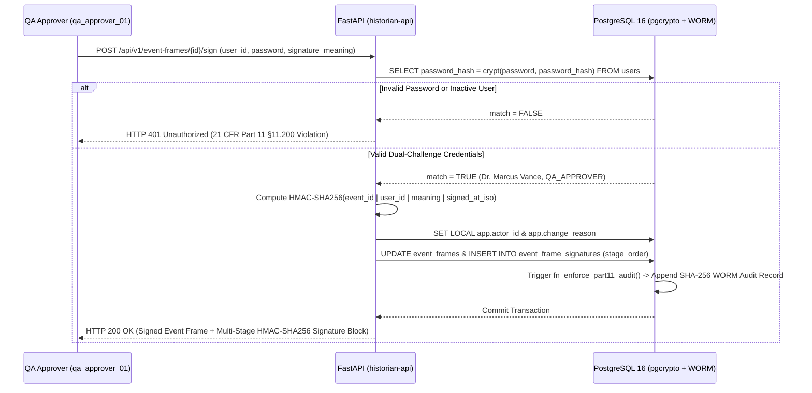

GxPHistorian implements regulatory data integrity controls directly inside the database kernel (**PostgreSQL 16 PL/pgSQL triggers & `pgcrypto`**) and the telemetry query layer (**ClickHouse `WHERE quality >= 192`**), ensuring that compliance cannot be bypassed by application bugs or unattributed SQL sessions.

---

## 1. Mandatory Attribution Context (`21 CFR §11.10(e)` / ALCOA+ Attributable)

Every `INSERT`, `UPDATE`, or `DELETE` on all 10 GxP configuration and state tables (`asset_templates`, `assets`, `tags`, `event_frames`, `digital_state_sets`, `event_frame_templates`, `event_frame_signatures`, `manual_logger_entries`, `notification_rules`, and `notification_deliveries`) is intercepted by the PostgreSQL trigger function `fn_enforce_part11_audit()`.

1. **Session Context Enforcement:**
   - Before executing any DML statement, the transaction must bind `app.actor_id` and `app.change_reason` using `SET LOCAL` (or `set_config(..., true)`):
     ```sql
     SET LOCAL app.actor_id = 'operator_01';
     SET LOCAL app.change_reason = 'Provision Dissolved Oxygen sensor for Bioreactor 201';
     ```
   - In `historian-api`, the helper `apply_part11_context()` extracts the mandatory `X-Actor-Id` and `X-Change-Reason` HTTP headers and binds them to the active PostgreSQL transaction.
2. **Kernel-Level Rejection of Unattributed Mutations (`URS-006` / `OQ-01`):**
   - If either `app.actor_id` or `app.change_reason` is missing or empty, PostgreSQL immediately aborts the transaction:
     ```sql
     IF v_actor IS NULL OR v_reason IS NULL THEN
         RAISE EXCEPTION '21 CFR Part 11 Violation: app.actor_id and app.change_reason are mandatory';
     END IF;
     ```

---

## 2. Write-Once-Read-Many (WORM) Audit Trail Immutability (`21 CFR §11.10(e)`)

The `part11_audit_log` table records `recorded_at`, `actor_id`, `change_reason`, `target_table`, `record_pk`, `operation`, `old_payload` (`JSONB`), `new_payload` (`JSONB`), `prev_hash`, and `row_hash`.

To prevent tampering—even by a privileged database superuser—two triggers (`trg_worm_part11_audit_log_stmt` and `trg_worm_part11_audit_log_row`) execute `fn_prevent_audit_tampering()` before any `UPDATE`, `DELETE`, or `TRUNCATE` (`URS-007` / `OQ-02`):

```sql
CREATE OR REPLACE FUNCTION fn_prevent_audit_tampering()
RETURNS TRIGGER
LANGUAGE plpgsql
AS $$
BEGIN
    RAISE EXCEPTION '21 CFR Part 11 WORM Violation: Audit trail records are immutable';
END;
$$;

CREATE TRIGGER trg_worm_part11_audit_log_stmt
BEFORE UPDATE OR DELETE OR TRUNCATE ON part11_audit_log
FOR EACH STATEMENT EXECUTE FUNCTION fn_prevent_audit_tampering();

CREATE TRIGGER trg_worm_part11_audit_log_row
BEFORE UPDATE OR DELETE ON part11_audit_log
FOR EACH ROW EXECUTE FUNCTION fn_prevent_audit_tampering();
```

---

## 3. Cryptographic SHA-256 Audit Hash Chaining (`ALCOA+ Original & Enduring`)

Every row inserted into `part11_audit_log` is cryptographically chained to the immediately preceding audit record (`URS-010` / `OQ-05`):

1. **Genesis Anchor:**
   - The first record in `part11_audit_log` anchors to `prev_hash = 'GENESIS_0000000000000000'`.
2. **Row Digest Formula:**
   - Each subsequent row fetches the prior row's `row_hash` as `prev_hash` and computes:
     $$\text{row\_hash} = \text{SHA256}\!\left(\text{prev\_hash} \parallel \text{recorded\_at} \parallel \text{actor\_id} \parallel \text{operation} \parallel \text{coalesce}(\text{new\_payload}, \text{''})\right)$$
   - In PL/pgSQL (`pgcrypto`):
     ```sql
     v_row_hash := encode(
         digest(
             v_prev_hash || v_recorded_at::text || v_actor || TG_OP || COALESCE(v_new_payload::text, ''),
             'sha256'
         ),
         'hex'
     );
     ```
3. **On-Demand Chain Verification (`GET /api/v1/audit-trail/verify`):**
   - Iterates through all rows in `part11_audit_log` in ascending `audit_id` order, recomputes every SHA-256 digest in PostgreSQL, verifies `prev_hash` continuity from `GENESIS_0000000000000000`, and returns `"chain_valid": true` (`broken_links: 0`).

---

## 4. Dual-Challenge & Multi-Stage Electronic Signatures (`21 CFR §11.50`, `§11.70`, `§11.200`)

When a Quality Assurance reviewer, supervisor, or process operator signs an ISA-88 Event Frame via `POST /api/v1/event-frames/{event_id}/sign` (`URS-008`, `URS-009`, `URS-021` / `OQ-03`, `OQ-04`, `OQ-16`):



- **Signature Manifestation (`§11.50`):** Every signed Event Frame permanently records the printed name and user ID of the signer (`signed_by`), the UTC timestamp (`signed_at`), and the explicit meaning associated with the signature (`signature_meaning`, e.g., `"Excursion Investigation Reviewed"` or `"Batch Release Approval"`).
- **Signature / Record Linking (`§11.70`):** The cryptographic `signature_hash` (`HMAC-SHA256`) binds `event_id`, `user_id`, `signature_meaning`, and `signed_at` so a signature cannot be excised, copied, or transferred to falsify another record.
- **Multi-Stage Sequential Sign-Off (`event_frame_signatures`):** Supports sequential multi-role disposition workflows (Stage 1: `Operator Review` $\rightarrow$ Stage 2: `Supervisor Verification` $\rightarrow$ Stage 3: `QA Final Approval`), queryable via `GET /api/v1/event-frames/{event_id}/signatures` (`URS-021` / `OQ-16`).

---

## 5. OPC Signal Quality (`quality >= 192`) & Interpolation Discipline

### OPC Quality Codes (`URS-012` / `OQ-07`)

| OPC Quality Code | Classification | Archive Behavior (`sensor_data`) | Analytical / Rollup / DataLink Behavior |
| :--- | :--- | :--- | :--- |
| **`192`** (`0xC0`) | **Good** | Archived losslessly | Included in all 1m rollups, LTTB trends, Event Frame KPIs, and Excel DataLink queries. |
| **`64`** (`0x40`) | **Uncertain** | Archived for sensor diagnostics | Excluded (`WHERE quality >= 192`) from GMP analytical calculations and batch release KPIs. |
| **`0`** (`0x00`) | **Bad** (Sensor Fault / Wire Break) | Archived for maintenance diagnostics | Strictly excluded (`WHERE quality >= 192`) so sentinel values (e.g., `-999.0` or `9999.9`) never corrupt batch averages or peak excursion metrics. |

### Continuous (`LINEAR`) vs. Discrete (`LOCF` Step) Interpolation (`URS-013` / `OQ-08`)

- **Continuous Analog Tags (`is_step_tag = false`):**
  - Used for physical continuous parameters (`BR201_TEMP_PV`, `BR201_PH_PV`, `CR104_DIFF_PRESS`, `CHROM01_UV280_PV`).
  - Sampled DataLink queries compute time-weighted linear interpolation between bounding good-quality timestamps (`WITH FILL STEP ... INTERPOLATE`).
- **Discrete State & At-Line Assay Tags (`is_step_tag = true`):**
  - Used for discrete equipment states (`BR201_AGIT_STATE` = `0` Off, `1` Low, `2` High), ISA-88 recipe phases, and at-line PAT laboratory assays.
  - Sampled DataLink queries enforce **Last Observation Carried Forward (LOCF)** step interpolation so impossible fractional states (such as `1.5` between state `1` and `2`) are never synthesized.
