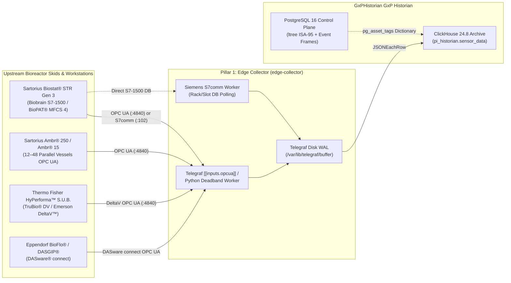

**Connecting Sartorius Biostat® STR, Sartorius Ambr® 15/250, Thermo Fisher HyPerforma™ (TruBio® DV), and Eppendorf BioFlo® / DASGIP® Systems to GxPHistorian GxP Industrial Historian**

> For **Cytiva Xcellerex™ X-Platform** bioreactors, see the dedicated guide: [XCELLEREX_X_PLATFORM_INTEGRATION.md](/docs/biopharma-integration/xcellerex-x-platform/).

---

## 1. Overview of Upstream Bioreactor Platforms

Upstream Processing (USP) seed trains, Process Development (PD) high-throughput screening, and GMP production vessels rely on four dominant bioreactor automation ecosystems alongside [Cytiva Figurate™](https://www.cytivalifesciences.com/en/us/solutions/bioprocessing/products-and-solutions/xcellerex):

1. **[Sartorius Biostat STR® (Gen 3)](https://www.sartorius.com/en/products/bioreactors-fermenters/single-use-bioreactors/biostat-str-generation-3-1110594) & Biostat® B-DCU:** Controlled by local **Biobrain / DCU-4** ([Siemens SIMATIC S7-1500 PLC](https://www.siemens.com)) and supervised by **[BioPAT® MFCS 4](https://www.sartorius.com/en/products/process-control-tools/biopat-mfcs-scada-software)** SCADA, exposing native **OPC UA** and **Siemens S7comm** interfaces.
2. **[Sartorius Ambr® 250 High Throughput](https://www.sartorius.com/en/products/bioreactors-fermenters/ambr-multi-parallel-bioreactors/ambr-250-modular-504778) & [Ambr® 15 Cell Culture](https://www.sartorius.com/en/products/bioreactors-fermenters/ambr-multi-parallel-bioreactors/ambr-15-cell-culture-504780):** Automated parallel microbioreactor workstations (12, 24, or 48 single-use vessels) exposing a unified **Ambr® OPC UA Server** (or bridged via [BioPAT® MFCS](https://www.sartorius.com/en/products/process-control-tools/biopat-mfcs-scada-software)) with multi-vessel namespace trees.
3. **[Thermo Fisher Scientific HyPerforma™ S.U.B. / S.U.F. (50 L – 5000 L)](https://www.thermofisher.com/us/en/home/industrial/bioproduction/single-use-systems.html):** Powered by **[TruBio™ DV](https://www.thermofisher.com/us/en/home/industrial/bioproduction/bioproduction-automation-software/trubio-bioprocess-control-software.html)** software built natively on **[Emerson DeltaV™ DCS](https://www.emerson.com/en-us/automation/control-and-safety-systems/distributed-control-systems-dcs/deltav-distributed-control-system)**, exposing **OPC UA** (DeltaV PK / Application Station) and legacy **OPC DA**.
4. **[Eppendorf BioFlo® 320 / 720 & DASGIP® Parallel Bioreactors](https://www.eppendorf.com/PM-EN/Bioprocess-Controllers-Bioreactor-Systems-84594):** Equipped with **[DASware® connect](https://www.eppendorf.com/PM-EN/Bioprocess-Controllers-Bioreactor-Systems-84594)**, which provides an integrated **OPC UA** and **OPC DA** server for seamless historian and DoE integration.


---

## 1.5 Non-Technical Step-by-Step Physical & Software Connection Walkthrough

Whether you are connecting a benchtop **Eppendorf BioFlo 320**, a 24-vessel **Sartorius Ambr 250** robot, or a 2,000 L **Sartorius Biostat STR**, here is exactly where to plug in and which menu buttons to press:

| Bioreactor System | Where to Plug the Ethernet Cable on the Physical Unit | Exact Touchscreen / Software Menu Path to Enable | Network Test Command |
| :--- | :--- | :--- | :--- |
| **1. [Sartorius Biostat STR® (Gen 3)](https://www.sartorius.com/en/products/bioreactors-fermenters/single-use-bioreactors/biostat-str-generation-3-1110594) & Biostat® B-DCU** | Open the stainless **Biobrain / DCU-4** cabinet door. Locate the **Siemens S7-1500 CPU**. Plug a **Cat6A cable** into **Port `X2` (Plant / SCADA LAN)**—leave Port `X1` (Green PROFINET I/O cable) untouched! | **Path A (Direct Biobrain OPC UA):** On the Biobrain touchscreen, tap **Settings $\rightarrow$ Service $\rightarrow$ Network (X2)**, set Static IP `10.20.40.15`, and verify **OPC UA Server = Active (`:4840`)**.<br>**Path B (Via [BioPAT® MFCS 4](https://www.sartorius.com/en/products/process-control-tools/biopat-mfcs-scada-software) PC):** Open **MFCS 4 Configurator $\rightarrow$ OPC UA Server $\rightarrow$ Enable Server on Port `4840`**. | `nc -zv 10.20.40.15 4840` |
| **2. [Sartorius Ambr® 250](https://www.sartorius.com/en/products/bioreactors-fermenters/ambr-multi-parallel-bioreactors/ambr-250-modular-504778) & [Ambr® 15](https://www.sartorius.com/en/products/bioreactors-fermenters/ambr-multi-parallel-bioreactors/ambr-15-cell-culture-504780) (12/24/48 Vessels)** | Look at the back of the **Ambr Control Workstation PC** next to the liquid-handling deck. **NEVER** unplug **NIC 1** (connected to the Ambr robot & deck sensors). Plug your **Cat6 cable** into **NIC 2 (Plant Network)** (or plug in a USB 3.0 Gigabit Ethernet adapter). | Open **Ambr® Runtime Software $\rightarrow$ System Configuration $\rightarrow$ OPC UA Server**. Check **Enable OPC UA Server**, bind it to **NIC 2 IP (`10.20.40.20:4840`)**, and verify all 12/24/48 vessel namespaces (`Vessel_01` .. `Vessel_24`) are exported. | `nc -zv 10.20.40.20 4840` |
| **3. [Thermo Fisher HyPerforma™ S.U.B. / S.U.F.](https://www.thermofisher.com/us/en/home/industrial/bioproduction/single-use-systems.html) ([TruBio™ DV](https://www.thermofisher.com/us/en/home/industrial/bioproduction/bioproduction-automation-software/trubio-bioprocess-control-software.html))** | Locate the **TruBio® DV / Emerson DeltaV™ Control Tower** on the bioreactor skid. Plug a **Cat6A cable** into the bulkhead port labeled **`NORTHBOUND / HISTORIAN LAN (SCN2)`**. | On the **TruBio® DV / DeltaV Application Station**, open **DeltaV Explorer $\rightarrow$ Application Station Properties $\rightarrow$ OPC UA Server**, check **Enable (`:4840`)**, and trust the `GxPHistorian` client certificate. | `nc -zv 10.20.40.30 4840` |
| **4. [Eppendorf BioFlo® 320 / 720 & DASGIP® Parallel](https://www.eppendorf.com/PM-EN/Bioprocess-Controllers-Bioreactor-Systems-84594)** | Look at the **lower-rear connector panel** of the BioFlo 320 cylindrical control tower (above the gas sparge connections). Plug a **Cat6 cable** into the **upper RJ45 jack labeled `Ethernet / OPC`** (do not use the lower `Aux / Sensor Bus` port). | On the **BioFlo 320 front touchscreen**, tap **Settings (Gear) $\rightarrow$ System $\rightarrow$ Network**, enter Static IP `10.20.40.40`. Then tap **Settings $\rightarrow$ License / Features $\rightarrow$ OPC UA** and toggle **OPC UA Server = ON (`Port 4840`)** *(requires Eppendorf `DASware connect` / OPC UA license key)*. | `nc -zv 10.20.40.40 4840` |

---

## 2. Integration Architecture



---

## 3. Platform-Specific Configuration

### 3.1 Sartorius Biostat® STR (Gen 3) & BioPAT® MFCS 4
Sartorius **BioPAT® MFCS 4** acts as the supervisory SCADA and batch server for Biostat® B, Biostat® D-DCU, and Biostat® STR single-use bioreactors, while **Biostat® STR Gen 3** also offers direct OPC UA server access from its **Biobrain** (Siemens S7-1500) automation controller.

#### Option 1: OPC UA via BioPAT® MFCS 4 or Biobrain (`edge-collector/telegraf-clickhouse.conf`)
```toml
[[inputs.opcua]]
  name = "sensor_data"
  endpoint = "opc.tcp://10.20.40.15:4840"
  security_policy = "Basic256Sha256"
  security_mode = "SignAndEncrypt"
  certificate = "/etc/telegraf/certs/gxphistorian_client_cert.pem"
  private_key = "/etc/telegraf/certs/gxphistorian_client_key.pem"
  auth_method = "UserName"
  username = "${MFCS_OPCUA_USER}"
  password = "${MFCS_OPCUA_PASSWORD}"

  nodes = [
    # Biostat STR 2000L Process Variables
    { name = "val", namespace = "2", identifier_type = "s", identifier = "Units.STR2000_01.Variables.TEMP.Value", default_tags = { tag_id = "201" } },
    { name = "val", namespace = "2", identifier_type = "s", identifier = "Units.STR2000_01.Variables.PH1.Value",  default_tags = { tag_id = "202" } },
    { name = "val", namespace = "2", identifier_type = "s", identifier = "Units.STR2000_01.Variables.PO2_1.Value", default_tags = { tag_id = "203" } },
    { name = "val", namespace = "2", identifier_type = "s", identifier = "Units.STR2000_01.Variables.STIRR.Value", default_tags = { tag_id = "204" } },
    { name = "val", namespace = "2", identifier_type = "s", identifier = "Units.STR2000_01.Variables.SUBS_A.Value", default_tags = { tag_id = "205" } },
    { name = "str_val", namespace = "2", identifier_type = "s", identifier = "Units.STR2000_01.Batch.PhaseName", default_tags = { tag_id = "206" } }
  ]
```

#### Option 2: Direct Siemens S7-1500 (`S7COMM`) Polling
For discrete safety interlocks, agitator drive status words, or jacket valve states stored in non-optimized S7-1500 Data Blocks (`DB`), GxPHistorian natively supports `S7COMM` metadata in `tags.source_config` (matching seeded Tag `103` in `init-postgres/01_control_plane_part11.sql`):
```json
{
  "plc_ip": "10.20.40.16",
  "rack": 0,
  "slot": 1,
  "db": 10,
  "offset": 0,
  "data_type": "INT"
}
```

---

### 3.2 Sartorius Ambr® 250 High Throughput & Ambr® 15 (Multi-Vessel Array Pattern)
An **Ambr® 250** (12 or 24 vessels) or **Ambr® 15** (24 or 48 vessels) generates hundreds of tags across parallel mini-bioreactors running Design of Experiments (DoE) clone selection or media optimization studies.

Because GxPHistorian GxP Historian models its Asset Framework in PostgreSQL using `ltree` (`assets.asset_path`) and `asset_templates`, you can instantiate all 24 or 48 Ambr vessels from a single template in one audited SQL transaction:

```sql
BEGIN;
SET LOCAL app.actor_id = 'operator_01';
SET LOCAL app.change_reason = 'Provision Ambr 250 HT 24-Vessel DoE Array in USP PD Lab';

-- 1. Create Reusable Ambr 250 Vessel Template
INSERT INTO asset_templates (template_id, template_name, attribute_specs) VALUES
  (10, 'Sartorius_Ambr250_Vessel_Template', '[
    {"attribute_name": "Vessel_Temperature", "eng_units": "degC", "low_limit": 36.0, "high_limit": 37.5, "is_step_tag": false},
    {"attribute_name": "Media_pH", "eng_units": "pH", "low_limit": 6.7, "high_limit": 7.3, "is_step_tag": false},
    {"attribute_name": "Dissolved_Oxygen", "eng_units": "%Sat", "low_limit": 20.0, "high_limit": 100.0, "is_step_tag": false},
    {"attribute_name": "Stirrer_Speed", "eng_units": "RPM", "low_limit": 100.0, "high_limit": 1500.0, "is_step_tag": false},
    {"attribute_name": "Pumped_Base_Volume", "eng_units": "mL", "is_step_tag": false}
  ]'::jsonb)
ON CONFLICT (template_id) DO NOTHING;

-- 2. Register Vessels 01..24 under BioCorp.Fremont.PD_USP.Ambr250_01.Vessel_XX
INSERT INTO assets (asset_name, asset_path, template_id, metadata)
SELECT
  format('Ambr250_Vessel_%s', lpad(v::text, 2, '0')),
  text2ltree(format('BioCorp.Fremont.PD_USP.Ambr250_01.Vessel_%s', lpad(v::text, 2, '0'))),
  10,
  jsonb_build_object('vessel_number', v, 'working_volume_mL', 250, 'system', 'Sartorius Ambr 250 HT')
FROM generate_series(1, 24) AS v
ON CONFLICT (asset_path) DO NOTHING;

COMMIT;
```

In Grafana (`gxphistorian_bioreactor_hmi.json`), changing the `$asset_path` dropdown or querying `asset_path <@ 'BioCorp.Fremont.PD_USP.Ambr250_01'` in ClickHouse via `dictGet('pi_historian.pg_asset_tags', 'asset_path', toUInt64(tag_id))` lets scientists overlay all 24 vessels or export the entire 24-vessel DoE dataset into a single Apache Parquet file (`POST /api/v1/lakehouse/export-parquet` with `"asset_path": "BioCorp.Fremont.PD_USP.Ambr250_01"`).

---

### 3.3 Thermo Fisher HyPerforma™ S.U.B. / TruBio® DV & Eppendorf DASware® connect

#### Thermo Fisher HyPerforma™ with TruBio® DV (DeltaV™)
TruBio® DV uses standard Emerson DeltaV™ modules (e.g., `TC-101` temperature control loop, `AC-101` pH control loop, `AC-102` DO control loop, `FC-101..104` gas MFCs, `SC-101` agitator speed, and `WC-101` vessel weight).
- **Modern DeltaV (v13/v14/v15+):** Connect `edge-collector` directly to the DeltaV Application Station / PK Controller OPC UA Server (`opc.tcp://<deltav-app-station>:4840`).
- **Legacy DeltaV OPC Mirror (OPC DA 2.05a):** Run `edge-collector/scripts/opcda_windows_forwarder.py` with `OPCDA_PROG_ID="OPC.DeltaV.1"` directly on the DeltaV Application Station to stream deadband-filtered JSON batches to `http://<edge-collector>:8080/ingest`.

#### Eppendorf BioFlo® / DASGIP® with DASware® connect
DASware® connect exposes each reactor module (`Unit 1` .. `Unit 16`) over OPC UA (`opc.tcp://<dasware-host>:4840/DASwareConnect`):
- Map `UnitX.T.PV` (Temperature), `UnitX.pH.PV` (pH), `UnitX.DO.PV` (Dissolved Oxygen), `UnitX.N.PV` (Agitation RPM), `UnitX.F.PV` ( Gas Flow `sL/h`), and `UnitX.Level.PV` (Foam/Level) with `is_step_tag = false`.
- Map `UnitX.InoculationTime` and `UnitX.ProcessState` with `is_step_tag = true` (`LOCF`).

---

## 4. Recommended Tag Deadband & Limit Reference for USP Bioreactors

| Parameter | Eng Units | `is_step_tag` | Recommended `exc_dev` | Recommended `exc_max` | Typical Mammalian Cell Culture Limits |
| :--- | :--- | :--- | :--- | :--- | :--- |
| **Vessel Temperature (`TEMP.PV`)** | `degC` | `false` (`LINEAR`) | `0.05` | `10.0 s` | `35.0` – `38.0 °C` |
| **Media pH (`PH.PV`)** | `pH` | `false` (`LINEAR`) | `0.02` | `10.0 s` | `6.80` – `7.40 pH` |
| **Dissolved Oxygen (`DO.PV`)** | `%Sat` | `false` (`LINEAR`) | `0.20` | `10.0 s` | `20.0` – `100.0 %Sat` |
| **Dissolved $\text{CO}_2$ (`pCO2.PV`)** | `mmHg` | `false` (`LINEAR`) | `0.50` | `30.0 s` | `20.0` – `120.0 mmHg` |
| **Agitation Speed (`AGIT_RPM.PV`)** | `RPM` | `false` (`LINEAR`) | `0.50` | `30.0 s` | Vessel scale dependent |
| **Agitator / Pump State** | `state` | `true` (`LOCF`) | `0.00` | `60.0 s` | `0` (`OFF`), `1` (`LOW`), `2` (`RUN`) |
| **Sparger / Overlay MFCs ($\text{Air}, \text{O}_2, \text{CO}_2, \text{N}_2$)** | `SLPM` | `false` (`LINEAR`) | `0.02` | `15.0 s` | `0.0` – Max MFC rating |
| **Vessel Weight / Feed Scale (`WT.PV`)** | `kg` or `g` | `false` (`LINEAR`) | `0.10` | `30.0 s` | Scale capacity limits |
| **Redox Potential (`ORP.PV`)** | `mV` | `false` (`LINEAR`) | `1.00` | `30.0 s` | `-400` – `+400 mV` |
| **ISA-88 Batch Phase (`PHASE_STATE`)** | `phase` | `true` (`LOCF`) | `0.00` | `60.0 s` | String state in `str_val` |

