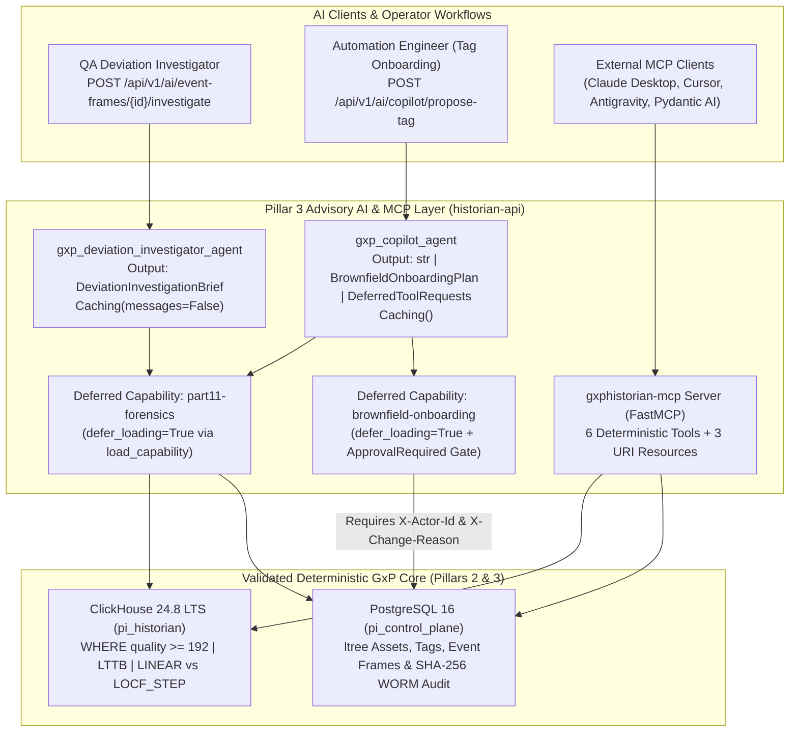
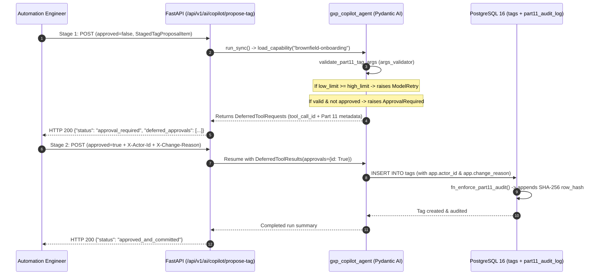

**GAMP 5 / 21 CFR Part 11 Deterministic AI Orchestration, Capabilities on Demand, Human-in-the-Loop Change Control, and MCP Server Integration**

In a **21 CFR Part 11**, **EU GMP Annex 11**, and **ISPE GAMP 5 (Second Edition)** regulated biopharmaceutical historian, introducing probabilistic AI directly into the telemetry ingestion pipeline, SQL interpolation math, or electronic signature execution would violate **ALCOA+** data integrity.

**GxPHistorian** solves this with a strict architectural boundary implemented in **`app/gxp_ai_agent.py`** (powered by **[Pydantic AI](https://ai.pydantic.dev/)**) and **`app/mcp_server.py`** (powered by **[FastMCP](https://gofastmcp.com/)**):

> **Core GxP AI Rule:** *AI proposes, queries, and correlates; deterministic ClickHouse and PostgreSQL execute, filter (`WHERE quality >= 192`), interpolate (`LINEAR` vs. `LOCF_STEP`), and audit (`SHA-256` WORM chain).*

---

## 1. Architecture & GxP Guardrails



### Why This Design Passes GAMP 5 & FDA CSA Audits (`URS-016` & `URS-017`)

| Layer / Operation | Who Executes It? | GxP / 21 CFR Part 11 Technical Control |
| :--- | :--- | :--- |
| **Time-Series Aggregations & Interpolation** | **ClickHouse 24.8 LTS** (never the LLM) | Every tool enforces `WHERE quality >= 192` (`Good` OPC quality) and respects `is_step_tag` (`LINEAR` for analog vs. integer `LOCF_STEP` for discrete states). |
| **Bad-Quality Sensor Fault Diagnostics** | **`diagnose_opc_signal_quality` Tool** | Explicitly compares raw `quality < 192` spikes (e.g., `9999.0` RTD fault) against `sensor_rollup_1m` to prove fault exclusion (`URS-012`). |
| **Specialist Context & Tool Schemas** | **Pydantic AI Capabilities on Demand** | `part11-forensics` and `brownfield-onboarding` use `defer_loading=True` and are loaded on demand via `load_capability`, keeping the base prompt compact and auditable. |
| **Tag Provisioning (`POST /api/v1/tags`)** | **Human-in-the-Loop (`ApprovalRequired`)** | `propose_part11_tag_creation` validates bounds via `args_validator` (`ModelRetry` on inverted limits) and pauses with `DeferredToolRequests` until a human supplies `X-Actor-Id` and `X-Change-Reason`. |
| **Batch / Excursion Electronic Signatures** | **Human Only (`21 CFR §11.200`)** | AI agents have **zero** tool access to `POST /api/v1/event-frames/{event_id}/sign`. Signatures require a human `user_id` + `password` challenge verified via `pgcrypto` bcrypt. |

---

## 2. Pydantic AI Agents & Capabilities on Demand

### 2.1 `gxp_deviation_investigator_agent` (Automated Excursion Pre-Investigation)

When an ISA-88 Event Frame opens (for example, `BR201_TEMP_PV_High_Limit_Excursion` on `BioCorp.Fremont.USP.Bioreactor_201`), `gxp_deviation_investigator_agent` assembles a structured **`DeviationInvestigationBrief`** Pydantic model:

1. **Correlates All Sibling Tags on the Same ISA-95 Asset:** Queries `BR201_TEMP_PV` (`LINEAR`), `BR201_PH_PV` (`LINEAR`), and `BR201_AGIT_STATE` (`LOCF_STEP`) over `WHERE quality >= 192`.
2. **Loads `part11-forensics` on Demand (`load_capability`):**
   - Calls `verify_part11_hash_chain` to verify the unbroken `SHA-256` hash chain in `part11_audit_log` from `GENESIS_0000000000000000`.
   - Calls `diagnose_opc_signal_quality` to check whether any `quality < 192` (`Bad=0` or `Uncertain=64`) sensor faults occurred during the window.
   - Queries `part11_audit_log` for recent configuration or limit changes.
3. **Outputs a Validated `DeviationInvestigationBrief`:** Classifies the event using the described `ExcursionClassification` enum (`critical_process_excursion`, `sensor_or_signal_fault`, or `setpoint_or_recipe_transition`), lists ranked `RootCauseHypothesis` items, recommends CAPA actions, and attaches a mandatory `part11_advisory_notice`.

```bash
# Run the Pydantic AI Deviation Investigator on an Event Frame UUID
EVENT_ID=$(curl -s http://localhost:8020/api/v1/event-frames | jq -r '.event_frames[0].event_id')
curl -s -X POST "http://localhost:8020/api/v1/ai/event-frames/${EVENT_ID}/investigate" | jq .
```

---

### 2.2 `gxp_copilot_agent` & Human-in-the-Loop 21 CFR Part 11 Tag Onboarding

Onboarding brownfield instruments requires mapping tags into ISA-95 `ltree` assets with accurate deadbands (`exc_dev`), interpolation modes (`is_step_tag`), and alarm limits (`low_limit`, `high_limit`).

`gxp_copilot_agent` uses Pydantic AI's **`ApprovalRequired` / `DeferredToolRequests` / `DeferredToolResults`** workflow:



#### Step 1 — Stage a Tag Proposal (`approved: false`)

```bash
curl -s -X POST http://localhost:8020/api/v1/ai/copilot/propose-tag \
  -H "Content-Type: application/json" \
  -d '{
    "approved": false,
    "proposal": {
      "tag_name": "BR201_DO_PV",
      "asset_id": 1,
      "attribute_name": "Dissolved_Oxygen_PV",
      "eng_units": "%Sat",
      "is_step_tag": false,
      "exc_dev": 0.1,
      "low_limit": 20.0,
      "high_limit": 100.0,
      "source_protocol": "OPC_UA",
      "source_config": {"node_id": "ns=2;s=BR201.DO.PV"}
    }
  }' | jq .
```

#### Step 2 — Approve & Commit with 21 CFR Part 11 Attribution (`approved: true`)

Omitting `X-Actor-Id` or `X-Change-Reason` when `approved: true` is immediately rejected with **`HTTP 400 Bad Request (21 CFR Part 11 Violation)`**.

```bash
curl -s -X POST http://localhost:8020/api/v1/ai/copilot/propose-tag \
  -H "Content-Type: application/json" \
  -H "X-Actor-Id: qa_approver_01" \
  -H "X-Change-Reason: Commission Hamilton VisiFerm DO optical sensor on Bioreactor 201" \
  -d '{
    "approved": true,
    "proposal": {
      "tag_name": "BR201_DO_PV",
      "asset_id": 1,
      "attribute_name": "Dissolved_Oxygen_PV",
      "eng_units": "%Sat",
      "is_step_tag": false,
      "exc_dev": 0.1,
      "low_limit": 20.0,
      "high_limit": 100.0,
      "source_protocol": "OPC_UA",
      "source_config": {"node_id": "ns=2;s=BR201.DO.PV"}
    }
  }' | jq .
```

---

## 3. Native `gxphistorian-mcp` Server (`app/mcp_server.py`)

`app/mcp_server.py` exposes GxPHistorian as a **Model Context Protocol (MCP)** server (`gxphistorian-mcp`) using `FastMCP`.

### Inspect the Live MCP & Pydantic AI Manifest

```bash
curl -s http://localhost:8020/api/v1/ai/mcp/manifest | jq .
```

### Exposed MCP Tools & Resources

| MCP Identifier | Type | Description |
| :--- | :--- | :--- |
| `mcp_browse_assets` | **Tool** | Browse the PostgreSQL ISA-95 `ltree` asset hierarchy and tag catalog (`root_path` optional). |
| `mcp_get_lttb_plot_values` | **Tool** | Fetch ClickHouse `largestTriangleThreeBuckets` (LTTB) peak-preserving trends (`WHERE quality >= 192`). |
| `mcp_get_sampled_datalink` | **Tool** | Fetch interpolated DataLink series (`WHERE quality >= 192`, `LINEAR` vs. `LOCF_STEP`). |
| `mcp_list_event_frames` | **Tool** | List ISA-88 Event Frames, captured KPIs, and 21 CFR Part 11 electronic signature status. |
| `mcp_verify_part11_audit_chain` | **Tool** | Recompute and verify the end-to-end `SHA-256` hash chain across `part11_audit_log`. |
| `mcp_draft_deviation_brief` | **Tool** | Assemble a complete `DeviationInvestigationBrief` for a target Event Frame UUID. |
| `gxphistorian://assets/tree` | **Resource** | Full ISA-95 asset tree and tag catalog JSON snapshot. |
| `gxphistorian://audit/verify` | **Resource** | Real-time 21 CFR Part 11 cryptographic hash-chain verification report. |
| `gxphistorian://docs/catalog` | **Resource** | Index of all biopharma instrument and hardware connector guides in `docs/*.md`. |

### Connecting Another Pydantic AI Agent to `gxphistorian-mcp`

Because `create_gxphistorian_mcp_server` returns a `FastMCP` instance, any Pydantic AI agent can mount `gxphistorian-mcp` in-process via the `MCP` capability:

```python
from main import gxphistorian_mcp_server
from pydantic_ai import Agent
from pydantic_ai.capabilities import Caching, MCP

plant_assistant = Agent(
    "google:gemini-3-flash-preview",
    name="plant_assistant_agent",
    capabilities=[
        Caching(),
        MCP(local=gxphistorian_mcp_server),
    ],
)
```

---

## 4. Observability with Pydantic Logfire & Model Configuration

`app/gxp_ai_agent.py` includes first-class **[Pydantic Logfire](https://pydantic.dev/logfire)** instrumentation (`logfire.configure()` and `logfire.instrument_pydantic_ai()`) to trace every agent run, capability load, tool execution, and token cost:

```bash
# Authenticate Logfire locally once to trace all Pydantic AI runs:
uvx logfire auth
uvx logfire projects new

# Or pass LOGFIRE_TOKEN and your preferred model in .env / docker-compose:
export LOGFIRE_TOKEN="pylf_v1_..."
export GXPHISTORIAN_AI_MODEL="google:gemini-3-flash-preview"
export GXPHISTORIAN_USE_LIVE_LLM="1"
```

When running in air-gapped cleanroom networks (`GXPHISTORIAN_USE_LIVE_LLM=0`, the default for deterministic IQ/OQ qualification), `gxp_deviation_investigator_agent` and `gxp_copilot_agent` execute their full multi-step tool loops and `ApprovalRequired` gates deterministically via `FunctionModel` and `TestModel`, guaranteeing **100% reproducible OQ verification (`test_oq_11` and `test_oq_12`)**.

