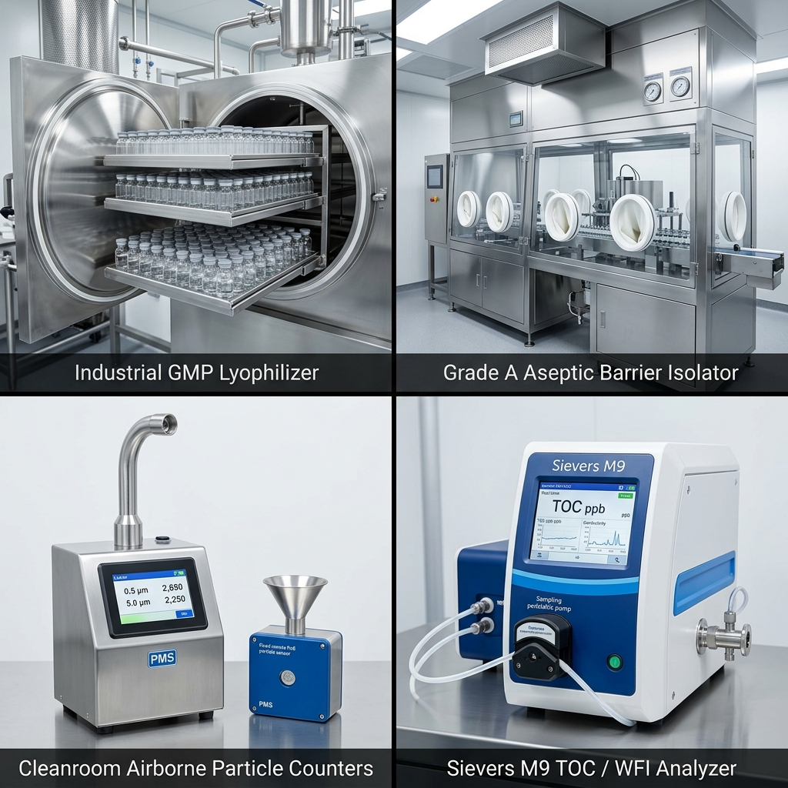
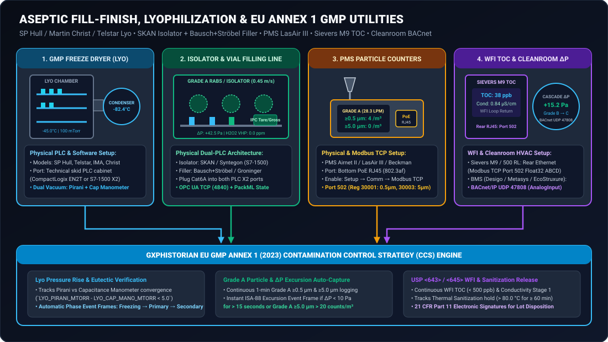
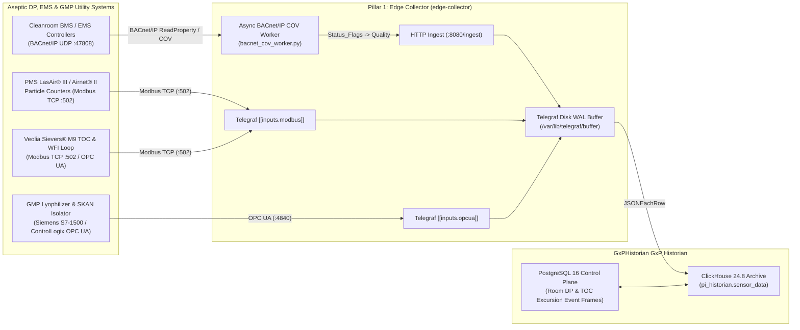

# Aseptic Fill-Finish, Lyophilization, Cleanroom EMS & GMP Utilities Integration Guide

**Connecting GMP Freeze Dryers (Lyophilizers), Aseptic Filling Isolators, Cleanroom Environmental Monitoring Systems (EMS / Particle Counters), and WFI / Veolia Sievers® M9 TOC Analyzers to GxPHistorian GxP Industrial Historian**

---

## 1. Overview: Sterile Drug Product (DP) & Facility Compliance (EU GMP Annex 1)

Under **EU GMP Annex 1 (2022 Revision)** and **FDA 21 CFR 211**, sterile Drug Product (DP) manufacturing and GMP facility utilities require continuous monitoring, alarm/excursion Event Frame tracking, and electronic signatures across four critical infrastructure domains:

1. **GMP Lyophilizers / Freeze Dryers ([SP Scientific Hull / VirTis](https://www.scientificproducts.com), IMA Edwards, [Telstar](https://www.telstar.com), Martin Christ, Hof):** Continuous tracking of shelf fluid temperature, product thermocouples, chamber vacuum pressure (Capacitance Manometer vs. Pirani gauge convergence), condenser temperature, and hydraulic stoppering pressure.
2. **Aseptic Filling Lines & RABS/Isolator Barrier Systems (Bausch+Ströbel, Optima, IMA Life, Groninger, [SKAN Isolators](https://www.skan.ch)):** Vaporized Hydrogen Peroxide ($\text{VHP}$ / $\text{H}_2\text{O}_2$) decontamination concentration (`ppm`), isolator positive pressure cascades (`Pa`), unidirectional laminar airflow velocity (`0.45 m/s ± 20%`), and 100% In-Process Control (IPC) checkweigher fill weights.
3. **Cleanroom Environmental Monitoring Systems (EMS) & Airborne Particle Counters ([Particle Measuring Systems LasAir® III / Pro & Airnet® II](https://www.pmeasuring.com/products/lasair-pro-airborne-particle-counter/), Lighthouse Solair, [Beckman MET ONE](https://www.beckman.com/particle-counters/air), Siemens Desigo CC / Honeywell EBI / JCI Metasys):** Continuous Grade A / ISO 5 and Grade B/C / ISO 7 differential pressure (`Pa`), temperature, relative humidity, and $0.5\,\mu\text{m}$ / $5.0\,\mu\text{m}$ non-viable particle counts via **BACnet/IP** and **Modbus TCP**.
4. **Compendial Water Loops (WFI, PW, Pure Steam) & Analytical Transmitters ([Veolia Sievers® M9 / M9e TOC](https://www.watertechnologies.com/products/sievers-m9-laboratory-toc-analyzer) & [Mettler Toledo Thornton M800 Conductivity](https://www.mt.com/us/en/home/products/Process-Analytics/Multi-parameter-transmitters/M800.html)):** Real-time USP <643> Total Organic Carbon (`ppb`) and USP <645> conductivity ($\mu\text{S/cm}$), return loop temperature ($> 80\,^\circ\text{C}$ sanitization), and ozone concentration.





---

## 1.5 Non-Technical Step-by-Step Physical & Software Connection Walkthrough

Sterile drug product (DP) suites and EU GMP Annex 1 utility rooms combine PLC-controlled machinery with PoE environmental sensors. Use this step-by-step physical connection table to wire each system to **GxPHistorian**:

| Sterile DP / Utility System | Where to Plug In on the Physical Unit | Exact Touchscreen / Software Menu Path to Enable | Protocol & Test Command |
| :--- | :--- | :--- | :--- |
| **1. GMP Freeze Dryers / Lyophilizers ([SP Hull](https://www.scientificproducts.com), `IMA Edwards`, [Telstar](https://www.telstar.com), `Martin Christ`)** | Walk into the technical service area (gray space) behind the cleanroom wall. Open the **Lyo Main PLC Cabinet** (`Siemens S7-1500` or `Allen-Bradley ControlLogix`). Plug a **Cat6A cable** into **Northbound Port `X2` / `EN2T`**. | In the Lyo SCADA (**Telstar Lyogistics**, **IMA Sentinel**, or **Christ LPCplus**), enable **OPC UA Server (`Port 4840`)** on the northbound interface. Ensure both **Capacitance Manometer (`mTorr`)** and **Pirani Vacuum (`mTorr`)** tags are exposed. | `nc -zv 10.20.90.10 4840` |
| **2. Aseptic Filling Line (`Bausch+Ströbel`, `Optima`, `IMA`) + Barrier Isolator ([SKAN](https://www.skan.ch), `Syntegon`)** | **Important:** An isolator filling line has **TWO separate PLCs**—one for the **SKAN Isolator** (managing $\text{H}_2\text{O}_2$ VHP bio-decontamination, glove-port pressures, and laminar airflow) and one for the **Vial/Syringe Filler** (managing peristaltic/rotary pumps and 100% IPC checkweighers). Plug **two Cat6A cables** into the respective `X2` SCADA ports of both PLCs. | Enable **OPC UA Server (`Port 4840`)** on both the SKAN Isolator S7-1500 PLC (`10.20.90.11`) and the Bausch+Ströbel Filler PLC (`10.20.90.12`). | `nc -zv 10.20.90.11 4840` & `nc -zv 10.20.90.12 4840` |
| **3. Non-Viable Airborne Particle Counters ([PMS LasAir® III / Pro & Airnet® II](https://www.pmeasuring.com/products/lasair-pro-airborne-particle-counter/), [Beckman MET ONE](https://www.beckman.com/particle-counters/air))** | Look at the **underside of the stainless particle counter enclosure**. Plug a **Power-over-Ethernet (PoE `802.3af`) Cat6A cable** into the sealed **RJ45 Ethernet port** (for `Airnet II` fixed sensors, this single cable provides both $24\text{V}$ power and Modbus TCP data!). | On the **LasAir III touchscreen** (or `Airnet II` web browser console), tap **Setup $\rightarrow$ Communications $\rightarrow$ Network**, set Static IP `10.20.90.21`, and toggle **Modbus TCP = Enabled (`Port 502`, Unit ID `1`)**. | `nc -zv 10.20.90.21 502` |
| **4. WFI Total Organic Carbon Analyzer ([Veolia Sievers® M9 / M9e / 500 RL On-Line](https://www.watertechnologies.com/products/sievers-m9-laboratory-toc-analyzer))** | Open the hinged **side splash cover on the rear/side I/O bay** of the Sievers M9 analyzer. Plug a **Cat6 cable** into the **RJ45 Ethernet port** labeled `LAN`. | On the **Sievers M9 touchscreen**, tap **Menu $\rightarrow$ Setup $\rightarrow$ Network & Comms $\rightarrow$ Modbus TCP**. Set Static IP `10.20.90.30` and enable **Modbus TCP Port `502`** (Big-Endian `ABCD` Float32 registers for TOC `ppb`, Conductivity $\mu\text{S/cm}$, and Temperature $^{\circ}\text{C}$). | `nc -zv 10.20.90.30 502` |
| **5. Cleanroom Differential Pressure (`Pa`), Temp & `%RH` (`Siemens Desigo`, `JCI Metasys`, `Honeywell EBI`)** | Connect `GxPHistorian` `edge-collector` to the **Facility BMS / EMS VLAN** (or install a **[LOYTEC](https://www.loytec.com) / [Contemporary Controls BASrouter](https://www.ccontrols.com/basautomation/basrouters.php)** BACnet MS/TP-to-BACnet/IP Router on the mechanical floor). | Register the `edge-collector` IP as a **Foreign Device** in your BMS **BBMD (BACnet Broadcast Management Device)** on **`UDP Port 47808`**. `bacnet_cov_worker.py` automatically maps ASHRAE `Status_Flags` to OPC Quality (`192/64/0`). | `python3 edge-collector/scripts/bacnet_cov_worker.py --self-test` |

---

## 2. Integration Architecture



---

## 3. Domain-Specific Integration Configurations

### 3.1 Cleanroom EMS via BACnet/IP (`bacnet_cov_worker.py`)
Cleanroom differential pressure cascades (e.g., Grade B/C corridor at `+30 Pa` $\rightarrow$ Grade C Bioreactor Suite at `+18.5 Pa` $\rightarrow$ Airlock at `+12.5 Pa`), HVAC supply/exhaust airflows, and room temperature/humidity are managed by **BACnet/IP** controllers.

GxPHistorian GxP Historian includes a production-ready asynchronous BACnet/IP worker at `edge-collector/scripts/bacnet_cov_worker.py` (`AsyncBacnetTelemetryWorker`) and seeds `Tag 301: CR_ISO7_DP_PV` under `BioCorp.Fremont.Facilities.Cleanroom_ISO7`.

#### How IEEE/ASHRAE BACnet `Status_Flags` Map to GxP OPC Quality
In `bacnet_cov_worker.py`, `status_flags_to_quality()` reads both the `presentValue` and the 4-bit `statusFlags` array (`[in_alarm, fault, overridden, out_of_service]`) from each BACnet `analog-input` object:
- **`fault = 1` $\rightarrow$ `quality = 0` (`Bad`), `status_code = 1`:** Sensor hardware failure; recorded in `sensor_data` for facilities maintenance but automatically excluded from `mv_sensor_rollup_1m` (`WHERE quality >= 192`).
- **`out_of_service = 1` or `overridden = 1` $\rightarrow$ `quality = 64` (`Uncertain`), `status_code = 3`:** Indicates a calibration technician placed the Magnehelic/differential pressure transmitter into manual override or out-of-service mode.
- **`in_alarm = 1` $\rightarrow$ `quality = 192` (`Good`), `status_code = 4`:** Valid measurement currently breaching local BACnet alarm limits; included in all GMP calculations and triggers an ISA-88 Excursion Event Frame in PostgreSQL.

**Configuring Additional Cleanroom Suites in `edge-collector/scripts/bacnet_cov_worker.py`:**
```python
worker = AsyncBacnetTelemetryWorker(
    ingest_url="http://localhost:8080/ingest",
    points=[
        BacnetPointSpec(tag_id=301, device_address="192.168.10.30:47808", object_identifier="analog-input,1", exc_dev=0.10, exc_max=10.0), # ISO-7 DP (Pa)
        BacnetPointSpec(tag_id=302, device_address="192.168.10.30:47808", object_identifier="analog-input,2", exc_dev=0.05, exc_max=30.0), # ISO-7 Temp (degC)
        BacnetPointSpec(tag_id=303, device_address="192.168.10.30:47808", object_identifier="analog-input,3", exc_dev=0.20, exc_max=30.0), # ISO-7 RH (%)
        BacnetPointSpec(tag_id=304, device_address="192.168.10.31:47808", object_identifier="analog-input,1", exc_dev=0.10, exc_max=5.0),  # Grade A Isolator DP (Pa)
    ],
)
```

---

### 3.2 Airborne Particle Counters (PMS LasAir® III / Airnet® II) & Veolia Sievers® M9 TOC via Modbus TCP
Both **Particle Measuring Systems (PMS) LasAir® III / Airnet® II** cleanroom particle counters and **Veolia Sievers® M9 / M9e** Total Organic Carbon (TOC) analyzers expose deterministic **Modbus TCP** register maps (port `502`) that can be polled directly by Telegraf’s native `[[inputs.modbus]]` plugin in `edge-collector/telegraf-clickhouse.conf`:

```toml
# 1. Veolia Sievers M9 TOC & Conductivity Analyzer (WFI Loop Return)
[[inputs.modbus]]
  name_override = "sensor_data"
  controller = "tcp://10.20.60.15:502"
  slave_id = 1
  timeout = "3s"
  configuration_type = "register"

  holding_registers = [
    # USP <643> TOC (ppb) - IEEE 754 Float32 across 2 registers
    { name = "val", byte_order = "ABCD", data_type = "FLOAT32-IEEE", scale = 1.0, address = [300, 301] }
  ]
  [inputs.modbus.tags]
    tag_id = "601"

# 2. PMS Airnet II / LasAir III Grade A Isolator Particle Counter (0.5 um & 5.0 um counts/m3)
[[inputs.modbus]]
  name_override = "sensor_data"
  controller = "tcp://10.20.60.20:502"
  slave_id = 1
  timeout = "3s"
  configuration_type = "register"

  input_registers = [
    { name = "val", byte_order = "ABCD", data_type = "UINT32", scale = 1.0, address = [100, 101] }
  ]
  [inputs.modbus.tags]
    tag_id = "602"
```

---

### 3.3 GMP Lyophilizers (Freeze Dryers) & SKAN Aseptic Filling Isolators
In lyophilization cycles (freezing, primary drying sublimation, and secondary drying desorption) running 48–120 hours, two vacuum gauges are monitored simultaneously over **OPC UA** (`[[inputs.opcua]]`):
1. **Capacitance Manometer (MKS Baratron®):** Gas-composition independent absolute chamber pressure (`mTorr` or `mbar`, `low_limit = 50 mTorr`, `high_limit = 150 mTorr` during primary drying).
2. **Pirani Thermal Conductivity Gauge:** Reads higher in water vapor than nitrogen; when the Pirani pressure curve converges downward to meet the Capacitance Manometer curve ($\Delta P_{\text{Pirani-CapMan}} \le 5\,\text{mTorr}$), sublimation is complete and the lyophilizer transitions from Primary Drying to Secondary Drying.

---

## 4. Standard Fill-Finish, Lyophilizer, EMS & WFI Utility Tag Catalog

| Tag ID | Tag Name | System / Area | Parameter | Eng Units | `is_step_tag` | `exc_dev` | Regulatory / GMP Limits (`Low` / `High`) | Protocol |
| :--- | :--- | :--- | :--- | :--- | :--- | :--- | :--- | :--- |
| `301` | `CR_ISO7_DP_PV` | Cleanroom ISO-7 (Grade C) | Room Differential Pressure | `Pa` | `false` (`LINEAR`) | `0.10` | `12.5` / `25.0 Pa` | `BACNET_IP` |
| `304` | `ISO_GRADEA_DP_PV` | SKAN Filling Isolator | Grade A Barrier Positive Pressure | `Pa` | `false` (`LINEAR`) | `0.10` | `35.0` / `60.0 Pa` | `BACNET_IP` / `OPC_UA` |
| `601` | `WFI_RETURN_TOC_PV` | WFI Loop Return (Sievers M9) | USP <643> Total Organic Carbon | `ppb` | `false` (`LINEAR`) | `0.50` | `0.0` / `500.0 ppb` | `MODBUS_TCP` |
| `602` | `ISO_APC_05UM_PV` | Grade A Filling Zone (LasAir III) | Non-Viable Particles $\ge 0.5\,\mu\text{m}$ | `cnt/m3` | `true` (`LOCF`) | `0.00` | `0.0` / `3520.0 cnt/m3` (Annex 1) | `MODBUS_TCP` |
| `603` | `ISO_APC_50UM_PV` | Grade A Filling Zone (LasAir III) | Non-Viable Particles $\ge 5.0\,\mu\text{m}$ | `cnt/m3` | `true` (`LOCF`) | `0.00` | `0.0` / `20.0 cnt/m3` (Annex 1) | `MODBUS_TCP` |
| `604` | `WFI_RETURN_COND_PV` | WFI Loop Return (Thornton) | USP <645> Stage 1 Conductivity | `uS/cm` | `false` (`LINEAR`) | `0.01` | `0.0` / `1.3 uS/cm` (at $25\,^\circ\text{C}$) | `MODBUS_TCP` |
| `605` | `WFI_RETURN_TEMP_PV` | WFI Loop Return | Thermal Sanitization Return Temp | `degC` | `false` (`LINEAR`) | `0.10` | `75.0` / `95.0 degC` | `OPC_UA` |
| `701` | `LYO01_SHELF_TEMP_PV` | Freeze Dryer Lyo-01 | Shelf Fluid Inlet Temperature | `degC` | `false` (`LINEAR`) | `0.05` | `-55.0` / `+40.0 degC` | `OPC_UA` |
| `702` | `LYO01_CAPMAN_VAC_PV` | Freeze Dryer Lyo-01 | Chamber Capacitance Manometer | `mTorr` | `false` (`LINEAR`) | `0.50` | `30.0` / `200.0 mTorr` | `OPC_UA` |
| `703` | `LYO01_PIRANI_VAC_PV` | Freeze Dryer Lyo-01 | Chamber Pirani Vacuum Gauge | `mTorr` | `false` (`LINEAR`) | `0.50` | `30.0` / `500.0 mTorr` | `OPC_UA` |
| `704` | `ISO_VHP_H2O2_PV` | SKAN Isolator Decontamination | Vaporized $\text{H}_2\text{O}_2$ Concentration | `ppm` | `false` (`LINEAR`) | `1.00` | `0.0` / `1200.0 ppm` | `OPC_UA` |
| `705` | `FILL01_IPC_WEIGHT_PV` | Aseptic Vial Checkweigher | Net Vial Fill Weight (IPC Sample) | `g` | `true` (`LOCF`) | `0.00` | Target $\pm 3\%$ | `OPC_UA` |
