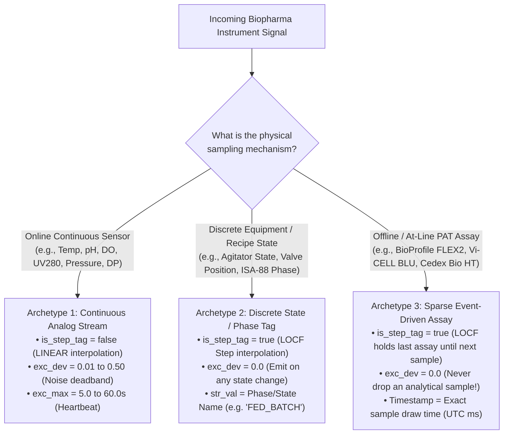

# Biopharma & Life Sciences Instrument Integration Catalog

**Comprehensive Research & Engineering Reference for Connecting Upstream, Downstream, PAT, Aseptic Fill-Finish, and GMP Utility Instruments to the GxPHistorian GxP Industrial Historian**

---

## 1. Executive Summary: Why Biopharma Instruments Connect to a Historian

In cGMP biopharmaceutical manufacturing (monoclonal antibodies, viral vectors, mRNA, cell and gene therapies, and recombinant proteins), regulatory frameworks—**FDA 21 CFR Part 11**, **EU GMP Annex 11**, **ICH Q8/Q9/Q10 (Quality by Design & PAT)**, and **EU GMP Annex 1 (Manufacture of Sterile Medicinal Products)**—mandate continuous, tamper-evident archiving of **Critical Process Parameters (CPPs)**, **Critical Quality Attributes (CQAs)**, and **Critical Material Attributes (CMAs)**.

Historically, life sciences facilities deployed the proprietary **OSIsoft / AVEVA PI System** (using *PI Interface for OPC DA*, *PI Connector for OPC UA*, *PI Interface for Modbus/BACnet*, and *PI Batch / Event Frames*) to aggregate data from islands of automation on the cleanroom floor.

**GxPHistorian GxP Industrial Historian** provides a drop-in, open-source 4-Pillar replacement that connects to every major bioprocess skid, Process Analytical Technology (PAT) analyzer, chromatography workstation, cell & gene therapy system, lyophilizer, stability chamber, and cleanroom Environmental Monitoring System (EMS) using standardized industrial protocols while enforcing cryptographic 21 CFR Part 11 data integrity.

---

## 1.5 Visual Field Guide: How Physical Connectors on Lab & Cleanroom Equipment Map to GxPHistorian

If you are a **bioprocess scientist, lab manager, cleanroom operator, or QA specialist** looking at the back panel of an instrument in your lab or cleanroom, every piece of biopharma equipment connects to **GxPHistorian** using one of **four physical connectors**:

| What You See on the Back of the Instrument | What Cable / Adapter to Buy | How It Connects to GxPHistorian |
| :--- | :--- | :--- |
| **1. Standard RJ45 Ethernet Jack (`LAN` / `X2` / `Port 1`)** | Standard **Cat6 / Cat6A Shielded Ethernet Patch Cable** (`$10`) | Plug directly into your Cleanroom / Lab Ethernet wall jack. Connects via **OPC UA (`Port 4840`)**, **Modbus TCP (`Port 502`)**, **BACnet/IP (`UDP 47808`)**, **S7comm (`Port 102`)**, or **SMB Shared Folder**. |
| **2. Circular Metal Screw-Lock Connector (`M12 D-Coded` / `X-Coded`)** | **M12-to-RJ45 Washdown Industrial Patch Cord** (`IP67`, `$25`) | Screws into the stainless washdown skid bulkhead on one end and clicks into a standard RJ45 Ethernet wall jack on the other end. |
| **3. 9-Pin D-Sub Serial Port (`DB9 RS-232`, Male or Female)** | **[Moxa NPort 5150](https://www.moxa.com/en/products/industrial-edge-connectivity/serial-device-servers/general-device-servers/nport-5100-series)** 1-Port Serial-to-Ethernet Device Server (`$130`) + **DB9 Null-Modem Adapter** (`$5`) | Plug the 9-pin serial cable from the balance/osmometer/freezer into the Moxa NPort 5150, and plug a Cat6 Ethernet cable from the Moxa into your network (`TCP Port 4001`). |
| **4. Green Screw-Terminal Block (`RS-485 D+/D-/GND` or `4–20 mA`)** | **[Moxa MGate MB3180](https://www.moxa.com/en/products/industrial-edge-connectivity/protocol-gateways/modbus-tcp-gateways/mgate-mb3180-mb3280-mb3480-series)** (for RS-485 Modbus RTU, `$160`) or **[Advantech ADAM-6017](https://www.advantech.com/en-us/products/a67f7853-013a-4b50-9b20-01798c56b090/adam-6017/mod_426ac8aa-4c77-4e4e-aed7-b41b9b387cf9)** (for `4–20 mA` / `PT100 RTD`, `$240`) | Screw the signal wires into the compact DIN-rail gateway box and plug a Cat6 Ethernet cable into your network (`Modbus TCP Port 502`). |

---

## 2. Master Biopharma Instrument & Protocol Matrix

The matrix below catalogs the most common life sciences instruments connected to historians in commercial GMP, clinical, and Process Development (PD) facilities, their official vendor product pages, physical ports, native vendor software/control layers, protocols, and corresponding **GxPHistorian** end-to-end visual tutorials:

| Process Area | Manufacturer & Instrument Family (Official Vendor Links) | Physical Port on Unit | Control / Software Platform | Primary Protocols | Data Cadence & Interpolation | Detailed Visual Tutorial |
| :--- | :--- | :--- | :--- | :--- | :--- | :--- |
| **USP Bioreactors (Single-Use)** | **[Cytiva Xcellerex™ X-Platform & XDR (50–2000 L)](https://www.cytivalifesciences.com/en/us/products/items/xcellerex-xdr-50-to-2000-single-use-stirred-tank-bioreactors-p-06177)** | Skid Cabinet RJ45 (`LAN2`) | [Figurate™](https://www.cytivalifesciences.com/en/us/solutions/bioprocessing/products-and-solutions/automation-and-digital-solutions/figurate-automation-solutions) ([Emerson DeltaV™](https://www.emerson.com/en/automation-systems/distributed-control-systems-dcs/deltav-distributed-control-system) or [Rockwell PlantPAx®](https://www.rockwellautomation.com/en-us/capabilities/process-solutions/process-systems/plantpax-distributed-control-system.html)) | OPC UA (`4840`), OPC DA, EtherNet/IP | Continuous (`1 s`, `LINEAR`) + Phase (`LOCF`) | [XCELLEREX_X_PLATFORM_INTEGRATION.md](XCELLEREX_X_PLATFORM_INTEGRATION.md) |
| **USP Bioreactors & High-Throughput** | **[Sartorius Biostat STR® (Gen 3)](https://www.sartorius.com/en/products/fermentation-bioreactors/single-use-bioreactors/biostat-str) & Biostat® B-DCU** | Biobrain S7-1500 `X2` RJ45 | [BioPAT® MFCS 4](https://www.sartorius.com/en/products/process-analytical-technology/process-control-automation/biobrain-supervise) / Biobrain / [Siemens S7-1500](https://www.siemens.com/en-us/products/simatic/s7-1500/) | OPC UA (`4840`), S7comm (`102`) | Continuous (`1 s`, `LINEAR`) + Phase (`LOCF`) | [USP_BIOREACTORS_SARTORIUS_THERMO_EPPENDORF.md](USP_BIOREACTORS_SARTORIUS_THERMO_EPPENDORF.md) |
| **USP Parallel Microbioreactors** | **[Sartorius Ambr® 250](https://www.sartorius.com/en/products/fermentation-bioreactors/ambr-multi-parallel-bioreactors/ambr-250-modular) & [Ambr® 15](https://www.sartorius.com/en/products/fermentation-bioreactors/ambr-multi-parallel-bioreactors/ambr-15-cell-culture) (12/24/48 vessels)** | Control PC Dual-NIC RJ45 | Ambr® Control Software / [BioPAT® MFCS](https://www.sartorius.com/en/products/process-analytical-technology/process-control-automation/biobrain-supervise) | OPC UA (`4840`) | Continuous (`1–5 s`) + At-line (`LOCF`) | [USP_BIOREACTORS_SARTORIUS_THERMO_EPPENDORF.md](USP_BIOREACTORS_SARTORIUS_THERMO_EPPENDORF.md) |
| **USP Bioreactors (Single-Use)** | **[Thermo Fisher HyPerforma™ S.U.B. / S.U.F. (50–5000 L)](https://www.thermofisher.com/us/en/home/bioprocessing/products/bioreactors/single-use-hyperforma.html)** | DeltaV PK / App Station RJ45 | [TruBio™ DV](https://www.thermofisher.com/us/en/home/bioprocessing/products/single-use/automation-data-management/software.html) ([Emerson DeltaV™](https://www.emerson.com/en/automation-systems/distributed-control-systems-dcs/deltav-distributed-control-system)) | OPC UA (`4840`), OPC DA | Continuous (`1 s`, `LINEAR`) + Phase (`LOCF`) | [USP_BIOREACTORS_SARTORIUS_THERMO_EPPENDORF.md](USP_BIOREACTORS_SARTORIUS_THERMO_EPPENDORF.md) |
| **USP Benchtop & Parallel** | **[Eppendorf BioFlo® 320/720 & DASGIP® Parallel](https://www.eppendorf.com/us-en/Products/Bioprocess/Glass-Bioreactors/BioFlo320-Bioreactors-p-PF-109136)** | Rear `Ethernet / OPC` RJ45 | [DASware® connect](https://www.eppendorf.com/us-en/Products/Bioprocess/Bioprocess-Controllers/DASGIP-Parallel-Bioreactor-System-p-PF-133597) | OPC UA (`4840`), OPC DA | Continuous (`1–5 s`, `LINEAR`) | [USP_BIOREACTORS_SARTORIUS_THERMO_EPPENDORF.md](USP_BIOREACTORS_SARTORIUS_THERMO_EPPENDORF.md) |
| **PAT Cell & Metabolite Analyzer** | **[Nova Biomedical BioProfile® FLEX2](https://www.novabiomedical.com/cell-culture-analyzers/) (+ [Seg-Flow®](https://flownamics.com/product/automated-sampling-system/))** | Rear Lower-Left RJ45 | BioProfile OPC Server / [Flownamics Seg-Flow®](https://flownamics.com/product/automated-sampling-system/) | OPC UA (`4840`), CSV Watchfolder | Sparse Event-Driven (`LOCF`, `exc_dev=0`) | [PAT_CELL_ANALYZERS_AND_SPECTROSCOPY.md](PAT_CELL_ANALYZERS_AND_SPECTROSCOPY.md) |
| **PAT Cell Viability Analyzer** | **[Beckman Coulter Vi-CELL™ BLU](https://www.beckman.com/cell-counters-and-analyzers/vi-cell-blu)** | Rear Panel RJ45 (`LAN`) | Vi-CELL BLU Embedded Automation Server | OPC UA (`4840`), HTTPS REST | Sparse Event-Driven (`LOCF`, `exc_dev=0`) | [PAT_CELL_ANALYZERS_AND_SPECTROSCOPY.md](PAT_CELL_ANALYZERS_AND_SPECTROSCOPY.md) |
| **PAT Metabolite & Titer Analyzer** | **[Roche CustomBiotech Cedex® Bio HT](https://custombiotech.roche.com/global/en/products/instruments/cedex-bio-ht-ins-3590.html) & Cedex® HiRes** | Control PC Dual-NIC RJ45 | Cedex Control Center / [Seg-Flow®](https://flownamics.com/product/automated-sampling-system/) | CSV/XML Archive, OPC UA Bridge | Sparse Event-Driven (`LOCF`, `exc_dev=0`) | [PAT_CELL_ANALYZERS_AND_SPECTROSCOPY.md](PAT_CELL_ANALYZERS_AND_SPECTROSCOPY.md) |
| **PAT In-Line Spectroscopy** | **[Endress+Hauser (Kaiser) Raman Rxn2™ / Rxn4™](https://www.endress.com/en/field-instruments-overview/optical-analysis-product-overview/raman-rxn2-analyzer)** | Analyzer Rear RJ45 | Raman RunTime™ / SIMCA®-online | OPC UA (`4840`), Modbus TCP (`502`) | Continuous (`1–5 min` scans, `LINEAR`) | [PAT_CELL_ANALYZERS_AND_SPECTROSCOPY.md](PAT_CELL_ANALYZERS_AND_SPECTROSCOPY.md) |
| **PAT Smart In-Line Sensors** | **[Hamilton Arc®](https://www.hamiltoncompany.com/technologies/arc) & [Mettler Toledo InPro® ISM](https://www.mt.com/us/en/home/products/Process-Analytics/transmitter/multi-parameter-digital-transmitter-M800/m800-process-transmitter-4-ch.html)** | M12 8-Pin + Moxa Gateway | ArcAir® / [Mettler M800 Transmitter](https://www.mt.com/us/en/home/products/Process-Analytics/transmitter/multi-parameter-digital-transmitter-M800/m800-process-transmitter-4-ch.html) | Modbus RTU/TCP (`502`), OPC UA | Continuous (`1 s`, `LINEAR`) | [PAT_CELL_ANALYZERS_AND_SPECTROSCOPY.md](PAT_CELL_ANALYZERS_AND_SPECTROSCOPY.md) |
| **DSP Chromatography & TFF** | **[Cytiva ÄKTA™ process, ÄKTA™ ready & ÄKTA™ readyflux](https://www.cytivalifesciences.com/en/us/about-us/our-brands/akta)** | UNICORN PC / Skid PLC RJ45 | [UNICORN™ 7 OPC Server](https://www.cytivalifesciences.com/en/us/about-us/our-brands/akta) / Figurate™ | OPC DA, OPC UA (`4840`) | Fast Continuous (`0.5–1 s`, `LINEAR` + LTTB) | [DSP_CHROMATOGRAPHY_TFF_FILTRATION.md](DSP_CHROMATOGRAPHY_TFF_FILTRATION.md) |
| **DSP TFF / UF / DF Skids** | **[Sartorius Sartoflow® Advanced / Modular](https://www.sartorius.com/en/products/process-filtration/tangential-flow-filtration/tff-systems) & Resolute®** | S7-1500 `X2` RJ45 / M12 | [BioPAT® MFCS](https://www.sartorius.com/en/products/process-analytical-technology/process-control-automation/biobrain-supervise) / Siemens S7-1500 | OPC UA (`4840`), S7comm (`102`) | Continuous (`1 s`, `LINEAR`) + Step (`LOCF`) | [DSP_CHROMATOGRAPHY_TFF_FILTRATION.md](DSP_CHROMATOGRAPHY_TFF_FILTRATION.md) |
| **DSP Chromatography & TFF** | **[MilliporeSigma Mobius® Chrom 20 & Cogent® TFF](https://www.sigmaaldrich.com/US/en/products/pharma-and-biopharma-manufacturing/chromatography-bioprocessing/chromatography-systems)** | ControlLogix `EN2T` RJ45 | [Rockwell ControlLogix / PlantPAx®](https://www.rockwellautomation.com/en-us/capabilities/process-solutions/process-systems/plantpax-distributed-control-system.html) | OPC UA (`4840`), EtherNet/IP | Continuous (`1 s`, `LINEAR`) | [DSP_CHROMATOGRAPHY_TFF_FILTRATION.md](DSP_CHROMATOGRAPHY_TFF_FILTRATION.md) |
| **Cell & Gene Therapy (CAR-T)** | **[Miltenyi CliniMACS Prodigy®](https://www.miltenyibiotec.com/US-en/products/clinimacs-prodigy.html), [Cytiva Sefia™](https://www.cytivalifesciences.com/en/us/products/items/sefia-select-system-p-43516) & [Sepax™ C-Pro](https://www.cytivalifesciences.com/en/us/products/items/sepax-c-pro-cell-processing-instrument-p-08418)** | Rear Panel RJ45 (`LAN`) | Embedded Prodigy / Chronicle™ / Sepax Export | OPC UA (`4840`), SMB XML/CSV Drop | Continuous (`1–5 s`) + Patient `COI_ID` Batch | [CELL_GENE_THERAPY_AND_MRNA_LNP_INSTRUMENTS.md](CELL_GENE_THERAPY_AND_MRNA_LNP_INSTRUMENTS.md) |
| **mRNA-LNP Formulation & Cryo** | **[Cytiva NanoAssemblr™ GMP](https://www.cytivalifesciences.com/en/us/products/items/nanoassemblr-gmp-system-for-nanoparticle-formulation-p-45347), [Planer Kryo 560](https://planer.com/downloads/controlled-rate-freezers-1/kryo-560-16.html) & [Thermo CryoMed™ CRF](https://www.thermofisher.com/order/catalog/product/TSCM17XV)** | Skid PLC RJ45 / Rear DB9 | Siemens S7-1500 / Planer MRV Controller | OPC UA (`500 ms`), RS-232 TCP (`4001`) | High-Speed (`0.5–1 s`, `LINEAR`) | [CELL_GENE_THERAPY_AND_MRNA_LNP_INSTRUMENTS.md](CELL_GENE_THERAPY_AND_MRNA_LNP_INSTRUMENTS.md) |
| **DP Freeze Drying (Lyophilization)** | **[SP Scientific (Hull / VirTis)](https://scientificproducts.com/product_cat/development-pilot-production-freeze-dryers/) & [Telstar Lyophilizers](https://www.telstar.com/en/pharma-equipment/gmp-freeze-dryers-and-loading-systems/gmp-industrial-freeze-dryers/)** | Technical Skid PLC RJ45 | Siemens S7-1500 / Rockwell ControlLogix | OPC UA (`4840`), S7comm (`102`) | Continuous (`1–5 s`, `LINEAR`) + Phase (`LOCF`) | [ASEPTIC_FILL_FINISH_LYO_AND_GMP_UTILITIES.md](ASEPTIC_FILL_FINISH_LYO_AND_GMP_UTILITIES.md) |
| **DP Aseptic Filling & Isolators** | **Bausch+Ströbel, Optima, IMA Life & [SKAN Isolators](https://skan.com/en/products/pharma/fill-finish/variosys)** | Dual PLC `X2` RJ45 Ports | Siemens S7-1500 / Rockwell ControlLogix | OPC UA (`4840`), S7comm, Modbus TCP | Continuous (`1 s`, `LINEAR`) + IPC Weight (`LOCF`) | [ASEPTIC_FILL_FINISH_LYO_AND_GMP_UTILITIES.md](ASEPTIC_FILL_FINISH_LYO_AND_GMP_UTILITIES.md) |
| **Cleanroom EMS & Particle Counters** | **[PMS LasAir® III / Pro & Airnet® II](https://www.pmeasuring.com/product/airborne-particle-counter-lasair-pro/) & [Beckman MET ONE](https://www.beckman.com/air-particle-counters)** | Bottom PoE RJ45 / BMS LAN | BMS / EMS Controllers | BACnet/IP (`UDP 47808`), Modbus TCP (`502`) | Continuous (`1–60 s`, `LINEAR`) | [ASEPTIC_FILL_FINISH_LYO_AND_GMP_UTILITIES.md](ASEPTIC_FILL_FINISH_LYO_AND_GMP_UTILITIES.md) |
| **GMP Utilities (WFI, PW, TOC)** | **[Veolia Sievers® M9 / M9e TOC](https://www.watertechnologies.com/products/analyzers-instruments/sievers-m9-toc-analyzers) & [Mettler Toledo Thornton M800](https://www.mt.com/us/en/home/products/Process-Analytics/transmitter/multi-parameter-digital-transmitter-M800/m800-process-transmitter-4-ch.html)** | Rear Splashproof RJ45 | Embedded Analyzer / WFI Skid PLC | Modbus TCP (`502`), OPC UA (`4840`) | Continuous (`1–60 s`, `LINEAR`) | [ASEPTIC_FILL_FINISH_LYO_AND_GMP_UTILITIES.md](ASEPTIC_FILL_FINISH_LYO_AND_GMP_UTILITIES.md) |
| **ICH Q1A Stability, Incubators & Cold Chain** | **[BINDER KBF Stability](https://www.binder-world.com/us-en/products/climate-chambers/humidity-test-chambers/product/kbf-720), [Infors HT](https://infors-ht.com/en/products/incubator-shakers/multitron) / [Thermo Heracell™](https://www.thermofisher.com/order/catalog/product/51030401), [PHCbi VIP® ECO](https://www.phchd.com/us/biomedical/vip-eco) / [Thermo TSX](https://www.thermofisher.com/order/catalog/product/TSX2305GA), [Fedegari](https://fedegari.com/en/prodotto/fof-saturated-steam-sterilizer/) / [Getinge](https://www.getinge.com/int/products/gss-p-steam-sterilizer/)** | Rear `X10` RJ45 / PT100 Port | MB2/Simpati / Thema4 / Advantech ADAM-6015 | Modbus TCP (`502`), OPC UA (`4840`) | Continuous (`1–10 s`, `LINEAR` + MKT & $F_0$ SQL) | [GMP_STABILITY_CHAMBERS_COLD_CHAIN_AND_AUTOCLAVES.md](GMP_STABILITY_CHAMBERS_COLD_CHAIN_AND_AUTOCLAVES.md) |
| **Benchtop Balances, Osmometers & Filter Testers** | **[Mettler XPR](https://www.mt.com/us/en/home/products/Laboratory_Weighing_Solutions/analytical-balances/xpr-essential-analytical-balances.html) / [Sartorius Cubis® II](https://www.sartorius.com/en/products/weighing/laboratory-balances/cubis-ii), [OsmoTECH® XT](https://www.novabiomedical.com/bioprocessing-osmometers/osmotech-xt-single-sample-micro-osmometer/), [Sartocheck® 5](https://www.sartorius.com/en/products/process-filtration/filter-integrity-testing) / [Palltronic® Flowstar](https://www.cytivalifesciences.com/en/us/products/items/palltronic-flowstar-v-filter-integrity-test-instrument-p-36943)** | Rear DB9 RS-232 / RJ45 | MT-SICS / [Moxa NPort 5150](https://www.moxa.com/en/products/industrial-edge-connectivity/serial-device-servers/general-device-servers/nport-5100-series) / SMB Drop Folder | Raw TCP (`4001`), CSV/XML Watchfolder | Event-Driven (`LOCF`, `exc_dev=0`) | [LEGACY_SERIAL_RS232_AND_PI_UFL_REPLACEMENT.md](LEGACY_SERIAL_RS232_AND_PI_UFL_REPLACEMENT.md) |

---

## 2.5 Official Vendor Product & Technical Reference Directory

For procurement, IQ/OQ vendor manual verification, and engineering submittals, the table below provides direct external links to every manufacturer's official product page for the instruments, automation systems, and hardware gateways covered across `GxPHistorian`:

| Category | Equipment / Gateway / Platform | Manufacturer | Official Product / Specification URL |
| :--- | :--- | :--- | :--- |
| **USP Bioreactors** | **Xcellerex™ XDR (50–2000 L) & Figurate™** | Cytiva | [cytivalifesciences.com — Xcellerex XDR](https://www.cytivalifesciences.com/en/us/products/items/xcellerex-xdr-50-to-2000-single-use-stirred-tank-bioreactors-p-06177) |
| **USP Bioreactors** | **Biostat STR® Generation 3 & BioPAT® MFCS** | Sartorius | [sartorius.com — Biostat STR Gen 3](https://www.sartorius.com/en/products/fermentation-bioreactors/single-use-bioreactors/biostat-str) · [BioPAT MFCS](https://www.sartorius.com/en/products/process-analytical-technology/process-control-automation/biobrain-supervise) |
| **USP Microbioreactors** | **Ambr® 15 Cell Culture & Ambr® 250 Modular** | Sartorius | [sartorius.com — Ambr 15](https://www.sartorius.com/en/products/fermentation-bioreactors/ambr-multi-parallel-bioreactors/ambr-15-cell-culture) · [Ambr 250](https://www.sartorius.com/en/products/fermentation-bioreactors/ambr-multi-parallel-bioreactors/ambr-250-modular) |
| **USP Bioreactors** | **HyPerforma™ S.U.B. & TruBio™ Control Software** | Thermo Fisher Scientific | [thermofisher.com — HyPerforma S.U.B.](https://www.thermofisher.com/us/en/home/bioprocessing/products/bioreactors/single-use-hyperforma.html) · [TruBio](https://www.thermofisher.com/us/en/home/bioprocessing/products/single-use/automation-data-management/software.html) |
| **USP Benchtop & Parallel** | **BioFlo® 320/720 & DASGIP® (`DASware® connect`)** | Eppendorf | [eppendorf.com — Bioprocess Controllers & Systems](https://www.eppendorf.com/us-en/Products/Bioprocess/Glass-Bioreactors/BioFlo320-Bioreactors-p-PF-109136) |
| **PAT Cell & Metabolites** | **BioProfile® FLEX2 Automated Cell Culture Analyzer** | Nova Biomedical | [novabiomedical.com — BioProfile FLEX2](https://www.novabiomedical.com/cell-culture-analyzers/) |
| **PAT Online Sampler** | **Seg-Flow® Automated On-Line Sampling System** | Flownamics | [flownamics.com — Seg-Flow Automated Sampling](https://flownamics.com/product/automated-sampling-system/) |
| **PAT Cell Viability** | **Vi-CELL™ BLU Cell Viability Analyzer** | Beckman Coulter | [beckman.com — Vi-CELL BLU](https://www.beckman.com/cell-counters-and-analyzers/vi-cell-blu) |
| **PAT Bioprocess Analyzer** | **Cedex® Bio HT Analyzer** | Roche CustomBiotech | [custombiotech.roche.com — Cedex Bio HT](https://custombiotech.roche.com/global/en/products/instruments/cedex-bio-ht-ins-3590.html) |
| **PAT Spectroscopy** | **Raman Rxn2™ / Rxn4™ Raman Analyzer** | Endress+Hauser | [endress.com — Raman Rxn2 Analyzer](https://www.endress.com/en/field-instruments-overview/optical-analysis-product-overview/raman-rxn2-analyzer) |
| **PAT Smart Sensors** | **Arc® Smart Sensors (Incyte®, VisiFerm™, EasyFerm™)** | Hamilton Company | [hamiltoncompany.com — Arc Sensors](https://www.hamiltoncompany.com/technologies/arc) |
| **PAT Transmitters** | **InPro® ISM Sensors & M800 Transmitter** | Mettler Toledo | [mt.com — M800 Multi-Parameter Transmitter](https://www.mt.com/us/en/home/products/Process-Analytics/transmitter/multi-parameter-digital-transmitter-M800/m800-process-transmitter-4-ch.html) |
| **DSP Chromatography** | **ÄKTA™ process, ÄKTA™ ready, ÄKTA™ readyflux & UNICORN™** | Cytiva | [cytivalifesciences.com — ÄKTA Systems](https://www.cytivalifesciences.com/en/us/about-us/our-brands/akta) |
| **DSP TFF Filtration** | **Sartoflow® Advanced / Modular / Smart TFF** | Sartorius | [sartorius.com — Sartoflow TFF Systems](https://www.sartorius.com/en/products/process-filtration/tangential-flow-filtration/tff-systems) |
| **DSP Single-Use Skids** | **Mobius® Single-Use Chromatography & Cogent® TFF** | MilliporeSigma | [sigmaaldrich.com — Mobius Single-Use Solutions](https://www.sigmaaldrich.com/US/en/products/pharma-and-biopharma-manufacturing/chromatography-bioprocessing/chromatography-systems) |
| **Cell & Gene Therapy** | **CliniMACS Prodigy® Closed Cell Processing** | Miltenyi Biotec | [miltenyibiotec.com — CliniMACS Prodigy](https://www.miltenyibiotec.com/US-en/products/clinimacs-prodigy.html) |
| **Cell & Gene Therapy** | **Sefia™ Select / S-2000 & Sepax™ C-Pro Systems** | Cytiva | [cytivalifesciences.com — Sefia](https://www.cytivalifesciences.com/en/us/products/items/sefia-select-system-p-43516) · [Sepax C-Pro](https://www.cytivalifesciences.com/en/us/products/items/sepax-c-pro-cell-processing-instrument-p-08418) |
| **mRNA-LNP Formulation** | **NanoAssemblr™ Commercial / GMP Formulation System** | Cytiva | [cytivalifesciences.com — NanoAssemblr GMP](https://www.cytivalifesciences.com/en/us/products/items/nanoassemblr-gmp-system-for-nanoparticle-formulation-p-45347) |
| **Cryopreservation (CRF)** | **Kryo 560-16 Controlled-Rate Freezer & CryoMed™ CRF** | Planer / Thermo Fisher | [planer.com — Kryo 560](https://planer.com/downloads/controlled-rate-freezers-1/kryo-560-16.html) · [thermofisher.com — CryoMed](https://www.thermofisher.com/order/catalog/product/TSCM17XV) |
| **Lyophilization & Isolators** | **GMP Freeze Dryers & Aseptic VHP Isolators** | SP Scientific / Telstar / SKAN | [scientificproducts.com](https://scientificproducts.com/product_cat/development-pilot-production-freeze-dryers/) · [telstar.com](https://www.telstar.com/en/pharma-equipment/gmp-freeze-dryers-and-loading-systems/gmp-industrial-freeze-dryers/) · [skan.ch](https://skan.com/en/products/pharma/fill-finish/variosys) |
| **Cleanroom EMS** | **LasAir® III / Pro & Airnet® II / MET ONE Counters** | PMS / Beckman Coulter | [pmeasuring.com — LasAir](https://www.pmeasuring.com/product/airborne-particle-counter-lasair-pro/) · [beckman.com — MET ONE](https://www.beckman.com/air-particle-counters) |
| **GMP WFI / TOC** | **Sievers® M9 / M9e TOC & Conductivity Analyzer** | Veolia Water Technologies | [watertechnologies.com — Sievers M9 TOC](https://www.watertechnologies.com/products/analyzers-instruments/sievers-m9-toc-analyzers) |
| **Stability & Incubators** | **KBF Constant Climate Chambers & Heracell™ / Multitron** | BINDER / Thermo / Infors HT | [binder-world.com — KBF Series](https://www.binder-world.com/us-en/products/climate-chambers/humidity-test-chambers/product/kbf-720) · [Heracell VIOS](https://www.thermofisher.com/order/catalog/product/51030401) · [infors-ht.com](https://infors-ht.com/en/products/incubator-shakers/multitron) |
| **Cold Chain & Autoclaves** | **VIP® ECO / TSX $-80\,^\circ\text{C}$ ULT & GMP Steam Sterilizers** | PHCbi / Thermo / Fedegari / Getinge | [phchd.com — PHCbi](https://www.phchd.com/us/biomedical/vip-eco) · [TSX Series](https://www.thermofisher.com/order/catalog/product/TSX2305GA) · [fedegari.com](https://fedegari.com/en/prodotto/fof-saturated-steam-sterilizer/) · [getinge.com](https://www.getinge.com/int/products/gss-p-steam-sterilizer/) |
| **Balances, Osmometers & Integrity** | **XPR / Cubis® II Balances, OsmoTECH® XT, Sartocheck® & Palltronic®** | Mettler / Sartorius / Advanced Inst. / Cytiva | [Mettler XPR](https://www.mt.com/us/en/home/products/Laboratory_Weighing_Solutions/analytical-balances/xpr-essential-analytical-balances.html) · [Cubis II](https://www.sartorius.com/en/products/weighing/laboratory-balances/cubis-ii) · [OsmoTECH XT](https://www.novabiomedical.com/bioprocessing-osmometers/osmotech-xt-single-sample-micro-osmometer/) · [Sartocheck](https://www.sartorius.com/en/products/process-filtration/filter-integrity-testing) · [Palltronic](https://www.cytivalifesciences.com/en/us/products/items/palltronic-flowstar-v-filter-integrity-test-instrument-p-36943) |
| **Industrial Protocol Gateways** | **NPort 5150, MGate MB3180, ADAM-6017, NETLink PRO, BASrouter, LOYTEC** | Moxa / Advantech / Helmholz / CControls / LOYTEC | [Moxa NPort 5150](https://www.moxa.com/en/products/industrial-edge-connectivity/serial-device-servers/general-device-servers/nport-5100-series) · [ADAM-6017](https://www.advantech.com/en-us/products/a67f7853-013a-4b50-9b20-01798c56b090/adam-6017/mod_426ac8aa-4c77-4e4e-aed7-b41b9b387cf9) · [Helmholz NETLink](https://www.helmholz.de/en/products/fieldbus-applications/profibus/netlink/700-884-MPI21) · [BASrouter](https://www.ccontrols.com/basautomation/basrouter.php) · [LOYTEC](https://www.loytec.com/products/routers-nic/lip-bacnet) |

---

## 3. Bioprocess Signal Archetypes & Historian Configuration Rules

Unlike general industrial telemetry, biopharma instruments produce **three distinct signal archetypes** that must be configured properly in PostgreSQL (`tags` table) and ClickHouse (`pi_historian.sensor_data`) to satisfy FDA/EMA data integrity expectations:

### Critical Rule for At-Line PAT Analyzers (Archetype 3)
When connecting at-line cell counters or metabolite analyzers (**BioProfile FLEX2**, **Vi-CELL BLU**, **Cedex Bio HT**) that run 1–4 times per day (or every 30–120 minutes via an automated sampler like Flownamics Seg-Flow®):
1. **Always set `exc_dev = 0.0`:** Every discrete sample analysis represents a critical laboratory record. Never allow deadband filtering to suppress an analytical result just because two consecutive samples yielded the same glucose or viability value.
2. **Set `is_step_tag = true` (`LOCF`):** In Excel DataLink (`=GXPHISTORIAN_SAMPLED()`) and Grafana trends, holding the last measured laboratory value (`LOCF`) until the next sample is drawn prevents artificial linear interpolation ramps across 12-hour intervals before a bolus glucose feed occurs.
3. **Preserve Sample Draw Timestamp (`ts`):** Send the analyzer's explicit sample draw/completion timestamp in the JSON payload (`{"tag_id": ..., "ts": 1792241400000, "val": ...}`) to `http://edge-collector:8080/ingest` so Telegraf writes the true analytical timestamp (`$exists(fields.ts) ? fields.ts : timestamp`) rather than file-parse arrival time.

---

## 4. Network Architecture & Purdue Model (ISA-95) Security Zoning

In a qualified GMP facility, instruments reside in **Purdue Level 1/2 (Cell/Area Control Network)**, whereas the central historian (`clickhouse-archive`, `postgres-control`, `historian-api`) resides in **Purdue Level 3 (Manufacturing Operations / MES / Historian DMZ)**:

1. **Zero Inbound Firewall Ports to Level 2:**
   - Deploy `edge-collector` inside the Level 2.5 Industrial DMZ (or on local skid gateway nodes).
   - Legacy Windows workstations (e.g., UNICORN™ 7 OPC DA or BioProfile® OPC DA) run `opcda_windows_forwarder.py` locally and push outbound HTTPS/HTTP JSON batches to `edge-collector:8080/ingest`, completely eliminating inbound DCOM port `135` and dynamic high-port exposure.
2. **Disk-Backed Store-and-Forward WAL (`URS-005`):**
   - `edge-collector/telegraf-clickhouse.conf` enforces `buffer_strategy = "disk"` at `/var/lib/telegraf/buffer` (`metric_buffer_limit = 1000000`). If the Level 3 firewall or ClickHouse server undergoes maintenance during a 14-day perfusion bioreactor run, zero telemetry points are lost.

---

## 5. Complete Visual Tutorial Index

- **[XCELLEREX_X_PLATFORM_INTEGRATION.md](XCELLEREX_X_PLATFORM_INTEGRATION.md):** Cytiva Xcellerex™ X-Platform (50 L – 2000 L) & Figurate™ Automation (DeltaV™ / PlantPAx®).
- **[USP_BIOREACTORS_SARTORIUS_THERMO_EPPENDORF.md](USP_BIOREACTORS_SARTORIUS_THERMO_EPPENDORF.md):** Sartorius Biostat® STR & Ambr® 15/250 (BioPAT® MFCS), Thermo Fisher HyPerforma™ S.U.B. (TruBio® DV), and Eppendorf BioFlo® / DASGIP®.
- **[PAT_CELL_ANALYZERS_AND_SPECTROSCOPY.md](PAT_CELL_ANALYZERS_AND_SPECTROSCOPY.md):** Nova BioProfile® FLEX2, Beckman Coulter Vi-CELL™ BLU, Roche Cedex® Bio HT, Endress+Hauser Raman Rxn2™/Rxn4™, and Hamilton Arc® / Mettler Toledo smart sensors.
- **[DSP_CHROMATOGRAPHY_TFF_FILTRATION.md](DSP_CHROMATOGRAPHY_TFF_FILTRATION.md):** Cytiva ÄKTA™ (UNICORN™ 7), Sartorius Sartoflow® / Resolute®, and MilliporeSigma Mobius® / Cogent® chromatography & TFF skids.
- **[CELL_GENE_THERAPY_AND_MRNA_LNP_INSTRUMENTS.md](CELL_GENE_THERAPY_AND_MRNA_LNP_INSTRUMENTS.md):** Miltenyi CliniMACS Prodigy®, Cytiva Sefia™ S-2000 & Sepax™ C-Pro, Precision NanoSystems NanoAssemblr™ GMP mRNA-LNP skids, and Planer Kryo 560 / Thermo CryoMed™ Controlled-Rate Freezers.
- **[ASEPTIC_FILL_FINISH_LYO_AND_GMP_UTILITIES.md](ASEPTIC_FILL_FINISH_LYO_AND_GMP_UTILITIES.md):** GMP Lyophilizers, Aseptic Filling Lines & SKAN Isolators, Cleanroom EMS / Particle Counters (BACnet/IP & Modbus), and Veolia Sievers® M9 TOC / WFI loops.
- **[GMP_STABILITY_CHAMBERS_COLD_CHAIN_AND_AUTOCLAVES.md](GMP_STABILITY_CHAMBERS_COLD_CHAIN_AND_AUTOCLAVES.md):** Binder KBF / Weiss ICH Q1A Stability Chambers (with automated MKT SQL), Infors HT / Thermo Heracell™ $\text{CO}_2$ Incubators, $-80\,^\circ\text{C}$ ULT Cold Chain Freezers, and Fedegari / Getinge Steam Sterilizers (with $F_0$ lethality SQL).
- **[LEGACY_PROTOCOLS_BACNET_OPCDA_MODBUS_S7.md](LEGACY_PROTOCOLS_BACNET_OPCDA_MODBUS_S7.md):** Deep-dive legacy fieldbus & PLC protocols (`BACnet/IP & MS/TP` BBMD routing, Windows COM/DCOM `OPC DA 2.05a`, `Modbus RTU/TCP` word-swapping, Siemens `S7comm` autoclaves, and `4–20 mA HART` multiplexers).
- **[LEGACY_SERIAL_RS232_AND_PI_UFL_REPLACEMENT.md](LEGACY_SERIAL_RS232_AND_PI_UFL_REPLACEMENT.md):** GxPHistorian replacement for *OSIsoft PI UFL* covering RS-232 / Moxa NPort serial streams (`MT-SICS` analytical balances, freezing-point osmometers) and flat-file watchfolders (Sartocheck® / Palltronic® filter integrity testers).
- **[HARDWARE_SIZING_AND_CAPACITY_PLANNING.md](HARDWARE_SIZING_AND_CAPACITY_PLANNING.md):** Compression math, 10k–25k tag clinical/pilot GMP reference Bill of Materials (BOM), 10-year NVMe + 15-year S3 WORM tiered storage, and Purdue Level 2.5 Industrial Edge PC specifications.

