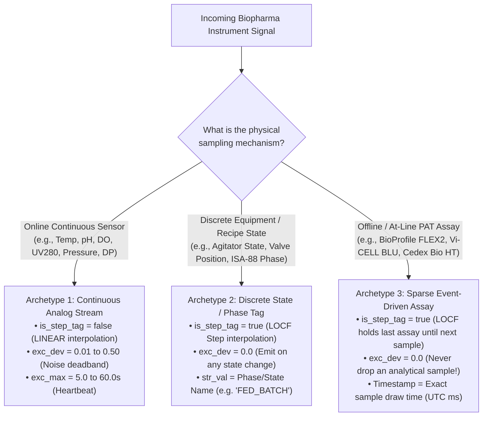

# Biopharma & Life Sciences Instrument Integration Catalog

**Comprehensive Research & Engineering Reference for Connecting Upstream, Downstream, PAT, Aseptic Fill-Finish, and GMP Utility Instruments to the OpenHistorian GxP Industrial Historian**

---

## 1. Executive Summary: Why Biopharma Instruments Connect to a Historian

In cGMP biopharmaceutical manufacturing (monoclonal antibodies, viral vectors, mRNA, cell and gene therapies, and recombinant proteins), regulatory frameworks—**FDA 21 CFR Part 11**, **EU GMP Annex 11**, **ICH Q8/Q9/Q10 (Quality by Design & PAT)**, and **EU GMP Annex 1 (Manufacture of Sterile Medicinal Products)**—mandate continuous, tamper-evident archiving of **Critical Process Parameters (CPPs)**, **Critical Quality Attributes (CQAs)**, and **Critical Material Attributes (CMAs)**.

Historically, life sciences facilities deployed the proprietary **OSIsoft / AVEVA PI System** (using *PI Interface for OPC DA*, *PI Connector for OPC UA*, *PI Interface for Modbus/BACnet*, and *PI Batch / Event Frames*) to aggregate data from islands of automation on the cleanroom floor.

**OpenHistorian GxP Industrial Historian** provides a drop-in, open-source 4-Pillar replacement that connects to every major bioprocess skid, Process Analytical Technology (PAT) analyzer, chromatography workstation, lyophilizer, and cleanroom Environmental Monitoring System (EMS) using standardized industrial protocols while enforcing cryptographic 21 CFR Part 11 data integrity.

---

## 2. Master Biopharma Instrument & Protocol Matrix

The matrix below catalogs the most common life sciences instruments connected to PI Historians in commercial GMP and Process Development (PD) facilities, their native vendor software/control layers, protocols, and corresponding OpenHistorian GxP integration pathways:

| Process Area | Manufacturer & Instrument Family | Control / Software Platform | Primary Protocols | Data Cadence & Interpolation | OpenHistorian GxP Ingestion Pathway | Detailed Guide |
| :--- | :--- | :--- | :--- | :--- | :--- | :--- |
| **USP Bioreactors (Single-Use)** | **Cytiva Xcellerex™ X-Platform & XDR (50–2000 L)** | Figurate™ (Emerson DeltaV™ or Rockwell PlantPAx®) | OPC UA, OPC DA, EtherNet/IP | Continuous (`1 s`, `LINEAR`) + Phase (`LOCF`) | `[[inputs.opcua]]` or `opcda_windows_forwarder.py` | [XCELLEREX_X_PLATFORM_INTEGRATION.md](XCELLEREX_X_PLATFORM_INTEGRATION.md) |
| **USP Bioreactors & High-Throughput** | **Sartorius Biostat® STR (Gen 3) & Biostat® B-DCU** | BioPAT® MFCS 4 / Biobrain / Siemens S7-1500 | OPC UA, S7comm | Continuous (`1 s`, `LINEAR`) + Phase (`LOCF`) | `[[inputs.opcua]]` or `[[inputs.s7comm]]` | [USP_BIOREACTORS_SARTORIUS_THERMO_EPPENDORF.md](USP_BIOREACTORS_SARTORIUS_THERMO_EPPENDORF.md) |
| **USP Parallel Microbioreactors** | **Sartorius Ambr® 250 HT & Ambr® 15 (12/24/48 vessels)** | Ambr® Control Software / BioPAT® MFCS | OPC UA | Continuous (`1–5 s`) + At-line (`LOCF`) | `[[inputs.opcua]]` + Multi-Vessel AF Template | [USP_BIOREACTORS_SARTORIUS_THERMO_EPPENDORF.md](USP_BIOREACTORS_SARTORIUS_THERMO_EPPENDORF.md) |
| **USP Bioreactors (Single-Use)** | **Thermo Fisher HyPerforma™ S.U.B. / S.U.F. (50–5000 L)** | TruBio® DV (Emerson DeltaV™ DCS) | OPC UA, OPC DA | Continuous (`1 s`, `LINEAR`) + Phase (`LOCF`) | `[[inputs.opcua]]` or `opcda_windows_forwarder.py` | [USP_BIOREACTORS_SARTORIUS_THERMO_EPPENDORF.md](USP_BIOREACTORS_SARTORIUS_THERMO_EPPENDORF.md) |
| **USP Benchtop & Parallel** | **Eppendorf BioFlo® 320/720 & DASGIP® Parallel** | DASware® connect | OPC UA, OPC DA | Continuous (`1–5 s`, `LINEAR`) | `[[inputs.opcua]]` | [USP_BIOREACTORS_SARTORIUS_THERMO_EPPENDORF.md](USP_BIOREACTORS_SARTORIUS_THERMO_EPPENDORF.md) |
| **PAT Cell & Metabolite Analyzer** | **Nova Biomedical BioProfile® FLEX2 (+ Autosampler)** | BioProfile OPC Server / Flownamics Seg-Flow® | OPC UA, OPC DA, CSV Watchfolder | Sparse Event-Driven (`LOCF`, `exc_dev=0`) | `[[inputs.opcua]]` or HTTP `:8080/ingest` | [PAT_CELL_ANALYZERS_AND_SPECTROSCOPY.md](PAT_CELL_ANALYZERS_AND_SPECTROSCOPY.md) |
| **PAT Cell Viability Analyzer** | **Beckman Coulter Vi-CELL™ BLU** | Vi-CELL BLU Embedded Automation Server | OPC UA, HTTPS REST | Sparse Event-Driven (`LOCF`, `exc_dev=0`) | `[[inputs.opcua]]` or Python REST Worker | [PAT_CELL_ANALYZERS_AND_SPECTROSCOPY.md](PAT_CELL_ANALYZERS_AND_SPECTROSCOPY.md) |
| **PAT Metabolite & Titer Analyzer** | **Roche CustomBiotech Cedex® Bio HT & Cedex® HiRes** | Cedex Control Center / Seg-Flow® | CSV/XML Archive, OPC UA Bridge | Sparse Event-Driven (`LOCF`, `exc_dev=0`) | Python Watchfolder Worker $\rightarrow$ `:8080/ingest` | [PAT_CELL_ANALYZERS_AND_SPECTROSCOPY.md](PAT_CELL_ANALYZERS_AND_SPECTROSCOPY.md) |
| **PAT In-Line Spectroscopy** | **Endress+Hauser (Kaiser) Raman Rxn2™ / Rxn4™** | Raman RunTime™ / SIMCA®-online | OPC UA, Modbus TCP | Continuous (`1–5 min` scans, `LINEAR`) | `[[inputs.opcua]]` or `[[inputs.modbus]]` | [PAT_CELL_ANALYZERS_AND_SPECTROSCOPY.md](PAT_CELL_ANALYZERS_AND_SPECTROSCOPY.md) |
| **PAT Smart In-Line Sensors** | **Hamilton Arc® (Incyte® VCD, VisiFerm™ DO, EasyFerm™ pH) & Mettler Toledo M800** | ArcAir® / M800 Transmitter | Modbus TCP/RTU, OPC UA, PROFINET | Continuous (`1 s`, `LINEAR`) | `[[inputs.modbus]]` or `[[inputs.opcua]]` | [PAT_CELL_ANALYZERS_AND_SPECTROSCOPY.md](PAT_CELL_ANALYZERS_AND_SPECTROSCOPY.md) |
| **DSP Chromatography & TFF** | **Cytiva ÄKTA™ process, ÄKTA™ ready, ÄKTA™ readyflux** | UNICORN™ 7 OPC Server / Figurate™ | OPC DA, OPC UA, OPC HDA | Fast Continuous (`0.5–1 s`, `LINEAR`) | `opcda_windows_forwarder.py` or `[[inputs.opcua]]` | [DSP_CHROMATOGRAPHY_TFF_FILTRATION.md](DSP_CHROMATOGRAPHY_TFF_FILTRATION.md) |
| **DSP TFF / UF / DF Skids** | **Sartorius Sartoflow® Advanced / Modular & Resolute®** | BioPAT® MFCS / Siemens S7-1500 | OPC UA, S7comm | Continuous (`1 s`, `LINEAR`) + Step (`LOCF`) | `[[inputs.opcua]]` or `[[inputs.s7comm]]` | [DSP_CHROMATOGRAPHY_TFF_FILTRATION.md](DSP_CHROMATOGRAPHY_TFF_FILTRATION.md) |
| **DSP Chromatography & TFF** | **MilliporeSigma Mobius® Chrom 20 & Cogent® TFF** | Rockwell ControlLogix / PlantPAx® | OPC UA, EtherNet/IP | Continuous (`1 s`, `LINEAR`) | `[[inputs.opcua]]` | [DSP_CHROMATOGRAPHY_TFF_FILTRATION.md](DSP_CHROMATOGRAPHY_TFF_FILTRATION.md) |
| **DP Freeze Drying (Lyophilization)** | **SP Hull, IMA Edwards, Telstar, Martin Christ Lyophilizers** | Siemens S7-1500 / Rockwell ControlLogix | OPC UA, S7comm | Continuous (`1–5 s`, `LINEAR`) + Phase (`LOCF`) | `[[inputs.opcua]]` or `[[inputs.s7comm]]` | [ASEPTIC_FILL_FINISH_LYO_AND_GMP_UTILITIES.md](ASEPTIC_FILL_FINISH_LYO_AND_GMP_UTILITIES.md) |
| **DP Aseptic Filling & Isolators** | **Bausch+Ströbel, Optima, IMA Life & SKAN Isolators** | Siemens S7-1500 / Rockwell ControlLogix | OPC UA, S7comm, Modbus TCP | Continuous (`1 s`, `LINEAR`) + IPC Weight (`LOCF`) | `[[inputs.opcua]]` | [ASEPTIC_FILL_FINISH_LYO_AND_GMP_UTILITIES.md](ASEPTIC_FILL_FINISH_LYO_AND_GMP_UTILITIES.md) |
| **GMP Cleanroom EMS & Particle Counters** | **PMS LasAir® III / Airnet® II, Lighthouse Solair, Siemens Desigo / Honeywell EBI** | BMS / EMS Controllers | BACnet/IP (`COV`), Modbus TCP, OPC UA | Continuous (`1–10 s`, `LINEAR`) | `bacnet_cov_worker.py` or `[[inputs.modbus]]` | [ASEPTIC_FILL_FINISH_LYO_AND_GMP_UTILITIES.md](ASEPTIC_FILL_FINISH_LYO_AND_GMP_UTILITIES.md) |
| **GMP Utilities (WFI, PW, TOC)** | **Veolia Sievers® M9 / M9e TOC & Mettler Toledo Thornton Conductivity** | Embedded Analyzer / WFI Skid PLC | Modbus TCP, OPC UA | Continuous (`1–60 s`, `LINEAR`) | `[[inputs.modbus]]` or `[[inputs.opcua]]` | [ASEPTIC_FILL_FINISH_LYO_AND_GMP_UTILITIES.md](ASEPTIC_FILL_FINISH_LYO_AND_GMP_UTILITIES.md) |

---

## 3. Bioprocess Signal Archetypes & Historian Configuration Rules

Unlike general industrial telemetry, biopharma instruments produce **three distinct signal archetypes** that must be configured properly in PostgreSQL (`tags` table) and ClickHouse (`pi_historian.sensor_data`) to satisfy FDA/EMA data integrity expectations:

### Critical Rule for At-Line PAT Analyzers (Archetype 3)
When connecting at-line cell counters or metabolite analyzers (**BioProfile FLEX2**, **Vi-CELL BLU**, **Cedex Bio HT**) that run 1–4 times per day (or every 30–120 minutes via an automated sampler like Flownamics Seg-Flow®):
1. **Always set `exc_dev = 0.0`:** Every discrete sample analysis represents a critical laboratory record. Never allow deadband filtering to suppress an analytical result just because two consecutive samples yielded the same glucose or viability value.
2. **Set `is_step_tag = true` (`LOCF`):** In Excel PI DataLink (`=PI_SAMPLED_DATA()`) and Grafana trends, holding the last measured laboratory value (`LOCF`) until the next sample is drawn prevents artificial linear interpolation ramps across 12-hour intervals before a bolus glucose feed occurs.
3. **Preserve Sample Draw Timestamp (`ts`):** Send the analyzer's explicit sample draw/completion timestamp in the JSON payload (`{"tag_id": ..., "ts": 1792241400000, "val": ...}`) to `http://edge-collector:8080/ingest` so Telegraf writes the true analytical timestamp (`$exists(fields.ts) ? fields.ts : timestamp`) rather than file-parse arrival time.

---

## 4. Network Architecture & Purdue Model (ISA-95) Security Zoning

In a qualified GMP facility, instruments reside in **Purdue Level 1/2 (Cell/Area Control Network)**, whereas the central historian (`clickhouse-archive`, `postgres-control`, `historian-api`) resides in **Purdue Level 3 (Manufacturing Operations / MES / Historian DMZ)**:

1. **Zero Inbound Firewall Ports to Level 2:**
   - Deploy `edge-collector` inside the Level 2.5 Industrial DMZ (or on local skid gateway nodes).
   - Legacy Windows workstations (e.g., UNICORN™ 7 OPC DA or BioProfile® OPC DA) run `opcda_windows_forwarder.py` locally and push outbound HTTPS/HTTP JSON batches to `edge-collector:8080/ingest`, completely eliminating inbound DCOM port `135` and dynamic high-port exposure.
2. **Disk-Backed Store-and-Forward WAL (`URS-005`):**
   - `edge-collector/telegraf-clickhouse.conf` enforces `buffer_strategy = "disk"` at `/var/lib/telegraf/buffer` (`metric_buffer_limit = 1000000`). If the Level 3 firewall or ClickHouse server undergoes maintenance during a 14-day perfusion bioreactor run, zero telemetry points are lost.

---

## 5. Guide Index

- **[XCELLEREX_X_PLATFORM_INTEGRATION.md](XCELLEREX_X_PLATFORM_INTEGRATION.md):** Cytiva Xcellerex™ X-Platform (50 L – 2000 L) & Figurate™ Automation (DeltaV™ / PlantPAx®).
- **[USP_BIOREACTORS_SARTORIUS_THERMO_EPPENDORF.md](USP_BIOREACTORS_SARTORIUS_THERMO_EPPENDORF.md):** Sartorius Biostat® STR & Ambr® 15/250 (BioPAT® MFCS), Thermo Fisher HyPerforma™ S.U.B. (TruBio® DV), and Eppendorf BioFlo® / DASGIP®.
- **[PAT_CELL_ANALYZERS_AND_SPECTROSCOPY.md](PAT_CELL_ANALYZERS_AND_SPECTROSCOPY.md):** Nova BioProfile® FLEX2, Beckman Coulter Vi-CELL™ BLU, Roche Cedex® Bio HT, Endress+Hauser Raman Rxn2™/Rxn4™, and Hamilton Arc® / Mettler Toledo smart sensors.
- **[DSP_CHROMATOGRAPHY_TFF_FILTRATION.md](DSP_CHROMATOGRAPHY_TFF_FILTRATION.md):** Cytiva ÄKTA™ (UNICORN™ 7), Sartorius Sartoflow® / Resolute®, and MilliporeSigma Mobius® / Cogent® chromatography & TFF skids.
- **[ASEPTIC_FILL_FINISH_LYO_AND_GMP_UTILITIES.md](ASEPTIC_FILL_FINISH_LYO_AND_GMP_UTILITIES.md):** GMP Lyophilizers, Aseptic Filling Lines & SKAN Isolators, Cleanroom EMS / Particle Counters (BACnet/IP & Modbus), and Veolia Sievers® M9 TOC / WFI loops.
- **[LEGACY_PROTOCOLS_BACNET_OPCDA_MODBUS_S7.md](LEGACY_PROTOCOLS_BACNET_OPCDA_MODBUS_S7.md):** Deep-dive legacy fieldbus & PLC protocols (`BACnet/IP & MS/TP` BBMD routing, Windows COM/DCOM `OPC DA 2.05a`, `Modbus RTU/TCP` word-swapping, Siemens `S7comm` autoclaves, and `4–20 mA HART` multiplexers).
- **[LEGACY_SERIAL_RS232_AND_PI_UFL_REPLACEMENT.md](LEGACY_SERIAL_RS232_AND_PI_UFL_REPLACEMENT.md):** OpenHistorian replacement for *OSIsoft PI UFL* covering RS-232 / Moxa NPort serial streams (`MT-SICS` analytical balances, freezing-point osmometers) and flat-file watchfolders (Sartocheck® / Palltronic® filter integrity testers).

