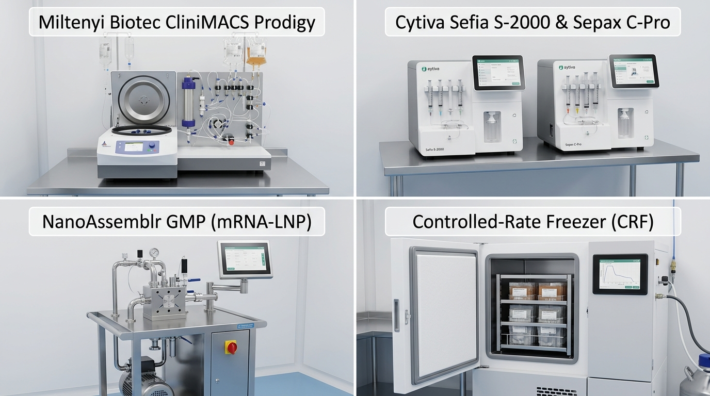
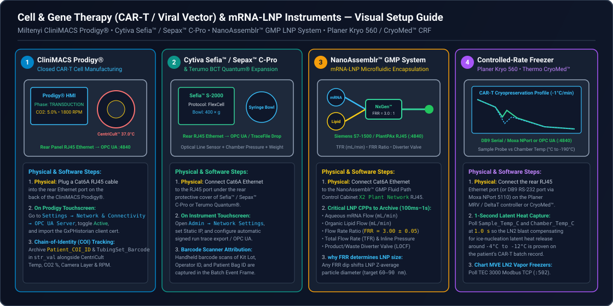
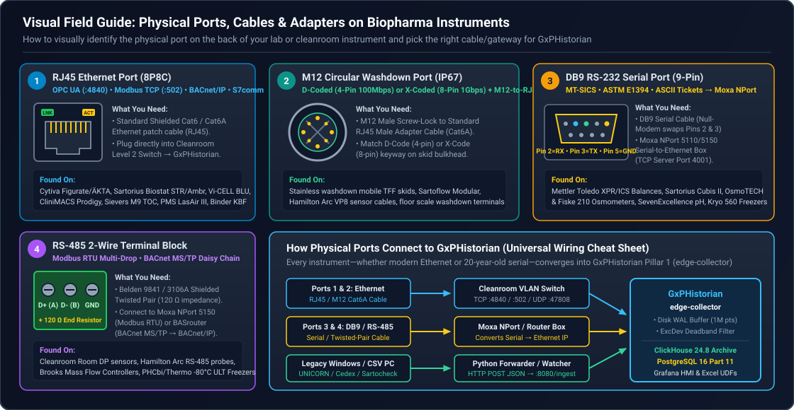

# Cell & Gene Therapy (CGT), mRNA-LNP & Controlled-Rate Freezer End-to-End Integration Guide

**Document ID:** `SOP-CGT-LNP-GXPHISTORIAN-2026`  
**Target Systems:** Miltenyi CliniMACS Prodigy®, Cytiva Sefia™ S-2000 & Sepax™ C-Pro, Terumo BCT Quantum®, Precision NanoSystems (Cytiva) NanoAssemblr™ GMP System, and Planer Kryo 560 / Thermo Scientific™ CryoMed™ Controlled-Rate Freezers (CRFs)  
**Target Platform:** GxPHistorian (`edge-collector`, `postgres-control`, `clickhouse-archive`, `grafana-vision`)  
**Regulatory Alignment:** 21 CFR Part 11, EU GMP Annex 11, EU Guidelines on GMP for ATMPs (Part IV), FDA CMC Guidance for Human Gene Therapy & mRNA-LNP Products, ISPE GAMP 5 (Second Edition)

---

## 1. Visual Equipment & Physical Connection Overview

Cell and Gene Therapy (CAR-T, TCR-T, NK, Viral Vectors) and mRNA-Lipid Nanoparticle (LNP) manufacturing present unique historian requirements:
1. **Autologous "One-Batch-Equals-One-Patient" Vein-to-Vein Traceability:** Every instrument run on a CliniMACS Prodigy, Sefia S-2000, or Controlled-Rate Freezer is tied to a single patient's Chain of Identity (`COI_ID` / `DIN` Donation Identification Number). Losing telemetry or failing to link it to the patient's `COI_ID` can delay life-saving release.
2. **Closed-System Benchtop & Cart Skids:** Unlike 2,000 L stainless bioreactors wired into plant-wide DCS cabinets, CGT instruments are compact benchtop or mobile cart units with rear **RJ45 Ethernet** or **9-pin DB9 RS-232 serial** ports.
3. **Critical Thermal Inflection Curves (Latent Heat of Fusion):** During cryopreservation in a Controlled-Rate Freezer, cells release latent heat as ice nucleates around $-4\,^\circ\text{C}$ to $-8\,^\circ\text{C}$. QA must verify from the historian curve that liquid nitrogen ($\text{LN}_2$) blast cooling compensated for the phase change without warming the patient bag.





Also refer to our universal connector diagram if you are unfamiliar with industrial ports:



---

## 2. Quick-Reference: What Cable & Software Protocol Does My CGT / mRNA Instrument Use?

| Instrument Make & Model (Official Vendor Links) | Typical Process Step | Where to Plug In on the Physical Unit | Cable / Adapter Needed | Software Protocol & Port | Required Vendor License / Option |
| :--- | :--- | :--- | :--- | :--- | :--- |
| **[Miltenyi Biotec CliniMACS Prodigy®](https://www.miltenyibiotec.com/US-en/products/clinimacs-prodigy.html)** | Automated CAR-T cell washing, magnetic separation, transduction & expansion | **Rear Panel — Lower Right Corner:** Standard **RJ45 Ethernet** port next to the main power switch | Standard **Cat6 Shielded Ethernet Cable** into Facility GMP Switch | **OPC UA Server** (`TCP 4840`) OR **Automated SMB/SFTP XML/PDF Run Export** | **CliniMACS Prodigy OPC UA License** (Firmware $\ge 2.2$) or Network Share Export enabled |
| **[Cytiva Sefia™ S-2000 / Sefia Select™](https://www.cytivalifesciences.com/en/us/shop/cell-therapy/systems/sefia-select-system-p-43516)** | Closed-system apheresis cell isolation, washing, and final formulation | **Rear Panel — Recessed I/O Bay:** **RJ45 Ethernet** port (`LAN`) | Standard **Cat6 Ethernet Cable** | **OPC UA Server** (`TCP 4840`) via **Chronicle™** or local skid OPC UA | **Cytiva OPC UA / Chronicle Integration Option** |
| **[Cytiva Sepax™ C-Pro](https://www.cytivalifesciences.com/en/us/shop/cell-therapy/systems/sepax-c-pro-cell-processing-system-p-29264741)** | Cord blood & cell therapy volume reduction / bead washing | **Rear Panel:** **RJ45 Ethernet** port (`Network`) + **USB-A** ports | Standard **Cat6 Ethernet Cable** | **Traceability Network Export** (PDF/XML over **SMB/CIFS** to GxPHistorian UFL watch-folder) | Built-in **Sepax Traceability** network share configuration |
| **[Precision NanoSystems (Cytiva) NanoAssemblr™ GMP System](https://www.cytivalifesciences.com/en/us/shop/lipid-nanoparticle-instruments-and-reagents/nanoparticle-formulation-systems/nanoassemblr-commercial-formulation-system-p-43407)** | Microfluidic impingement jet mixing of mRNA (aqueous) + Lipids (ethanol) | **Pump Skid PLC Cabinet ([Siemens S7-1500](https://www.siemens.com) / Allen-Bradley):** **RJ45 Service / SCADA Port** | Standard **Cat6A Shielded Cable** (M12 D-coded if washdown cart) | **OPC UA Server** (`TCP 4840`) at $100\text{ ms}$ – $1\text{ s}$ high-speed polling | Included in **NanoAssemblr GMP Automation Package** |
| **[Planer Kryo 560-16 / Kryo 750](https://planer.com)** | Controlled-rate $\text{LN}_2$ cryopreservation of CAR-T & leukapheresis bags | **Rear of MRV Controller Head:** **9-Pin DB9 Male RS-232** (`Serial PC`) or **RJ45 Ethernet** | **[Moxa NPort 5150](https://www.moxa.com/en/products/industrial-edge-connectivity/serial-device-servers/general-device-servers/nport-5100-series)** + DB9 Null-Modem adapter (or direct Cat6 to Planer DeltaT PC) | **ASCII Serial over TCP** (`Port 4001`) or **CSV Run Export** (`ufl_file_collector.py`) | Standard Serial Comms port (or **Planer DeltaT** software) |
| **[Thermo Scientific™ CryoMed™ (TSX / 7450 Series)](https://www.thermofisher.com/order/catalog/product/TSCM17XV)** | Controlled-rate $\text{LN}_2$ freezer for cell therapy bags & vials | **Rear Panel — Upper Comms Plate:** **RJ45 Ethernet** / **USB-B** / **RS-232 DB9** | Standard **Cat6 Cable** or **FTDI USB-to-RS232 + [Moxa NPort 5150](https://www.moxa.com/en/products/industrial-edge-connectivity/serial-device-servers/general-device-servers/nport-5100-series)** | **OPC UA / Modbus TCP** (`Port 502`) on touchscreen models; **RS-232 ASCII** on legacy 7450 | Standard on touchscreen CryoMed models |

---

## 3. Tutorial 1: Miltenyi Biotec CliniMACS Prodigy® (CAR-T Automated Cell Processing)

The **Miltenyi CliniMACS Prodigy** is the workhorse of autologous CAR-T manufacturing, performing cell washing, magnetic microbead enrichment (`CentriCult` chamber), viral transduction, and multi-day cell expansion (`37.0 °C`, `5.0 % CO2`, gentle shaking) inside a single-use tubing set (`TS 520` / `TS 310`).

### 3.1 Physical Connection Step-by-Step (For Lab Scientists & Operators)
1. **What to Bring to the Cleanroom:**
   - One **Cat6 Shielded Ethernet patch cable** ( wiped down with $70\%$ IPA / sporicidal wipes per your Grade B/C material transfer SOP).
2. **Locate the Physical Port:**
   - Walk behind the CliniMACS Prodigy benchtop unit (or roll the mobile Prodigy cart slightly forward).
   - Look at the **lower-right corner of the rear stainless panel**, adjacent to the main AC power inlet and equipotential grounding stud.
   - Locate the **RJ45 Ethernet port** (labeled with the network `🌐` icon).
3. **Plug In:**
   - Insert one end of the Cat6 cable into the Prodigy's rear RJ45 port until it clicks.
   - Plug the other end into the cleanroom wall Ethernet jack patched to your **GMP Instrument VLAN** (e.g., `10.20.70.0/24`).
   - Verify the **green Link LED** on the RJ45 port lights up solid and the **amber Activity LED** blinks.

### 3.2 Software Enablement on the CliniMACS Prodigy Touchscreen
1. On the CliniMACS Prodigy front touchscreen, log in with an **Administrator** or **Supervisor** account.
2. Tap **Settings (Gear Icon)** $\rightarrow$ **Network Configuration**.
3. Select **Static IP** (never use DHCP without a permanent MAC reservation in a GMP facility) and enter:
   - **IP Address:** `10.20.70.21`
   - **Subnet Mask:** `255.255.255.0`
   - **Default Gateway:** `10.20.70.1`
   - **NTP Time Server:** Point to your facility NTP server (same NTP source used by `GxPHistorian` to satisfy 21 CFR Part 11 synchronized time).
4. **Enable OPC UA (Recommended for Real-Time Telemetry):**
   - Navigate to **Settings** $\rightarrow$ **Interfaces / Connectivity** $\rightarrow$ **OPC UA Server**.
   - Toggle **Enable OPC UA Server** to **ON**.
   - Confirm **Port:** `4840`.
   - Select **Security Policy:** `Basic256Sha256` (Sign & Encrypt) and export/trust the `GxPHistorian` client certificate (or select `None` during initial commissioning inside an isolated VLAN).
5. **Enable Automated Run Report Export (Backup / Dual-Path Verification):**
   - Navigate to **Settings** $\rightarrow$ **Data Export / Network Share**.
   - Configure the SMB path `\\10.20.70.10\gxphistorian_ufl\incoming\prodigy_01` so that upon completion of every process protocol, the signed XML/CSV process log is automatically dropped into `GxPHistorian`.

### 3.3 Verify Network Connectivity from the GxPHistorian Host
Run this single command from your `GxPHistorian` server terminal to confirm the Prodigy is reachable on Port `4840`:
```bash
nc -zv 10.20.70.21 4840
# Expected output: Connection to 10.20.70.21 4840 port [tcp/*] succeeded!
```

### 3.4 Critical CliniMACS Prodigy Tags & Interpolation Rules

| Tag Name | Parameter Description | Engineering Units | `is_step_tag` | Why It Matters for ATMP Batch Release |
| :--- | :--- | :--- | :--- | :--- |
| `PRODIGY01_CHAMBER_TEMP_PV` | CentriCult Chamber Temperature PV | `degC` | `false` (Linear) | Must hold $37.0 \pm 0.5\,^\circ\text{C}$ during T-cell transduction & expansion |
| `PRODIGY01_CHAMBER_TEMP_SP` | CentriCult Chamber Temperature Setpoint | `degC` | `true` (LOCF) | Step-change setpoint (`4.0 °C` labeling vs `37.0 °C` expansion) |
| `PRODIGY01_CO2_CONC_PV` | Gas Mix $\text{CO}_2$ Concentration PV | `%` | `false` (Linear) | Maintains media pH buffering during multi-day expansion |
| `PRODIGY01_CENTRICULT_RPM` | CentriCult Chamber Centrifugation / Shake Speed | `RPM` | `false` (Linear) | Verifies wash spin $g$-force (`0–2500 RPM`) and gentle agitation |
| `PRODIGY01_PRESSURE_P1_MBAR` | Tubing Set Line Pressure Sensor P1 | `mbar` | `false` (Linear) | Detects filter/tubing occlusion or bag overpressure |
| `PRODIGY01_PHASE_CODE` | Active Activity Matrix Step ID | `enum` | `true` (LOCF) | Drives automatic ISA-88 Phase Event Frames (`Wash`, `Feed`, `Harvest`) |

---

## 4. Tutorial 2: Cytiva Sefia™ S-2000 & Sepax™ C-Pro (Cell Washing & Formulation)

The **Cytiva Sefia S-2000** and **Sepax C-Pro** use a syringe-like rotating centrifugation chamber (`CT-800.1` / `CT-90.1` kits) and optical line sensors to separate plasma, wash DMSO/cryoprotectant, and concentrate CAR-T cells into final cryobags.

### 4.1 Physical Connection Step-by-Step
1. **Locate the Recessed I/O Panel:**
   - Look at the **back of the Sefia S-2000 or Sepax C-Pro**.
   - Above the AC power socket is a recessed stainless connector bay containing an **RJ45 Ethernet port** (`LAN`) and two **USB-A** ports (used for the handheld 2D barcode scanner that scans the patient `COI_ID` and kit lot).
2. **Plug In:**
   - Plug a **Cat6 Ethernet cable** into the rear `LAN` RJ45 port and connect to your GMP Instrument switch (`10.20.70.22`).

### 4.2 Software Enablement (OPC UA or Traceability File Export)
- **On Sefia S-2000 (with OPC UA / Chronicle Gateway):**
  1. Log in as **Administrator** on the Sefia touchscreen.
  2. Go to **Setup** $\rightarrow$ **Connectivity** $\rightarrow$ **Network** and set Static IP `10.20.70.22`.
  3. Enable **OPC UA Telemetry** (`Port 4840`) to stream chamber speed (`RPM`), piston position (`mm`), optical line sensor absorbance, and thermal mixer temperature (`°C`).
- **On Sepax C-Pro (Automated XML/CSV Traceability Drop):**
  1. Log in as **Administrator** $\rightarrow$ **Configuration** $\rightarrow$ **Network & Export**.
  2. Enter the SMB network share path of the `GxPHistorian` watch folder: `\\10.20.70.10\gxphistorian_ufl\incoming\sepax_01`.
  3. Enable **Auto-Export Traceability File at End of Procedure**.
  4. When an operator scans the patient's `COI_ID` barcode and completes a `NeatCell` or `PeriCell` protocol, the Sepax C-Pro writes a structured XML/CSV file containing the time-series pressure/RPM trace, kit lot number, and patient `COI_ID`, which `GxPHistorian`'s `ufl_file_collector.py` parses into ClickHouse telemetry + an ISA-88 Event Frame within 2 seconds!

---

## 5. Tutorial 3: Precision NanoSystems (Cytiva) NanoAssemblr™ GMP System (mRNA-LNP Formulation)

In mRNA vaccine and gene editing (CRISPR LNP) production, the **NanoAssemblr™ GMP System** mixes an aqueous mRNA stream with an ethanolic lipid stream inside a **NxGen™ microfluidic cartridge**.
- **Why 100 ms – 1 s High-Speed Historian Logging Is Mandatory:** Particle size ($60\text{–}100\text{ nm}$ hydrodynamic diameter) and Polydispersity Index ($\text{PDI} < 0.15$) depend entirely on maintaining a rock-steady **Total Flow Rate (TFR)** and **Flow Rate Ratio (FRR, typically 3:1 Aqueous:Ethanol)**. Even a $2\text{ second}$ pressure pulsation during start-up or waste-to-collect valve diversion alters LNP encapsulation efficiency.

### 5.1 Physical Connection Step-by-Step
1. **Locate the NanoAssemblr GMP Automation Cabinet:**
   - The NanoAssemblr GMP system consists of the cleanroom **Fluid Path Cart** (holding the dual high-pressure syringe/gear pumps, flow meters, and NxGen mixer) connected to the **Automation Control Unit (PLC cabinet)**.
   - Open the PLC cabinet (or locate the bulkhead washdown connector on the side of the skid).
   - Connect a **Cat6A Shielded Ethernet cable** (or **M12 D-coded washdown Ethernet** to RJ45 patch cord) into the **Customer SCADA / Historian Port (`X2`)** on the onboard **Siemens S7-1500** or **Allen-Bradley CompactLogix** PLC.

### 5.2 Software Enablement & High-Frequency Telegraf Polling
1. Verify with your Cytiva commissioning engineer that the **Customer OPC UA Server (`opc.tcp://10.20.70.25:4840`)** is active on the PLC's `X2` interface.
2. Because LNP formulation runs are short ($5\text{ to }45\text{ minutes}$) and fast, configure `GxPHistorian` `edge-collector` with a **`500ms` (`0.5 s`) polling interval**:

```toml
# Added to edge-collector/telegraf.conf for NanoAssemblr GMP mRNA-LNP Skid
[[inputs.opcua]]
  name = "nanoassemblr_lnp_skid01"
  endpoint = "opc.tcp://10.20.70.25:4840"
  security_policy = "Basic256Sha256"
  security_mode = "SignAndEncrypt"
  certificate = "/etc/telegraf/certs/gxphistorian_client.pem"
  private_key = "/etc/telegraf/certs/gxphistorian_client.key"
  interval = "500ms"

  nodes = [
    { name = "LNP01_AQUEOUS_FLOW_ML_MIN", namespace = "2", identifier_type = "s", identifier = "DB_HMI.Pumps.Aqueous_mRNA_Flow_PV" },
    { name = "LNP01_LIPID_FLOW_ML_MIN",   namespace = "2", identifier_type = "s", identifier = "DB_HMI.Pumps.Ethanol_Lipid_Flow_PV" },
    { name = "LNP01_TOTAL_FLOW_RATE_TFR", namespace = "2", identifier_type = "s", identifier = "DB_HMI.Process.Total_Flow_Rate_PV" },
    { name = "LNP01_FLOW_RATE_RATIO_FRR", namespace = "2", identifier_type = "s", identifier = "DB_HMI.Process.Flow_Rate_Ratio_PV" },
    { name = "LNP01_PRESSURE_AQUEOUS_BAR",namespace = "2", identifier_type = "s", identifier = "DB_HMI.Sensors.PT_Aqueous_Bar" },
    { name = "LNP01_PRESSURE_LIPID_BAR",  namespace = "2", identifier_type = "s", identifier = "DB_HMI.Sensors.PT_Lipid_Bar" },
    { name = "LNP01_COLLECT_VALVE_STATE", namespace = "2", identifier_type = "s", identifier = "DB_HMI.Valves.XV_Product_Collect_Open" }
  ]
```

---

## 6. Tutorial 4: Planer Kryo 560-16 & Thermo CryoMed™ Controlled-Rate Freezers (CRFs)

Before CAR-T cells can be shipped in a $-150\,^\circ\text{C}$ vapor-phase $\text{LN}_2$ dry shipper (`Cryoport`) back to the hospital, they must be frozen at a tightly controlled rate (typically $-1.0\,^\circ\text{C/min}$ down to $-40\,^\circ\text{C}$, then $-10.0\,^\circ\text{C/min}$ down to $-90\,^\circ\text{C}$).

### 6.1 Physical Connection Step-by-Step (Non-Technical Guide)
- **For Planer Kryo 560-16 / Kryo 750 (with MRV Controller Head):**
  1. Look at the **back of the MRV display controller head** mounted on top of the freezer lid.
  2. Locate the **9-Pin DB9 RS-232 Serial Connector** labeled `PC / Serial`.
  3. Plug a **9-pin DB9 serial cable** + **Null-Modem Adapter** into Port 1 of a **Moxa NPort 5150 Serial-to-Ethernet Device Server** (`$130` industrial box).
  4. Plug a standard **Cat6 Ethernet cable** from the Moxa NPort 5150 into your cleanroom network jack (`10.20.70.28`).
  5. *(Alternative if your Planer freezer already connects to a Windows PC running Planer **DeltaT** software)*: Install a second USB-to-Ethernet adapter on the DeltaT PC and point `GxPHistorian`'s `ufl_file_collector.py` at the DeltaT CSV export folder.
- **For Thermo Scientific™ CryoMed™ (Touchscreen Series):**
  1. Locate the **RJ45 Ethernet port** on the upper rear communications panel.
  2. Plug a **Cat6 Ethernet cable** directly into your GMP Instrument VLAN (`10.20.70.29`).
  3. On the CryoMed touchscreen, go to **Settings** $\rightarrow$ **Communications** $\rightarrow$ **Modbus TCP / OPC UA** and enable external read access on Port `502` / `4840`.

### 6.2 Capturing the Latent Heat of Fusion Dip (1-Second Polling)
- Why $1\text{ Hz}$ (`1s`) polling matters: When the liquid inside the cryobag transitions to ice (around $-6\,^\circ\text{C}$), it releases latent heat. The Controlled-Rate Freezer triggers a rapid $\text{LN}_2$ solenoid pulse plunging the **Chamber Temperature (`CRF01_CHAMBER_TEMP_C`)** down to $-45\,^\circ\text{C}$ for $60\text{ seconds}$ so that the **Sample Probe Temperature (`CRF01_SAMPLE_TEMP_C`)** inside the reference dummy bag continues cooling smoothly at $-1.0\,^\circ\text{C/min}$.
- By polling `CRF01_CHAMBER_TEMP_C`, `CRF01_SAMPLE_TEMP_C`, and `CRF01_PROFILE_SP_C` every `1s` into ClickHouse (`is_step_tag = false` for continuous temperatures), QA reviewers can overlay all three curves in Grafana or Excel DataLink to prove zero supercooling or post-nucleation thermal rebound occurred.

---

## 7. Registering CGT Assets, Patient `COI_ID` Event Frames & Verifying in GxPHistorian

### Step 1: Register the CAR-T Suite Asset & Tags in `GxPHistorian` (with 21 CFR Part 11 Audit Headers)
Run the following `curl` commands (or paste into the FastAPI Swagger UI at `http://localhost:8000/docs`) to register the **CliniMACS Prodigy** and **Controlled-Rate Freezer** under your Cell Therapy Suite:

```bash
# 1. Create the CliniMACS Prodigy Asset in the ISA-95 Hierarchy
curl -X POST "http://localhost:8000/api/v1/assets" \
  -H "Content-Type: application/json" \
  -H "X-Actor-Id: qa_lead@biopharma.com" \
  -H "X-Change-Reason: IQ/OQ Commissioning of CAR-T Suite CliniMACS Prodigy 01" \
  -d '{
    "asset_code": "PRODIGY_01",
    "asset_name": "Miltenyi CliniMACS Prodigy CAR-T Unit 01",
    "parent_path": "enterprise.site_boston.area_cgt.line_cart_suite1"
  }'

# 2. Register the Continuous & Setpoint Telemetry Tags
curl -X POST "http://localhost:8000/api/v1/tags" \
  -H "Content-Type: application/json" \
  -H "X-Actor-Id: automation_eng@biopharma.com" \
  -H "X-Change-Reason: Bind CliniMACS Prodigy CentriCult and Controlled-Rate Freezer tags" \
  -d '[
    {"tag_name": "PRODIGY01_CHAMBER_TEMP_PV", "asset_code": "PRODIGY_01", "eng_units": "degC", "is_step_tag": false},
    {"tag_name": "PRODIGY01_CHAMBER_TEMP_SP", "asset_code": "PRODIGY_01", "eng_units": "degC", "is_step_tag": true},
    {"tag_name": "PRODIGY01_CO2_CONC_PV",     "asset_code": "PRODIGY_01", "eng_units": "%",    "is_step_tag": false},
    {"tag_name": "PRODIGY01_CENTRICULT_RPM",  "asset_code": "PRODIGY_01", "eng_units": "RPM",  "is_step_tag": false},
    {"tag_name": "CRF01_SAMPLE_TEMP_C",       "asset_code": "PRODIGY_01", "eng_units": "degC", "is_step_tag": false},
    {"tag_name": "CRF01_CHAMBER_TEMP_C",      "asset_code": "PRODIGY_01", "eng_units": "degC", "is_step_tag": false}
  ]'
```

### Step 2: Open an Autologous Patient Batch Event Frame Linked to `COI_ID`
When the operator scans the patient's apheresis bag barcode (`COI-2026-88412-CAR`), open an ISA-88 Event Frame in `GxPHistorian`:

```bash
curl -X POST "http://localhost:8000/api/v1/event-frames" \
  -H "Content-Type: application/json" \
  -H "X-Actor-Id: cell_therapy_operator_04@biopharma.com" \
  -H "X-Change-Reason: Start CAR-T T-Cell Expansion Protocol for Patient COI-2026-88412-CAR" \
  -d '{
    "event_name": "CAR-T Expansion & Cryopreservation",
    "batch_id": "COI-2026-88412-CAR",
    "asset_code": "PRODIGY_01",
    "start_time": "2026-10-17T08:00:00Z",
    "attributes": {
      "patient_coi_id": "COI-2026-88412-CAR",
      "apheresis_din": "W411926008412",
      "tubing_set_lot": "TS520-2026-0991",
      "protocol_version": "T-Cell-Transduction-v3.4"
    }
  }'
```

### Step 3: Verify Patient Batch Summary in Excel DataLink
Once the run finishes, QA can open Microsoft Excel and pull the complete patient batch temperature and $\text{CO}_2$ CQA summary using a single formula:
```excel
=GXPHISTORIAN_EVENT_SUMMARY("COI-2026-88412-CAR", "PRODIGY01_CHAMBER_TEMP_PV", "mean,min,max")
```

---

## 8. Non-Technical Troubleshooting Checklist

| Symptom Seen by Operator / QA | Most Likely Physical or Software Cause | 2-Minute Fix |
| :--- | :--- | :--- |
| **Green Link LED on rear of CliniMACS Prodigy or Sefia is OFF** | Patch cable not fully seated in the recessed rear jack, or cleanroom wall port is not patched in the telecom closet. | Push the RJ45 connector until it clicks; test the wall jack with a laptop or move to the adjacent active cleanroom jack. |
| **`nc -zv <IP> 4840` times out on Prodigy** | Prodigy IP is set to DHCP (`169.254.x.x` self-assigned) or OPC UA toggle was not saved before rebooting the user interface. | On the Prodigy screen, check **Settings $\rightarrow$ Network** to confirm the Static IP matches `10.20.70.21` and toggle **OPC UA Server = ON**. |
| **Planer Kryo 560 connects on Port 4001, but zero temperature values appear** | Pin 2 (`RX`) and Pin 3 (`TX`) are not crossed between the MRV DB9 port and the Moxa NPort 5150. | Insert a **DB9 Null-Modem Adapter** between the serial cable and the Moxa NPort Port 1; watch the orange `Tx/Rx` LED start blinking every second. |
| **Sepax C-Pro says "Network Path Not Found" at end of run** | The SMB shared folder on the historian server does not grant Write permission to the `sepax_svc` service account. | Verify the SMB share `\\10.20.70.10\gxphistorian_ufl\incoming\sepax_01` allows **Write/Create** (while blocking Delete/Overwrite for Part 11 compliance). |
