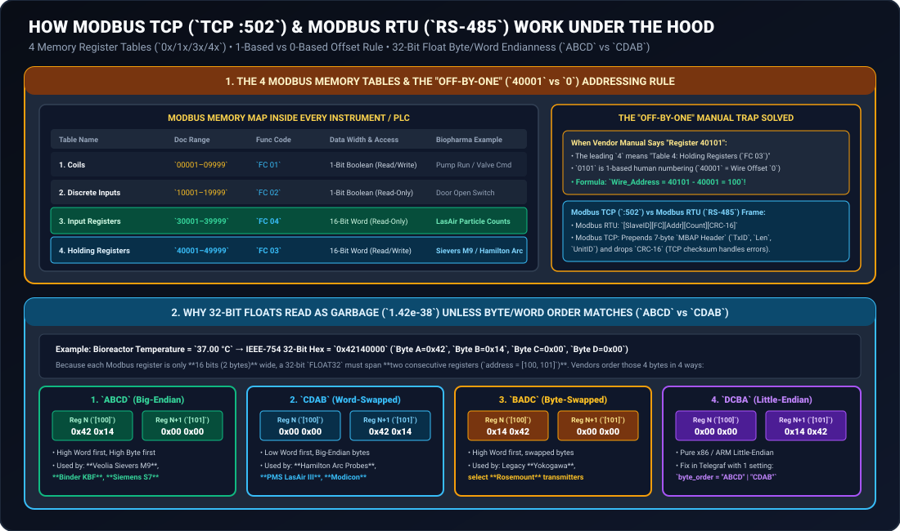

# Modbus TCP (`TCP :502`) & Modbus RTU (`RS-485`) Connectors: How They Work & Setup Guide

**Document ID:** `REF-CONNECTOR-MODBUS-GXPHISTORIAN-2026`  
**Protocols Covered:** **Modbus TCP/IP** over `TCP Port 502` and **Modbus RTU (Remote Terminal Unit)** over `EIA-485` (2-Wire / 4-Wire) and `EIA-232` bridged via Modbus TCP Gateways (**[Moxa MGate MB3180](https://www.moxa.com/en/products/industrial-edge-connectivity/protocol-gateways/modbus-tcp-gateways/mgate-mb3180-mb3280-mb3480-series)**)  
**Typical Biopharma Equipment:** [PMS LasAir® III / Pro & Airnet® II Particle Counters](https://www.pmeasuring.com/products/lasair-pro-airborne-particle-counter/), [Veolia Sievers® M9 / 500 RL WFI TOC Analyzers](https://www.watertechnologies.com/products/sievers-m9-laboratory-toc-analyzer), [Hamilton Arc® Smart Probes](https://www.hamiltoncompany.com/process-analytics/arc-sensors) (`Incyte` VCD, `VisiFerm` DO, `EasyFerm` pH), [BINDER KBF Stability Chambers](https://www.binder-world.com/us/products/simulation-chambers/constant-climate-chambers/kbf-series), [Thermo CryoMed™ Freezers](https://www.thermofisher.com/order/catalog/product/TSCM17XV), Brooks SLA Mass Flow Controllers, and [Advantech ADAM-6015 / 6017 Remote I/O Modules](https://www.advantech.com/en/products/iot-modules/adam-6017/mod_9df3d854-3e9a-4712-9856-d76ffefb2100)

---

## 1. Visual Architecture: How Modbus TCP & Modbus RTU Work Under the Hood

Originally developed by Modicon in 1979, **Modbus** remains the universal lingua franca of smart sensors, particle counters, TOC analyzers, and environmental chambers because of its simplicity. However, **90% of Modbus commissioning issues** come down to two things:
1. **The "Off-by-One" Register Addressing Rule (`40101` vs. Wire Offset `100`).**
2. **32-Bit IEEE-754 Float Byte/Word Endianness (`ABCD` Big-Endian vs. `CDAB` Word-Swapped).**

The visual diagram below explains both concepts at a glance:



---

## 2. Physical Appearance & Wiring: Modbus TCP vs. Modbus RTU

### 2.1 Modbus TCP (`TCP Port 502`)
- **What It Looks Like:** Standard **RJ45 Ethernet port** on the back or bottom of the analyzer (e.g., **Veolia Sievers® M9**, **Binder KBF Stability Chamber**, **PMS Airnet® II / LasAir® III**, **Advantech ADAM-6017**).
- **How It Connects:** Plug a Cat6/Cat6A cable directly into your GMP instrument switch. `GxPHistorian`'s Telegraf `[[inputs.modbus]]` plugin polls `tcp://<IP_ADDRESS>:502` directly.

### 2.2 Modbus RTU (`RS-485` 2-Wire Screw Terminal or M12 8-Pin)
Many field sensors—such as **Hamilton Arc® pH/DO/Permittivity probes** mounted directly in bioreactor ports, older cleanroom particle counters, or chiller controllers—use **2-wire RS-485 Modbus RTU**.
- **What It Looks Like:**
  - Either a **3-pin green screw terminal** (`Data+ / B`, `Data- / A`, `GND`) or an **8-pin M12 A-coded circular plug** (`Hamilton Ref 242079` cable).
- **The 4 Rules of Bulletproof RS-485 Modbus RTU Wiring:**
  1. **Daisy-Chain Topology Only:** Wire `D+` to `D+`, `D-` to `D-`, and `GND` to `GND` from instrument 1 $\rightarrow$ instrument 2 $\rightarrow$ ... $\rightarrow$ **Moxa MGate MB3180** gateway (up to 32 devices per segment, up to $1,200\text{ m}$ total cable length).
  2. **$120\,\Omega$ End-of-Line Termination Resistors:** Place a $120\,\Omega$ quarter-watt resistor across `D+` and `D-` at the **very first device** and enable the built-in $120\,\Omega$ termination switch on the **Moxa MGate MB3180** at the other end. This absorbs signal reflections at the ends of the transmission line.
  3. **Unique Slave ID (`1..247`) & Identical Serial Framing:** Every device on the same RS-485 wire must share the exact same baud rate and parity (e.g., `19200, 8, N, 2` for Hamilton Arc or `9600, 8, E, 1` for industrial meters), and each device must have a unique **Unit / Slave ID** (`1`, `2`, `3`, ...).
  4. **Vendor Polarity Naming Quirk (`A/B` vs `D+/D-`):** Most vendors label `D+ = B` and `D- = A`, but a few vendors reverse `A` and `B`. *Practical tip:* Connecting `D+` and `D-` backwards will **never** damage an RS-485 chip—if a new device doesn't reply, simply swap the two `D+`/`D-` wires!

---

## 3. How the 4 Modbus Memory Tables & Function Codes Work

Inside every Modbus device, memory is divided into **four separate tables** distinguished by the **Function Code (`FC`)** sent in the request packet:

| Table Number | Table Name | Traditional 5-Digit Doc Address | Modern 6-Digit Doc Address | Modbus Function Code (`Read`) | Data Width | Access | Typical Biopharma Usage |
| :---: | :--- | :--- | :--- | :---: | :--- | :--- | :--- |
| **`0xxxx`** | **Coils** | `00001 – 09999` | `000001 – 065536` | **`FC 01`** (`Read Coils`) | **1-Bit** (`0` or `1`) | Read / Write | Discrete command relays (e.g., Start/Stop sample pump). |
| **`1xxxx`** | **Discrete Inputs** | `10001 – 19999` | `100001 – 165536` | **`FC 02`** (`Read Discrete Inputs`) | **1-Bit** (`0` or `1`) | **Read-Only** | Hardware limit switches (`Door_Open`, `Flow_Switch_OK`, `High_Temp_Alarm`). |
| **`3xxxx`** | **Input Registers** | `30001 – 39999` | `300001 – 365536` | **`FC 04`** (`Read Input Registers`) | **16-Bit Word** (`2 Bytes`) | **Read-Only** | Read-only live sensor measurements (**PMS LasAir® III** particle counts, **Advantech ADAM** RTD temperatures). |
| **`4xxxx`** | **Holding Registers** | `40001 – 49999` | `400001 – 465536` | **`FC 03`** (`Read Holding Registers`) | **16-Bit Word** (`2 Bytes`) | Read / Write | Universal process registers (**Veolia Sievers® M9** TOC/Cond, **Hamilton Arc®** probes, **Binder KBF** temp/humidity). |

### Solving the "Off-by-One" (`40001` vs `0`) Addressing Trap
- In old Modicon PLC manuals, register numbers started at **`1`** (`30001` = first Input Register, `40001` = first Holding Register).
- However, **on the actual Ethernet/serial wire**, register addresses start at **`0`** (`0x0000`)!
- **Rule:**
  - If a vendor manual lists **"Holding Register `40101`"**, strip the leading `4` (which just tells you to use `holding_registers` / `FC 03`) and subtract `1`:
    $$\text{Wire Address} = 40101 - 40001 = \mathbf{100}$$
  - If a modern vendor manual (like **Hamilton Arc®** or **Binder KBF**) already lists **0-based addresses** (e.g., *"Register Address `2088` (`0x0828`), Function Code `03`"*), use `2088` directly (`[2088, 2089]`)!

---

## 4. How 32-Bit IEEE-754 Float Byte/Word Ordering (`ABCD` vs `CDAB`) Works

Because a standard Modbus register is only **16 bits (`2 bytes`)** wide, any **32-bit Floating Point (`FLOAT32-IEEE`)** or **32-bit Integer (`INT32` / `UINT32`)** measurement requires reading **two consecutive 16-bit registers (`[N, N+1]`)**—a total of `4 bytes` (`A, B, C, D`).

Take a bioreactor temperature of **`37.00 °C`**, which in IEEE-754 32-bit floating-point hexadecimal is **`0x42140000`** (`Byte A = 0x42`, `Byte B = 0x14`, `Byte C = 0x00`, `Byte D = 0x00`):

| Telegraf `byte_order` Setting | Register `N` (First 16-Bit Word) | Register `N+1` (Second 16-Bit Word) | Common Name | Biopharma Instruments Using This Order |
| :--- | :---: | :---: | :--- | :--- |
| **`"ABCD"`** | `0x4214` (`A B`) | `0x0000` (`C D`) | **Big-Endian (High Word First)** | **Veolia Sievers® M9 TOC**, **Binder KBF Stability Chambers**, **Siemens S7**, **Advantech ADAM** |
| **`"CDAB"`** | `0x0000` (`C D`) | `0x4214` (`A B`) | **Word-Swapped (Low Word First)** | **Hamilton Arc® Smart Probes** (`Incyte`, `VisiFerm`, `EasyFerm`), **PMS LasAir® III**, **Schneider Modicon** |
| **`"BADC"`** | `0x1442` (`B A`) | `0x0000` (`D C`) | **Byte-Swapped Big-Endian** | Legacy **Yokogawa** recorders, select **Rosemount** HART gateways |
| **`"DCBA"`** | `0x0000` (`D C`) | `0x1442` (`B A`) | **True Little-Endian** | Select embedded ARM/x86 custom skids |

> **Instant Diagnostic Tip:** If your Modbus temperature tag in `GxPHistorian` reads a bizarre scientific notation number like `1.42e-38` or `-2.84e+29`, your physical wiring and register address are working—simply change `byte_order = "ABCD"` to `byte_order = "CDAB"` in `telegraf.conf`!

---

## 5. How Modbus Exception Codes & Quality Mapping Work

When a Modbus request succeeds, `GxPHistorian` records `quality = 192` (`Good`). If the instrument returns a **Modbus Exception Frame** (where the Function Code has its highest bit set, e.g., `0x83` or `0x84`) or a TCP/CRC timeout occurs, `GxPHistorian` flags the issue immediately:

| Modbus Exception Code | Name | Meaning & Cause |
| :---: | :--- | :--- |
| **`0x01`** | `ILLEGAL FUNCTION` | You queried `holding_registers` (`FC 03`), but the vendor stored the data in `input_registers` (`FC 04`). |
| **`0x02`** | `ILLEGAL DATA ADDRESS` | Register offset is off by 1 (`40101` vs `100`), or you requested only 1 register (`[2088]`) of a 2-register 32-bit float (`[2088, 2089]`). |
| **`0x03`** | `ILLEGAL DATA VALUE` | Requested block size exceeds the device's max register count per packet (max `125` registers per `FC 03/04` call). |
| **`0x04`** | `SLAVE DEVICE FAILURE` | Unrecoverable hardware/sensor fault inside the instrument $\rightarrow$ maps to `quality = 0` (`Bad`). |
| **`0x0A` / `0x0B`** | `GATEWAY PATH / TARGET FAILED TO RESPOND` | The **Moxa MGate MB3180** Ethernet side is reachable on Port `502`, but the downstream RS-485 instrument (`Slave ID`) is powered off or unplugged! |

---

## 6. Production Telegraf Configuration (`edge-collector/telegraf-clickhouse.conf`)

```toml
# Example 1: Veolia Sievers M9 WFI TOC Analyzer (Big-Endian ABCD Float32 over Modbus TCP)
[[inputs.modbus]]
  name = "sensor_data"
  controller = "tcp://10.20.90.30:502"
  slave_id = 1
  timeout = "3s"
  interval = "10s"
  configuration_type = "register"

  holding_registers = [
    { name = "val", byte_order = "ABCD", data_type = "FLOAT32-IEEE", scale = 1.0, address = [100, 101] }
  ]
  [inputs.modbus.tags]
    tag_id = "501" # WFI_LOOP01_TOC_PPB

# Example 2: Hamilton VisiFerm Optical DO Probe via Moxa MGate MB3180 (Word-Swapped CDAB Float32)
[[inputs.modbus]]
  name = "sensor_data"
  controller = "tcp://10.20.50.40:502"
  slave_id = 2
  timeout = "2s"
  interval = "1s"
  configuration_type = "register"

  holding_registers = [
    { name = "val", byte_order = "CDAB", data_type = "FLOAT32-IEEE", scale = 1.0, address = [2088, 2089] }
  ]
  [inputs.modbus.tags]
    tag_id = "104" # BR201_DO_PV
```
