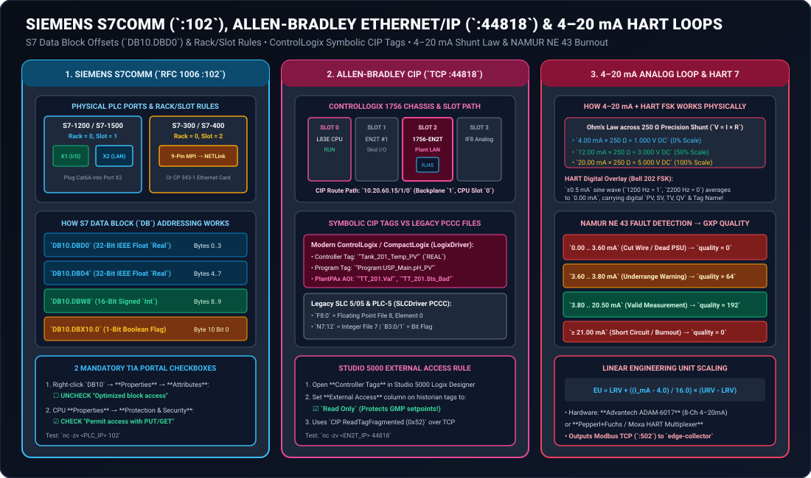
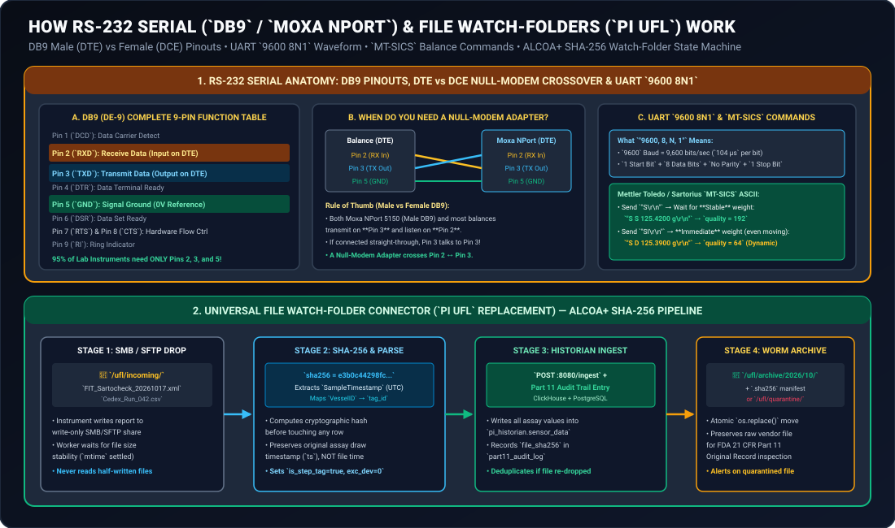

# Siemens S7comm (`:102`), Allen-Bradley EtherNet/IP (`:44818`), 4–20 mA / HART, RS-232 Serial & File Watch-Folder (`PI UFL`) Connectors

**Document ID:** `REF-CONNECTOR-PLC-SERIAL-UFL-GXPHISTORIAN-2026`  
**Protocols Covered:** **Siemens S7comm (`RFC 1006` ISO-on-TCP `:102`)**, **Rockwell Allen-Bradley EtherNet/IP (`CIP :44818`) & Legacy PCCC/DF1**, **4–20 mA Analog Current Loops + HART 7 (`Bell 202 FSK`)**, **RS-232 / RS-422 Serial ASCII (`MT-SICS`, `SBI`, `ASTM E1394`)**, and **Universal File / SMB Watch-Folders (`OSIsoft PI UFL` Replacement)**  
**Typical Biopharma Equipment:** [Fedegari](https://fedegari.com) / [Getinge Steam Autoclaves](https://www.getinge.com), [Sartorius Biostat® D-DCU & Sartoflow®](https://www.sartorius.com/en/products/tangential-flow-filtration-tff/tff-systems), [MilliporeSigma Mobius® & Cogent® Skids](https://www.sigmaaldrich.com/US/en/products/pharma-and-biopharma-manufacturing/mobius-single-use-solutions), [Emerson Rosemount](https://www.emerson.com) / [Endress+Hauser Sanitary Transmitters](https://www.endress.com), [Mettler Toledo XPR](https://www.mt.com/us/en/home/products/Laboratory_Weighing_Solutions/Balances/XPR-analytical-balance.html) / [Sartorius Cubis® II Analytical Balances](https://www.sartorius.com/en/products/lab-weighing/lab-balances/cubis-ii), [Advanced Instruments OsmoTECH® Osmometers](https://www.aicompanies.com/product/osmotech-xt-single-sample-micro-osmometer/), and [Sartocheck®](https://www.sartorius.com/en/products/process-filtration/filter-integrity-testing) / [Palltronic® Filter Integrity Testers](https://www.cytivalifesciences.com/en/us/shop/bioprocess-filtration/integrity-test-instruments/palltronic-flowstar-iv-filter-integrity-test-instrument-p-45129)

---

## 1. Visual Architecture: PLC Protocols (`S7comm` & `EtherNet/IP`) and `4–20 mA` / `HART` Loops

---

## 2. Deep Dive 1: Siemens S7comm Connector (`RFC 1006` ISO-on-TCP Port `102`)

European bioprocess skids—including **Sartorius Biostat® STR / B-DCU / Sartoflow®**, **Fedegari & Getinge autoclaves**, **Syntegon / Bosch & Bausch+Ströbel filling lines**, **SKAN isolators**, and **GEA separators**—are predominantly controlled by **[Siemens SIMATIC S7-1500, S7-1200, S7-300, or S7-400 PLCs](https://www.siemens.com)**.

While newer S7-1500 CPUs include an onboard OPC UA server, thousands of brownfield S7-300/400 skids (and high-speed S7-1500 skids without an OPC UA license) communicate via Siemens' native **S7comm (`PUT/GET`) protocol** over **TCP Port `102`** (`RFC 1006` ISO-on-TCP).

### 2.1 Physical Connector & How to Retrofit Older S7-300/400 PLCs Without Ethernet
- **On Modern S7-1500 / S7-1200 PLCs:**
  - The CPU has two built-in RJ45 PROFINET ports: **Port `X1`** (green PROFINET cable to internal skid I/O) and **Port `X2`** (Northbound Plant / Historian LAN). Plug a **Cat6A Shielded cable** into **Port `X2`**.
- **On Legacy S7-300 / S7-400 PLCs (Only a 9-Pin `MPI / PROFIBUS` DB9 Port):**
  - If the S7-300 rack does not have a `CP 343-1` Ethernet card, snap a **[Helmholz NETLink® PRO Compact](https://www.helmholz.de/en/products/fieldbus-applications/profibus/gateways/netlink-pro/artikel/show/700-884-mpi21/)** (or **IBH Link S7++**) RJ45-to-MPI/PROFIBUS adapter directly onto the 9-pin female `X1 MPI/DP` port on the front of the CPU.
  - The adapter draws $24\text{V DC}$ power directly from Pin 7 of the PLC's MPI port, preserves a pass-through 9-pin socket on its back so the local skid HMI touchscreen stays plugged in, and exposes standard **S7comm over Ethernet (`TCP Port 102`)**!

### 2.2 Crucial Siemens `Rack` & `Slot` Connection Rules
When establishing an ISO-on-TCP (`Port 102`) connection to a Siemens PLC, you must specify the CPU's **`Rack`** and **`Slot`** numbers (which form the TSAP connection parameter):

| Siemens PLC Family | CPU `Rack` | CPU `Slot` | Why? |
| :--- | :---: | :---: | :--- |
| **SIMATIC S7-300** | **`0`** | **`2`** | In an S7-300 rail, Slot 1 is always reserved for the Power Supply (`PS 307`), so the CPU is always in **Slot `2`**! |
| **SIMATIC S7-400** | **`0`** | **`2` or `3`** | Depends on whether a wide 2-slot or 1-slot power supply is installed in the rack. |
| **SIMATIC S7-1200 & S7-1500** | **`0`** | **`1`** | S7-1200/1500 architecture always addresses the CPU at **Rack `0`, Slot `1`**. |

### 2.3 How Siemens Data Block (`DB`) Byte-Offset Addressing Works
Inside a Siemens PLC, process variables intended for SCADA/Historian collection are grouped into a global **Data Block (e.g., `DB10` or `DB100`)**. Every variable has a deterministic byte offset from the start of the Data Block:
- **`DB10.DBD0` (`Data Block Double-Word at Byte 0`):** 4-byte (`32-bit`) IEEE-754 Floating-Point `Real` (occupies Bytes `0, 1, 2, 3`, Big-Endian `ABCD`). Next `Real` starts at **`DB10.DBD4`**.
- **`DB10.DBW8` (`Data Block Word at Byte 8`):** 2-byte (`16-bit`) signed `Int` or unsigned `Word` (occupies Bytes `8, 9`).
- **`DB10.DBX10.0` (`Data Block Bit at Byte 10, Bit 0`):** Single boolean flag (`0` or `1`, e.g., `Sterilization_Hold_Active`). Up to 8 booleans (`DBX10.0` through `DBX10.7`) pack into Byte `10`.

### 2.4 The Two Mandatory Checkboxes in Siemens TIA Portal (For S7-1200 / S7-1500)
If you are connecting to an S7-1200 or S7-1500 over `S7comm (Port 102)`, ask your automation engineer to verify two settings in **Siemens TIA Portal**:
1. **Uncheck "Optimized block access"** on the Historian Data Block (`Right-click DB10` $\rightarrow$ `Properties` $\rightarrow$ `Attributes` $\rightarrow$ `☐ Optimized block access`) so TIA Portal assigns fixed byte offsets (`0.0, 4.0, 8.0`).
2. **Check "Permit access with PUT/GET communication from remote partner"** under `CPU Properties` $\rightarrow$ `Protection & Security` $\rightarrow$ `Connection mechanisms`.

---

## 3. Deep Dive 2: Allen-Bradley EtherNet/IP (`CIP :44818`) & Legacy PCCC/DF1 Connectors

North American bioprocess skids—including **Cytiva Xcellerex™ (PlantPAx® option)**, **MilliporeSigma Mobius® & Cogent® TFF**, **Paul Mueller WFI skids**, and **SP Hull lyophilizers**—use **Rockwell Automation Allen-Bradley ControlLogix (`1756-L7x` / `L8x`)** or **CompactLogix (`5069-L3x`)** PLCs communicating over **EtherNet/IP (Common Industrial Protocol, `TCP Port 44818`)**.

### 3.1 Physical Connection & CIP Backplane Routing Path
- **On CompactLogix (`5069` / `1769`):** Dual built-in RJ45 ports on the bottom/front of the processor. Plug your Cat6A cable into **Port 2 (Configured in Dual-IP mode for Plant/Historian LAN)**.
- **On ControlLogix (`1756` Modular Chassis):**
  - A ControlLogix chassis has numbered vertical slots (`Slot 0, Slot 1, Slot 2, ...`).
  - Often the `L83E` CPU is in `Slot 0`, the internal skid I/O `1756-EN2T` card is in `Slot 1`, and the **Plant / Historian `1756-EN2T` Ethernet card is in `Slot 2`**.
  - When connecting with Python `pycomm3` (`LogixDriver`), the CIP route path `10.20.60.15` automatically routes across the ControlLogix backplane to `Slot 0` (or you can specify `"10.20.60.15/1/4"` if the CPU resides in `Slot 4`).

### 3.2 Symbolic Controller Tags (`LogixDriver`) vs. Legacy File Addressing (`SLCDriver`)
- **Modern ControlLogix / CompactLogix:** No memory register numbers needed! You query the exact symbolic tag name created in **Studio 5000 Logix Designer**:
  - Controller-scoped tag: `"BR201_TT_01.Val"`
  - Program-scoped tag: `"Program:MainProgram.Vessel_Weight_kg"`
  - **Quality Mapping from Rockwell PlantPAx® Add-On Instructions (AOIs):** Every PlantPAx process object (`P_AIn`) exposes both `.Val` (the float PV) and status bits `.Sts_Bad` (`1 = Sensor Fault`) and `.Sts_Uncertain` (`1 = Simulated / Hand Override`). `GxPHistorian` reads the entire structure in one CIP call and maps `.Sts_Bad == 1` $\rightarrow$ `quality = 0` and `.Sts_Uncertain == 1` $\rightarrow$ `quality = 64`!
- **Legacy Allen-Bradley SLC 5/05 & PLC-5 (`PCCC` over Ethernet or DF1 Serial):**
  - Uses typed Data Files: **`F8:0`** (Floating-Point File 8, Element 0), **`N7:10`** (16-bit Integer File 7, Element 10), and **`B3:0/1`** (Bit File 3).

---

## 4. Deep Dive 3: `4–20 mA` Analog Current Loops, `PT100 RTDs` & `HART 7` Connectors

### 4.1 Why Biopharma Still Uses `4–20 mA` Current Loops instead of `0–10 V` Voltage Signals
1. **Zero Voltage Drop Over Long Cables:** By Kirchhoff's Current Law, the current flowing into a series loop is identical at every point along a $300\text{ m}$ cleanroom cable run, regardless of wire resistance!
2. **Live-Zero Broken-Wire Detection (`4.00 mA` = 0%, `0.00 mA` = Dead/Cut Wire):**
   - If a $0\text{–}10\text{ V}$ sensor reads $0.00\text{ V}$, you cannot tell whether the tank pressure is genuinely $0.0\text{ bar}$ or someone severed the cable with a scissor lift.
   - In a **$4\text{–}20\text{ mA}$ loop**, $0\%$ of engineering range is **$4.00\text{ mA}$** and $100\%$ of range is **$20.00\text{ mA}$**:
     $$\text{Engineering Value} = \text{LRV} + \left(\frac{I_{\text{mA}} - 4.00}{16.00}\right) \times (\text{URV} - \text{LRV})$$
   - Under the international **NAMUR NE 43** standard enforced by `GxPHistorian`:
     - **`I <= 3.60 mA` (Downscale Burnout / Cut Wire):** Mapped to **`quality = 0` (`Bad`)**.
     - **`3.60 mA < I < 3.80 mA` (Underrange):** Mapped to **`quality = 64` (`Uncertain`)**.
     - **`3.80 mA <= I <= 20.50 mA` (Normal Operating Span):** Mapped to **`quality = 192` (`Good`)**.
     - **`I >= 21.00 mA` (Upscale Burnout / Short Circuit):** Mapped to **`quality = 0` (`Bad`)**.

### 4.2 How `HART` (Highway Addressable Remote Transducer) Works on Top of `4–20 mA`
Smart sanitary transmitters (**Endress+Hauser Liquiline / Cerabar**, **Emerson Rosemount 3051S**, **Micro Motion Coriolis flowmeters**) superimpose a tiny $\pm 0.5\text{ mA}$ **Bell 202 Frequency Shift Keying (FSK)** digital sine wave (`1200 Hz` = Binary `1`, `2200 Hz` = Binary `0`) on top of the analog $4\text{–}20\text{ mA}$ DC current.
- Because the high-frequency sine wave averages to exactly `0.000 mA` over time, the analog PLC input card doesn't even notice it—while a **HART-to-Modbus-TCP Multiplexer** (**Pepperl+Fuchs KFD2-HMM-16** or **Spectrum Controls**) extracts up to **4 digital process variables per single pair of wires**:
  - **`PV` (Primary Variable):** Mass Flow Rate (`kg/h`)
  - **`SV` (Secondary Variable):** Fluid Density (`g/cm³`)
  - **`TV` (Tertiary Variable):** Fluid Temperature (`°C`)
  - **`QV` (Quaternary Variable):** Totalized Mass (`kg`)

---

## 5. Visual Architecture: RS-232 Serial (`DB9` / `Moxa NPort`) & File Watch-Folders (`PI UFL`)

---

## 6. Deep Dive 4: RS-232 Serial (`DB9`), USB Virtual COM (`FTDI`) & Moxa NPort 5150

Standalone benchtop instruments in media prep, buffer kitchens, and QC labs (**Mettler Toledo XPR / XSR / SevenExcellence**, **Sartorius Cubis® II**, **Advanced Instruments OsmoTECH®**, **Planer Kryo 560**) output ASCII text strings over **RS-232 Serial**.

### 6.1 Complete 9-Pin `DB9` (`DE-9`) Pinout Reference Table

| DB9 Pin | Signal Name | Direction on DTE (Male Plug / PC / Balance) | Direction on DCE (Female Socket / Modem) | Do You Need It for GxPHistorian? |
| :---: | :--- | :---: | :---: | :--- |
| **Pin 1** | `DCD` (Data Carrier Detect) | Input | Output | Optional |
| **Pin 2** | **`RXD` (Receive Data)** | **Input (Listens)** | Output (Transmits) | **YES — Core Data Wire** |
| **Pin 3** | **`TXD` (Transmit Data)** | **Output (Transmits)** | Input (Listens) | **YES — Core Data Wire** |
| **Pin 4** | `DTR` (Data Terminal Ready) | Output | Input | Only if hardware handshaking enabled |
| **Pin 5** | **`GND` (Signal Ground)** | **0V Common Reference** | **0V Common Reference** | **YES — Mandatory Common Ground** |
| **Pin 6** | `DSR` (Data Set Ready) | Input | Output | Only if hardware handshaking enabled |
| **Pin 7** | `RTS` (Request To Send) | Output | Input | Tied to Pin 8 if `RTS/CTS` enabled |
| **Pin 8** | `CTS` (Clear To Send) | Input | Output | Tied to Pin 7 if `RTS/CTS` enabled |
| **Pin 9** | `RI` (Ring Indicator) | Input | Output | Unused |

### 6.2 How to Know Immediately If You Need a Null-Modem Crossover Adapter
- In RS-232, **DTE (Data Terminal Equipment)** transmits on **Pin 3** and listens on **Pin 2**.
- Both the **Moxa NPort 5150** (which has a **Male DB9** port) and most analytical balances are wired as **DTE**.
- If you connect two DTE devices with a straight-through cable, both devices shout into Pin 3 while nobody is talking on Pin 2!
- **The Solution:** Insert a `$5` **DB9 Null-Modem Adapter** (which internally swaps **Pin 2 $\leftrightarrow$ Pin 3** and **Pin 7 $\leftrightarrow$ Pin 8**). Look at the **orange `Tx/Rx` LED** on the Moxa NPort 5150 when you press `Print` on the balance—if it flashes orange, your pinout is correct!

### 6.3 How `MT-SICS` (Mettler Toledo Standard Interface Command Set) Maps to GxP Quality
When `GxPHistorian` parses a Mettler Toledo or Sartorius balance line (`S S     125.4200 g\r\n`):
- **`S S <weight> <unit>` (`Stable` weight):** Balance vibration detector confirmed mechanical stability before printing $\rightarrow$ **`quality = 192` (`Good`)**.
- **`S D <weight> <unit>` (`Dynamic / Non-Stable` weight):** Weight was captured while the pan was still settling or drifting $\rightarrow$ **`quality = 64` (`Uncertain`)**.
- **`S +` (Overload) or `S -` (Underload / Pan Removed):** Hardware out-of-range error $\rightarrow$ **`quality = 0` (`Bad`)**.

---

## 7. Deep Dive 5: Universal File Watch-Folder Connector (`OSIsoft PI UFL` Replacement)

For file-exporting GMP instruments—such as **Sartorius Sartocheck® 4/5 Plus** & **Palltronic® Flowstar V** filter integrity testers, **Roche Cedex® Bio HT** metabolite analyzers, **Cytiva Sepax™ C-Pro** cell processors, and **C Technologies SoloVPE** variable-pathlength spectrophotometers—`GxPHistorian` provides an **ALCOA+ SHA-256 Watch-Folder Pipeline** replacing the proprietary *OSIsoft PI Interface for Universal File and Stream Loading (PI UFL)*:

1. **Write-Only SMB/SFTP Drop (`incoming/`):** The instrument is configured to auto-export its `.csv`, `.xml`, or `.txt` result file to `\\<historian-ip>\gxphistorian_ufl\incoming\<instrument_name>` using a service account that has **Create/Write** permissions but **zero Delete or Modify** permissions.
2. **File-Size Settling Guard:** The Python watch-folder worker verifies that the file's byte size and modification time (`mtime`) have stabilized for $\ge 1.0\text{ second}$ (and no `.tmp` / `.part` lock file exists) so a large XML report is never parsed mid-transfer.
3. **Cryptographic `SHA-256` Original Record Seal:** Before parsing a single line, the worker computes the `SHA-256` digest of the raw vendor file bytes and writes a `.sha256` manifest.
4. **True Assay Timestamp & `LOCF` Step Tag Ingestion:** Extracts the instrument's internal `SampleTimestamp` (UTC ms), `BatchID`/`VesselID`, and analytical parameters, posting them to `http://edge-collector:8080/ingest` with `is_step_tag = true` (`LOCF`) and `exc_dev = 0.0`.
5. **Immutable WORM Archive (`archive/YYYY/MM/`):** Atomically moves both the original vendor file and its `.sha256` seal into the date-partitioned archive directory (or into `quarantine/` with an immediate operator alert if a schema error is detected).
