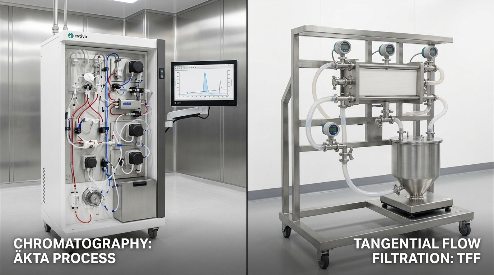
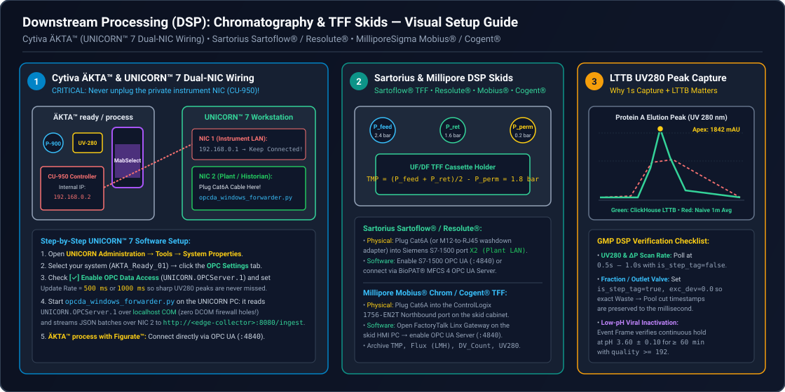
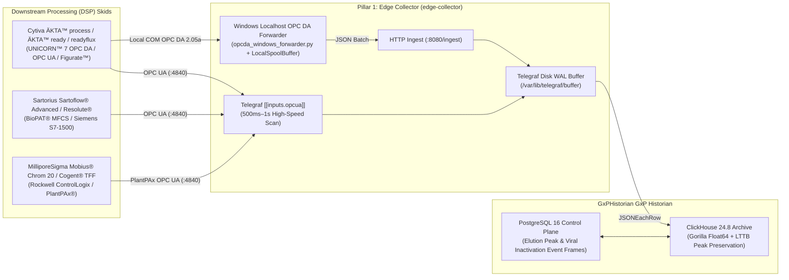

# Downstream Processing (DSP): Chromatography, TFF/UF/DF & Viral Filtration Integration Guide

**Connecting Cytiva ÄKTA™ (UNICORN™ 7), Sartorius Sartoflow® / Resolute®, and MilliporeSigma Mobius® / Cogent® Skids to GxPHistorian GxP Industrial Historian**

---

## 1. Overview of Downstream Purification Skids

Downstream Processing (DSP)—Protein A affinity capture, ion-exchange polishing, viral inactivation, ultrafiltration/diafiltration (UF/DF / TFF), and nanofiltration—requires **high-frequency, lossless signal capture** (`0.5 s` to `1 s` scan rates) with **LTTB peak preservation**. Unlike slow upstream temperature trends, a chromatography UV 280 nm elution peak or transmembrane pressure (TMP) spike occurs over seconds, and peak height/area (AUC) directly governs pooling gates and yield calculations.

GxPHistorian GxP Industrial Historian is pre-seeded with a chromatography UV 280 nm tag (`Tag 401: CHROM_UV280_PV` in `init-postgres/01_control_plane_part11.sql`) and includes a production Windows localhost OPC DA forwarder (`edge-collector/scripts/opcda_windows_forwarder.py`) specifically designed for chromatography skid workstations.





---

## 1.5 Non-Technical Step-by-Step Physical & Software Connection Walkthrough

Downstream purification skids (**[Cytiva ÄKTA™](https://www.cytivalifesciences.com/en/us/about-us/our-brands/akta)**, **[Sartorius Sartoflow®](https://www.sartorius.com/en/products/process-filtration/tangential-flow-filtration/tff-systems)**, **[MilliporeSigma Mobius® / Cogent®](https://www.sigmaaldrich.com/US/en/products/pharma-and-biopharma-manufacturing/chromatography-bioprocessing/chromatography-systems)**) use a dual-network design to protect internal real-time pump/UV control. Follow this exact checklist to plug in safely:

| Downstream Skid | CRITICAL Physical Connection Rule (Where to Plug In) | Software Menu / Service to Enable | Sampling & Peak Rule |
| :--- | :--- | :--- | :--- |
| **1. [Cytiva ÄKTA™ avant, ÄKTA™ pilot, ÄKTA™ ready & readyflux (UNICORN™ 7)](https://www.cytivalifesciences.com/en/us/about-us/our-brands/akta)** | **WARNING:** Never unplug the Ethernet cable going to the **CU-950 Control Box** (`192.168.0.x` private instrument link) or the ÄKTA will immediately fault! Instead, plug your **Cat6 cable** into **NIC 2 (Plant Network)** on the **UNICORN™ 7 Windows Workstation PC** (or connect to the central **UNICORN™ Database Server**). | Install the **UNICORN™ OPC Server** option (`UNICORN.OPCServer.1` for OPC DA or `UNICORN 7.6+ OPC UA Server`). Run `edge-collector/scripts/opcda_windows_forwarder.py` locally on the UNICORN PC so **zero Windows DCOM firewall ports** need to be opened! | Poll `UV1_280`, `Cond`, `P901`, `Flow` every **`0.5 s` – `1.0 s`** (`is_step_tag = false`) so ClickHouse LTTB preserves exact elution peak height ($\text{mAU}$) and area ($\text{AUC}$). |
| **2. [Cytiva ÄKTA™ process (Figurate™ Automation)](https://www.cytivalifesciences.com/en/us/about-us/our-brands/akta)** | Open the stainless **Figurate™ PLC Cabinet** on the ÄKTA process skid. Plug a **Cat6A Shielded cable** into the **Northbound Plant LAN (`X2`)** port on the **[Emerson DeltaV™](https://www.emerson.com/en/automation-systems/distributed-control-systems-dcs/deltav-distributed-control-system) PK Controller** or **[Rockwell ControlLogix `1756-EN2T`](https://www.rockwellautomation.com/en-us/capabilities/process-solutions/process-systems/plantpax-distributed-control-system.html)**. | Enable the onboard **OPC UA Server (`Port 4840`)** on the secondary interface (`10.20.60.15:4840`) with `Basic256Sha256` security. | Poll every `500 ms` (`0.5 s`) during `ELUTION` and `VIRAL_INACTIVATION` phases. |
| **3. [Sartorius Sartoflow® Advanced / Modular](https://www.sartorius.com/en/products/process-filtration/tangential-flow-filtration/tff-systems) & Resolute® AutoPak** | Locate the **[Siemens S7-1500 (`Biobrain`)](https://www.siemens.com/en-us/products/simatic/s7-1500/)** inside the skid control cabinet (or the external **M12 D-coded washdown bulkhead**). Plug a **Cat6A cable** into **Port `X2` (Plant Network)**. | On the **Biobrain / [BioPAT® MFCS 4](https://www.sartorius.com/en/products/process-analytical-technology/process-control-automation/biobrain-supervise)** screen, enable **OPC UA Server (`Port 4840`)** (or enable `Permit PUT/GET` for `S7comm` on `Port 102`). | Tracks Feed Pressure ($P_{\text{feed}}$), Retentate ($P_{\text{ret}}$), Permeate ($P_{\text{perm}}$), $\text{TMP} = \frac{P_{\text{feed}}+P_{\text{ret}}}{2} - P_{\text{perm}}$, and Retentate Scale Weight (`kg`). |
| **4. [MilliporeSigma Mobius® Chrom 20 / FlexReady & Cogent® Process Scale TFF](https://www.sigmaaldrich.com/US/en/products/pharma-and-biopharma-manufacturing/chromatography-bioprocessing/chromatography-systems)** | Open the **Rockwell CompactLogix / ControlLogix** enclosure on the rear of the Mobius or Cogent skid. Plug a **Cat6A cable** into **Port 2 (`Plant LAN`)** of the dual-IP processor/switch. | On the skid HMI (or **FactoryTalk Linx Gateway**), enable **OPC UA Server (`Port 4840`)** and assign Read-Only historian permissions. | Automatically triggers an ISA-88 Event Frame when Low-pH Viral Inactivation (`pH <= 3.60`) hold timer starts and ends. |

---

## 2. Downstream Integration Architecture



---

## 3. Platform-Specific Integration Guides

### 3.1 Cytiva ÄKTA™ process, ÄKTA™ ready, ÄKTA™ readyflux & UNICORN™ 7
Cytiva’s **ÄKTA™** chromatography and tangential flow filtration (TFF) family is controlled either by **UNICORN™ 7** workstation/client-server software or by **Figurate™** (Emerson DeltaV™ / Rockwell PlantPAx®) on larger **ÄKTA™ process** skids.

#### Pathway 1: UNICORN™ OPC Server on Windows (`opcda_windows_forwarder.py`)
Many GMP UNICORN™ installations run the licensed **UNICORN OPC Server** (`UNICORN.OPCServer.1`) on the local Windows control PC or UNICORN Server. Opening Windows DCOM ports (`TCP 135` + dynamic RPC range) across cleanroom firewalls is a major cybersecurity and GAMP 5 validation liability.

Instead, deploy `edge-collector/scripts/opcda_windows_forwarder.py` directly on the UNICORN Windows workstation:
1. It connects to `UNICORN.OPCServer.1` over `localhost` COM (`OpenOPC`).
2. Polls UV absorbance (`UV 1_280`), conductivity (`Cond`), system/pre-column/delta-column pressure (`P901`, `DeltaP`), pH, flow velocity (`Flow`), gradient concentration (`Conc B`), and `RunLog` phase strings at `1.0 s` intervals.
3. Applies Stage 1 `exc_dev` / `exc_max` deadband filtering (`WindowsOpcDaForwarder.poll_once`) so baseline equilibration noise is compressed while steep UV elution peaks are captured at full 1-second resolution.
4. Buffers to `LocalSpoolBuffer` (`opcda_spool.jsonl`) during any network interruption and posts JSON batches to `http://<edge-collector>:8080/ingest`.

**Example `opcda_windows_forwarder.py` Configuration for Cytiva ÄKTA™ ready / UNICORN™:**
```python
forwarder = WindowsOpcDaForwarder(
    prog_id="UNICORN.OPCServer.1",
    ingest_url="http://10.20.10.50:8080/ingest",
    tags=[
        OpcDaTagSpec(tag_id=401, item_id="AKTA_Ready_01.UV1_280.Value",     exc_dev=0.05, exc_max=5.0),
        OpcDaTagSpec(tag_id=402, item_id="AKTA_Ready_01.UV2_254.Value",     exc_dev=0.05, exc_max=5.0),
        OpcDaTagSpec(tag_id=403, item_id="AKTA_Ready_01.Cond.Value",        exc_dev=0.02, exc_max=5.0),
        OpcDaTagSpec(tag_id=404, item_id="AKTA_Ready_01.pH.Value",          exc_dev=0.01, exc_max=5.0),
        OpcDaTagSpec(tag_id=405, item_id="AKTA_Ready_01.SystemFlow.Value",  exc_dev=0.05, exc_max=5.0),
        OpcDaTagSpec(tag_id=406, item_id="AKTA_Ready_01.DeltaColumnP.Value",exc_dev=0.01, exc_max=5.0),
        OpcDaTagSpec(tag_id=407, item_id="AKTA_Ready_01.ConcB.Value",       exc_dev=0.10, exc_max=10.0),
        OpcDaTagSpec(tag_id=408, item_id="AKTA_Ready_01.OutletValve.Pos",   exc_dev=0.00, exc_max=30.0),
    ],
)
```

#### Pathway 2: Modern OPC UA (UNICORN™ OPC UA Wrapper or Figurate™ ÄKTA™ process)
For ÄKTA™ process skids running Figurate™ (DeltaV / PlantPAx) or UNICORN™ 7 with an OPC UA Server/Gateway, configure `[[inputs.opcua]]` in `edge-collector/telegraf-clickhouse.conf` with a `500ms` or `1s` scan interval.

---

### 3.2 Sartorius Sartoflow® Advanced / Modular TFF & Resolute® Chromatography
Sartorius **Sartoflow®** crossflow (UF/DF) systems and **Resolute®** chromatography skids run on **Siemens SIMATIC S7-1500** PLCs and **BioPAT® MFCS** with native **OPC UA**:
- **Critical TFF/UF/DF Parameters to Archive:**
  - **Feed Pressure ($P_{\text{feed}}$), Retentate Pressure ($P_{\text{ret}}$), Permeate Pressure ($P_{\text{perm}}$):** `bar` or `psig` (`is_step_tag = false`, `exc_dev = 0.01`)
  - **Transmembrane Pressure ($\text{TMP} = \frac{P_{\text{feed}} + P_{\text{ret}}}{2} - P_{\text{perm}}$):** `bar` (`low_limit = 0.2`, `high_limit = 2.0 bar`)
  - **Permeate Flux ($J$):** `LMH` ($\text{L/m}^2\text{/h}$, `is_step_tag = false`, `exc_dev = 0.2`)
  - **Retentate Vessel Weight & Diafiltration Volumes (DV):** `kg` and dimensionless `DV` (`is_step_tag = false`)
  - **Permeate Conductivity & UV 280 nm Breakthrough:** `mS/cm` and `mAU` (`is_step_tag = false`)

---

### 3.3 MilliporeSigma (Merck) Mobius® Chrom 20 / FlexReady & Cogent® TFF
MilliporeSigma’s **Mobius®** single-use chromatography systems and **Cogent®** process-scale TFF skids use **Rockwell Automation ControlLogix** PLCs with **FactoryTalk® / PlantPAx®**:
- Connect `edge-collector` via **OPC UA** to the skid’s FactoryTalk Linx OPC UA server (`opc.tcp://<skid-ip>:4840`).
- Map ISA-88 recipe step numbers (`Recipe_Step_ID`, `is_step_tag = true`) alongside continuous pressure, flow, conductivity, and UV tags.

---

## 4. Standard DSP Chromatography & TFF Tag Catalog

| Tag ID | Tag Name | Skid / Unit Operation | Parameter | Eng Units | `is_step_tag` | `exc_dev` | Typical DSP Limits (`Low` / `High`) |
| :--- | :--- | :--- | :--- | :--- | :--- | :--- | :--- |
| `401` | `CHROM_UV280_PV` | Protein A / IEX Chrom Skid | UV 280 nm Absorbance | `mAU` | `false` (`LINEAR`) | `0.05` | `0.0` / `2000.0` |
| `402` | `CHROM_UV254_PV` | Protein A / IEX Chrom Skid | UV 254 nm Nucleic Acid | `mAU` | `false` (`LINEAR`) | `0.05` | `0.0` / `1500.0` |
| `403` | `CHROM_COND_PV` | Protein A / IEX Chrom Skid | Eluate Conductivity | `mS/cm` | `false` (`LINEAR`) | `0.02` | `0.5` / `150.0` |
| `404` | `CHROM_PH_PV` | Viral Inactivation / Chrom | Eluate / Hold Vessel pH | `pH` | `false` (`LINEAR`) | `0.01` | `3.50` / `3.70` (Low-pH VI) |
| `405` | `CHROM_FLOW_PV` | Protein A / IEX Chrom Skid | Linear Flow Velocity | `cm/h` | `false` (`LINEAR`) | `0.50` | `50.0` / `300.0` |
| `406` | `CHROM_DELTAP_PV` | Protein A / IEX Chrom Skid | Delta-Column Pressure ($\Delta P$) | `bar` | `false` (`LINEAR`) | `0.01` | `0.0` / `3.0` |
| `408` | `CHROM_OUT_VALVE` | Protein A / IEX Chrom Skid | Fraction/Outlet Valve Position (`0=Waste, 1=Pool`) | `pos` | `true` (`LOCF`) | `0.00` | `0.0` / `5.0` |
| `411` | `TFF01_TMP_PV` | UF/DF TFF Skid 01 | Transmembrane Pressure (TMP) | `bar` | `false` (`LINEAR`) | `0.01` | `0.2` / `2.0` |
| `412` | `TFF01_FLUX_PV` | UF/DF TFF Skid 01 | Permeate Flux | `LMH` | `false` (`LINEAR`) | `0.20` | `10.0` / `120.0` |
| `413` | `TFF01_DV_COUNT` | UF/DF TFF Skid 01 | Diafiltration Volumes Exchanged | `DV` | `false` (`LINEAR`) | `0.01` | `0.0` / `10.0` |

---

## 5. Why ClickHouse LTTB Downsampling (`URS-014`) is Essential for Chromatography

Standard time-bucket averaging (`GROUP BY toStartOfMinute(ts)`) flattens sharp chromatography UV 280 nm elution peaks and hides transient column over-pressure spikes.

GxPHistorian GxP Historian’s `/api/v1/trends/plot-values` endpoint (`app/main.py`) uses ClickHouse’s native **`largestTriangleThreeBuckets(N)` (LTTB)** algorithm over raw `quality >= 192` samples:
- Whether an operator views a 6-hour chromatography run across 200 screen pixels in Grafana (`gxphistorian_bioreactor_hmi.json`) or exports plot values for batch review, LTTB mathematically preserves the **exact maximum apex (`mAU`) and inflection shoulders** of every elution peak (verified by automated qualification test `test_oq_09_lttb_peak_preservation` in `gxp-validation-package/tests/test_03_oq_historian_core.py`).
