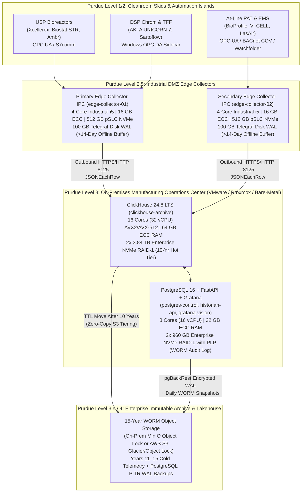

# Hardware Sizing & Capacity Planning Guide

**Engineering Reference & Bill of Materials (BOM) for Deploying OpenHistorian GxP Across Lab, Clinical Pilot, and Commercial cGMP Biomanufacturing Facilities**

---

## 1. Executive Summary & Telemetry Compression Math

Unlike legacy relational historians or uncompressed time-series databases, **OpenHistorian GxP Industrial Historian** combines two orthogonal data-reduction layers that reduce storage footprint by **10× to 25×** while preserving **100% mathematically lossless** raw sensor fidelity:

1. **Stage 1 Edge Exception / Deadband Filtering (`ExcDev` & `ExcMax`):**
   - Executed in memory at the Purdue Level 2.5 `edge-collector` before network transmission (`edge-collector/scripts/multi_protocol_simulator.py`).
   - Suppresses steady-state ADC electrical jitter within `exc_dev` until either a meaningful process change occurs, OPC signal quality transitions (e.g., `192` Good $\rightarrow$ `0` Bad), or the heartbeat timer `exc_max` expires.
   - Reduces continuous `1 Hz` PLC polling volume by **65% to 80%** during steady-state bioreactor holds and cleanroom operations.
2. **Stage 2 ClickHouse Columnar Codecs (`init-clickhouse/01_telemetry_core.sql`):**
   - `pi_historian.sensor_data` orders data physically on disk by `ORDER BY (tag_id, ts)` and applies specialized per-column codecs layered under `ZSTD(1)`:
     - `tag_id UInt32 CODEC(Delta, ZSTD(1))`
     - `ts DateTime64(3, 'UTC') CODEC(DoubleDelta, ZSTD(1))`
     - `val Float64 CODEC(Gorilla, ZSTD(1))`
     - `str_val LowCardinality(String) CODEC(ZSTD(1))`
     - `quality UInt8 CODEC(T64, ZSTD(1))`
     - `status_code UInt16 CODEC(T64, ZSTD(1))`

### Per-Sample Storage Equations

An uncompressed 25-byte telemetry row in `pi_historian.sensor_data` plus its corresponding 1-minute rollup state in `pi_historian.sensor_rollup_1m` (`AggregatingMergeTree`) compresses to **$1.5\text{ to }2.5\text{ bytes per sample}$** on disk:

$$\text{Annual Disk per Tag (at 1 Hz)} = 86,400\frac{\text{samples}}{\text{day}} \times 365.25\text{ days} \times B_{\text{eff}} \times (1 - R_{\text{deadband}})$$

Where $B_{\text{eff}} \approx 2.5\text{ bytes/sample}$ (including 1-minute rollup overhead) and $R_{\text{deadband}}$ is the Stage 1 exception filtering ratio:

| Operating Scenario | Effective Sample Rate ($1 - R_{\text{deadband}}$) | Bytes / Tag / Day | Annual Storage / Tag | 10-Year Storage (25,000 Tags) |
| :--- | :--- | :--- | :--- | :--- |
| **Worst-Case Continuous (`exc_dev = 0`, 100% 1 Hz)** | $1.00\text{ Hz}$ ($0\%$ suppression) | $216\text{ KB/day}$ | **$78.9\text{ MB/yr}$** | **$19.7\text{ TB}$** |
| **Conservative GMP Bioprocess Mix ($50\%$ suppression)** | $0.50\text{ Hz}$ average | $108\text{ KB/day}$ | **$39.5\text{ MB/yr}$** | **$9.86\text{ TB}$** |
| **Typical GMP Plant Mix ($70\%$ deadband suppression)** | $0.30\text{ Hz}$ average | $64.8\text{ KB/day}$ | **$23.7\text{ MB/yr}$** | **$5.92\text{ TB}$** |

> **Compaction & Export Headroom Rule:** Always provision **$\ge 30\%$ free space** on the ClickHouse NVMe volume (`ch_archive_data`) to accommodate background `MergeTree` part merges, temporary query spill files, and Snappy Parquet exports (`/app/exports`).

---

## 2. Target Facility Blueprint: 10,000 – 25,000 Tags (Clinical / Pilot GMP Plant)

This reference design is tailored for a **Single-Suite Clinical / Pilot or Mid-Size Commercial GMP Facility** with:
- **Scale:** **10,000 to 25,000 active tags** ($\sim 5,000\text{ to }15,000\text{ samples/sec}$ peak ingest across bioreactors, chromatography skids, TFF, lyophilizers, PAT analyzers, and cleanroom EMS).
- **Retention Policy:** **10 years online NVMe hot retention** + **15-year S3 / MinIO Object Lock (WORM) archive** satisfying FDA `21 CFR 211.180` and `EU GMP Chapter 4` batch record retention mandates.
- **Deployment Topology:** **Hybrid Purdue Model (ISA-95)** — On-premises VMware vSphere / Proxmox VE (or Bare-Metal) server in **Purdue Level 3**, fed by fanless DIN-rail Industrial Edge Collector PCs in the **Purdue Level 2.5 Industrial DMZ**.



---

### A. Purdue Level 3 Historian Core Bill of Materials (10k–25k Tags)

You can deploy the Level 3 services either on a **single consolidated Bare-Metal Server / Hypervisor Host** or split across **two dedicated Virtual Machines** (recommended for VMware vSphere 8 / Proxmox VE 8 HA clusters):

| Component | Consolidated Bare-Metal Server Spec | Split VM Spec (VM 1: ClickHouse / VM 2: Postgres + API + HMI) | Qualification & Hardware Rationale |
| :--- | :--- | :--- | :--- |
| **Processor (CPU)** | **1× AMD EPYC 9224 / 9334** (24–32 Physical Cores, $\ge 3.0\text{ GHz}$) or **2× Intel Xeon Gold 6426Y** (32 Physical Cores total) | • **VM 1 (`clickhouse-archive`):** 16 vCPUs (CPU affinity pinned, `AVX2`/`AVX-512` passthrough)<br>• **VM 2 (`postgres` + `api` + `grafana`):** 8 vCPUs | ClickHouse relies on `AVX2`/`AVX-512` SIMD instructions for vectorized `DoubleDelta`/`Gorilla` codecs and `largestTriangleThreeBuckets` (LTTB) downsampling. |
| **Memory (RAM)** | **96 GB – 128 GB ECC DDR5-4800 RDIMM** | • **VM 1 (`clickhouse-archive`):** 64 GB ECC RAM<br>• **VM 2 (`postgres` + `api` + `grafana`):** 32 GB ECC RAM | ECC memory prevents single-bit flips prior to immutable `MergeTree` block writes and SHA-256 audit hashing. `pg_asset_tags` `FLAT` dictionary consumes $< 50\text{ MB}$ RAM for 25,000 tags. |
| **OS Boot Volume** | **2× 480 GB Enterprise SATA/NVMe M.2 SSD (Hardware RAID-1)** | **64 GB OS vDisk per VM** on redundant enterprise datastore | Isolates container runtime (`Docker Engine 24+`) and OS logs from database I/O queues. |
| **ClickHouse Hot Telemetry Volume (`ch_archive_data`)** | **4× 3.84 TB Enterprise U.2/U.3 Gen4 NVMe SSD in RAID-10** ($\mathbf{7.68\text{ TB}}$ usable) *or* **2× 7.68 TB NVMe in RAID-1** | **7.5 TB Dedicated NVMe Datastore / Raw Device Pass-Through** ($\ge 1\text{ DWPD}$, Power-Loss Protection) | Stores **10 full years** of 25,000 tags ($\sim 5.9\text{ TB}$ typical) plus $> 20\%$ free space for `MergeTree` background compactions and Parquet staging. |
| **PostgreSQL Control Plane & WORM Audit Volume (`pg_control_data`)** | **2× 960 GB Enterprise U.2/U.3 NVMe SSD in Hardware RAID-1** ($\ge 3\text{ DWPD}$, Hardware PLP Capacitors) | **500 GB Dedicated High-IOPS NVMe Volume** (`write-through` cache policy, hardware PLP backed) | Every tag mutation and `§11.200` e-signature executes a synchronous `fsync` commit of the SHA-256 hash chain (`part11_audit_log`). Hardware PLP guarantees zero torn pages on power loss. |
| **15-Year WORM Cold Tier & Backup Target** | **15 TB – 20 TB Immutable Object Storage** (On-Premises MinIO Appliance with `xfs` Object Lock or AWS S3 Object Lock in Compliance Mode) | Mounted via ClickHouse `s3` disk policy + `pgBackRest` S3 repository | Holds years 11–15 of telemetry ($\sim 3\text{ TB}$), daily Snappy Parquet exports, and 15 years of PostgreSQL PITR WAL archives. |
| **Network Interface** | **Dual-Port 10 GbE / 25 GbE SFP28 NIC** (Intel E810 or Mellanox ConnectX-6, LACP 802.3ad bonded) | `vmxnet3` / `VirtIO` multiqueue NICs backed by redundant physical 10 GbE switches | Ensures low-latency ingestion from Level 2.5 DMZ collectors and fast multi-megabyte Parquet/DataLink transfers to Level 4 clients. |
| **Power & Time Sync** | **Dual Redundant Hot-Swap PSUs** (connected to A/B UPS feeds) + **Stratum-1 NTP / PTP Time Sync** | Host synchronized via `chrony` to GPS/PTP Grandmaster ($< 10\text{ ms}$ drift alarm) | Enforces `21 CFR §11.10(e)` contemporaneous time-stamping across all 4 pillars. |

---

### B. 10-Year + 15-Year Storage Allocation Breakdown (25,000 Tags)

| Dataset / Subsystem | Storage Engine | 1-Year Footprint | 10-Year Hot NVMe Footprint | Years 11–15 Cold WORM S3 Footprint |
| :--- | :--- | :--- | :--- | :--- |
| **Raw Telemetry (`pi_historian.sensor_data`)** | ClickHouse `MergeTree` (`DoubleDelta` + `Gorilla` + `ZSTD(1)`) | $\sim 520\text{ GB}$ | $\sim 5.20\text{ TB}$ | $\sim 2.60\text{ TB}$ |
| **1-Minute Rollups (`pi_historian.sensor_rollup_1m`)** | ClickHouse `AggregatingMergeTree` (`WHERE quality >= 192`) | $\sim 72\text{ GB}$ | $\sim 720\text{ GB}$ | $\sim 360\text{ GB}$ |
| **ClickHouse Compaction & Parquet Staging Headroom** | Free space on `ch_archive_data` NVMe array | $\sim 1.76\text{ TB}$ buffer | $\sim 1.76\text{ TB}$ buffer | N/A (Object storage elastic) |
| **ISA-95 Assets, Tags & ISA-88 Event Frames** | PostgreSQL 16 (`assets`, `tags`, `event_frames` + `GiST` indexes) | $\sim 5\text{ GB}$ | $\sim 50\text{ GB}$ | $\sim 25\text{ GB}$ |
| **21 CFR Part 11 WORM Audit Trail (`part11_audit_log`)** | PostgreSQL 16 (`JSONB` + SHA-256 chain + WAL archives) | $\sim 10\text{ GB}$ | $\sim 100\text{ GB}$ | $\sim 50\text{ GB}$ |
| **Total Provisioned Usable Capacity** | — | — | **$7.68\text{ TB}$ Usable NVMe** | **$15\text{ TB}$ S3/MinIO WORM Quota** |

---

### C. Purdue Level 2.5 Industrial Edge Collector Specs (`edge-collector`)

Deploy **two redundant Industrial Edge Collector PCs** (or Level 2.5 DMZ VMs) splitting cleanroom suites or protocol domains (e.g., `edge-collector-01` for USP/DSP OPC UA & S7comm; `edge-collector-02` for Facility EMS BACnet/IP, Modbus, and PAT HTTP watchfolders):

| Specification | Recommended Industrial PC Hardware (Level 2 / 2.5 Utility Corridor) | Recommended Level 2.5 DMZ VM Allocation |
| :--- | :--- | :--- |
| **Chassis / Form Factor** | **Fanless DIN-Rail Industrial PC** (e.g., Advantech UNO-2484G, OnLogic Karbon 400/800, or Siemens SIMATIC IPC427E), $-20^\circ\text{C}\text{ to }+60^\circ\text{C}$, $24\text{ VDC}$ dual power input | Standard High-Availability VM in Level 2.5 Industrial DMZ cluster |
| **CPU** | **Intel Core i5 Industrial (4–6 Cores)** or **Intel Xeon E / Atom x6425E (4 Cores)** | **4 vCPUs** ($\ge 2.4\text{ GHz}$) |
| **Memory (RAM)** | **16 GB Industrial DDR4/DDR5 SO-DIMM** (ECC preferred) | **8 GB – 16 GB RAM** |
| **Local Storage & Disk WAL (`/var/lib/telegraf/buffer`)** | **512 GB Industrial pSLC or Wide-Temp 3D TLC NVMe/SATA SSD** ($\ge 1,500\text{ TBW}$ endurance) | **150 GB Thick-Provisioned Eager-Zeroed vDisk** |
| **Telegraf WAL Buffer Sizing (`URS-005`)** | Dedicate a **100 GB partition** to `/var/lib/telegraf/buffer` (`metric_buffer_limit = 50000000`). Buffers **$> 14\text{ days}$ of 25,000 tags** during a complete Level 3 network outage—covering an entire fed-batch or perfusion bioreactor campaign with zero data loss. | Same (`100 GB` mount at `/var/lib/telegraf/buffer`) |
| **Network Interfaces** | **2× – 4× Isolated 1 GbE / 2.5 GbE RJ45 Ports:**<br>• `eth0`: Level 2 Automation / PLC VLAN (no default gateway)<br>• `eth1`: Level 2.5 DMZ (outbound `TCP 8123/8125` to ClickHouse only) | Dual vNICs mapped to Level 2 Skid VLAN and Level 2.5 Historian Ingest VLAN |

#### Legacy Windows COM OPC DA Sidecar (`opcda_windows_forwarder.py`)
- **Co-Located on Vendor Workstation (UNICORN 7, DeltaV, BioProfile):** No extra hardware needed; uses $< 5\%$ of 1 CPU core and $< 250\text{ MB}$ RAM.
- **Dedicated Windows OPC DA Aggregator VM (Optional):** 4 vCPUs, 8 GB RAM, 80 GB OS disk running Windows Server 2022 LTSC in Level 2.

---

## 3. Multi-Tier Hardware Sizing Reference Matrix (All Facility Scales)

For organizations scaling from a single benchtop development lab up to a global multi-site enterprise historian, use the following reference matrix:

| Sizing Dimension | Tier 1: Lab / PD / IQ-OQ Sandbox | Tier 2: Clinical / Pilot GMP Plant *(Target Profile)* | Tier 3: Commercial Multi-Suite GMP Site (HA) | Tier 4: Enterprise Multi-Site Aggregator (HA) |
| :--- | :--- | :--- | :--- | :--- |
| **Active Tag Count** | Up to **2,500 tags** | **10,000 – 25,000 tags** | **25,000 – 100,000 tags** | **100,000 – 500,000+ tags** |
| **Sustained Ingest Rate** | $\le 2,500\text{ samples/s}$ | $5,000\text{ – }15,000\text{ samples/s}$ | $25,000\text{ – }50,000\text{ samples/s}$ | $100,000\text{ – }250,000\text{ samples/s}$ |
| **Topology** | Single Host (`docker-compose.yml`) | 1× Bare-Metal Host or 2× Split VMs + 2× Edge IPCs | **2× ClickHouse Keeper/Replica Nodes** + **2× Patroni Postgres/API Nodes** + **4× Edge IPCs** | **3× ClickHouse Shard/Replica Nodes** + **3× Patroni Postgres/API Nodes** + Site Edge Collectors |
| **ClickHouse CPU** | 4–8 vCPUs (shared) | **16 vCPUs (8–16 Physical Cores)** | **2× Nodes @ 24 Cores (48 vCPUs) each** | **3× Nodes @ 32–48 Cores (64–96 vCPUs) each** |
| **ClickHouse RAM** | 16–32 GB RAM (shared) | **64 GB ECC RAM** | **2× Nodes @ 128 GB ECC DDR5 each** | **3× Nodes @ 256 GB ECC DDR5 each** |
| **ClickHouse Hot NVMe (10-Yr)** | 1 TB NVMe SSD | **7.68 TB Usable Enterprise NVMe** (RAID-10 / RAID-1) | **2× Nodes @ 15.36 TB Usable NVMe each** (RAID-10) | **3× Nodes @ 30.72 TB Usable NVMe each** (RAID-10) |
| **PostgreSQL + API CPU & RAM** | Shared with ClickHouse | **8 vCPUs / 32 GB ECC RAM** | **2× Nodes @ 8 Cores (16 vCPUs) / 32 GB ECC RAM** | **3× Nodes @ 16 Cores (32 vCPUs) / 64 GB ECC RAM** |
| **PostgreSQL NVMe (PLP)** | Shared NVMe | **2× 960 GB NVMe RAID-1 (PLP)** | **2× Nodes @ 2× 1.92 TB NVMe RAID-1 (PLP)** | **3× Nodes @ 2× 3.84 TB NVMe RAID-1 (PLP)** |
| **15-Yr Cold WORM S3 Tier** | Optional ($2\text{ TB}$) | **15 TB – 20 TB S3/MinIO WORM** | **50 TB – 80 TB S3/MinIO WORM** | **250 TB+ S3/MinIO WORM** |
| **Network Fabric** | 1 GbE | **Dual 10 GbE (LACP)** | **Dual 10 / 25 GbE (Redundant ToR)** | **Dual 25 / 100 GbE** |

---

## 4. Configuring ClickHouse 10-Year Hot NVMe + 15-Year WORM Tiered Storage

To implement the **10-year NVMe hot tier + 15-year S3/MinIO WORM cold tier** without changing any application queries in `historian-api` or Grafana:

### Step 1: Configure Multi-Volume Storage Policy (`/etc/clickhouse-server/config.d/tiered_storage.xml`)

```xml
<clickhouse>
  <storage_configuration>
    <disks>
      <!-- Local Enterprise NVMe RAID Array (Years 0 to 10) -->
      <hot_nvme>
        <path>/var/lib/clickhouse/</path>
        <keep_free_space_bytes>1099511627776</keep_free_space_bytes> <!-- 1 TB safety reserve -->
      </hot_nvme>

      <!-- Immutable S3 / MinIO Object Lock Bucket (Years 10 to 15) -->
      <cold_worm_s3>
        <type>s3</type>
        <endpoint>https://minio-worm.biocorp.internal:9000/openhistorian-gxp-archive/telemetry/</endpoint>
        <access_key_id from_env="S3_ACCESS_KEY_ID" />
        <secret_access_key from_env="S3_SECRET_ACCESS_KEY" />
        <metadata_path>/var/lib/clickhouse/disks/cold_worm_s3/</metadata_path>
        <cache_enabled>true</cache_enabled>
        <data_cache_max_size>107374182400</data_cache_max_size> <!-- 100 GB local NVMe read cache -->
      </cold_worm_s3>
    </disks>

    <policies>
      <gxp_10yr_nvme_15yr_worm>
        <volumes>
          <hot_volume>
            <disk>hot_nvme</disk>
          </hot_volume>
          <cold_volume>
            <disk>cold_worm_s3</disk>
          </cold_volume>
        </volumes>
        <!-- Automatically spill if NVMe fills above 80% before 10 years -->
        <move_factor>0.2</move_factor>
      </gxp_10yr_nvme_15yr_worm>
    </policies>
  </storage_configuration>
</clickhouse>
```

### Step 2: Apply 10-Year Tiering TTL to `pi_historian.sensor_data` and `sensor_rollup_1m`

```sql
ALTER TABLE pi_historian.sensor_data
    MODIFY SETTING storage_policy = 'gxp_10yr_nvme_15yr_worm',
    MODIFY TTL toDateTime(ts) + INTERVAL 10 YEAR TO VOLUME 'cold_volume';

ALTER TABLE pi_historian.sensor_rollup_1m
    MODIFY SETTING storage_policy = 'gxp_10yr_nvme_15yr_worm',
    MODIFY TTL bucket_1m + INTERVAL 10 YEAR TO VOLUME 'cold_volume';
```

> **ALCOA+ Enduring Compliance Note:** Notice that the `TTL` rule uses `TO VOLUME 'cold_volume'` and **never** uses `DELETE`. Partitions older than 10 years are moved transparently to the WORM object storage volume while remaining immediately queryable via standard SQL in Grafana (`largestTriangleThreeBuckets`) and Excel DataLink (`/api/v1/datalink/sampled`).

---

## 5. VMware vSphere / Proxmox VE & Linux Host Qualification Checklist (IQ)

When deploying Level 3 nodes on **VMware vSphere / ESXi**, **Proxmox VE (KVM)**, or bare-metal Linux in a GAMP 5 qualified environment, include the following verification steps in your **Installation Qualification (IQ)** protocol:

1. **Hypervisor CPU Passthrough (`AVX2` / `AVX-512`):**
   - Set the VM CPU type to `host` (Proxmox) or expose full hardware instruction sets (VMware EVC mode $\ge$ Intel Ice Lake / AMD Milan) and verify inside the container host:
     ```bash
     grep -E 'avx2|avx512' /proc/cpuinfo | head -n 4
     ```
2. **Disable Hypervisor Memory Ballooning & Host Swap:**
   - Pin 100% of allocated RAM (`64 GB` on ClickHouse VM, `32 GB` on PostgreSQL VM) with **Memory Reservation = 100%** so the hypervisor never reclaims ClickHouse page cache or dictionary RAM.
   - Set `/etc/sysctl.d/99-openhistorian-gxp.conf` on the Linux host:
     ```ini
     vm.swappiness = 1
     vm.max_map_count = 262144
     vm.overcommit_memory = 0
     ```
3. **Enterprise NVMe Power-Loss Protection (PLP) & Write-Through Verification:**
   - Ensure the RAID controller or NVMe namespace backing `pg_control_data` and `ch_archive_data` uses enterprise SSDs with hardware power-loss capacitors (e.g., Micron 7450/7500 MAX, Samsung PM9A3/PM1735, Solidigm D7-P5520/P5620) and mount `xfs` or `ext4` with `noatime`:
     ```text
     UUID=<NVME_UUID>  /var/lib/clickhouse  xfs  defaults,noatime,nodiratime  0  2
     ```
4. **Stratum-1 NTP / PTP Time Synchronization (`21 CFR §11.10(e)`):**
   - Configure `/etc/chrony/chrony.conf` on all Level 2.5 Edge Collectors and Level 3 Historian servers to poll redundant internal Stratum-1 NTP servers (`minpoll 4 maxpoll 6 iburst`) and verify offset $< 10\text{ ms}$ via `chronyc tracking`.
