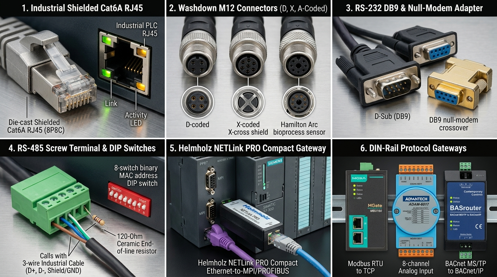
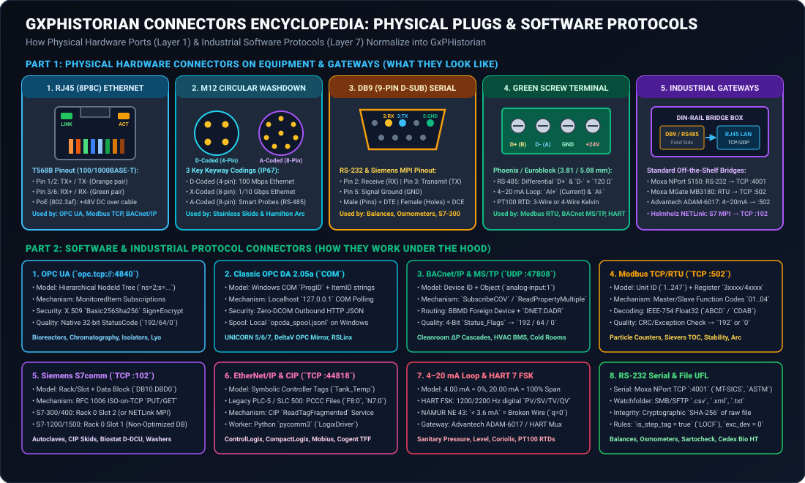
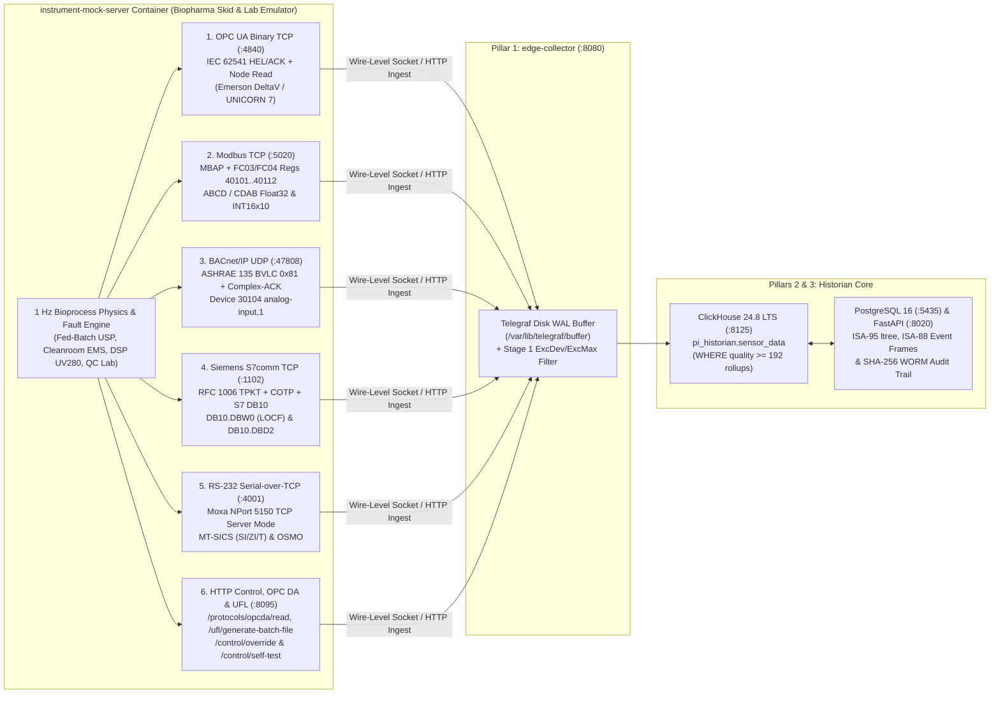

# Multi-Protocol Biopharma Instrument Mock Server & Connection Testing Guide

**Document ID:** `GUIDE-MOCK-INSTRUMENT-SERVER-GXPHISTORIAN-2026`  
**Scope:** End-to-End Hardware-Free Protocol Verification, Wire-Level Packet Testing, Fault/Excursion Injection, and Edge Store-and-Forward Qualification Using `instrument-mock-server`  
**Protocols Emulated Concurrently:** OPC UA Binary (`TCP :4840`), Modbus TCP (`TCP :5020`), BACnet/IP (`UDP :47808`), Siemens S7comm ISO-on-TCP (`TCP :1102`), RS-232 Serial-over-TCP `MT-SICS` & `OSMO` (`TCP :4001`), Classic Windows OPC DA 2.05a Bridge & PI UFL SHA-256 Watch-Folder (`HTTP :8095`)  
**Regulatory Alignment:** 21 CFR Part 11, EU GMP Annex 11, ISPE GAMP 5 (Second Edition) Category 4 / 5 Qualification, FDA Computer Software Assurance (CSA)

---

## 1. Executive Summary: Why a Multi-Protocol Biopharma Instrument Mock Server?

When commissioning a GMP historian or migrating off a legacy **OSIsoft / AVEVA PI System**, automation and CSV/CSA validation engineers rarely have live access to a **2,000 L [Cytiva Xcellerex™ XDR](https://www.cytivalifesciences.com/en/us/shop/bioprocessing-hardware/bioreactors/single-use-bioreactors)** bioreactor, a **[Sartorius Biostat® STR](https://www.sartorius.com/en/products/fermentation-bioreactors/single-use-bioreactors/biostat-str)** Siemens S7-1500 skid, a **[BINDER KBF](https://www.binder-world.com/en-us/products/constant-climate-chambers/series-kbf)** stability chamber, or a **[Mettler Toledo XPR](https://www.mt.com/us/en/home/products/Laboratory_Weighing_Solutions/analytical-balances/xpr-essential-analytical-balances.html)** analytical balance on their development laptops or CI/CD runners.

To enable deterministic **Factory Acceptance Testing (FAT)**, **Site Acceptance Testing (SAT)**, and **offline IQ/OQ qualification**, **GxPHistorian** ships with a dedicated, zero-dependency containerized **Multi-Protocol Biopharma Instrument Mock Server (`instrument-mock-server`)** orchestrated directly inside `docker-compose.yml`.





---

## 2. Architecture & Live Port Matrix

The `instrument-mock-server` container (`instrument-mock-server/mock_instruments.py`) runs a deterministic 1 Hz bioprocess physics engine (simulating a fed-batch mammalian cell culture reactor, cleanroom HVAC pressure cascade, chromatography UV280 elution peak, analytical balance weighings, and filter integrity tests) and exposes **6 concurrent industrial protocol listeners**:



### Live Protocol Listener & Port Matrix

| Protocol Family | Transport & Container/Host Port | Emulated Biopharma Equipment & Gateways | Mapped GxPHistorian Tag ID & Name | Wire Framing & Endianness / Status Support |
| :--- | :--- | :--- | :--- | :--- |
| **1. HTTP Control Plane, OpenAPI, OPC DA & PI UFL** | `TCP :8095` (`MOCK_HTTP_PORT`) | **[Cytiva ÄKTA™ UNICORN](https://www.cytivalifesciences.com/en/us/shop/chromatography/software/unicorn-7-p-05649)** OPC DA 2.05a Bridge & **[Sartorius Sartocheck® 5](https://www.sartorius.com/en/products/process-filtration/filter-integrity-testing)** CSV Watch-Folder | `401` (`CHROM01_UV280_PV`, `mAU`, `LINEAR`) | Swagger UI (`/docs`), `/control/self-test`, `/control/override`, OPC DA `0xC0`/`0x40`/`0x00` quality, SHA-256 CSV manifest |
| **2. OPC UA (`IEC 62541`)** | `TCP :4840` (`MOCK_OPCUA_PORT`) | **[Emerson DeltaV™](https://www.emerson.com/en-us/automation/control-and-safety-systems/distributed-control-systems-dcs/deltav-distributed-control-system)** / **[Cytiva Xcellerex™](https://www.cytivalifesciences.com/en/us/shop/bioprocessing-hardware/bioreactors/single-use-bioreactors)** & **[Hamilton Arc®](https://www.hamiltoncompany.com/technologies/arc)** | `101` (`BR201_TEMP_PV`, `degC`, `LINEAR`) & `102` (`BR201_PH_PV`, `pH`, `LINEAR`) | Binary `HEL`/`ACK` framing (`opc.tcp://localhost:4840/gxphistorian/opcua/`) + JSON/ASCII Node Read (`ns=2;s=BR201.Temp.PV`) |
| **3. Modbus TCP (`MBAP`)** | `TCP :5020` (`MOCK_MODBUS_PORT`) | **[BINDER KBF](https://www.binder-world.com/en-us/products/constant-climate-chambers/series-kbf)** Stability Chamber, **[Moxa MGate MB3180](https://www.moxa.com/en/products/industrial-edge-connectivity/protocol-gateways/modbus-tcp-gateways/mgate-mb3180-mb3280-mb3480-series)** & **[Advantech ADAM-6017](https://www.advantech.com/en-us/products/a67f7853-013a-4b50-9b20-01798c56b090/adam-6017/mod_426ac8aa-4c77-4e4e-aed7-b41b9b387cf9)** | `101` (`BR201_TEMP_PV`), `102` (`BR201_PH_PV`), `301` (`CR104_DIFF_PRESS`) | 7-byte MBAP + `FC 0x03`/`0x04` (`Unit ID 1`, 0-based `100..111` / 1-based `40101..40112`) in Float32 `ABCD`, Word-Swapped `CDAB`, & `INT16 × 10` |
| **4. BACnet/IP (`ASHRAE 135`)** | `UDP :47808` (`MOCK_BACNET_PORT`) | **[PMS LasAir® III / Airnet® II](https://www.pmeasuring.com/products/cleanroom-monitoring/)** Cleanroom EMS & **[LOYTEC LIP-ME201](https://www.loytec.com/products/routers-nic/lip-bacnet)** Router | `301` (`CR104_DIFF_PRESS`, `Pa`, `LINEAR`) | BVLC `0x81` (`Original-Unicast-NPDU`) + `Complex-ACK` (`0x30`) IEEE-754 Float32 + JSON-UDP (`Device 30104`, `analog-input,1`) |
| **5. Siemens S7comm (`RFC 1006`)** | `TCP :1102` (`MOCK_S7_PORT`) | **[Siemens SIMATIC S7-1500](https://www.siemens.com/en-us/products/simatic-s7-1500/)** (`Biostat STR`) & **[Helmholz NETLink® PRO](https://www.helmholz.de/en/products/fieldbus-applications/profibus/netlink/700-884-MPI21)** (`S7-300/400` Autoclaves) | `103` (`BR201_AGIT_STATE`, `state`, `LOCF` step tag) & `101` (`BR201_TEMP_PV`) | ISO-on-TCP `TPKT` (`0x03`) + `COTP` (`0xE0`/`0xD0`) + `S7 DB10` Read (`DB10.DBW0` uint16 `0/1/2`, `DB10.DBD2` float32) |
| **6. RS-232 Serial-over-TCP** | `TCP :4001` (`MOCK_SERIAL_PORT`) | **[Moxa NPort 5150](https://www.moxa.com/en/products/industrial-edge-connectivity/serial-device-servers/general-device-servers/nport-5100-series)** + **[Mettler Toledo XPR](https://www.mt.com/us/en/home/products/Laboratory_Weighing_Solutions/analytical-balances/xpr-essential-analytical-balances.html)** & **[OsmoTECH® XT](https://www.novabiomedical.com/bioprocessing-osmometers/osmotech-xt-single-sample-micro-osmometer/)** | `101` / `102` / Lab Balance Stream | Interactive TCP socket supporting `SI\r\n` (stable/dynamic weight `S S` vs `S D`), `ZI\r\n` (zero), `T\r\n` (tare), `I4\r\n` (serial number), and `OSMO\r\n` |

---

## 3. Quickstart: 1-Command Automated 6-Protocol Self-Test

Once `docker compose up -d` is running, you can execute a full wire-level verification of all 6 industrial protocols—and optionally push the resulting normalized GxP telemetry batch directly into **`edge-collector:8080/ingest`**—with a single `curl` command:

```bash
curl -s -X POST http://localhost:8095/control/self-test \
  -H "Content-Type: application/json" \
  -d '{"push_to_edge_collector": true}' | jq .
```

### Expected Self-Test Output

```json
{
  "overall_status": "ALL_6_PROTOCOLS_PASSED",
  "protocols_verified": 6,
  "protocol_checks": {
    "opc_ua_tcp_4840": {
      "passed": true,
      "ack_header": "ACKF",
      "sample_node": {
        "node_id": "ns=2;s=BR201.Temp.PV",
        "tag_id": 101,
        "tag_name": "BR201_TEMP_PV",
        "value": 36.98,
        "units": "degC",
        "opc_quality": 192,
        "opc_ua_status_hex": "0x00000000"
      }
    },
    "modbus_tcp_5020": {
      "passed": true,
      "function_code": 3,
      "register_40101_abcd_float32": 36.98
    },
    "bacnet_ip_udp_47808": {
      "passed": true,
      "object_id": "analog-input,1",
      "present_value_pa": 18.61,
      "opc_quality": 192
    },
    "siemens_s7comm_tcp_1102": {
      "passed": true,
      "cotp_cc_received": true,
      "db10_dbw0_agitator_state": 1,
      "db10_dbd2_temp_pv": 36.98
    },
    "rs232_serial_moxa_tcp_4001": {
      "passed": true,
      "mt_sics_si_response": "S S     125.4321 g",
      "osmotech_response": "SAMPLE_ID=2026-lotA12,OSMOLALITY=291,UNITS=mOsm/kg H2O,STATUS=PASS"
    },
    "opc_da_and_pi_ufl_http_8095": {
      "passed": true,
      "opc_da_item": "UNICORN.ChromSkid01.UV280.PV",
      "uv280_val_mau": 12.14,
      "pi_ufl_sha256": "542764f903e2d3dd53159b34dbbf411f5785b1866f0c5fb8ff025d8f03923eb0"
    }
  },
  "edge_collector_ingest": {
    "pushed": true,
    "edge_ingest_url": "http://edge-collector:8080/ingest",
    "http_status": 200,
    "records_sent": 5
  }
}
```

> [!TIP]
> **Interactive Swagger UI for `instrument-mock-server`:** Open **`http://localhost:8095/docs`** in your browser to inspect all simulated protocol endpoints, register maps, and fault injection payloads interactively.

---

## 4. Protocol-by-Protocol Wire Testing Recipes

Below are copy-pasteable terminal commands (`curl`, `python3`, and `nc`) to test each of the 6 industrial protocol interfaces individually from your host workstation.

### 4.1 Protocol 1: OPC UA (`IEC 62541` Binary `HEL`/`ACK` + Node Read on `TCP :4840`)


#### A. Inspect the Simulated OPC UA Address Space (`HTTP :8095`)
```bash
curl -s http://localhost:8095/protocols/opcua/nodes | jq .
```

#### B. Test Raw OPC UA Binary `HEL` / `ACK` Handshake & Node Read over `TCP :4840`
```bash
python3 -c '
import socket, struct, json

with socket.create_connection(("localhost", 4840), timeout=3.0) as s:
    # 1. Send IEC 62541 OPC UA Binary Hello (HEL) frame
    ep = b"opc.tcp://localhost:4840/gxphistorian/opcua/"
    body = struct.pack("<IIIIII", 0, 65536, 65536, 16777216, 0, len(ep)) + ep
    s.sendall(b"HELF" + struct.pack("<I", 8 + len(body)) + body)
    ack = s.recv(1024)
    print("OPC UA Binary Handshake Header:", ack[:4].decode())

    # 2. Read NodeId ns=2;s=BR201.Temp.PV
    s.sendall(b"READ ns=2;s=BR201.Temp.PV\n")
    print("Node Read Response:", json.dumps(json.loads(s.recv(4096).decode()), indent=2))
'
```

---

### 4.2 Protocol 2: Modbus TCP (`MBAP` + `FC 0x03`/`0x04` Registers on `TCP :5020`)


The Modbus TCP listener on `:5020` intentionally exposes every process variable in **three encodings** so you can verify your Modbus client's word-swap (`ABCD` vs `CDAB`) and fixed-point scaling (`INT16 × 10`) configuration:

| 1-Based PLC Address | 0-Based Wire Offset | Register Count | Encoding Format | Mapped Process Variable |
| :--- | :--- | :--- | :--- | :--- |
| `40101..40102` | `100..101` | `2` (`32-bit`) | **IEEE-754 Float32 Big-Endian (`ABCD`)** | `BR201_TEMP_PV` (`degC`) |
| `40103..40104` | `102..103` | `2` (`32-bit`) | **IEEE-754 Float32 Word-Swapped (`CDAB`)** | `BR201_TEMP_PV` (`degC`) |
| `40105..40106` | `104..105` | `2` (`32-bit`) | **IEEE-754 Float32 Big-Endian (`ABCD`)** | `BR201_PH_PV` (`pH`) |
| `40107..40108` | `106..107` | `2` (`32-bit`) | **IEEE-754 Float32 Big-Endian (`ABCD`)** | `CR104_DIFF_PRESS` (`Pa`) |
| `40109` | `108` | `1` (`16-bit`) | **Scaled Signed Integer (`INT16 × 10`)** | `BR201_TEMP_PV` (e.g., `370` = `37.0 °C`) |
| `40110` | `109` | `1` (`16-bit`) | **Scaled Signed Integer (`INT16 × 100`)** | `BR201_PH_PV` (e.g., `705` = `7.05 pH`) |
| `40111` | `110` | `1` (`16-bit`) | **Discrete Enum (`UInt16`)** | `BR201_AGIT_STATE` (`0=OFF, 1=LOW, 2=HIGH`) |
| `40112` | `111` | `1` (`16-bit`) | **OPC Quality Word (`UInt16`)** | `192` (`Good`), `64` (`Uncertain`), `0` (`Bad`) |

#### A. Inspect Register Map via HTTP Helper (`HTTP :8095`)
```bash
curl -s http://localhost:8095/protocols/modbus/registers | jq .
```

#### B. Poll Raw Modbus TCP `FC 0x03` Holding Registers (`100..103`) over `TCP :5020`
```bash
python3 -c '
import socket, struct

with socket.create_connection(("localhost", 5020), timeout=3.0) as s:
    # MBAP Header (TxID=1, Proto=0, Len=6, UnitID=1) + FC=0x03, Start=100 (40101), Qty=4
    req = struct.pack(">HHHBBHH", 1, 0, 6, 1, 3, 100, 4)
    s.sendall(req)
    resp = s.recv(1024)
    # Decode ABCD Float32 (regs 100..101) and CDAB Word-Swapped Float32 (regs 102..103)
    abcd_val = struct.unpack(">f", resp[9:13])[0]
    w_low, w_high = struct.unpack(">HH", resp[13:17])
    cdab_val = struct.unpack(">f", struct.pack(">HH", w_high, w_low))[0]
    print(f"Register 40101 (ABCD Float32): {abcd_val:.3f} degC")
    print(f"Register 40103 (CDAB Swapped): {cdab_val:.3f} degC")
'
```

---

### 4.3 Protocol 3: BACnet/IP (`ASHRAE 135 Annex J` `UDP :47808`)


#### A. Inspect BACnet Device `30104` Objects & 4-Bit `Status_Flags` (`HTTP :8095`)
```bash
curl -s http://localhost:8095/protocols/bacnet/objects | jq .
```

#### B. Query Live BACnet/IP `UDP :47808` Socket (JSON-UDP & Binary `BVLC 0x81`)
```bash
python3 -c '
import socket, struct, json

with socket.socket(socket.AF_INET, socket.SOCK_DGRAM) as sock:
    sock.settimeout(3.0)
    # 1. JSON-UDP ReadProperty / SubscribeCOV query
    sock.sendto(json.dumps({"service": "ReadProperty", "object_id": "analog-input,1"}).encode(), ("localhost", 47808))
    data, _ = sock.recvfrom(4096)
    print("BACnet JSON-UDP Response:", json.dumps(json.loads(data.decode()), indent=2))

    # 2. Binary ASHRAE 135 BVLC Original-Unicast-NPDU (0x81 0x0a)
    bvlc_req = bytes([0x81, 0x0A, 0x00, 0x08, 0x01, 0x04, 0x02, 0x0C])
    sock.sendto(bvlc_req, ("localhost", 47808))
    bvlc_resp, _ = sock.recvfrom(1024)
    pv_pa = struct.unpack(">f", bvlc_resp[-5:-1])[0]
    print(f"BACnet Binary Complex-ACK Present_Value: {pv_pa:.2f} Pa (BVLC header: 0x{bvlc_resp[0]:02x})")
'
```

---

### 4.4 Protocol 4: Siemens S7comm (`RFC 1006` ISO-on-TCP `DB10` on `TCP :1102`)


#### A. Inspect Data Block `DB10` Layout (`DB10.DBW0` LOCF Step State & `DB10.DBD2` Temp)
```bash
curl -s http://localhost:8095/protocols/s7/db10 | jq .
```

#### B. Execute `RFC 1006` ISO-COTP Connection Request + `S7 DB10` Read over `TCP :1102`
```bash
python3 -c '
import socket, struct

with socket.create_connection(("localhost", 1102), timeout=3.0) as s:
    # 1. Send RFC 1006 TPKT + COTP Connection Request (0xE0)
    s.sendall(bytes([0x03, 0x00, 0x00, 0x0B, 0x06, 0xE0, 0x00, 0x00, 0x00, 0x01, 0x00]))
    cotp_cc = s.recv(1024)
    print(f"S7 COTP Connection Confirm PDU Type: 0x{cotp_cc[5]:02X} (Expected 0xD0)")

    # 2. Send S7 Read DB10 request
    s.sendall(bytes([0x03, 0x00, 0x00, 0x08, 0x02, 0xF0, 0x80, 0x32]))
    pdu = s.recv(1024)
    agit_state, temp_pv, ph_pv, quality = struct.unpack(">HffH", pdu[-12:])
    print(f"DB10.DBW0 Agitator State (LOCF): {agit_state} | DB10.DBD2 Temp: {temp_pv:.2f} degC | DB10.DBD6 pH: {ph_pv:.2f} | Quality: {quality}")
'
```

---

### 4.5 Protocol 5: RS-232 Serial-over-TCP (`Moxa NPort 5150` `MT-SICS` & `OSMO` on `TCP :4001`)


You can interact with port `:4001` just like a **[Moxa NPort 5150](https://www.moxa.com/en/products/industrial-edge-connectivity/serial-device-servers/general-device-servers/nport-5100-series)** connected to a **[Mettler Toledo XPR](https://www.mt.com/us/en/home/products/Laboratory_Weighing_Solutions/analytical-balances/xpr-essential-analytical-balances.html)** balance or **[Advanced Instruments OsmoTECH®](https://www.novabiomedical.com/bioprocessing-osmometers/osmotech-xt-single-sample-micro-osmometer/)** osmometer:

```bash
python3 -c '
import socket

with socket.create_connection(("localhost", 4001), timeout=3.0) as s:
    for cmd in [b"I4\r\n", b"SI\r\n", b"T\r\n", b"ZI\r\n", b"OSMO\r\n"]:
        s.sendall(cmd)
        reply = s.recv(1024).decode().strip()
        print(f"Command {cmd.decode().strip():<6} -> {reply}")
'
```

Expected output:
```text
Command I4     -> I4 A "B948271042"
Command SI     -> S S     125.4321 g
Command T      -> T S       0.0000 g
Command ZI     -> Z A
Command OSMO   -> SAMPLE_ID=2026-lotA12,OSMOLALITY=291,UNITS=mOsm/kg H2O,USER=OP_402,STATUS=PASS
```

---

### 4.6 Protocol 6: Classic Windows OPC DA 2.05a Bridge & PI UFL SHA-256 Watch-Folder (`HTTP :8095`)

#### A. Poll Simulated Windows Localhost COM `OPC DA 2.05a` Group/Items
```bash
curl -s -X POST http://localhost:8095/protocols/opcda/read \
  -H "Content-Type: application/json" \
  -d '{
    "server_prog_id": "UNICORN.OPCServer.1",
    "group_name": "DSP_Skid01_FastPoll",
    "item_ids": [
      "UNICORN.ChromSkid01.UV280.PV",
      "DeltaV.BR201.Temp.PV",
      "DeltaV.BR201.pH.PV"
    ]
  }' | jq .
```

#### B. Generate a SHA-256 Sealed `PI UFL` Filter Integrity / Bioanalyzer Batch CSV
```bash
curl -s -X POST http://localhost:8095/protocols/ufl/generate-batch-file \
  -H "Content-Type: application/json" \
  -d '{
    "instrument_type": "SARTOCHECK_5_FILTER_TESTER",
    "batch_id": "BATCH-2026-MOCK-01",
    "sample_id": "FILT-019"
  }' | jq .
```

---

## 5. Fault, Wire-Break & Thermal Excursion Injection (`POST /control/override`)

To test **21 CFR Part 11 / GAMP 5 negative edge cases**—such as verifying that **`WHERE quality >= 192`** rejects `Bad (0)` or `Uncertain (64)` sensor readings (`URS-012`) or triggering an automated **ISA-88 High-Temperature Excursion Event Frame** (`URS-015`)—use the `/control/override` endpoint. Any override applied via `/control/override` immediately alters the values and quality flags returned across **all 6 protocol listeners simultaneously** (`OPC UA :4840`, `Modbus :5020`, `BACnet :47808`, `S7comm :1102`, `RS-232 :4001`, and `OPC DA :8095`):

### Scenario A: Simulate a Cut Sensor Wire (`quality = 0` Bad + `-999.0` Sentinel)

```bash
# 1. Inject a cut PT100 RTD wire fault on Tag 101 (BR201_TEMP_PV)
curl -s -X POST http://localhost:8095/control/override \
  -H "Content-Type: application/json" \
  -d '{
    "tag_id": 101,
    "val": -999.0,
    "quality": 0,
    "status_code": 1
  }' | jq .

# 2. Verify that OPC UA (:4840), Modbus Register 40112 (:5020), and OPC DA (:8095) now report Bad Quality (0 / 0x80000000)
curl -s http://localhost:8095/protocols/opcua/nodes | jq '.nodes[] | select(.tag_id == 101)'
```

 Notice that across `instrument-mock-server`:
- **OPC UA (`:4840`)** switches `status_code_hex` to **`0x80000000` (`BadSensorFailure`)**.
- **Classic OPC DA (`:8095`)** switches `opc_da_quality_hex` to **`0x00 (OPC_QUALITY_BAD)`**.
- **Modbus TCP (`:5020`)** sets Holding Register `40112` to **`0`**.
- **RS-232 Balance (`:4001`)** switches `SI\r\n` response to **`S I` (Invalid / Command Not Executable)**.
- **ClickHouse (`pi_historian.sensor_data`)** records the raw diagnostic tuple `(-999.0, quality=0)` for maintenance troubleshooting, while **`pi_historian.sensor_rollup_1m`** and **Excel DataLink** strictly exclude it (`WHERE quality >= 192`).

### Scenario B: Simulate a Bioreactor Thermal Excursion (`39.4 °C > 38.0 °C` High Limit)

```bash
# 1. Inject a 39.4 °C thermal spike with Good OPC Quality (192)
curl -s -X POST http://localhost:8095/control/override \
  -H "Content-Type: application/json" \
  -d '{
    "tag_id": 101,
    "val": 39.4,
    "quality": 192,
    "status_code": 4
  }' | jq .

# 2. Push the excursion sample into edge-collector (:8080/ingest)
curl -s -X POST http://localhost:8095/control/self-test \
  -H "Content-Type: application/json" \
  -d '{"push_to_edge_collector": true}' | jq .edge_collector_ingest
```

### Reset All Overrides Back to Normal Sine-Wave Physics

```bash
curl -s -X POST http://localhost:8095/control/override \
  -H "Content-Type: application/json" \
  -d '{"tag_id": 101, "clear": true}' | jq .
```

---

## 6. Related Connector & Equipment Guides

- **[Connectors, Protocols & Wiring Encyclopedia](CONNECTORS_AND_PROTOCOLS_ENCYCLOPEDIA.md)**
- **[OPC UA (`:4840`) & Classic OPC DA (`COM/DCOM`) Connector Guide](CONNECTOR_GUIDE_OPC_UA_AND_OPC_DA.md)**
- **[BACnet/IP (`UDP :47808`) & BACnet MS/TP (`RS-485`) Connector Guide](CONNECTOR_GUIDE_BACNET_IP_AND_MSTP.md)**
- **[Modbus TCP (`:502`) & Modbus RTU (`RS-485`) Connector Guide](CONNECTOR_GUIDE_MODBUS_TCP_AND_RTU.md)**
- **[Siemens S7comm (`:102`), Allen-Bradley EtherNet/IP (`:44818`), 4–20 mA / HART, RS-232 Serial & File Watch-Folder (`PI UFL`) Connector Guide](CONNECTOR_GUIDE_PLC_S7_ETHERNETIP_HART_SERIAL_UFL.md)**
